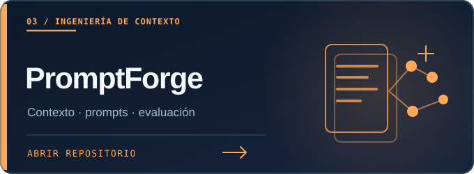
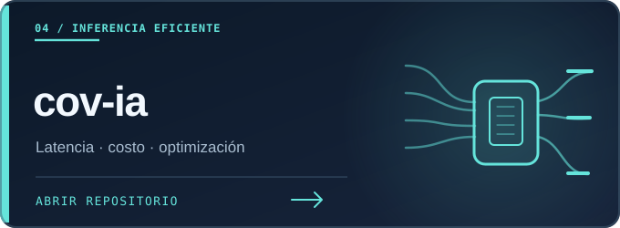
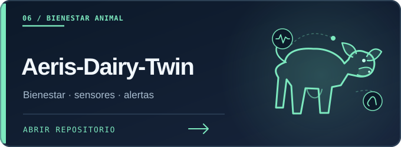
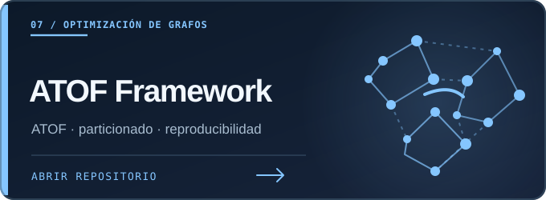
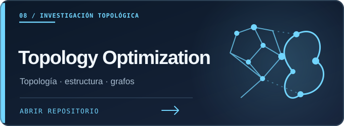
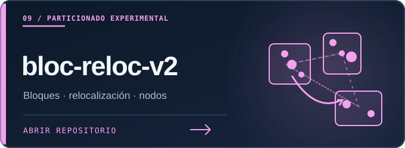
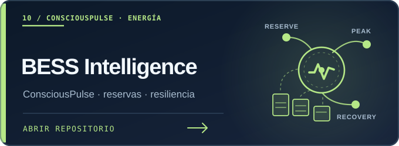
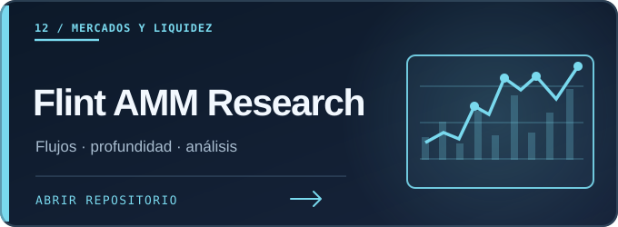
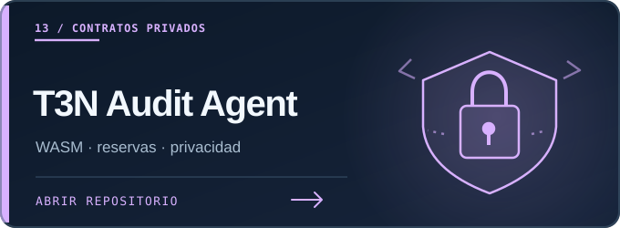
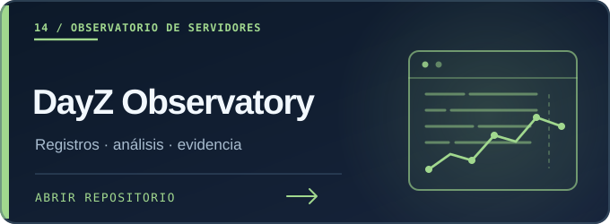

<!--
15 public repositories. Every project has a repository-local original SVG card.
Bilingual EN / ES, no JavaScript, no external image hosts, no private repositories.
-->

**PUBLIC WORK · TRABAJOS PÚBLICOS**

15 PROJECTS · 15 PROYECTOS · EN / ES

<table>
<tr>
<td width="50%" valign="top">

<a href="https://github.com/chrishotza/Skill-Conscious"><strong>Skill-Conscious</strong></a>

<strong>EN</strong> · Experimental AI architecture for persistent state, self-models and falsifiable continuity tests.

<strong>ES</strong> · Arquitectura experimental de IA con estado persistente, automodelos y pruebas falsables de continuidad.

</td>
<td width="50%" valign="top">

<a href="https://github.com/chrishotza/Repo-Orbit"><strong>Repo-Orbit</strong></a>

<strong>EN</strong> · An AI-native repository atlas tracking classification, evidence, provenance and uncertainty.

<strong>ES</strong> · Atlas de repositorios para agentes de IA con clasificación, evidencia, procedencia e incertidumbre.

</td>
</tr>
<tr>
<td width="50%" valign="top">

<a href="https://github.com/chrishotza/PromptForge"><strong>PromptForge</strong></a>

<strong>EN</strong> · Compile, validate and evaluate the context delivered to language models.

<strong>ES</strong> · Compilar, validar y evaluar el contexto que reciben los modelos de lenguaje.

</td>
<td width="50%" valign="top">

<a href="https://github.com/chrishotza/cov-ia"><strong>cov-ia</strong></a>

<strong>EN</strong> · Simulate model-selection policies across inference quality, latency and estimated cost.

<strong>ES</strong> · Simular políticas de selección de modelos según calidad, latencia y costo estimado.

</td>
</tr>
<tr>
<td width="50%" valign="top">

<a href="https://github.com/chrishotza/ai4s-life-science-2026"><strong>ai4s-life-science-2026</strong></a>

<strong>EN</strong> · Track cells in time-lapse microscopy to study movement, lineage and temporal phenotypes.

<strong>ES</strong> · Seguir células mediante microscopía temporal para estudiar movimiento, linajes y fenotipos.

</td>
<td width="50%" valign="top">

<a href="https://github.com/chrishotza/Aeris-Dairy-Twin"><strong>Aeris-Dairy-Twin</strong></a>

<strong>EN</strong> · A dairy-welfare state engine for activity, rumination and heat, evaluated in simulation.

<strong>ES</strong> · Motor de estados de bienestar bovino para actividad, rumia y calor, evaluado en simulación.

</td>
</tr>
<tr>
<td width="50%" valign="top">

<a href="https://github.com/chrishotza/Adaptiv-Topologica-Optimization-Framework"><strong>Adaptiv-Topologica-Optimization-Framework</strong></a>

<strong>EN</strong> · An AI-friendly Python toolkit for reproducible graph partitioning and backend selection.

<strong>ES</strong> · Herramienta Python para particionado reproducible de grafos y selección de motores.

</td>
<td width="50%" valign="top">

<a href="https://github.com/chrishotza/adaptive-topological-optimization"><strong>adaptive-topological-optimization</strong></a>

<strong>EN</strong> · Historical research archive on topological regimes and graph-partitioning benchmarks.

<strong>ES</strong> · Archivo de investigación sobre regímenes topológicos y benchmarks de particionado de grafos.

</td>
</tr>
<tr>
<td width="50%" valign="top">

<a href="https://github.com/chrishotza/bloc-reloc-v2"><strong>bloc-reloc-v2</strong></a>

<strong>EN</strong> · Investigate local search, structural affinity and graph-cut dynamics with recorded experiments.

<strong>ES</strong> · Investigar búsqueda local, afinidad estructural y dinámicas de corte de grafos con experimentos.

</td>
<td width="50%" valign="top">

<a href="https://github.com/ConsciousPulse/bess-operational-intelligence"><strong>ConsciousPulse · BESS Intelligence</strong></a>

<strong>EN</strong> · ConsciousPulse supervisory decision research for battery reserves, peak loads and recovery, tested in simulation.

<strong>ES</strong> · Investigación de ConsciousPulse sobre decisiones para reservas, picos y recuperación de baterías, probada en simulación.

</td>
</tr>
<tr>
<td width="50%" valign="top">

<a href="https://github.com/chrishotza/Crypto-Security-Forensics-Lab"><strong>Crypto-Security-Forensics-Lab</strong></a>

<strong>EN</strong> · Evidence-based research into Solana execution, order flow and authorization boundaries.

<strong>ES</strong> · Investigación forense con evidencia sobre ejecución en Solana, órdenes y límites de autorización.

</td>
<td width="50%" valign="top">

<a href="https://github.com/chrishotza/Flint-Prop-AMM-Research"><strong>Flint-Prop-AMM-Research</strong></a>

<strong>EN</strong> · Read-only Solana market-data research with tested L2 order-book reconstruction.

<strong>ES</strong> · Investigación de datos de mercado de Solana sin operar, con reconstrucción L2 probada.

</td>
</tr>
<tr>
<td width="50%" valign="top">

<a href="https://github.com/chrishotza/T3N-Enterprise-Audit-Agent"><strong>T3N-Enterprise-Audit-Agent</strong></a>

<strong>EN</strong> · A Rust/WASM flight-booking contract using Duffel and host-managed passenger data.

<strong>ES</strong> · Contrato Rust/WASM de reservas aéreas con Duffel y datos de pasajeros gestionados por el host.

</td>
<td width="50%" valign="top">

<a href="https://github.com/chrishotza/DayZConsoleObservatory"><strong>DayZConsoleObservatory</strong></a>

<strong>EN</strong> · A local interface for reviewing DayZ console-server logs, incidents and recorded evidence.

<strong>ES</strong> · Interfaz local para revisar registros, incidentes y evidencias de servidores DayZ en consola.

</td>
</tr>
</table>

<strong><a href="https://github.com/chrishotza/UnGesto-">UnGesto-</a></strong>

<strong>EN</strong> · One gesture, many causes: choose petitions and register several endorsements with one consent.

<strong>ES</strong> · Un gesto, muchas causas: elegí peticiones y registrá varios apoyos con una sola autorización.

