<!-- CHRIS HOTZA // AI-NARRATED RESEARCH INTERFACE
     Curated static profile. No live assistant, JavaScript or tracking.
     Original profile README: README.archive-2026-10-16.md
-->

 

**INDEPENDENT RESEARCHER · VIBE CODER · AI-ASSISTED EXPERIMENTATION**

*Curiosity is the starting point. Evidence decides what survives.*

[**ENTER THE INTERFACE**](#the-interface) · [**EXPLORE THE WORK**](#explore-the-work) · [**EN ESPAÑOL**](#en-espanol) · [**RESEARCH ARCHIVE**](#research-archive)

---

## > INTERFACE ONLINE_

> **AI / NARRATOR:** You have reached Chris Hotza's GitHub.
>
> He doesn't fit neatly inside a single technical discipline. He follows questions across artificial intelligence, scientific computing, optimization, biology, energy systems and practical tools.
>
> **His method is unusual but simple:** the human leads the investigation; AI helps turn ideas into prototypes, code, experiments and documentation. The results still need to be tested.
>
> **His reason for doing it:** to create value for society.
>
> I'm here to introduce his work. Choose a question.

<b>01 // WHO IS THE HUMAN BEHIND THIS SIGNAL?</b> &nbsp; ▸ Identity

 

**AI:** Chris is an independent researcher and a vibe coder based in Argentina. Research is not one category among many for him; it is how he approaches unfamiliar problems.

He is drawn to questions about how systems work, what persists, what changes, and whether an idea can be transformed into something observable and useful.

He doesn't claim that curiosity is a qualification. The repositories are the record of what he has tried to build and evaluate.

**Human answer:** *"Quiero generar valor en la sociedad."*

<b>02 // HOW DOES HE BUILD WITH AI?</b> &nbsp; ▸ Method

 

**AI:** Chris works through **AI-assisted development and vibe coding**. He frames the problem, proposes directions, sets constraints, evaluates iterations, and connects work across projects. AI tools contribute code, technical analysis, drafting and implementation.

That doesn't make a generated result automatically correct. A successful build is not a successful experiment; a passing test is not external validation; a promising hypothesis is not a scientific discovery.

**His responsibility remains human:** choosing the problem, challenging the output, maintaining the work, and stating honestly what has and hasn't been demonstrated.

**QUESTION → HYPOTHESIS → AI-ASSISTED BUILD → TEST → EVIDENCE → REVISE**

<b>03 // WHAT KIND OF QUESTIONS KEEP HIM BUSY?</b> &nbsp; ▸ Research

 

**AI:** Self-models and continuity in AI. More efficient context representations. Graph optimization. How individual cells behave over time. Operational decisions in energy storage. Forensic analysis of complex systems.

These are different research domains, **not claims of a single proven theory of everything**. Some repositories contain working applications, others experimental frameworks, curated evidence or unfinished research. Each must be judged on its own documented results.

Start with [Skill-Conscious](https://github.com/chrishotza/Skill-Conscious), [PromptForge](https://github.com/chrishotza/PromptForge), [ATOF](https://github.com/chrishotza/Adaptiv-Topologica-Optimization-Framework) and [AI4S Life Science](https://github.com/chrishotza/ai4s-life-science-2026).

<b>04 // WHAT DOES SOCIETY GET OUT OF IT?</b> &nbsp; ▸ Purpose

 

**AI:** That is the question Chris wants his work to answer.

Some projects explore foundational ideas. Others aim at useful systems: animal-welfare monitoring, energy decision support, accessible tools for community-server administrators, or easier participation in social causes.

A project's social value should be assessed through real outcomes, not the ambition written in a README. **The intention is to build things that become useful beyond the person who imagined them.**

See [AERIS](https://github.com/chrishotza/Aeris-Dairy-Twin), [BESS Operational Intelligence](https://github.com/chrishotza/bess-operational-intelligence), [DayZ Console Observatory](https://github.com/chrishotza/DayZConsoleObservatory) and [UnGesto](https://github.com/chrishotza/UnGesto-).

<b>05 // CAN I TRUST THE CLAIMS?</b> &nbsp; ▸ Evidence protocol

 

**AI:** Don't trust a visual identity, a benchmark headline or my narration in isolation. Follow the repository links. Read the methods, tests, limitations and status files.

Chris's projects include explicit evidence boundaries: [Skill-Conscious](https://github.com/chrishotza/Skill-Conscious) does not demonstrate phenomenal consciousness; [AI4S Life Science](https://github.com/chrishotza/ai4s-life-science-2026) separates internal metrics from official evaluation; [UnGesto](https://github.com/chrishotza/UnGesto-) does not claim third-party petitions have received signatures without an authorized integration.

**A better question than “what do you claim?” is “what can I verify?”**

INTERFACE NOTE: This is a scripted, expandable README experience narrated in an AI voice, not a live chatbot. It uses GitHub's native Markdown/HTML support and requires no JavaScript, account or external tracking.

---

## > EXPLORE THE WORK_

**Different projects. One recurring pattern: investigate → build → test → improve.**

| 🧠 Intelligence & agents | 🔬 Scientific exploration |
| :--- | :--- |
| **[Skill-Conscious](https://github.com/chrishotza/Skill-Conscious)** — experimental architecture for persistent state, self-models and causal tests. | **[AI4S Life Science](https://github.com/chrishotza/ai4s-life-science-2026)** — image-based cell tracking and temporal phenotype research. |
| **[PromptForge](https://github.com/chrishotza/PromptForge)** — reproducible context engineering and evaluation harnesses. | **[AERIS Dairy Twin](https://github.com/chrishotza/Aeris-Dairy-Twin)** — multimodal animal-welfare state estimation. |
| **[RepoOrbit](https://github.com/chrishotza/Repo-Orbit)** — a repository atlas designed for AI agents, with provenance and explicit uncertainty. | **[ATOF](https://github.com/chrishotza/Adaptiv-Topologica-Optimization-Framework)** — graph partitioning with reproducible, agent-readable interfaces. |

| ⚡ Applied systems | 🌍 Tools for real people |
| :--- | :--- |
| **[BESS Operational Intelligence](https://github.com/chrishotza/bess-operational-intelligence)** — supervisory energy-storage decision research. | **[UnGesto](https://github.com/chrishotza/UnGesto-)** — choose multiple social causes and register adhesions in one flow; external petition integrations remain a goal. |
| **[Crypto Security Forensics Lab](https://github.com/chrishotza/Crypto-Security-Forensics-Lab)** — documented research evidence on trading and execution systems. | **[DayZ Console Observatory](https://github.com/chrishotza/DayZConsoleObservatory)** — local browser interface for historical console-server logs and incident review. |

<b>▸ EXPAND // More public research and experiments</b>

- **[Adaptive Topological Optimization (historical)](https://github.com/chrishotza/adaptive-topological-optimization)** — earlier graph-optimization research and benchmark archive.
- **[BLOC-RELOC v2](https://github.com/chrishotza/bloc-reloc-v2)** — experimental graph-partitioning validation.
- **[Flint Prop AMM Research](https://github.com/chrishotza/Flint-Prop-AMM-Research)** — read-only observations of public market data and order-book reconstruction.
- **[T3N Enterprise Audit Agent](https://github.com/chrishotza/T3N-Enterprise-Audit-Agent)** — experimental Rust/WASM contract and enterprise-agent work.
- **[COV-IA](https://github.com/chrishotza/cov-ia)** — historical AI-inference optimization research; reported figures require independent examination.
- **[All public repositories](https://github.com/chrishotza?tab=repositories)** — the complete public catalog.

---

## > HUMAN × AI // OPERATING PRINCIPLES_

| Human signal | AI assistance | Reality check |
| :--- | :--- | :--- |
| Curiosity and direction | Exploration and research support | Is the question well-posed? |
| Hypothesis and constraints | Code and prototype construction | Does it actually run? |
| Judgment and responsibility | Iteration, testing and documentation | Can anyone reproduce the result? |
| Social purpose | Scale and acceleration | Does it help someone? |

**I don't need every idea to be right. I need the process to help find out.**

---

<b>🇦🇷 EN ESPAÑOL // La persona detrás de la señal</b> &nbsp; ▸ Abrir transmisión

 

> **IA / NARRADORA:** Estás frente al GitHub de Chris Hotza, investigador independiente y vibe coder argentino.
>
> Su especialidad no es fingir que domina todas las disciplinas. Es **hacer preguntas**, investigar problemas, proponer caminos y utilizar inteligencia artificial para construir herramientas y experimentos.
>
> La IA aporta implementación, análisis y velocidad. Chris aporta dirección, criterio, preguntas y responsabilidad sobre lo que se publica.
>
> Su objetivo es claro: **generar valor en la sociedad**.

**¿Qué investiga?** Conciencia y modelos computacionales como hipótesis de investigación, arquitecturas experimentales de IA, optimización matemática, análisis celular, energía, sistemas complejos y herramientas prácticas.

**¿Cómo trabaja?** Problema → hipótesis → prototipo asistido por IA → prueba → evidencia → corrección.

**¿Por dónde empezar?** [Skill-Conscious](https://github.com/chrishotza/Skill-Conscious) · [RepoOrbit](https://github.com/chrishotza/Repo-Orbit) · [PromptForge](https://github.com/chrishotza/PromptForge) · [UnGesto](https://github.com/chrishotza/UnGesto-).

**¿Qué espera de su trabajo?** Que las ideas no terminen siendo solamente ideas, sino investigaciones honestas y, cuando sea posible, soluciones útiles para otras personas.

## > RESEARCH ARCHIVE_

This landing page is the introduction, **not a substitute for the technical record**.

- **[Research archive and chronology](docs/README.md)** — historical progression through photonic-consciousness research, TCF, AEVUM, TIF, applied experiments and Skill-Conscious.
- **[Original profile README, preserved verbatim](README.archive-2026-10-16.md)** — previous long-form bilingual introduction, retained with its relative links intact.
- **[Complete repository index](https://github.com/chrishotza?tab=repositories)** — browse ongoing and historical public projects.

---

**AI / NARRATOR:** *I can introduce the researcher. Only the work can answer for itself.*

**[Explore the repositories](https://github.com/chrishotza?tab=repositories)** · **[Follow the research](https://github.com/chrishotza)**

Built with curiosity, AI assistance and the intention to make something useful.

