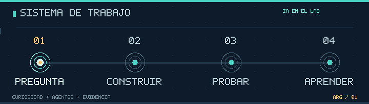

<!-- LABORATORIO DE VIBE CODING: estado dinámico del agente vía Issues + Actions. -->

**ARG / LABORATORIO DE VIBE CODING**

### No es un CV. Es un agente que evoluciona.

Juntá skills, sumá IAs, incorporá complementos y armá setups. **El personaje crece con cada jugada de la comunidad. Sin nivel máximo.**

---

<!-- VIBE-LAB:START -->

### VIBE CODER / AGENTE EN EVOLUCIÓN ∞

**Nivel 1** · **0 XP** · **0 jugadas** · **0 setups creados**

▱▱▱▱▱▱▱▱▱▱  → Siguiente nivel: 50 XP

> **Es un juego compartido, no instalaciones reales.** Cada jugador elige una mejora, confirma una jugada en GitHub Issues y una Action actualiza este agente dentro del README. Volvé al perfil y refrescá para ver el nuevo estado. No hace falta abrir ningún repositorio para entenderlo.

| 🧠 SKILLS ADQUIRIDAS | 🧩 COMPLEMENTOS | 🤖 IAs SUMADAS |
| :-- | :-- | :-- |
| Sin adquirir | Sin adquirir | Sin adquirir |

#### 🎮 Elegí la próxima evolución

Cada enlace prepara la jugada. **Hay que pulsar Submit new issue** para que se procese; GitHub no permite ejecutar un juego instantáneo con JavaScript en el README.

<b>01 / Aprender una skill (+12 XP)</b>

[Python](https://github.com/chrishotza/ChrisHotza/issues/new?title=LAB%3Askill%3Apython&body=Jugada%20del%20laboratorio.%20Cre%C3%A1%20el%20issue%20para%20sumar%20esta%20mejora%20al%20agente%20compartido.%20GitHub%20Actions%20actualiza%20el%20perfil%20y%20cierra%20esta%20jugada%20cuando%20termina.) · [Investigación](https://github.com/chrishotza/ChrisHotza/issues/new?title=LAB%3Askill%3Aresearch&body=Jugada%20del%20laboratorio.%20Cre%C3%A1%20el%20issue%20para%20sumar%20esta%20mejora%20al%20agente%20compartido.%20GitHub%20Actions%20actualiza%20el%20perfil%20y%20cierra%20esta%20jugada%20cuando%20termina.) · [Seguridad](https://github.com/chrishotza/ChrisHotza/issues/new?title=LAB%3Askill%3Asecurity&body=Jugada%20del%20laboratorio.%20Cre%C3%A1%20el%20issue%20para%20sumar%20esta%20mejora%20al%20agente%20compartido.%20GitHub%20Actions%20actualiza%20el%20perfil%20y%20cierra%20esta%20jugada%20cuando%20termina.) · [Visión computacional](https://github.com/chrishotza/ChrisHotza/issues/new?title=LAB%3Askill%3Avision&body=Jugada%20del%20laboratorio.%20Cre%C3%A1%20el%20issue%20para%20sumar%20esta%20mejora%20al%20agente%20compartido.%20GitHub%20Actions%20actualiza%20el%20perfil%20y%20cierra%20esta%20jugada%20cuando%20termina.) · [SQL y datos](https://github.com/chrishotza/ChrisHotza/issues/new?title=LAB%3Askill%3Adata&body=Jugada%20del%20laboratorio.%20Cre%C3%A1%20el%20issue%20para%20sumar%20esta%20mejora%20al%20agente%20compartido.%20GitHub%20Actions%20actualiza%20el%20perfil%20y%20cierra%20esta%20jugada%20cuando%20termina.) · [Testing](https://github.com/chrishotza/ChrisHotza/issues/new?title=LAB%3Askill%3Atesting&body=Jugada%20del%20laboratorio.%20Cre%C3%A1%20el%20issue%20para%20sumar%20esta%20mejora%20al%20agente%20compartido.%20GitHub%20Actions%20actualiza%20el%20perfil%20y%20cierra%20esta%20jugada%20cuando%20termina.) · [Orquestación de agentes](https://github.com/chrishotza/ChrisHotza/issues/new?title=LAB%3Askill%3Aagents&body=Jugada%20del%20laboratorio.%20Cre%C3%A1%20el%20issue%20para%20sumar%20esta%20mejora%20al%20agente%20compartido.%20GitHub%20Actions%20actualiza%20el%20perfil%20y%20cierra%20esta%20jugada%20cuando%20termina.) · [Optimización](https://github.com/chrishotza/ChrisHotza/issues/new?title=LAB%3Askill%3Amath&body=Jugada%20del%20laboratorio.%20Cre%C3%A1%20el%20issue%20para%20sumar%20esta%20mejora%20al%20agente%20compartido.%20GitHub%20Actions%20actualiza%20el%20perfil%20y%20cierra%20esta%20jugada%20cuando%20termina.) · [Memoria de IA](https://github.com/chrishotza/ChrisHotza/issues/new?title=LAB%3Askill%3Amemory&body=Jugada%20del%20laboratorio.%20Cre%C3%A1%20el%20issue%20para%20sumar%20esta%20mejora%20al%20agente%20compartido.%20GitHub%20Actions%20actualiza%20el%20perfil%20y%20cierra%20esta%20jugada%20cuando%20termina.) · [Experimentación](https://github.com/chrishotza/ChrisHotza/issues/new?title=LAB%3Askill%3Ascience&body=Jugada%20del%20laboratorio.%20Cre%C3%A1%20el%20issue%20para%20sumar%20esta%20mejora%20al%20agente%20compartido.%20GitHub%20Actions%20actualiza%20el%20perfil%20y%20cierra%20esta%20jugada%20cuando%20termina.) · [Debugging](https://github.com/chrishotza/ChrisHotza/issues/new?title=LAB%3Askill%3Adebugging&body=Jugada%20del%20laboratorio.%20Cre%C3%A1%20el%20issue%20para%20sumar%20esta%20mejora%20al%20agente%20compartido.%20GitHub%20Actions%20actualiza%20el%20perfil%20y%20cierra%20esta%20jugada%20cuando%20termina.) · [APIs](https://github.com/chrishotza/ChrisHotza/issues/new?title=LAB%3Askill%3Aapi&body=Jugada%20del%20laboratorio.%20Cre%C3%A1%20el%20issue%20para%20sumar%20esta%20mejora%20al%20agente%20compartido.%20GitHub%20Actions%20actualiza%20el%20perfil%20y%20cierra%20esta%20jugada%20cuando%20termina.)

<b>02 / Conectar un complemento (+13 XP)</b>

[GitHub Actions](https://github.com/chrishotza/ChrisHotza/issues/new?title=LAB%3Aplugin%3Agithub&body=Jugada%20del%20laboratorio.%20Cre%C3%A1%20el%20issue%20para%20sumar%20esta%20mejora%20al%20agente%20compartido.%20GitHub%20Actions%20actualiza%20el%20perfil%20y%20cierra%20esta%20jugada%20cuando%20termina.) · [Playwright](https://github.com/chrishotza/ChrisHotza/issues/new?title=LAB%3Aplugin%3Aplaywright&body=Jugada%20del%20laboratorio.%20Cre%C3%A1%20el%20issue%20para%20sumar%20esta%20mejora%20al%20agente%20compartido.%20GitHub%20Actions%20actualiza%20el%20perfil%20y%20cierra%20esta%20jugada%20cuando%20termina.) · [Ollama](https://github.com/chrishotza/ChrisHotza/issues/new?title=LAB%3Aplugin%3Aollama&body=Jugada%20del%20laboratorio.%20Cre%C3%A1%20el%20issue%20para%20sumar%20esta%20mejora%20al%20agente%20compartido.%20GitHub%20Actions%20actualiza%20el%20perfil%20y%20cierra%20esta%20jugada%20cuando%20termina.) · [n8n](https://github.com/chrishotza/ChrisHotza/issues/new?title=LAB%3Aplugin%3An8n&body=Jugada%20del%20laboratorio.%20Cre%C3%A1%20el%20issue%20para%20sumar%20esta%20mejora%20al%20agente%20compartido.%20GitHub%20Actions%20actualiza%20el%20perfil%20y%20cierra%20esta%20jugada%20cuando%20termina.) · [FastAPI](https://github.com/chrishotza/ChrisHotza/issues/new?title=LAB%3Aplugin%3Afastapi&body=Jugada%20del%20laboratorio.%20Cre%C3%A1%20el%20issue%20para%20sumar%20esta%20mejora%20al%20agente%20compartido.%20GitHub%20Actions%20actualiza%20el%20perfil%20y%20cierra%20esta%20jugada%20cuando%20termina.) · [Docker](https://github.com/chrishotza/ChrisHotza/issues/new?title=LAB%3Aplugin%3Adocker&body=Jugada%20del%20laboratorio.%20Cre%C3%A1%20el%20issue%20para%20sumar%20esta%20mejora%20al%20agente%20compartido.%20GitHub%20Actions%20actualiza%20el%20perfil%20y%20cierra%20esta%20jugada%20cuando%20termina.) · [Hugging Face](https://github.com/chrishotza/ChrisHotza/issues/new?title=LAB%3Aplugin%3Ahuggingface&body=Jugada%20del%20laboratorio.%20Cre%C3%A1%20el%20issue%20para%20sumar%20esta%20mejora%20al%20agente%20compartido.%20GitHub%20Actions%20actualiza%20el%20perfil%20y%20cierra%20esta%20jugada%20cuando%20termina.) · [Supabase](https://github.com/chrishotza/ChrisHotza/issues/new?title=LAB%3Aplugin%3Asupabase&body=Jugada%20del%20laboratorio.%20Cre%C3%A1%20el%20issue%20para%20sumar%20esta%20mejora%20al%20agente%20compartido.%20GitHub%20Actions%20actualiza%20el%20perfil%20y%20cierra%20esta%20jugada%20cuando%20termina.) · [Render](https://github.com/chrishotza/ChrisHotza/issues/new?title=LAB%3Aplugin%3Arender&body=Jugada%20del%20laboratorio.%20Cre%C3%A1%20el%20issue%20para%20sumar%20esta%20mejora%20al%20agente%20compartido.%20GitHub%20Actions%20actualiza%20el%20perfil%20y%20cierra%20esta%20jugada%20cuando%20termina.) · [Kaggle](https://github.com/chrishotza/ChrisHotza/issues/new?title=LAB%3Aplugin%3Akaggle&body=Jugada%20del%20laboratorio.%20Cre%C3%A1%20el%20issue%20para%20sumar%20esta%20mejora%20al%20agente%20compartido.%20GitHub%20Actions%20actualiza%20el%20perfil%20y%20cierra%20esta%20jugada%20cuando%20termina.) · [Pandas](https://github.com/chrishotza/ChrisHotza/issues/new?title=LAB%3Aplugin%3Apandas&body=Jugada%20del%20laboratorio.%20Cre%C3%A1%20el%20issue%20para%20sumar%20esta%20mejora%20al%20agente%20compartido.%20GitHub%20Actions%20actualiza%20el%20perfil%20y%20cierra%20esta%20jugada%20cuando%20termina.) · [Gradio](https://github.com/chrishotza/ChrisHotza/issues/new?title=LAB%3Aplugin%3Agradio&body=Jugada%20del%20laboratorio.%20Cre%C3%A1%20el%20issue%20para%20sumar%20esta%20mejora%20al%20agente%20compartido.%20GitHub%20Actions%20actualiza%20el%20perfil%20y%20cierra%20esta%20jugada%20cuando%20termina.)

<b>03 / Sumar otra IA al equipo (+15 XP)</b>

[GPT](https://github.com/chrishotza/ChrisHotza/issues/new?title=LAB%3Amodel%3Agpt&body=Jugada%20del%20laboratorio.%20Cre%C3%A1%20el%20issue%20para%20sumar%20esta%20mejora%20al%20agente%20compartido.%20GitHub%20Actions%20actualiza%20el%20perfil%20y%20cierra%20esta%20jugada%20cuando%20termina.) · [Claude](https://github.com/chrishotza/ChrisHotza/issues/new?title=LAB%3Amodel%3Aclaude&body=Jugada%20del%20laboratorio.%20Cre%C3%A1%20el%20issue%20para%20sumar%20esta%20mejora%20al%20agente%20compartido.%20GitHub%20Actions%20actualiza%20el%20perfil%20y%20cierra%20esta%20jugada%20cuando%20termina.) · [Gemini](https://github.com/chrishotza/ChrisHotza/issues/new?title=LAB%3Amodel%3Agemini&body=Jugada%20del%20laboratorio.%20Cre%C3%A1%20el%20issue%20para%20sumar%20esta%20mejora%20al%20agente%20compartido.%20GitHub%20Actions%20actualiza%20el%20perfil%20y%20cierra%20esta%20jugada%20cuando%20termina.) · [Llama](https://github.com/chrishotza/ChrisHotza/issues/new?title=LAB%3Amodel%3Allama&body=Jugada%20del%20laboratorio.%20Cre%C3%A1%20el%20issue%20para%20sumar%20esta%20mejora%20al%20agente%20compartido.%20GitHub%20Actions%20actualiza%20el%20perfil%20y%20cierra%20esta%20jugada%20cuando%20termina.) · [Qwen](https://github.com/chrishotza/ChrisHotza/issues/new?title=LAB%3Amodel%3Aqwen&body=Jugada%20del%20laboratorio.%20Cre%C3%A1%20el%20issue%20para%20sumar%20esta%20mejora%20al%20agente%20compartido.%20GitHub%20Actions%20actualiza%20el%20perfil%20y%20cierra%20esta%20jugada%20cuando%20termina.) · [Gemma](https://github.com/chrishotza/ChrisHotza/issues/new?title=LAB%3Amodel%3Agemma&body=Jugada%20del%20laboratorio.%20Cre%C3%A1%20el%20issue%20para%20sumar%20esta%20mejora%20al%20agente%20compartido.%20GitHub%20Actions%20actualiza%20el%20perfil%20y%20cierra%20esta%20jugada%20cuando%20termina.) · [DeepSeek](https://github.com/chrishotza/ChrisHotza/issues/new?title=LAB%3Amodel%3Adeepseek&body=Jugada%20del%20laboratorio.%20Cre%C3%A1%20el%20issue%20para%20sumar%20esta%20mejora%20al%20agente%20compartido.%20GitHub%20Actions%20actualiza%20el%20perfil%20y%20cierra%20esta%20jugada%20cuando%20termina.) · [Mistral](https://github.com/chrishotza/ChrisHotza/issues/new?title=LAB%3Amodel%3Amistral&body=Jugada%20del%20laboratorio.%20Cre%C3%A1%20el%20issue%20para%20sumar%20esta%20mejora%20al%20agente%20compartido.%20GitHub%20Actions%20actualiza%20el%20perfil%20y%20cierra%20esta%20jugada%20cuando%20termina.)

<b>04 / Compilar un nuevo setup (+25 XP)</b>

[Research Stack](https://github.com/chrishotza/ChrisHotza/issues/new?title=LAB%3Abuild%3Aresearch&body=Jugada%20del%20laboratorio.%20Cre%C3%A1%20el%20issue%20para%20sumar%20esta%20mejora%20al%20agente%20compartido.%20GitHub%20Actions%20actualiza%20el%20perfil%20y%20cierra%20esta%20jugada%20cuando%20termina.) · [Builder Stack](https://github.com/chrishotza/ChrisHotza/issues/new?title=LAB%3Abuild%3Amaker&body=Jugada%20del%20laboratorio.%20Cre%C3%A1%20el%20issue%20para%20sumar%20esta%20mejora%20al%20agente%20compartido.%20GitHub%20Actions%20actualiza%20el%20perfil%20y%20cierra%20esta%20jugada%20cuando%20termina.) · [Science Stack](https://github.com/chrishotza/ChrisHotza/issues/new?title=LAB%3Abuild%3Ascience&body=Jugada%20del%20laboratorio.%20Cre%C3%A1%20el%20issue%20para%20sumar%20esta%20mejora%20al%20agente%20compartido.%20GitHub%20Actions%20actualiza%20el%20perfil%20y%20cierra%20esta%20jugada%20cuando%20termina.) · [Audit Stack](https://github.com/chrishotza/ChrisHotza/issues/new?title=LAB%3Abuild%3Aaudit&body=Jugada%20del%20laboratorio.%20Cre%C3%A1%20el%20issue%20para%20sumar%20esta%20mejora%20al%20agente%20compartido.%20GitHub%20Actions%20actualiza%20el%20perfil%20y%20cierra%20esta%20jugada%20cuando%20termina.)

#### 🖥️ Setup actual

**SIN COMPILAR.** Juntá skills, IAs y complementos. Después elegí *Compilar un setup*.

| Skill | IA | Complemento |
| :-- | :-- | :-- |
| Por elegir | Por elegir | Por elegir |

∞ Sin nivel máximo. El estado se actualiza a cada jugada confirmada. La lista de setups recientes se conserva acotada para mantener el README rápido; el XP y el progreso siguen creciendo. Los nombres de modelos y complementos son opciones simuladas, no conexiones activas.

<!-- VIBE-LAB:END -->

---

### ¿Qué hay detrás del juego?

Soy un investigador independiente de Argentina. Uso agentes de IA para formular hipótesis, construir software y probar qué funciona. Lo que quiero generar es **valor real en la sociedad**.

| Trabajo realizado | Qué pasó realmente |
| :-- | :-- |
| **🧬 Biología computacional** | Procesé 168 imágenes de microscopía y generé trayectorias celulares. Métricas internas; no validación biológica. |
| **🪐 Agentes e información** | RepoOrbit catalogó 1.462 rutas en su instantánea del 13/10/2026. Una ruta indexada no implica verificación. |
| **⚡ Energía** | Un supervisor BESS superó 260 ejecuciones de simulación en un banco de pruebas documentado. No está validado en campo. |
| **🌱 UnGesto** | Desarrollé un sistema para registrar adhesiones a varias causas. No entrega todavía firmas a campañas externas. |
| **🧠 IA experimental** | Construí mecanismos de memoria, autorreferencia y ensayos causales. No establecen conciencia artificial. |

<b>🛠️ ¿Cómo se construye un setup en el laboratorio?</b>

**1. Aprender:** sumás capacidades como Python, SQL, investigación, visión computacional o seguridad.

**2. Ampliar:** incorporás un complemento como Playwright, Ollama, n8n, GitHub Actions o Docker.

**3. Elegir IA:** agregás modelos a un equipo virtual: GPT, Claude, Gemini, Llama, Qwen y otros.

**4. Compilar:** cada build combina skill + IA + complemento, con un objetivo explícito. Repetí el ciclo tanto como quieras: el nivel y el inventario siguen creciendo.

Es un **simulador de decisiones**, no instala proveedores en tu cuenta ni habilita APIs pagas. Para que el cambio se vea en GitHub hay que confirmar la jugada en una Issue; una Action procesa el comando y vuelve a publicar el tablero.

### ¿Querés controlar el gusanito con teclado?

El Snake en tiempo real también está disponible y usa HTML, canvas y controles táctiles.

**[▶ JUGAR SIGNAL SNAKE](https://hotza-lab-arcade.onrender.com)**

English: A public, community-built vibe-coder agent that grows by collecting skills, models and tools. The README is the scoreboard; issue-based moves are processed by GitHub Actions.

[Archivo de investigaciones](docs/README.md) · [README histórico](README.archive-2026-10-16.md)

