<!-- Perfil de Chris Hotza. Diseño GitHub-native: accesible, sin JS, compatible con temas claro/oscuro. -->

<picture>
  <source media="(prefers-color-scheme: dark)" srcset="./assets/chris-hotza-dark.svg">
  <source media="(prefers-color-scheme: light)" srcset="./assets/chris-hotza-light.svg">
  
</picture>

 

**Investigador independiente** &nbsp;·&nbsp; **Vibe coder** &nbsp;·&nbsp; 🇦🇷 Argentina

### No tengo todas las respuestas. Por eso investigo.

Uso inteligencia artificial para convertir preguntas en código, experimentos y proyectos. Mi objetivo no es producir más software porque sí: **es generar valor para la sociedad**.

[**Explorar proyectos**](#proyectos) &nbsp;·&nbsp; [**Elegí un recorrido**](#recorridos) &nbsp;·&nbsp; [**Research archive**](docs/README.md)

---

### 🛰️ Elegí un recorrido

*Tres puertas para entender mi trabajo. Abrí la que te interese.*

<b>01. Quiero explorar los límites de la inteligencia artificial</b>

 

**Pregunta:** ¿Podemos construir sistemas de IA con memoria, autoobservación y continuidad de estado, y comprobar qué aporta cada mecanismo?

**Investigación:** [Skill-Conscious](https://github.com/chrishotza/Skill-Conscious).

Arquitectura experimental con self-model, memoria persistente y pruebas causales. **No es una afirmación de conciencia artificial.** El interés está en diseñar experimentos que permitan distinguir lo que funciona de lo que todavía es hipótesis.

<b>02. Busco herramientas que otras IAs puedan usar</b>

 

**Pregunta:** ¿Cómo hacemos que los agentes encuentren recursos, trabajen con menos contexto y produzcan resultados verificables?

**Construcciones:** [RepoOrbit](https://github.com/chrishotza/Repo-Orbit) y [PromptForge](https://github.com/chrishotza/PromptForge).

Un atlas de repositorios navegable por agentes y un laboratorio para preparar, transformar y evaluar contextos de IA. Acá importa tanto la herramienta como la trazabilidad de sus decisiones.

<b>03. Quiero ver ciencia y proyectos con impacto</b>

 

**Pregunta:** ¿Qué ocurre cuando llevamos la experimentación a problemas de biología, matemáticas y participación social?

**Aplicaciones:** [AI4S Life Science](https://github.com/chrishotza/ai4s-life-science-2026), [ATOF](https://github.com/chrishotza/Adaptiv-Topologica-Optimization-Framework) y [UnGesto](https://github.com/chrishotza/UnGesto-).

Seguimiento celular, optimización de grafos y una plataforma de adhesiones a causas elegidas. Son proyectos con alcances distintos; la utilidad real y la validación externa no se presuponen.

---

### 🔬 Proyectos seleccionados

| | |
| :--- | :--- |
| **[🧠 Skill-Conscious](https://github.com/chrishotza/Skill-Conscious)**   Arquitectura experimental de IA: memoria, self-model y pruebas causales. | **[🪐 RepoOrbit](https://github.com/chrishotza/Repo-Orbit)**   Atlas de repositorios creado para que los agentes puedan descubrir, clasificar y verificar. |
| **[🧩 PromptForge](https://github.com/chrishotza/PromptForge)**   Context engineering y evaluación reproducible de prompts. | **[🧬 AI4S Life Science](https://github.com/chrishotza/ai4s-life-science-2026)**   Investigación de trayectorias celulares a partir de microscopía. |
| **[📐 ATOF](https://github.com/chrishotza/Adaptiv-Topologica-Optimization-Framework)**   Optimización y particionado de grafos con interfaces para agentes. | **[🌱 UnGesto](https://github.com/chrishotza/UnGesto-)**   Una selección de causas, un solo flujo de adhesión; integraciones externas en desarrollo. |

**[Ver todos los repositorios públicos ↗](https://github.com/chrishotza?tab=repositories)**

---

### ⚙️ Cómo trabajo

**Curiosidad** → **Hipótesis** → **Construcción asistida por IA** → **Pruebas** → **Evidencia** → **Iteración**

No soy una empresa de un solo hombre ni pretendo dominar todas las tecnologías que aparecen en estos repositorios. Soy un investigador que utiliza agentes y herramientas de IA para ir más lejos, más rápido, **sin confundir un prototipo con un resultado demostrado**.

<b>+ Otras investigaciones y proyectos</b>

 

- [AERIS Dairy Twin](https://github.com/chrishotza/Aeris-Dairy-Twin): investigación de bienestar animal y señales multimodales.
- [BESS Operational Intelligence](https://github.com/chrishotza/bess-operational-intelligence): inteligencia de decisión para almacenamiento energético.
- [DayZ Console Observatory](https://github.com/chrishotza/DayZConsoleObservatory): herramientas locales para analizar registros históricos de servidores.
- [Crypto Security Forensics Lab](https://github.com/chrishotza/Crypto-Security-Forensics-Lab): investigación forense y corpus de evidencia técnica.

<b>🌐 In English / About me</b>

 

I'm Chris Hotza, an independent researcher and vibe coder from Argentina.

**I ask the questions; AI helps me build and test possible answers.** My work spans experimental AI, scientific computing and practical tools. The purpose behind it is simple: create value for society.

Explore the repositories, inspect the evidence, and judge the work for yourself.

---

**La curiosidad inicia el trabajo. La evidencia decide qué sigue.**

[Archivo de investigación](docs/README.md) · [README histórico preservado](README.archive-2026-10-16.md) · [GitHub @chrishotza](https://github.com/chrishotza)

