

**ARG / LABORATORIO INTERACTIVO** · Investigación · IA · Vibe coding

<!-- DOOM-LAB / INICIO DEL JUEGO DENTRO DEL README -->

### 🎮 DOOM-LAB / PRIMER NIVEL

**Jugás acá, sin salir de `github.com/chrishotza`.**

**Un mini-FPS retro por decisiones:** avanzá por un laboratorio en primera persona, enfrentate a bugs, levantá skills y complementos, integrá una IA y compilá un setup. Las pantallas son dibujos originales, no capturas del DOOM comercial. **Las escenas están abiertas para que cada acción funcione en un solo clic.**

**Cómo jugar:** tocá las acciones debajo de cada pantalla. Te llevan a otra escena de *esta misma página*. No se abren repositorios, Issues ni sitios externos. Un clic salta a la siguiente imagen y sus controles, **siempre dentro del mismo README**.

<b>00 / Sector 00 · Ingreso — COMENZAR ACÁ</b>

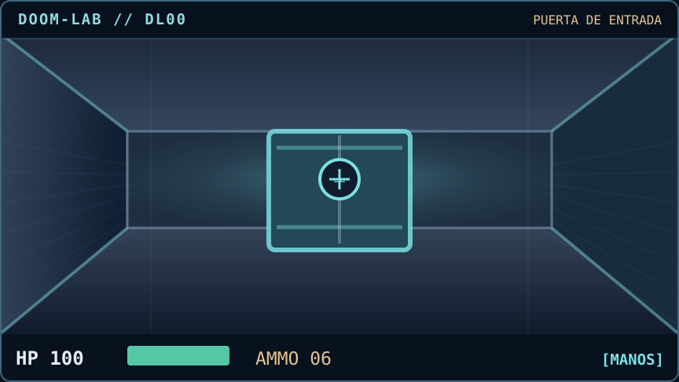

No necesitás salir de esta página. Las acciones de abajo saltan entre escenas de este mismo README.

[**↑ ENTRAR**](#dl01) &nbsp;·&nbsp; [**← REVISAR EL COSTADO**](#dl02)

<b>01 / Sector 01 · Primer bug — ESCENA</b>

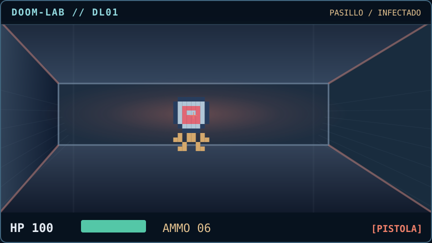

**Enemigo:** un bug. Dispará o investigá cómo llegó al sistema.

[**◎ DISPARAR**](#dl03) &nbsp;·&nbsp; [**→ LEER LA CONSOLA**](#dl04) &nbsp;·&nbsp; [**↓ RETROCEDER**](#dl00)

<b>02 / Sector 02 · Primera skill — ESCENA</b>

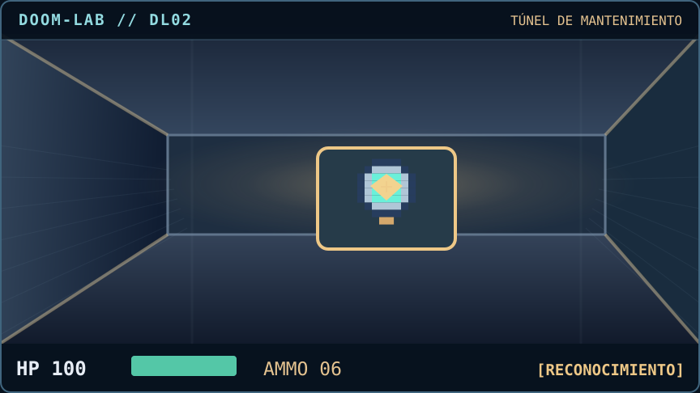

**Loot:** Python. Una skill para automatizar, construir y probar.

[**+ RECOGER PYTHON**](#dl05) &nbsp;·&nbsp; [**→ VOLVER AL PASILLO**](#dl01)

<b>03 / Sector 03 · Error eliminado — ESCENA</b>

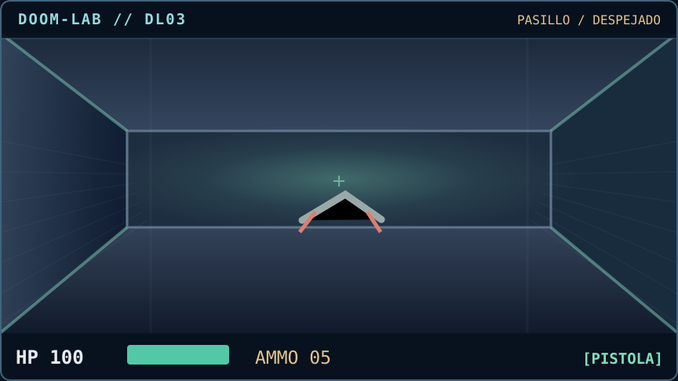

**Enemigo eliminado.** Un test de regresión impide que reaparezca el mismo error.

[**↑ ENTRAR AL NÚCLEO**](#dl06) &nbsp;·&nbsp; [**+ TOMAR EL BOTÍN**](#dl07) &nbsp;·&nbsp; [**→ ESCANEAR TERMINAL**](#dl04)

<b>04 / Sector 04 · Herramientas — ESCENA</b>

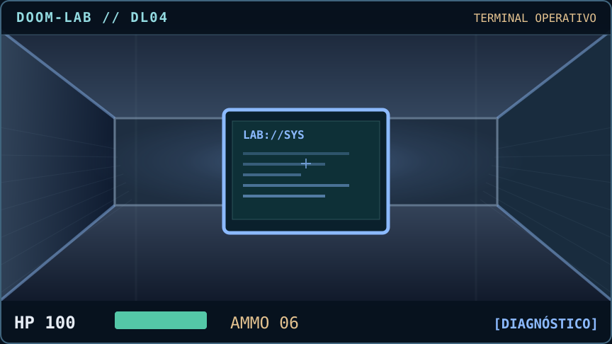

**Complemento:** GitHub Actions. Las pruebas repetibles importan más que la suerte.

[**+ EQUIPAR GITHUB ACTIONS**](#dl08) &nbsp;·&nbsp; [**← VOLVER AL PASILLO**](#dl01)

<b>05 / Sector 05 · Python equipado — ESCENA</b>

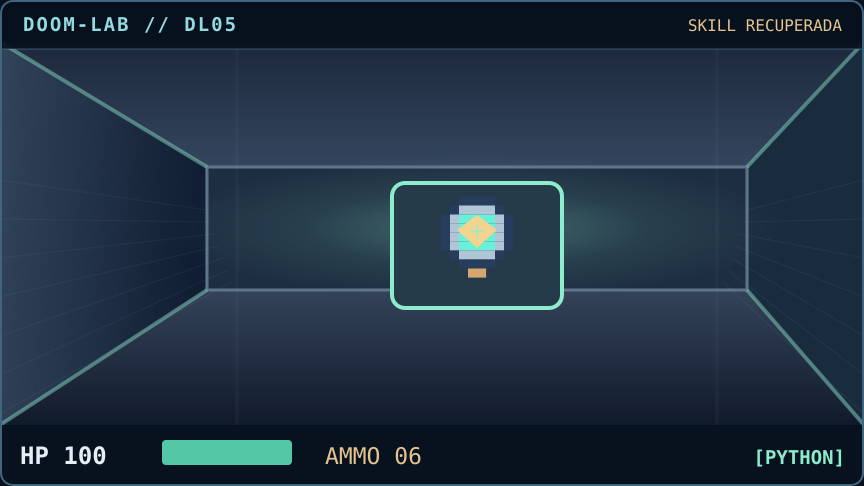

**Skill desbloqueada:** Python.

[**↑ IR A REVISAR CÓDIGO**](#dl09) &nbsp;·&nbsp; [**→ VOLVER AL COMBATE**](#dl01)

<b>06 / Sector 06 · Decisión — ESCENA</b>

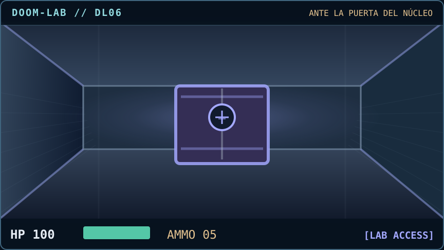

**Objetivo:** elegir una IA y preparar un experimento.

[**↑ ABRIR LA PUERTA**](#dl10) &nbsp;·&nbsp; [**← VER SI HAY UN ENEMIGO**](#dl11)

<b>07 / Sector 07 · Botín de pruebas — ESCENA</b>

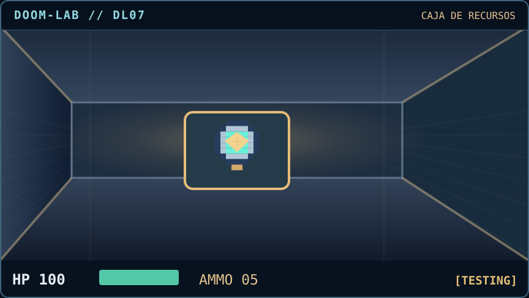

**Item:** Testing. Las pruebas son parte del equipamiento.

[**+ EQUIPAR PRUEBAS**](#dl03) &nbsp;·&nbsp; [**↑ SEGUIR AL NÚCLEO**](#dl06)

<b>08 / Sector 08 · CI lista — ESCENA</b>

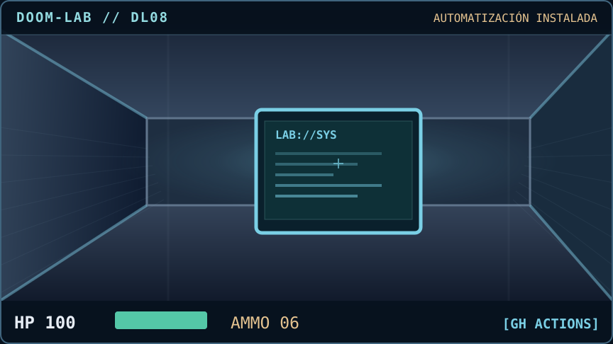

**Complemento desbloqueado:** GitHub Actions.

[**↑ ENTRAR AL NÚCLEO**](#dl06) &nbsp;·&nbsp; [**← REVISAR ARCHIVOS**](#dl09)

<b>09 / Sector 09 · Un resultado negativo — ESCENA</b>

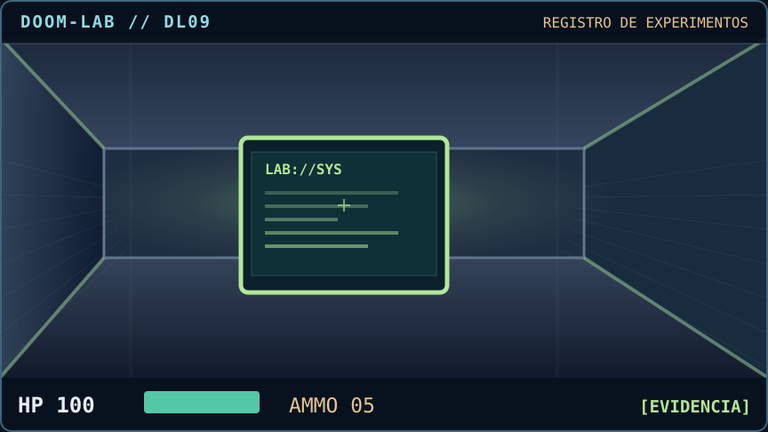

**Hallazgo:** algunas hipótesis no se sostienen, y está bien dejarlo documentado.

[**↑ AUDITAR EL NÚCLEO**](#dl06) &nbsp;·&nbsp; [**← BUSCAR MÁS HERRAMIENTAS**](#dl04)

<b>10 / Sector 10 · Elegir una IA — ESCENA</b>

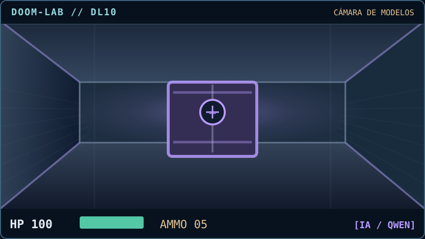

**Modelo:** Qwen. Las capacidades requieren hipótesis y evaluación.

[**+ INCORPORAR QWEN AL SETUP**](#dl12) &nbsp;·&nbsp; [**→ ESPERAR SIN TESTEAR**](#dl13) &nbsp;·&nbsp; [**← REVISAR EL CORREDOR**](#dl11)

<b>11 / Sector 11 · Otro bug — ESCENA</b>

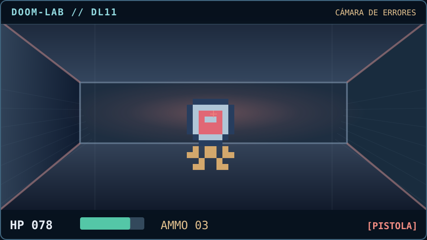

**Enemigo:** dependencia rota. Elegí entre combatir o retroceder.

[**◎ DISPARAR / MITIGAR**](#dl14) &nbsp;·&nbsp; [**↓ HUIR A REINICIAR**](#dl15) &nbsp;·&nbsp; [**← VOLVER AL MODELO**](#dl10)

<b>12 / Sector 12 · Python + Qwen + Actions — ESCENA</b>

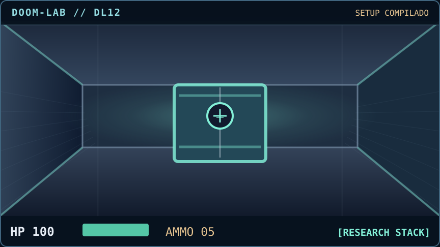

**SETUP:** Python + Qwen + GitHub Actions = Research Stack (virtual).

[**↑ PROBAR ANTES DE LANZAR**](#dl16) &nbsp;·&nbsp; [**! LANZAR SIN PRUEBAS**](#dl17)

<b>13 / Sector 13 · Falta contexto — ESCENA</b>

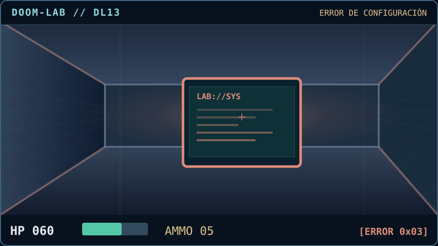

**Error:** el modelo no reemplaza la definición de un problema.

[**↶ REVISAR CONFIGURACIÓN**](#dl10) &nbsp;·&nbsp; [**↑ BUSCAR EL PROBLEMA**](#dl11)

<b>14 / Sector 14 · Bug corregido — ESCENA</b>

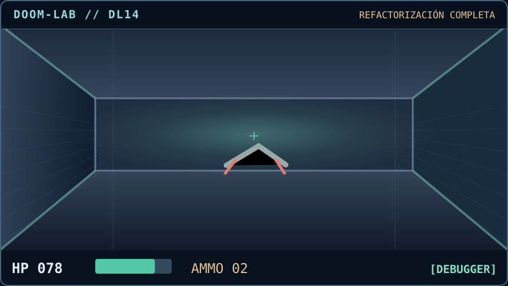

**Bug resuelto:** revisar causa y añadir pruebas.

[**↑ RETOMAR LA INVESTIGACIÓN**](#dl10) &nbsp;·&nbsp; [**→ AUDITAR LOGS**](#dl09)

<b>15 / Sector 15 · Reiniciá con evidencia — ESCENA</b>

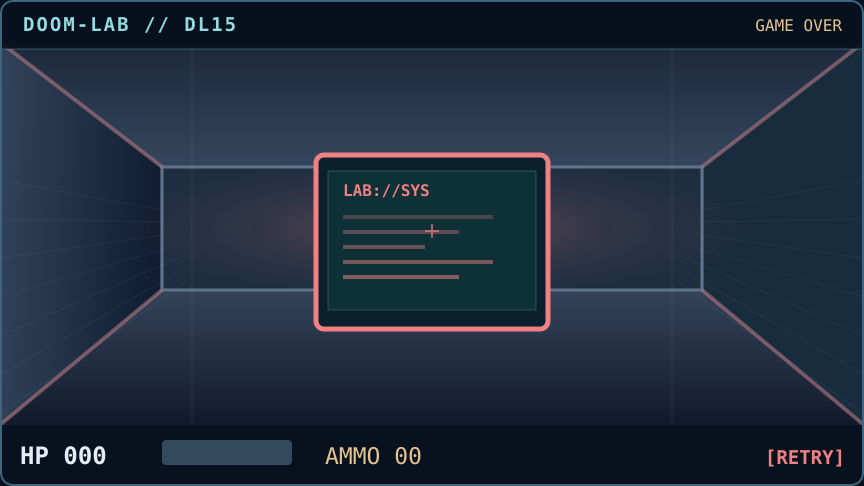

**Reinicio:** perder una partida no borra lo aprendido.

[**↻ REINICIAR EN EL README**](#dl00) &nbsp;·&nbsp; [**→ VOLVER AL REGISTRO**](#dl09)

<b>16 / Sector 16 · Completaste el nivel — ESCENA</b>

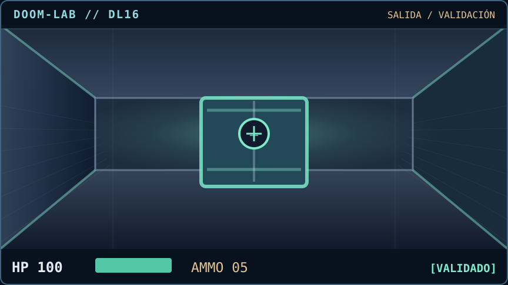

**Victoria:** experimento probado y documentado.

[**▶ JUGAR OTRA VUELTA**](#dl00) &nbsp;·&nbsp; [**↗ VER AGENTE EN EVOLUCIÓN**](#vibe-lab) &nbsp;·&nbsp; [**→ VER OTRO MINI JUEGO**](#lab-snake)

<b>17 / Sector 17 · Producción falló — ESCENA</b>

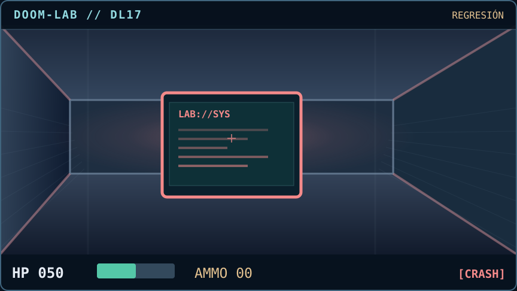

**Regresión:** saltarse los tests es una apuesta.

[**← REVISAR LOS LOGS**](#dl09) &nbsp;·&nbsp; [**↻ VOLVER AL SETUP**](#dl12)

Motor Markdown de estados enlazados: 18 escenas y navegación interna. Es jugable por clics; **no ejecuta DOOM original, WebAssembly, audio ni controles WASD**. El modo Snake en tiempo real es otro proyecto separado, pero este juego corre íntegramente dentro del README.

<!-- DOOM-LAB / FIN -->

<b>🐍 OTRO JUEGO DENTRO DEL README — Skill Snake / elegir rutas, recolectar IA y compilar setup</b>

No tenés que abrir otra pestaña. Se juega **con clics en esta página**. Seguí al gusanito, evitá chocar y conseguí Python, Qwen y GitHub Actions. Es un puzzle de decisiones con tableros dibujados, no el Snake en tiempo real con teclas.

<b>00 / SKILL SNAKE — PASO 0</b>

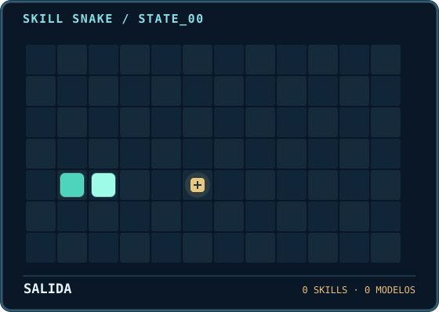

Comenzás con un agente diminuto. Su primera misión es encontrar una skill.

[**→ MOVER**](#sn01) &nbsp; · &nbsp; [**↑ SUBIR (CHOQUE)**](#sn10)

<b>01 / SKILL SNAKE — PASO 1</b>

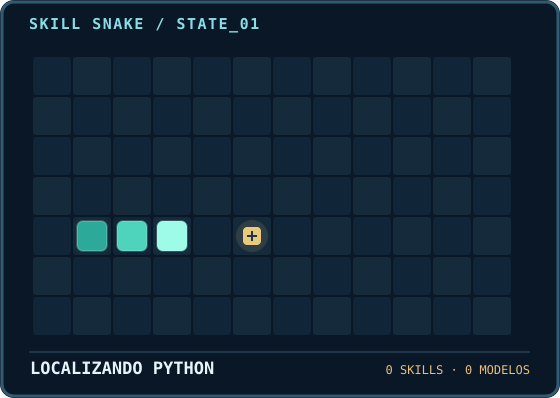

Seguí la dirección de movimiento. Revertir de golpe tiene consecuencias.

[**→ MOVER**](#sn02) &nbsp; · &nbsp; [**← INVERTIR (CHOQUE)**](#sn10)

<b>02 / SKILL SNAKE — PASO 2</b>

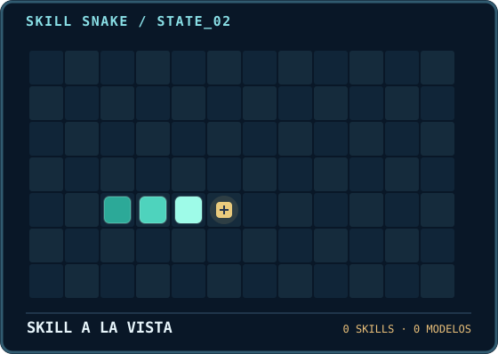

Ya casi tenés Python. Elegí el movimiento correcto.

[**→ COMER SKILL**](#sn03) &nbsp; · &nbsp; [**↑ SUBIR (CHOQUE)**](#sn10)

<b>03 / SKILL SNAKE — PASO 3</b>

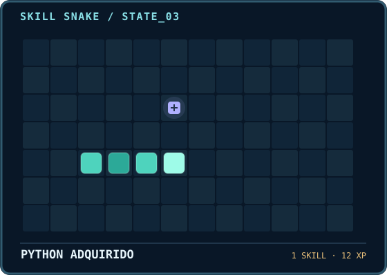

**+ Python**. Una skill útil para construir y probar. Ahora buscá una IA.

[**↑ BUSCAR IA**](#sn04) &nbsp; · &nbsp; [**→ CHOCAR**](#sn10)

<b>04 / SKILL SNAKE — PASO 4</b>

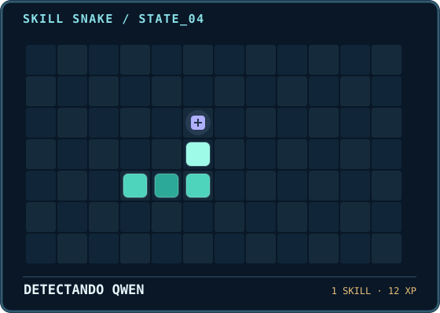

Qwen está a un paso. Seguí recto.

[**↑ RECOGER QWEN**](#sn05) &nbsp; · &nbsp; [**← CHOCAR**](#sn10)

<b>05 / SKILL SNAKE — PASO 5</b>

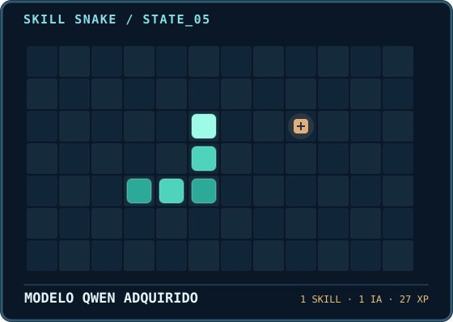

**+ Qwen**. El agente ahora tiene una skill y una IA; falta una herramienta.

[**→ BUSCAR PLUGIN**](#sn06) &nbsp; · &nbsp; [**↓ INVERTIR (CHOQUE)**](#sn10)

<b>06 / SKILL SNAKE — PASO 6</b>

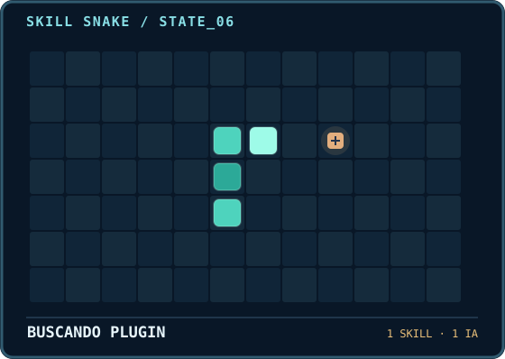

El complemento se ve adelante. No tires el progreso.

[**→ MOVER**](#sn07) &nbsp; · &nbsp; [**↑ PARED**](#sn10)

<b>07 / SKILL SNAKE — PASO 7</b>

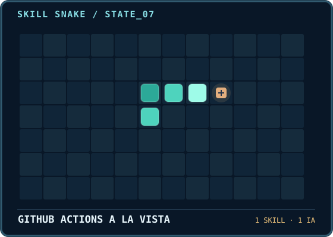

Una acción más para completar el equipo.

[**→ RECOGER ACTIONS**](#sn08) &nbsp; · &nbsp; [**↓ INVERTIR (CHOQUE)**](#sn10)

<b>08 / SKILL SNAKE — PASO 8</b>

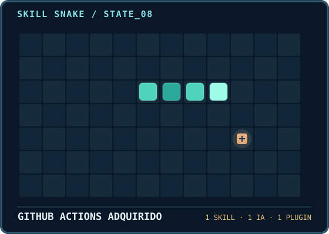

**+ GitHub Actions**. Ya tenés skill + IA + complemento.

[**✓ COMPILAR SETUP**](#sn09) &nbsp; · &nbsp; [**← CHOCAR**](#sn10)

<b>09 / SETUP COMPLETO</b>

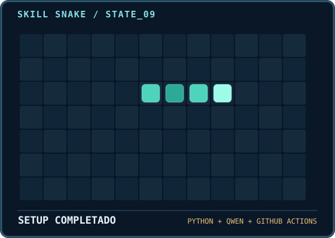

**Setup virtual compilado:** Python + Qwen + GitHub Actions = Research Stack. El ciclo puede volver a empezar.

[**↻ OTRA RONDA**](#sn00) &nbsp; · &nbsp; [**◈ VER MODO COMUNIDAD**](#vibe-lab)

<b>☠ / CHOQUE / FIN DE PARTIDA</b>

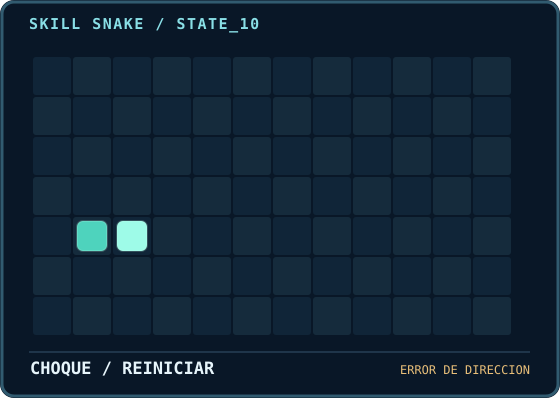

Choque. Este nivel es un rompecabezas por clics: aprendé la ruta y probá otra vez.

[**↻ REINICIAR**](#sn00) &nbsp; · &nbsp; [**↓ VER DOOM-LAB**](#doom-lab)

---

### 🧠 El agente comunitario también evoluciona

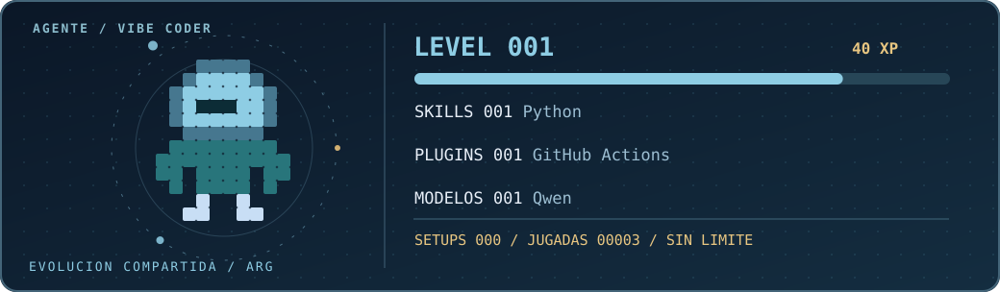

<b>▸ Abrir el modo comunidad — XP, skills, IAs y setups persistentes</b>

<!-- VIBE-LAB:START -->

### VIBE CODER / AGENTE EN EVOLUCIÓN ∞

**Nivel 2** · **65 XP** · **4 jugadas** · **Setups: 1**

▰▰▰▱▱▱▱▱▱▱  → Siguiente nivel: 100 XP

> **Es un juego compartido, no instalaciones reales.** Cada jugador elige una mejora, confirma una jugada en GitHub Issues y una Action actualiza este agente dentro del README. Volvé al perfil y refrescá para ver el nuevo estado. No hace falta abrir ningún repositorio para entenderlo.

| 🧠 SKILLS ADQUIRIDAS | 🧩 COMPLEMENTOS | 🤖 IAs SUMADAS |
| :-- | :-- | :-- |
| Python ×1 | GitHub Actions ×1 | Qwen ×1 |

#### 🎮 Elegí la próxima evolución

Cada enlace prepara la jugada. **Hay que pulsar Submit new issue** para que se procese; GitHub no permite ejecutar un juego instantáneo con JavaScript en el README.

<b>01 / Aprender una skill (+12 XP)</b>

[Python](https://github.com/chrishotza/ChrisHotza/issues/new?title=LAB%3Askill%3Apython&body=Jugada%20del%20laboratorio.%20Cre%C3%A1%20el%20issue%20para%20sumar%20esta%20mejora%20al%20agente%20compartido.%20GitHub%20Actions%20actualiza%20el%20perfil%20y%20cierra%20esta%20jugada%20cuando%20termina.) · [Investigación](https://github.com/chrishotza/ChrisHotza/issues/new?title=LAB%3Askill%3Aresearch&body=Jugada%20del%20laboratorio.%20Cre%C3%A1%20el%20issue%20para%20sumar%20esta%20mejora%20al%20agente%20compartido.%20GitHub%20Actions%20actualiza%20el%20perfil%20y%20cierra%20esta%20jugada%20cuando%20termina.) · [Seguridad](https://github.com/chrishotza/ChrisHotza/issues/new?title=LAB%3Askill%3Asecurity&body=Jugada%20del%20laboratorio.%20Cre%C3%A1%20el%20issue%20para%20sumar%20esta%20mejora%20al%20agente%20compartido.%20GitHub%20Actions%20actualiza%20el%20perfil%20y%20cierra%20esta%20jugada%20cuando%20termina.) · [Visión computacional](https://github.com/chrishotza/ChrisHotza/issues/new?title=LAB%3Askill%3Avision&body=Jugada%20del%20laboratorio.%20Cre%C3%A1%20el%20issue%20para%20sumar%20esta%20mejora%20al%20agente%20compartido.%20GitHub%20Actions%20actualiza%20el%20perfil%20y%20cierra%20esta%20jugada%20cuando%20termina.) · [SQL y datos](https://github.com/chrishotza/ChrisHotza/issues/new?title=LAB%3Askill%3Adata&body=Jugada%20del%20laboratorio.%20Cre%C3%A1%20el%20issue%20para%20sumar%20esta%20mejora%20al%20agente%20compartido.%20GitHub%20Actions%20actualiza%20el%20perfil%20y%20cierra%20esta%20jugada%20cuando%20termina.) · [Testing](https://github.com/chrishotza/ChrisHotza/issues/new?title=LAB%3Askill%3Atesting&body=Jugada%20del%20laboratorio.%20Cre%C3%A1%20el%20issue%20para%20sumar%20esta%20mejora%20al%20agente%20compartido.%20GitHub%20Actions%20actualiza%20el%20perfil%20y%20cierra%20esta%20jugada%20cuando%20termina.) · [Orquestación de agentes](https://github.com/chrishotza/ChrisHotza/issues/new?title=LAB%3Askill%3Aagents&body=Jugada%20del%20laboratorio.%20Cre%C3%A1%20el%20issue%20para%20sumar%20esta%20mejora%20al%20agente%20compartido.%20GitHub%20Actions%20actualiza%20el%20perfil%20y%20cierra%20esta%20jugada%20cuando%20termina.) · [Optimización](https://github.com/chrishotza/ChrisHotza/issues/new?title=LAB%3Askill%3Amath&body=Jugada%20del%20laboratorio.%20Cre%C3%A1%20el%20issue%20para%20sumar%20esta%20mejora%20al%20agente%20compartido.%20GitHub%20Actions%20actualiza%20el%20perfil%20y%20cierra%20esta%20jugada%20cuando%20termina.) · [Memoria de IA](https://github.com/chrishotza/ChrisHotza/issues/new?title=LAB%3Askill%3Amemory&body=Jugada%20del%20laboratorio.%20Cre%C3%A1%20el%20issue%20para%20sumar%20esta%20mejora%20al%20agente%20compartido.%20GitHub%20Actions%20actualiza%20el%20perfil%20y%20cierra%20esta%20jugada%20cuando%20termina.) · [Experimentación](https://github.com/chrishotza/ChrisHotza/issues/new?title=LAB%3Askill%3Ascience&body=Jugada%20del%20laboratorio.%20Cre%C3%A1%20el%20issue%20para%20sumar%20esta%20mejora%20al%20agente%20compartido.%20GitHub%20Actions%20actualiza%20el%20perfil%20y%20cierra%20esta%20jugada%20cuando%20termina.) · [Debugging](https://github.com/chrishotza/ChrisHotza/issues/new?title=LAB%3Askill%3Adebugging&body=Jugada%20del%20laboratorio.%20Cre%C3%A1%20el%20issue%20para%20sumar%20esta%20mejora%20al%20agente%20compartido.%20GitHub%20Actions%20actualiza%20el%20perfil%20y%20cierra%20esta%20jugada%20cuando%20termina.) · [APIs](https://github.com/chrishotza/ChrisHotza/issues/new?title=LAB%3Askill%3Aapi&body=Jugada%20del%20laboratorio.%20Cre%C3%A1%20el%20issue%20para%20sumar%20esta%20mejora%20al%20agente%20compartido.%20GitHub%20Actions%20actualiza%20el%20perfil%20y%20cierra%20esta%20jugada%20cuando%20termina.)

<b>02 / Conectar un complemento (+13 XP)</b>

[GitHub Actions](https://github.com/chrishotza/ChrisHotza/issues/new?title=LAB%3Aplugin%3Agithub&body=Jugada%20del%20laboratorio.%20Cre%C3%A1%20el%20issue%20para%20sumar%20esta%20mejora%20al%20agente%20compartido.%20GitHub%20Actions%20actualiza%20el%20perfil%20y%20cierra%20esta%20jugada%20cuando%20termina.) · [Playwright](https://github.com/chrishotza/ChrisHotza/issues/new?title=LAB%3Aplugin%3Aplaywright&body=Jugada%20del%20laboratorio.%20Cre%C3%A1%20el%20issue%20para%20sumar%20esta%20mejora%20al%20agente%20compartido.%20GitHub%20Actions%20actualiza%20el%20perfil%20y%20cierra%20esta%20jugada%20cuando%20termina.) · [Ollama](https://github.com/chrishotza/ChrisHotza/issues/new?title=LAB%3Aplugin%3Aollama&body=Jugada%20del%20laboratorio.%20Cre%C3%A1%20el%20issue%20para%20sumar%20esta%20mejora%20al%20agente%20compartido.%20GitHub%20Actions%20actualiza%20el%20perfil%20y%20cierra%20esta%20jugada%20cuando%20termina.) · [n8n](https://github.com/chrishotza/ChrisHotza/issues/new?title=LAB%3Aplugin%3An8n&body=Jugada%20del%20laboratorio.%20Cre%C3%A1%20el%20issue%20para%20sumar%20esta%20mejora%20al%20agente%20compartido.%20GitHub%20Actions%20actualiza%20el%20perfil%20y%20cierra%20esta%20jugada%20cuando%20termina.) · [FastAPI](https://github.com/chrishotza/ChrisHotza/issues/new?title=LAB%3Aplugin%3Afastapi&body=Jugada%20del%20laboratorio.%20Cre%C3%A1%20el%20issue%20para%20sumar%20esta%20mejora%20al%20agente%20compartido.%20GitHub%20Actions%20actualiza%20el%20perfil%20y%20cierra%20esta%20jugada%20cuando%20termina.) · [Docker](https://github.com/chrishotza/ChrisHotza/issues/new?title=LAB%3Aplugin%3Adocker&body=Jugada%20del%20laboratorio.%20Cre%C3%A1%20el%20issue%20para%20sumar%20esta%20mejora%20al%20agente%20compartido.%20GitHub%20Actions%20actualiza%20el%20perfil%20y%20cierra%20esta%20jugada%20cuando%20termina.) · [Hugging Face](https://github.com/chrishotza/ChrisHotza/issues/new?title=LAB%3Aplugin%3Ahuggingface&body=Jugada%20del%20laboratorio.%20Cre%C3%A1%20el%20issue%20para%20sumar%20esta%20mejora%20al%20agente%20compartido.%20GitHub%20Actions%20actualiza%20el%20perfil%20y%20cierra%20esta%20jugada%20cuando%20termina.) · [Supabase](https://github.com/chrishotza/ChrisHotza/issues/new?title=LAB%3Aplugin%3Asupabase&body=Jugada%20del%20laboratorio.%20Cre%C3%A1%20el%20issue%20para%20sumar%20esta%20mejora%20al%20agente%20compartido.%20GitHub%20Actions%20actualiza%20el%20perfil%20y%20cierra%20esta%20jugada%20cuando%20termina.) · [Render](https://github.com/chrishotza/ChrisHotza/issues/new?title=LAB%3Aplugin%3Arender&body=Jugada%20del%20laboratorio.%20Cre%C3%A1%20el%20issue%20para%20sumar%20esta%20mejora%20al%20agente%20compartido.%20GitHub%20Actions%20actualiza%20el%20perfil%20y%20cierra%20esta%20jugada%20cuando%20termina.) · [Kaggle](https://github.com/chrishotza/ChrisHotza/issues/new?title=LAB%3Aplugin%3Akaggle&body=Jugada%20del%20laboratorio.%20Cre%C3%A1%20el%20issue%20para%20sumar%20esta%20mejora%20al%20agente%20compartido.%20GitHub%20Actions%20actualiza%20el%20perfil%20y%20cierra%20esta%20jugada%20cuando%20termina.) · [Pandas](https://github.com/chrishotza/ChrisHotza/issues/new?title=LAB%3Aplugin%3Apandas&body=Jugada%20del%20laboratorio.%20Cre%C3%A1%20el%20issue%20para%20sumar%20esta%20mejora%20al%20agente%20compartido.%20GitHub%20Actions%20actualiza%20el%20perfil%20y%20cierra%20esta%20jugada%20cuando%20termina.) · [Gradio](https://github.com/chrishotza/ChrisHotza/issues/new?title=LAB%3Aplugin%3Agradio&body=Jugada%20del%20laboratorio.%20Cre%C3%A1%20el%20issue%20para%20sumar%20esta%20mejora%20al%20agente%20compartido.%20GitHub%20Actions%20actualiza%20el%20perfil%20y%20cierra%20esta%20jugada%20cuando%20termina.)

<b>03 / Sumar otra IA al equipo (+15 XP)</b>

[GPT](https://github.com/chrishotza/ChrisHotza/issues/new?title=LAB%3Amodel%3Agpt&body=Jugada%20del%20laboratorio.%20Cre%C3%A1%20el%20issue%20para%20sumar%20esta%20mejora%20al%20agente%20compartido.%20GitHub%20Actions%20actualiza%20el%20perfil%20y%20cierra%20esta%20jugada%20cuando%20termina.) · [Claude](https://github.com/chrishotza/ChrisHotza/issues/new?title=LAB%3Amodel%3Aclaude&body=Jugada%20del%20laboratorio.%20Cre%C3%A1%20el%20issue%20para%20sumar%20esta%20mejora%20al%20agente%20compartido.%20GitHub%20Actions%20actualiza%20el%20perfil%20y%20cierra%20esta%20jugada%20cuando%20termina.) · [Gemini](https://github.com/chrishotza/ChrisHotza/issues/new?title=LAB%3Amodel%3Agemini&body=Jugada%20del%20laboratorio.%20Cre%C3%A1%20el%20issue%20para%20sumar%20esta%20mejora%20al%20agente%20compartido.%20GitHub%20Actions%20actualiza%20el%20perfil%20y%20cierra%20esta%20jugada%20cuando%20termina.) · [Llama](https://github.com/chrishotza/ChrisHotza/issues/new?title=LAB%3Amodel%3Allama&body=Jugada%20del%20laboratorio.%20Cre%C3%A1%20el%20issue%20para%20sumar%20esta%20mejora%20al%20agente%20compartido.%20GitHub%20Actions%20actualiza%20el%20perfil%20y%20cierra%20esta%20jugada%20cuando%20termina.) · [Qwen](https://github.com/chrishotza/ChrisHotza/issues/new?title=LAB%3Amodel%3Aqwen&body=Jugada%20del%20laboratorio.%20Cre%C3%A1%20el%20issue%20para%20sumar%20esta%20mejora%20al%20agente%20compartido.%20GitHub%20Actions%20actualiza%20el%20perfil%20y%20cierra%20esta%20jugada%20cuando%20termina.) · [Gemma](https://github.com/chrishotza/ChrisHotza/issues/new?title=LAB%3Amodel%3Agemma&body=Jugada%20del%20laboratorio.%20Cre%C3%A1%20el%20issue%20para%20sumar%20esta%20mejora%20al%20agente%20compartido.%20GitHub%20Actions%20actualiza%20el%20perfil%20y%20cierra%20esta%20jugada%20cuando%20termina.) · [DeepSeek](https://github.com/chrishotza/ChrisHotza/issues/new?title=LAB%3Amodel%3Adeepseek&body=Jugada%20del%20laboratorio.%20Cre%C3%A1%20el%20issue%20para%20sumar%20esta%20mejora%20al%20agente%20compartido.%20GitHub%20Actions%20actualiza%20el%20perfil%20y%20cierra%20esta%20jugada%20cuando%20termina.) · [Mistral](https://github.com/chrishotza/ChrisHotza/issues/new?title=LAB%3Amodel%3Amistral&body=Jugada%20del%20laboratorio.%20Cre%C3%A1%20el%20issue%20para%20sumar%20esta%20mejora%20al%20agente%20compartido.%20GitHub%20Actions%20actualiza%20el%20perfil%20y%20cierra%20esta%20jugada%20cuando%20termina.)

<b>04 / Compilar un nuevo setup (+25 XP)</b>

[Research Stack](https://github.com/chrishotza/ChrisHotza/issues/new?title=LAB%3Abuild%3Aresearch&body=Jugada%20del%20laboratorio.%20Cre%C3%A1%20el%20issue%20para%20sumar%20esta%20mejora%20al%20agente%20compartido.%20GitHub%20Actions%20actualiza%20el%20perfil%20y%20cierra%20esta%20jugada%20cuando%20termina.) · [Builder Stack](https://github.com/chrishotza/ChrisHotza/issues/new?title=LAB%3Abuild%3Amaker&body=Jugada%20del%20laboratorio.%20Cre%C3%A1%20el%20issue%20para%20sumar%20esta%20mejora%20al%20agente%20compartido.%20GitHub%20Actions%20actualiza%20el%20perfil%20y%20cierra%20esta%20jugada%20cuando%20termina.) · [Science Stack](https://github.com/chrishotza/ChrisHotza/issues/new?title=LAB%3Abuild%3Ascience&body=Jugada%20del%20laboratorio.%20Cre%C3%A1%20el%20issue%20para%20sumar%20esta%20mejora%20al%20agente%20compartido.%20GitHub%20Actions%20actualiza%20el%20perfil%20y%20cierra%20esta%20jugada%20cuando%20termina.) · [Audit Stack](https://github.com/chrishotza/ChrisHotza/issues/new?title=LAB%3Abuild%3Aaudit&body=Jugada%20del%20laboratorio.%20Cre%C3%A1%20el%20issue%20para%20sumar%20esta%20mejora%20al%20agente%20compartido.%20GitHub%20Actions%20actualiza%20el%20perfil%20y%20cierra%20esta%20jugada%20cuando%20termina.)

#### 🖥️ Setup actual

**Research Stack #1** — Explorar hipótesis con pruebas, fuentes y trazabilidad.

| Skill | IA | Complemento |
| :-- | :-- | :-- |
| Python | Qwen | GitHub Actions |

<b>📟 Últimas jugadas de la comunidad</b>

| Turno | Jugador | Acción |
| --: | :-- | :-- |
| 4 | @chrishotza | SETUP: Research Stack |
| 3 | @chrishotza | COMPLEMENTO: GitHub Actions |
| 2 | @chrishotza | MODELO: Qwen |
| 1 | @chrishotza | SKILL: Python |

∞ Sin nivel máximo. El estado se actualiza a cada jugada confirmada. La lista de setups recientes se conserva acotada para mantener el README rápido; el XP y el progreso siguen creciendo. Los nombres de modelos y complementos son opciones simuladas, no conexiones activas.

<!-- VIBE-LAB:END -->

---

### ¿Qué hay detrás del juego?

Soy un investigador independiente de Argentina. Uso agentes de IA para formular hipótesis, construir software y probar qué funciona. Lo que quiero generar es **valor real en la sociedad**.

| Trabajo realizado | Qué pasó realmente |
| :-- | :-- |
| **🧬 Biología computacional** | Procesé 168 imágenes de microscopía y generé trayectorias celulares. Métricas internas; no validación biológica. |
| **🪐 Agentes e información** | RepoOrbit catalogó 1.462 rutas en su instantánea del 13/10/2026. Una ruta indexada no implica verificación. |
| **⚡ Energía** | Un supervisor BESS superó 260 ejecuciones de simulación en un banco de pruebas documentado. No está validado en campo. |
| **🌱 UnGesto** | Desarrollé un sistema para registrar adhesiones a varias causas. No entrega todavía firmas a campañas externas. |
| **🧠 IA experimental** | Construí mecanismos de memoria, autorreferencia y ensayos causales. No establecen conciencia artificial. |

<b>🛠️ ¿Cómo se construye un setup en el laboratorio?</b>

**1. Aprender:** sumás capacidades como Python, SQL, investigación, visión computacional o seguridad.

**2. Ampliar:** incorporás un complemento como Playwright, Ollama, n8n, GitHub Actions o Docker.

**3. Elegir IA:** agregás modelos a un equipo virtual: GPT, Claude, Gemini, Llama, Qwen y otros.

**4. Compilar:** cada build combina skill + IA + complemento, con un objetivo explícito. Repetí el ciclo tanto como quieras: el nivel y el inventario siguen creciendo.

Es un **simulador de decisiones**, no instala proveedores en tu cuenta ni habilita APIs pagas. Para que el cambio se vea en GitHub hay que confirmar la jugada en una Issue; una Action procesa el comando y vuelve a publicar el tablero.

### ¿Querés controlar el gusanito con teclado?

El Snake en tiempo real también está disponible y usa HTML, canvas y controles táctiles.

**[▶ JUGAR SIGNAL SNAKE](https://hotza-lab-arcade.onrender.com)**

English: A public, community-built vibe-coder agent that grows by collecting skills, models and tools. The README is the scoreboard; issue-based moves are processed by GitHub Actions.

[Archivo de investigaciones](docs/README.md) · [README histórico](README.archive-2026-10-16.md)

