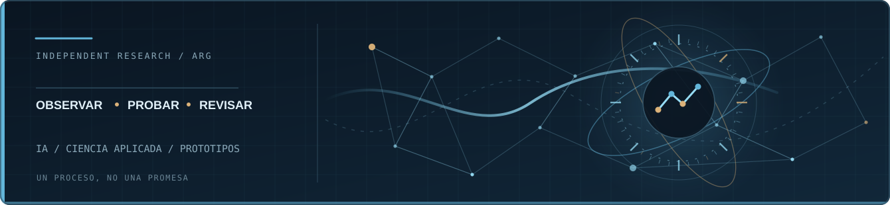
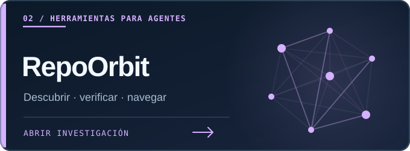
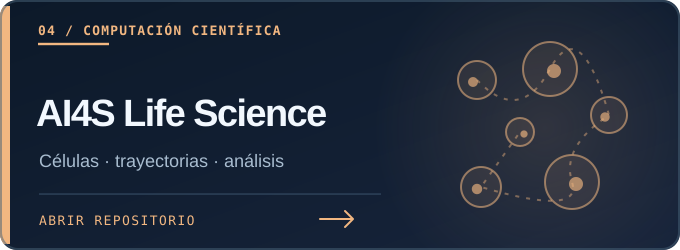

<!-- REAL README GAME / GitHub native HTML-only state machine. No JS, redirects or external execution. -->
## 🎮 Una partida adentro de este README

**Creo cosas con IA.** La máquina está jugando al tres en raya. ¿Le ganás?

Esto **es un juego con reglas, turnos y adversario automático**: elegís una posición, la computadora hace su movimiento y ves el tablero actualizado, **sin salir de esta página**. No es un chat con IA en vivo: todas las respuestas legales están calculadas previamente.

<b>▶ JUGAR AHORA — X CONTRA LA MÁQUINA</b>

**X = vos** · **O = máquina** · **1–9 = casillas disponibles**. Tres en línea gana. Tocá una jugada debajo del tablero. Las demás opciones del mismo turno se cerrarán automáticamente.

<pre>
    1   2   3
  ┌───┬───┬───┐
A │ 1 │ 2 │ 3 │
  ├───┼───┼───┤
B │ 4 │ 5 │ 6 │
  ├───┼───┼───┤
C │ 7 │ 8 │ 9 │
  └───┴───┴───┘
</pre>

**TU TURNO · ELEGÍ LA PRIMERA CASILLA**

<b>① A1 · jugar X</b>

**Vos:** A1 　 **CPU:** B2

<pre>
    1   2   3
  ┌───┬───┬───┐
A │ X │ 2 │ 3 │
  ├───┼───┼───┤
B │ 4 │ O │ 6 │
  ├───┼───┼───┤
C │ 7 │ 8 │ 9 │
  └───┴───┴───┘
</pre>

**TURNO 2/5 · ELEGÍ TU PRÓXIMA CASILLA VACÍA**

<b>② A2 · jugar X</b>

**Vos:** A2 　 **CPU:** A3

<pre>
    1   2   3
  ┌───┬───┬───┐
A │ X │ X │ O │
  ├───┼───┼───┤
B │ 4 │ O │ 6 │
  ├───┼───┼───┤
C │ 7 │ 8 │ 9 │
  └───┴───┴───┘
</pre>

**TURNO 3/5 · ELEGÍ TU PRÓXIMA CASILLA VACÍA**

<b>④ B1 · jugar X</b>

**Vos:** B1 　 **CPU:** C1

<pre>
    1   2   3
  ┌───┬───┬───┐
A │ X │ X │ O │
  ├───┼───┼───┤
B │ X │ O │ 6 │
  ├───┼───┼───┤
C │ O │ 8 │ 9 │
  └───┴───┴───┘
</pre>

### 💀 PERDISTE

La máquina hizo tres en línea. Partida terminada.

**Otra partida:** actualizá esta misma página o cerrá y volvé a abrir el cartucho.

<b>⑥ B3 · jugar X</b>

**Vos:** B3 　 **CPU:** C1

<pre>
    1   2   3
  ┌───┬───┬───┐
A │ X │ X │ O │
  ├───┼───┼───┤
B │ 4 │ O │ X │
  ├───┼───┼───┤
C │ O │ 8 │ 9 │
  └───┴───┴───┘
</pre>

### 💀 PERDISTE

La máquina hizo tres en línea. Partida terminada.

**Otra partida:** actualizá esta misma página o cerrá y volvé a abrir el cartucho.

<b>⑦ C1 · jugar X</b>

**Vos:** C1 　 **CPU:** C3

<pre>
    1   2   3
  ┌───┬───┬───┐
A │ X │ X │ O │
  ├───┼───┼───┤
B │ 4 │ O │ 6 │
  ├───┼───┼───┤
C │ X │ 8 │ O │
  └───┴───┴───┘
</pre>

**TURNO 4/5 · ELEGÍ TU PRÓXIMA CASILLA VACÍA**

<b>④ B1 · jugar X</b>

**Vos:** B1 · la máquina no pudo responder

<pre>
    1   2   3
  ┌───┬───┬───┐
A │ X │ X │ O │
  ├───┼───┼───┤
B │ X │ O │ 6 │
  ├───┼───┼───┤
C │ X │ 8 │ O │
  └───┴───┴───┘
</pre>

### 🏆 GANASTE

Tres en línea. La máquina perdió. Partida terminada.

**Otra partida:** actualizá esta misma página o cerrá y volvé a abrir el cartucho.

<b>⑥ B3 · jugar X</b>

**Vos:** B3 　 **CPU:** B1

<pre>
    1   2   3
  ┌───┬───┬───┐
A │ X │ X │ O │
  ├───┼───┼───┤
B │ O │ O │ X │
  ├───┼───┼───┤
C │ X │ 8 │ O │
  └───┴───┴───┘
</pre>

**TURNO 5/5 · ELEGÍ TU PRÓXIMA CASILLA VACÍA**

<b>⑧ C2 · jugar X</b>

**Vos:** C2 · la máquina no pudo responder

<pre>
    1   2   3
  ┌───┬───┬───┐
A │ X │ X │ O │
  ├───┼───┼───┤
B │ O │ O │ X │
  ├───┼───┼───┤
C │ X │ X │ O │
  └───┴───┴───┘
</pre>

### 🤝 EMPATE

Tablero lleno, sin ganador.

**Otra partida:** actualizá esta misma página o cerrá y volvé a abrir el cartucho.

<b>⑧ C2 · jugar X</b>

**Vos:** C2 　 **CPU:** B3

<pre>
    1   2   3
  ┌───┬───┬───┐
A │ X │ X │ O │
  ├───┼───┼───┤
B │ 4 │ O │ O │
  ├───┼───┼───┤
C │ X │ X │ O │
  └───┴───┴───┘
</pre>

### 💀 PERDISTE

La máquina hizo tres en línea. Partida terminada.

**Otra partida:** actualizá esta misma página o cerrá y volvé a abrir el cartucho.

<b>⑧ C2 · jugar X</b>

**Vos:** C2 　 **CPU:** C1

<pre>
    1   2   3
  ┌───┬───┬───┐
A │ X │ X │ O │
  ├───┼───┼───┤
B │ 4 │ O │ 6 │
  ├───┼───┼───┤
C │ O │ X │ 9 │
  └───┴───┴───┘
</pre>

### 💀 PERDISTE

La máquina hizo tres en línea. Partida terminada.

**Otra partida:** actualizá esta misma página o cerrá y volvé a abrir el cartucho.

<b>⑨ C3 · jugar X</b>

**Vos:** C3 　 **CPU:** C1

<pre>
    1   2   3
  ┌───┬───┬───┐
A │ X │ X │ O │
  ├───┼───┼───┤
B │ 4 │ O │ 6 │
  ├───┼───┼───┤
C │ O │ 8 │ X │
  └───┴───┴───┘
</pre>

### 💀 PERDISTE

La máquina hizo tres en línea. Partida terminada.

**Otra partida:** actualizá esta misma página o cerrá y volvé a abrir el cartucho.

<b>③ A3 · jugar X</b>

**Vos:** A3 　 **CPU:** C1

<pre>
    1   2   3
  ┌───┬───┬───┐
A │ X │ 2 │ X │
  ├───┼───┼───┤
B │ 4 │ O │ 6 │
  ├───┼───┼───┤
C │ O │ 8 │ 9 │
  └───┴───┴───┘
</pre>

**TURNO 3/5 · ELEGÍ TU PRÓXIMA CASILLA VACÍA**

<b>② A2 · jugar X</b>

**Vos:** A2 · la máquina no pudo responder

<pre>
    1   2   3
  ┌───┬───┬───┐
A │ X │ X │ X │
  ├───┼───┼───┤
B │ 4 │ O │ 6 │
  ├───┼───┼───┤
C │ O │ 8 │ 9 │
  └───┴───┴───┘
</pre>

### 🏆 GANASTE

Tres en línea. La máquina perdió. Partida terminada.

**Otra partida:** actualizá esta misma página o cerrá y volvé a abrir el cartucho.

<b>④ B1 · jugar X</b>

**Vos:** B1 　 **CPU:** C3

<pre>
    1   2   3
  ┌───┬───┬───┐
A │ X │ 2 │ X │
  ├───┼───┼───┤
B │ X │ O │ 6 │
  ├───┼───┼───┤
C │ O │ 8 │ O │
  └───┴───┴───┘
</pre>

**TURNO 4/5 · ELEGÍ TU PRÓXIMA CASILLA VACÍA**

<b>② A2 · jugar X</b>

**Vos:** A2 · la máquina no pudo responder

<pre>
    1   2   3
  ┌───┬───┬───┐
A │ X │ X │ X │
  ├───┼───┼───┤
B │ X │ O │ 6 │
  ├───┼───┼───┤
C │ O │ 8 │ O │
  └───┴───┴───┘
</pre>

### 🏆 GANASTE

Tres en línea. La máquina perdió. Partida terminada.

**Otra partida:** actualizá esta misma página o cerrá y volvé a abrir el cartucho.

<b>⑥ B3 · jugar X</b>

**Vos:** B3 　 **CPU:** C2

<pre>
    1   2   3
  ┌───┬───┬───┐
A │ X │ 2 │ X │
  ├───┼───┼───┤
B │ X │ O │ X │
  ├───┼───┼───┤
C │ O │ O │ O │
  └───┴───┴───┘
</pre>

### 💀 PERDISTE

La máquina hizo tres en línea. Partida terminada.

**Otra partida:** actualizá esta misma página o cerrá y volvé a abrir el cartucho.

<b>⑧ C2 · jugar X</b>

**Vos:** C2 　 **CPU:** A2

<pre>
    1   2   3
  ┌───┬───┬───┐
A │ X │ O │ X │
  ├───┼───┼───┤
B │ X │ O │ 6 │
  ├───┼───┼───┤
C │ O │ X │ O │
  └───┴───┴───┘
</pre>

**TURNO 5/5 · ELEGÍ TU PRÓXIMA CASILLA VACÍA**

<b>⑥ B3 · jugar X</b>

**Vos:** B3 · la máquina no pudo responder

<pre>
    1   2   3
  ┌───┬───┬───┐
A │ X │ O │ X │
  ├───┼───┼───┤
B │ X │ O │ X │
  ├───┼───┼───┤
C │ O │ X │ O │
  └───┴───┴───┘
</pre>

### 🤝 EMPATE

Tablero lleno, sin ganador.

**Otra partida:** actualizá esta misma página o cerrá y volvé a abrir el cartucho.

<b>⑥ B3 · jugar X</b>

**Vos:** B3 　 **CPU:** C3

<pre>
    1   2   3
  ┌───┬───┬───┐
A │ X │ 2 │ X │
  ├───┼───┼───┤
B │ 4 │ O │ X │
  ├───┼───┼───┤
C │ O │ 8 │ O │
  └───┴───┴───┘
</pre>

**TURNO 4/5 · ELEGÍ TU PRÓXIMA CASILLA VACÍA**

<b>② A2 · jugar X</b>

**Vos:** A2 · la máquina no pudo responder

<pre>
    1   2   3
  ┌───┬───┬───┐
A │ X │ X │ X │
  ├───┼───┼───┤
B │ 4 │ O │ X │
  ├───┼───┼───┤
C │ O │ 8 │ O │
  └───┴───┴───┘
</pre>

### 🏆 GANASTE

Tres en línea. La máquina perdió. Partida terminada.

**Otra partida:** actualizá esta misma página o cerrá y volvé a abrir el cartucho.

<b>④ B1 · jugar X</b>

**Vos:** B1 　 **CPU:** C2

<pre>
    1   2   3
  ┌───┬───┬───┐
A │ X │ 2 │ X │
  ├───┼───┼───┤
B │ X │ O │ X │
  ├───┼───┼───┤
C │ O │ O │ O │
  └───┴───┴───┘
</pre>

### 💀 PERDISTE

La máquina hizo tres en línea. Partida terminada.

**Otra partida:** actualizá esta misma página o cerrá y volvé a abrir el cartucho.

<b>⑧ C2 · jugar X</b>

**Vos:** C2 　 **CPU:** A2

<pre>
    1   2   3
  ┌───┬───┬───┐
A │ X │ O │ X │
  ├───┼───┼───┤
B │ 4 │ O │ X │
  ├───┼───┼───┤
C │ O │ X │ O │
  └───┴───┴───┘
</pre>

**TURNO 5/5 · ELEGÍ TU PRÓXIMA CASILLA VACÍA**

<b>④ B1 · jugar X</b>

**Vos:** B1 · la máquina no pudo responder

<pre>
    1   2   3
  ┌───┬───┬───┐
A │ X │ O │ X │
  ├───┼───┼───┤
B │ X │ O │ X │
  ├───┼───┼───┤
C │ O │ X │ O │
  └───┴───┴───┘
</pre>

### 🤝 EMPATE

Tablero lleno, sin ganador.

**Otra partida:** actualizá esta misma página o cerrá y volvé a abrir el cartucho.

<b>⑧ C2 · jugar X</b>

**Vos:** C2 　 **CPU:** C3

<pre>
    1   2   3
  ┌───┬───┬───┐
A │ X │ 2 │ X │
  ├───┼───┼───┤
B │ 4 │ O │ 6 │
  ├───┼───┼───┤
C │ O │ X │ O │
  └───┴───┴───┘
</pre>

**TURNO 4/5 · ELEGÍ TU PRÓXIMA CASILLA VACÍA**

<b>② A2 · jugar X</b>

**Vos:** A2 · la máquina no pudo responder

<pre>
    1   2   3
  ┌───┬───┬───┐
A │ X │ X │ X │
  ├───┼───┼───┤
B │ 4 │ O │ 6 │
  ├───┼───┼───┤
C │ O │ X │ O │
  └───┴───┴───┘
</pre>

### 🏆 GANASTE

Tres en línea. La máquina perdió. Partida terminada.

**Otra partida:** actualizá esta misma página o cerrá y volvé a abrir el cartucho.

<b>④ B1 · jugar X</b>

**Vos:** B1 　 **CPU:** A2

<pre>
    1   2   3
  ┌───┬───┬───┐
A │ X │ O │ X │
  ├───┼───┼───┤
B │ X │ O │ 6 │
  ├───┼───┼───┤
C │ O │ X │ O │
  └───┴───┴───┘
</pre>

**TURNO 5/5 · ELEGÍ TU PRÓXIMA CASILLA VACÍA**

<b>⑥ B3 · jugar X</b>

**Vos:** B3 · la máquina no pudo responder

<pre>
    1   2   3
  ┌───┬───┬───┐
A │ X │ O │ X │
  ├───┼───┼───┤
B │ X │ O │ X │
  ├───┼───┼───┤
C │ O │ X │ O │
  └───┴───┴───┘
</pre>

### 🤝 EMPATE

Tablero lleno, sin ganador.

**Otra partida:** actualizá esta misma página o cerrá y volvé a abrir el cartucho.

<b>⑥ B3 · jugar X</b>

**Vos:** B3 　 **CPU:** A2

<pre>
    1   2   3
  ┌───┬───┬───┐
A │ X │ O │ X │
  ├───┼───┼───┤
B │ 4 │ O │ X │
  ├───┼───┼───┤
C │ O │ X │ O │
  └───┴───┴───┘
</pre>

**TURNO 5/5 · ELEGÍ TU PRÓXIMA CASILLA VACÍA**

<b>④ B1 · jugar X</b>

**Vos:** B1 · la máquina no pudo responder

<pre>
    1   2   3
  ┌───┬───┬───┐
A │ X │ O │ X │
  ├───┼───┼───┤
B │ X │ O │ X │
  ├───┼───┼───┤
C │ O │ X │ O │
  └───┴───┴───┘
</pre>

### 🤝 EMPATE

Tablero lleno, sin ganador.

**Otra partida:** actualizá esta misma página o cerrá y volvé a abrir el cartucho.

<b>⑨ C3 · jugar X</b>

**Vos:** C3 　 **CPU:** A2

<pre>
    1   2   3
  ┌───┬───┬───┐
A │ X │ O │ X │
  ├───┼───┼───┤
B │ 4 │ O │ 6 │
  ├───┼───┼───┤
C │ O │ 8 │ X │
  └───┴───┴───┘
</pre>

**TURNO 4/5 · ELEGÍ TU PRÓXIMA CASILLA VACÍA**

<b>④ B1 · jugar X</b>

**Vos:** B1 　 **CPU:** C2

<pre>
    1   2   3
  ┌───┬───┬───┐
A │ X │ O │ X │
  ├───┼───┼───┤
B │ X │ O │ 6 │
  ├───┼───┼───┤
C │ O │ O │ X │
  └───┴───┴───┘
</pre>

### 💀 PERDISTE

La máquina hizo tres en línea. Partida terminada.

**Otra partida:** actualizá esta misma página o cerrá y volvé a abrir el cartucho.

<b>⑥ B3 · jugar X</b>

**Vos:** B3 · la máquina no pudo responder

<pre>
    1   2   3
  ┌───┬───┬───┐
A │ X │ O │ X │
  ├───┼───┼───┤
B │ 4 │ O │ X │
  ├───┼───┼───┤
C │ O │ 8 │ X │
  └───┴───┴───┘
</pre>

### 🏆 GANASTE

Tres en línea. La máquina perdió. Partida terminada.

**Otra partida:** actualizá esta misma página o cerrá y volvé a abrir el cartucho.

<b>⑧ C2 · jugar X</b>

**Vos:** C2 　 **CPU:** B1

<pre>
    1   2   3
  ┌───┬───┬───┐
A │ X │ O │ X │
  ├───┼───┼───┤
B │ O │ O │ 6 │
  ├───┼───┼───┤
C │ O │ X │ X │
  └───┴───┴───┘
</pre>

**TURNO 5/5 · ELEGÍ TU PRÓXIMA CASILLA VACÍA**

<b>⑥ B3 · jugar X</b>

**Vos:** B3 · la máquina no pudo responder

<pre>
    1   2   3
  ┌───┬───┬───┐
A │ X │ O │ X │
  ├───┼───┼───┤
B │ O │ O │ X │
  ├───┼───┼───┤
C │ O │ X │ X │
  └───┴───┴───┘
</pre>

### 🏆 GANASTE

Tres en línea. La máquina perdió. Partida terminada.

**Otra partida:** actualizá esta misma página o cerrá y volvé a abrir el cartucho.

<b>④ B1 · jugar X</b>

**Vos:** B1 　 **CPU:** A3

<pre>
    1   2   3
  ┌───┬───┬───┐
A │ X │ 2 │ O │
  ├───┼───┼───┤
B │ X │ O │ 6 │
  ├───┼───┼───┤
C │ 7 │ 8 │ 9 │
  └───┴───┴───┘
</pre>

**TURNO 3/5 · ELEGÍ TU PRÓXIMA CASILLA VACÍA**

<b>② A2 · jugar X</b>

**Vos:** A2 　 **CPU:** C1

<pre>
    1   2   3
  ┌───┬───┬───┐
A │ X │ X │ O │
  ├───┼───┼───┤
B │ X │ O │ 6 │
  ├───┼───┼───┤
C │ O │ 8 │ 9 │
  └───┴───┴───┘
</pre>

### 💀 PERDISTE

La máquina hizo tres en línea. Partida terminada.

**Otra partida:** actualizá esta misma página o cerrá y volvé a abrir el cartucho.

<b>⑥ B3 · jugar X</b>

**Vos:** B3 　 **CPU:** C1

<pre>
    1   2   3
  ┌───┬───┬───┐
A │ X │ 2 │ O │
  ├───┼───┼───┤
B │ X │ O │ X │
  ├───┼───┼───┤
C │ O │ 8 │ 9 │
  └───┴───┴───┘
</pre>

### 💀 PERDISTE

La máquina hizo tres en línea. Partida terminada.

**Otra partida:** actualizá esta misma página o cerrá y volvé a abrir el cartucho.

<b>⑦ C1 · jugar X</b>

**Vos:** C1 · la máquina no pudo responder

<pre>
    1   2   3
  ┌───┬───┬───┐
A │ X │ 2 │ O │
  ├───┼───┼───┤
B │ X │ O │ 6 │
  ├───┼───┼───┤
C │ X │ 8 │ 9 │
  └───┴───┴───┘
</pre>

### 🏆 GANASTE

Tres en línea. La máquina perdió. Partida terminada.

**Otra partida:** actualizá esta misma página o cerrá y volvé a abrir el cartucho.

<b>⑧ C2 · jugar X</b>

**Vos:** C2 　 **CPU:** C1

<pre>
    1   2   3
  ┌───┬───┬───┐
A │ X │ 2 │ O │
  ├───┼───┼───┤
B │ X │ O │ 6 │
  ├───┼───┼───┤
C │ O │ X │ 9 │
  └───┴───┴───┘
</pre>

### 💀 PERDISTE

La máquina hizo tres en línea. Partida terminada.

**Otra partida:** actualizá esta misma página o cerrá y volvé a abrir el cartucho.

<b>⑨ C3 · jugar X</b>

**Vos:** C3 　 **CPU:** C1

<pre>
    1   2   3
  ┌───┬───┬───┐
A │ X │ 2 │ O │
  ├───┼───┼───┤
B │ X │ O │ 6 │
  ├───┼───┼───┤
C │ O │ 8 │ X │
  └───┴───┴───┘
</pre>

### 💀 PERDISTE

La máquina hizo tres en línea. Partida terminada.

**Otra partida:** actualizá esta misma página o cerrá y volvé a abrir el cartucho.

<b>⑥ B3 · jugar X</b>

**Vos:** B3 　 **CPU:** A3

<pre>
    1   2   3
  ┌───┬───┬───┐
A │ X │ 2 │ O │
  ├───┼───┼───┤
B │ 4 │ O │ X │
  ├───┼───┼───┤
C │ 7 │ 8 │ 9 │
  └───┴───┴───┘
</pre>

**TURNO 3/5 · ELEGÍ TU PRÓXIMA CASILLA VACÍA**

<b>② A2 · jugar X</b>

**Vos:** A2 　 **CPU:** C1

<pre>
    1   2   3
  ┌───┬───┬───┐
A │ X │ X │ O │
  ├───┼───┼───┤
B │ 4 │ O │ X │
  ├───┼───┼───┤
C │ O │ 8 │ 9 │
  └───┴───┴───┘
</pre>

### 💀 PERDISTE

La máquina hizo tres en línea. Partida terminada.

**Otra partida:** actualizá esta misma página o cerrá y volvé a abrir el cartucho.

<b>④ B1 · jugar X</b>

**Vos:** B1 　 **CPU:** C1

<pre>
    1   2   3
  ┌───┬───┬───┐
A │ X │ 2 │ O │
  ├───┼───┼───┤
B │ X │ O │ X │
  ├───┼───┼───┤
C │ O │ 8 │ 9 │
  └───┴───┴───┘
</pre>

### 💀 PERDISTE

La máquina hizo tres en línea. Partida terminada.

**Otra partida:** actualizá esta misma página o cerrá y volvé a abrir el cartucho.

<b>⑦ C1 · jugar X</b>

**Vos:** C1 　 **CPU:** C3

<pre>
    1   2   3
  ┌───┬───┬───┐
A │ X │ 2 │ O │
  ├───┼───┼───┤
B │ 4 │ O │ X │
  ├───┼───┼───┤
C │ X │ 8 │ O │
  └───┴───┴───┘
</pre>

**TURNO 4/5 · ELEGÍ TU PRÓXIMA CASILLA VACÍA**

<b>② A2 · jugar X</b>

**Vos:** A2 　 **CPU:** B1

<pre>
    1   2   3
  ┌───┬───┬───┐
A │ X │ X │ O │
  ├───┼───┼───┤
B │ O │ O │ X │
  ├───┼───┼───┤
C │ X │ 8 │ O │
  └───┴───┴───┘
</pre>

**TURNO 5/5 · ELEGÍ TU PRÓXIMA CASILLA VACÍA**

<b>⑧ C2 · jugar X</b>

**Vos:** C2 · la máquina no pudo responder

<pre>
    1   2   3
  ┌───┬───┬───┐
A │ X │ X │ O │
  ├───┼───┼───┤
B │ O │ O │ X │
  ├───┼───┼───┤
C │ X │ X │ O │
  └───┴───┴───┘
</pre>

### 🤝 EMPATE

Tablero lleno, sin ganador.

**Otra partida:** actualizá esta misma página o cerrá y volvé a abrir el cartucho.

<b>④ B1 · jugar X</b>

**Vos:** B1 · la máquina no pudo responder

<pre>
    1   2   3
  ┌───┬───┬───┐
A │ X │ 2 │ O │
  ├───┼───┼───┤
B │ X │ O │ X │
  ├───┼───┼───┤
C │ X │ 8 │ O │
  └───┴───┴───┘
</pre>

### 🏆 GANASTE

Tres en línea. La máquina perdió. Partida terminada.

**Otra partida:** actualizá esta misma página o cerrá y volvé a abrir el cartucho.

<b>⑧ C2 · jugar X</b>

**Vos:** C2 　 **CPU:** A2

<pre>
    1   2   3
  ┌───┬───┬───┐
A │ X │ O │ O │
  ├───┼───┼───┤
B │ 4 │ O │ X │
  ├───┼───┼───┤
C │ X │ X │ O │
  └───┴───┴───┘
</pre>

**TURNO 5/5 · ELEGÍ TU PRÓXIMA CASILLA VACÍA**

<b>④ B1 · jugar X</b>

**Vos:** B1 · la máquina no pudo responder

<pre>
    1   2   3
  ┌───┬───┬───┐
A │ X │ O │ O │
  ├───┼───┼───┤
B │ X │ O │ X │
  ├───┼───┼───┤
C │ X │ X │ O │
  └───┴───┴───┘
</pre>

### 🏆 GANASTE

Tres en línea. La máquina perdió. Partida terminada.

**Otra partida:** actualizá esta misma página o cerrá y volvé a abrir el cartucho.

<b>⑧ C2 · jugar X</b>

**Vos:** C2 　 **CPU:** C1

<pre>
    1   2   3
  ┌───┬───┬───┐
A │ X │ 2 │ O │
  ├───┼───┼───┤
B │ 4 │ O │ X │
  ├───┼───┼───┤
C │ O │ X │ 9 │
  └───┴───┴───┘
</pre>

### 💀 PERDISTE

La máquina hizo tres en línea. Partida terminada.

**Otra partida:** actualizá esta misma página o cerrá y volvé a abrir el cartucho.

<b>⑨ C3 · jugar X</b>

**Vos:** C3 　 **CPU:** C1

<pre>
    1   2   3
  ┌───┬───┬───┐
A │ X │ 2 │ O │
  ├───┼───┼───┤
B │ 4 │ O │ X │
  ├───┼───┼───┤
C │ O │ 8 │ X │
  └───┴───┴───┘
</pre>

### 💀 PERDISTE

La máquina hizo tres en línea. Partida terminada.

**Otra partida:** actualizá esta misma página o cerrá y volvé a abrir el cartucho.

<b>⑦ C1 · jugar X</b>

**Vos:** C1 　 **CPU:** A3

<pre>
    1   2   3
  ┌───┬───┬───┐
A │ X │ 2 │ O │
  ├───┼───┼───┤
B │ 4 │ O │ 6 │
  ├───┼───┼───┤
C │ X │ 8 │ 9 │
  └───┴───┴───┘
</pre>

**TURNO 3/5 · ELEGÍ TU PRÓXIMA CASILLA VACÍA**

<b>② A2 · jugar X</b>

**Vos:** A2 　 **CPU:** C3

<pre>
    1   2   3
  ┌───┬───┬───┐
A │ X │ X │ O │
  ├───┼───┼───┤
B │ 4 │ O │ 6 │
  ├───┼───┼───┤
C │ X │ 8 │ O │
  └───┴───┴───┘
</pre>

**TURNO 4/5 · ELEGÍ TU PRÓXIMA CASILLA VACÍA**

<b>④ B1 · jugar X</b>

**Vos:** B1 · la máquina no pudo responder

<pre>
    1   2   3
  ┌───┬───┬───┐
A │ X │ X │ O │
  ├───┼───┼───┤
B │ X │ O │ 6 │
  ├───┼───┼───┤
C │ X │ 8 │ O │
  └───┴───┴───┘
</pre>

### 🏆 GANASTE

Tres en línea. La máquina perdió. Partida terminada.

**Otra partida:** actualizá esta misma página o cerrá y volvé a abrir el cartucho.

<b>⑥ B3 · jugar X</b>

**Vos:** B3 　 **CPU:** B1

<pre>
    1   2   3
  ┌───┬───┬───┐
A │ X │ X │ O │
  ├───┼───┼───┤
B │ O │ O │ X │
  ├───┼───┼───┤
C │ X │ 8 │ O │
  └───┴───┴───┘
</pre>

**TURNO 5/5 · ELEGÍ TU PRÓXIMA CASILLA VACÍA**

<b>⑧ C2 · jugar X</b>

**Vos:** C2 · la máquina no pudo responder

<pre>
    1   2   3
  ┌───┬───┬───┐
A │ X │ X │ O │
  ├───┼───┼───┤
B │ O │ O │ X │
  ├───┼───┼───┤
C │ X │ X │ O │
  └───┴───┴───┘
</pre>

### 🤝 EMPATE

Tablero lleno, sin ganador.

**Otra partida:** actualizá esta misma página o cerrá y volvé a abrir el cartucho.

<b>⑧ C2 · jugar X</b>

**Vos:** C2 　 **CPU:** B3

<pre>
    1   2   3
  ┌───┬───┬───┐
A │ X │ X │ O │
  ├───┼───┼───┤
B │ 4 │ O │ O │
  ├───┼───┼───┤
C │ X │ X │ O │
  └───┴───┴───┘
</pre>

### 💀 PERDISTE

La máquina hizo tres en línea. Partida terminada.

**Otra partida:** actualizá esta misma página o cerrá y volvé a abrir el cartucho.

<b>④ B1 · jugar X</b>

**Vos:** B1 · la máquina no pudo responder

<pre>
    1   2   3
  ┌───┬───┬───┐
A │ X │ 2 │ O │
  ├───┼───┼───┤
B │ X │ O │ 6 │
  ├───┼───┼───┤
C │ X │ 8 │ 9 │
  └───┴───┴───┘
</pre>

### 🏆 GANASTE

Tres en línea. La máquina perdió. Partida terminada.

**Otra partida:** actualizá esta misma página o cerrá y volvé a abrir el cartucho.

<b>⑥ B3 · jugar X</b>

**Vos:** B3 　 **CPU:** C3

<pre>
    1   2   3
  ┌───┬───┬───┐
A │ X │ 2 │ O │
  ├───┼───┼───┤
B │ 4 │ O │ X │
  ├───┼───┼───┤
C │ X │ 8 │ O │
  └───┴───┴───┘
</pre>

**TURNO 4/5 · ELEGÍ TU PRÓXIMA CASILLA VACÍA**

<b>② A2 · jugar X</b>

**Vos:** A2 　 **CPU:** B1

<pre>
    1   2   3
  ┌───┬───┬───┐
A │ X │ X │ O │
  ├───┼───┼───┤
B │ O │ O │ X │
  ├───┼───┼───┤
C │ X │ 8 │ O │
  └───┴───┴───┘
</pre>

**TURNO 5/5 · ELEGÍ TU PRÓXIMA CASILLA VACÍA**

<b>⑧ C2 · jugar X</b>

**Vos:** C2 · la máquina no pudo responder

<pre>
    1   2   3
  ┌───┬───┬───┐
A │ X │ X │ O │
  ├───┼───┼───┤
B │ O │ O │ X │
  ├───┼───┼───┤
C │ X │ X │ O │
  └───┴───┴───┘
</pre>

### 🤝 EMPATE

Tablero lleno, sin ganador.

**Otra partida:** actualizá esta misma página o cerrá y volvé a abrir el cartucho.

<b>④ B1 · jugar X</b>

**Vos:** B1 · la máquina no pudo responder

<pre>
    1   2   3
  ┌───┬───┬───┐
A │ X │ 2 │ O │
  ├───┼───┼───┤
B │ X │ O │ X │
  ├───┼───┼───┤
C │ X │ 8 │ O │
  └───┴───┴───┘
</pre>

### 🏆 GANASTE

Tres en línea. La máquina perdió. Partida terminada.

**Otra partida:** actualizá esta misma página o cerrá y volvé a abrir el cartucho.

<b>⑧ C2 · jugar X</b>

**Vos:** C2 　 **CPU:** A2

<pre>
    1   2   3
  ┌───┬───┬───┐
A │ X │ O │ O │
  ├───┼───┼───┤
B │ 4 │ O │ X │
  ├───┼───┼───┤
C │ X │ X │ O │
  └───┴───┴───┘
</pre>

**TURNO 5/5 · ELEGÍ TU PRÓXIMA CASILLA VACÍA**

<b>④ B1 · jugar X</b>

**Vos:** B1 · la máquina no pudo responder

<pre>
    1   2   3
  ┌───┬───┬───┐
A │ X │ O │ O │
  ├───┼───┼───┤
B │ X │ O │ X │
  ├───┼───┼───┤
C │ X │ X │ O │
  └───┴───┴───┘
</pre>

### 🏆 GANASTE

Tres en línea. La máquina perdió. Partida terminada.

**Otra partida:** actualizá esta misma página o cerrá y volvé a abrir el cartucho.

<b>⑧ C2 · jugar X</b>

**Vos:** C2 　 **CPU:** C3

<pre>
    1   2   3
  ┌───┬───┬───┐
A │ X │ 2 │ O │
  ├───┼───┼───┤
B │ 4 │ O │ 6 │
  ├───┼───┼───┤
C │ X │ X │ O │
  └───┴───┴───┘
</pre>

**TURNO 4/5 · ELEGÍ TU PRÓXIMA CASILLA VACÍA**

<b>② A2 · jugar X</b>

**Vos:** A2 　 **CPU:** B3

<pre>
    1   2   3
  ┌───┬───┬───┐
A │ X │ X │ O │
  ├───┼───┼───┤
B │ 4 │ O │ O │
  ├───┼───┼───┤
C │ X │ X │ O │
  └───┴───┴───┘
</pre>

### 💀 PERDISTE

La máquina hizo tres en línea. Partida terminada.

**Otra partida:** actualizá esta misma página o cerrá y volvé a abrir el cartucho.

<b>④ B1 · jugar X</b>

**Vos:** B1 · la máquina no pudo responder

<pre>
    1   2   3
  ┌───┬───┬───┐
A │ X │ 2 │ O │
  ├───┼───┼───┤
B │ X │ O │ 6 │
  ├───┼───┼───┤
C │ X │ X │ O │
  └───┴───┴───┘
</pre>

### 🏆 GANASTE

Tres en línea. La máquina perdió. Partida terminada.

**Otra partida:** actualizá esta misma página o cerrá y volvé a abrir el cartucho.

<b>⑥ B3 · jugar X</b>

**Vos:** B3 　 **CPU:** A2

<pre>
    1   2   3
  ┌───┬───┬───┐
A │ X │ O │ O │
  ├───┼───┼───┤
B │ 4 │ O │ X │
  ├───┼───┼───┤
C │ X │ X │ O │
  └───┴───┴───┘
</pre>

**TURNO 5/5 · ELEGÍ TU PRÓXIMA CASILLA VACÍA**

<b>④ B1 · jugar X</b>

**Vos:** B1 · la máquina no pudo responder

<pre>
    1   2   3
  ┌───┬───┬───┐
A │ X │ O │ O │
  ├───┼───┼───┤
B │ X │ O │ X │
  ├───┼───┼───┤
C │ X │ X │ O │
  └───┴───┴───┘
</pre>

### 🏆 GANASTE

Tres en línea. La máquina perdió. Partida terminada.

**Otra partida:** actualizá esta misma página o cerrá y volvé a abrir el cartucho.

<b>⑨ C3 · jugar X</b>

**Vos:** C3 　 **CPU:** A2

<pre>
    1   2   3
  ┌───┬───┬───┐
A │ X │ O │ O │
  ├───┼───┼───┤
B │ 4 │ O │ 6 │
  ├───┼───┼───┤
C │ X │ 8 │ X │
  └───┴───┴───┘
</pre>

**TURNO 4/5 · ELEGÍ TU PRÓXIMA CASILLA VACÍA**

<b>④ B1 · jugar X</b>

**Vos:** B1 · la máquina no pudo responder

<pre>
    1   2   3
  ┌───┬───┬───┐
A │ X │ O │ O │
  ├───┼───┼───┤
B │ X │ O │ 6 │
  ├───┼───┼───┤
C │ X │ 8 │ X │
  └───┴───┴───┘
</pre>

### 🏆 GANASTE

Tres en línea. La máquina perdió. Partida terminada.

**Otra partida:** actualizá esta misma página o cerrá y volvé a abrir el cartucho.

<b>⑥ B3 · jugar X</b>

**Vos:** B3 　 **CPU:** C2

<pre>
    1   2   3
  ┌───┬───┬───┐
A │ X │ O │ O │
  ├───┼───┼───┤
B │ 4 │ O │ X │
  ├───┼───┼───┤
C │ X │ O │ X │
  └───┴───┴───┘
</pre>

### 💀 PERDISTE

La máquina hizo tres en línea. Partida terminada.

**Otra partida:** actualizá esta misma página o cerrá y volvé a abrir el cartucho.

<b>⑧ C2 · jugar X</b>

**Vos:** C2 · la máquina no pudo responder

<pre>
    1   2   3
  ┌───┬───┬───┐
A │ X │ O │ O │
  ├───┼───┼───┤
B │ 4 │ O │ 6 │
  ├───┼───┼───┤
C │ X │ X │ X │
  └───┴───┴───┘
</pre>

### 🏆 GANASTE

Tres en línea. La máquina perdió. Partida terminada.

**Otra partida:** actualizá esta misma página o cerrá y volvé a abrir el cartucho.

<b>⑧ C2 · jugar X</b>

**Vos:** C2 　 **CPU:** A3

<pre>
    1   2   3
  ┌───┬───┬───┐
A │ X │ 2 │ O │
  ├───┼───┼───┤
B │ 4 │ O │ 6 │
  ├───┼───┼───┤
C │ 7 │ X │ 9 │
  └───┴───┴───┘
</pre>

**TURNO 3/5 · ELEGÍ TU PRÓXIMA CASILLA VACÍA**

<b>② A2 · jugar X</b>

**Vos:** A2 　 **CPU:** C1

<pre>
    1   2   3
  ┌───┬───┬───┐
A │ X │ X │ O │
  ├───┼───┼───┤
B │ 4 │ O │ 6 │
  ├───┼───┼───┤
C │ O │ X │ 9 │
  └───┴───┴───┘
</pre>

### 💀 PERDISTE

La máquina hizo tres en línea. Partida terminada.

**Otra partida:** actualizá esta misma página o cerrá y volvé a abrir el cartucho.

<b>④ B1 · jugar X</b>

**Vos:** B1 　 **CPU:** C1

<pre>
    1   2   3
  ┌───┬───┬───┐
A │ X │ 2 │ O │
  ├───┼───┼───┤
B │ X │ O │ 6 │
  ├───┼───┼───┤
C │ O │ X │ 9 │
  └───┴───┴───┘
</pre>

### 💀 PERDISTE

La máquina hizo tres en línea. Partida terminada.

**Otra partida:** actualizá esta misma página o cerrá y volvé a abrir el cartucho.

<b>⑥ B3 · jugar X</b>

**Vos:** B3 　 **CPU:** C1

<pre>
    1   2   3
  ┌───┬───┬───┐
A │ X │ 2 │ O │
  ├───┼───┼───┤
B │ 4 │ O │ X │
  ├───┼───┼───┤
C │ O │ X │ 9 │
  └───┴───┴───┘
</pre>

### 💀 PERDISTE

La máquina hizo tres en línea. Partida terminada.

**Otra partida:** actualizá esta misma página o cerrá y volvé a abrir el cartucho.

<b>⑦ C1 · jugar X</b>

**Vos:** C1 　 **CPU:** C3

<pre>
    1   2   3
  ┌───┬───┬───┐
A │ X │ 2 │ O │
  ├───┼───┼───┤
B │ 4 │ O │ 6 │
  ├───┼───┼───┤
C │ X │ X │ O │
  └───┴───┴───┘
</pre>

**TURNO 4/5 · ELEGÍ TU PRÓXIMA CASILLA VACÍA**

<b>② A2 · jugar X</b>

**Vos:** A2 　 **CPU:** B3

<pre>
    1   2   3
  ┌───┬───┬───┐
A │ X │ X │ O │
  ├───┼───┼───┤
B │ 4 │ O │ O │
  ├───┼───┼───┤
C │ X │ X │ O │
  └───┴───┴───┘
</pre>

### 💀 PERDISTE

La máquina hizo tres en línea. Partida terminada.

**Otra partida:** actualizá esta misma página o cerrá y volvé a abrir el cartucho.

<b>④ B1 · jugar X</b>

**Vos:** B1 · la máquina no pudo responder

<pre>
    1   2   3
  ┌───┬───┬───┐
A │ X │ 2 │ O │
  ├───┼───┼───┤
B │ X │ O │ 6 │
  ├───┼───┼───┤
C │ X │ X │ O │
  └───┴───┴───┘
</pre>

### 🏆 GANASTE

Tres en línea. La máquina perdió. Partida terminada.

**Otra partida:** actualizá esta misma página o cerrá y volvé a abrir el cartucho.

<b>⑥ B3 · jugar X</b>

**Vos:** B3 　 **CPU:** A2

<pre>
    1   2   3
  ┌───┬───┬───┐
A │ X │ O │ O │
  ├───┼───┼───┤
B │ 4 │ O │ X │
  ├───┼───┼───┤
C │ X │ X │ O │
  └───┴───┴───┘
</pre>

**TURNO 5/5 · ELEGÍ TU PRÓXIMA CASILLA VACÍA**

<b>④ B1 · jugar X</b>

**Vos:** B1 · la máquina no pudo responder

<pre>
    1   2   3
  ┌───┬───┬───┐
A │ X │ O │ O │
  ├───┼───┼───┤
B │ X │ O │ X │
  ├───┼───┼───┤
C │ X │ X │ O │
  └───┴───┴───┘
</pre>

### 🏆 GANASTE

Tres en línea. La máquina perdió. Partida terminada.

**Otra partida:** actualizá esta misma página o cerrá y volvé a abrir el cartucho.

<b>⑨ C3 · jugar X</b>

**Vos:** C3 　 **CPU:** C1

<pre>
    1   2   3
  ┌───┬───┬───┐
A │ X │ 2 │ O │
  ├───┼───┼───┤
B │ 4 │ O │ 6 │
  ├───┼───┼───┤
C │ O │ X │ X │
  └───┴───┴───┘
</pre>

### 💀 PERDISTE

La máquina hizo tres en línea. Partida terminada.

**Otra partida:** actualizá esta misma página o cerrá y volvé a abrir el cartucho.

<b>⑨ C3 · jugar X</b>

**Vos:** C3 　 **CPU:** A3

<pre>
    1   2   3
  ┌───┬───┬───┐
A │ X │ 2 │ O │
  ├───┼───┼───┤
B │ 4 │ O │ 6 │
  ├───┼───┼───┤
C │ 7 │ 8 │ X │
  └───┴───┴───┘
</pre>

**TURNO 3/5 · ELEGÍ TU PRÓXIMA CASILLA VACÍA**

<b>② A2 · jugar X</b>

**Vos:** A2 　 **CPU:** C1

<pre>
    1   2   3
  ┌───┬───┬───┐
A │ X │ X │ O │
  ├───┼───┼───┤
B │ 4 │ O │ 6 │
  ├───┼───┼───┤
C │ O │ 8 │ X │
  └───┴───┴───┘
</pre>

### 💀 PERDISTE

La máquina hizo tres en línea. Partida terminada.

**Otra partida:** actualizá esta misma página o cerrá y volvé a abrir el cartucho.

<b>④ B1 · jugar X</b>

**Vos:** B1 　 **CPU:** C1

<pre>
    1   2   3
  ┌───┬───┬───┐
A │ X │ 2 │ O │
  ├───┼───┼───┤
B │ X │ O │ 6 │
  ├───┼───┼───┤
C │ O │ 8 │ X │
  └───┴───┴───┘
</pre>

### 💀 PERDISTE

La máquina hizo tres en línea. Partida terminada.

**Otra partida:** actualizá esta misma página o cerrá y volvé a abrir el cartucho.

<b>⑥ B3 · jugar X</b>

**Vos:** B3 　 **CPU:** C1

<pre>
    1   2   3
  ┌───┬───┬───┐
A │ X │ 2 │ O │
  ├───┼───┼───┤
B │ 4 │ O │ X │
  ├───┼───┼───┤
C │ O │ 8 │ X │
  └───┴───┴───┘
</pre>

### 💀 PERDISTE

La máquina hizo tres en línea. Partida terminada.

**Otra partida:** actualizá esta misma página o cerrá y volvé a abrir el cartucho.

<b>⑦ C1 · jugar X</b>

**Vos:** C1 　 **CPU:** A2

<pre>
    1   2   3
  ┌───┬───┬───┐
A │ X │ O │ O │
  ├───┼───┼───┤
B │ 4 │ O │ 6 │
  ├───┼───┼───┤
C │ X │ 8 │ X │
  └───┴───┴───┘
</pre>

**TURNO 4/5 · ELEGÍ TU PRÓXIMA CASILLA VACÍA**

<b>④ B1 · jugar X</b>

**Vos:** B1 · la máquina no pudo responder

<pre>
    1   2   3
  ┌───┬───┬───┐
A │ X │ O │ O │
  ├───┼───┼───┤
B │ X │ O │ 6 │
  ├───┼───┼───┤
C │ X │ 8 │ X │
  └───┴───┴───┘
</pre>

### 🏆 GANASTE

Tres en línea. La máquina perdió. Partida terminada.

**Otra partida:** actualizá esta misma página o cerrá y volvé a abrir el cartucho.

<b>⑥ B3 · jugar X</b>

**Vos:** B3 　 **CPU:** C2

<pre>
    1   2   3
  ┌───┬───┬───┐
A │ X │ O │ O │
  ├───┼───┼───┤
B │ 4 │ O │ X │
  ├───┼───┼───┤
C │ X │ O │ X │
  └───┴───┴───┘
</pre>

### 💀 PERDISTE

La máquina hizo tres en línea. Partida terminada.

**Otra partida:** actualizá esta misma página o cerrá y volvé a abrir el cartucho.

<b>⑧ C2 · jugar X</b>

**Vos:** C2 · la máquina no pudo responder

<pre>
    1   2   3
  ┌───┬───┬───┐
A │ X │ O │ O │
  ├───┼───┼───┤
B │ 4 │ O │ 6 │
  ├───┼───┼───┤
C │ X │ X │ X │
  └───┴───┴───┘
</pre>

### 🏆 GANASTE

Tres en línea. La máquina perdió. Partida terminada.

**Otra partida:** actualizá esta misma página o cerrá y volvé a abrir el cartucho.

<b>⑧ C2 · jugar X</b>

**Vos:** C2 　 **CPU:** C1

<pre>
    1   2   3
  ┌───┬───┬───┐
A │ X │ 2 │ O │
  ├───┼───┼───┤
B │ 4 │ O │ 6 │
  ├───┼───┼───┤
C │ O │ X │ X │
  └───┴───┴───┘
</pre>

### 💀 PERDISTE

La máquina hizo tres en línea. Partida terminada.

**Otra partida:** actualizá esta misma página o cerrá y volvé a abrir el cartucho.

<b>② A2 · jugar X</b>

**Vos:** A2 　 **CPU:** B2

<pre>
    1   2   3
  ┌───┬───┬───┐
A │ 1 │ X │ 3 │
  ├───┼───┼───┤
B │ 4 │ O │ 6 │
  ├───┼───┼───┤
C │ 7 │ 8 │ 9 │
  └───┴───┴───┘
</pre>

**TURNO 2/5 · ELEGÍ TU PRÓXIMA CASILLA VACÍA**

<b>① A1 · jugar X</b>

**Vos:** A1 　 **CPU:** A3

<pre>
    1   2   3
  ┌───┬───┬───┐
A │ X │ X │ O │
  ├───┼───┼───┤
B │ 4 │ O │ 6 │
  ├───┼───┼───┤
C │ 7 │ 8 │ 9 │
  └───┴───┴───┘
</pre>

**TURNO 3/5 · ELEGÍ TU PRÓXIMA CASILLA VACÍA**

<b>④ B1 · jugar X</b>

**Vos:** B1 　 **CPU:** C1

<pre>
    1   2   3
  ┌───┬───┬───┐
A │ X │ X │ O │
  ├───┼───┼───┤
B │ X │ O │ 6 │
  ├───┼───┼───┤
C │ O │ 8 │ 9 │
  └───┴───┴───┘
</pre>

### 💀 PERDISTE

La máquina hizo tres en línea. Partida terminada.

**Otra partida:** actualizá esta misma página o cerrá y volvé a abrir el cartucho.

<b>⑥ B3 · jugar X</b>

**Vos:** B3 　 **CPU:** C1

<pre>
    1   2   3
  ┌───┬───┬───┐
A │ X │ X │ O │
  ├───┼───┼───┤
B │ 4 │ O │ X │
  ├───┼───┼───┤
C │ O │ 8 │ 9 │
  └───┴───┴───┘
</pre>

### 💀 PERDISTE

La máquina hizo tres en línea. Partida terminada.

**Otra partida:** actualizá esta misma página o cerrá y volvé a abrir el cartucho.

<b>⑦ C1 · jugar X</b>

**Vos:** C1 　 **CPU:** C3

<pre>
    1   2   3
  ┌───┬───┬───┐
A │ X │ X │ O │
  ├───┼───┼───┤
B │ 4 │ O │ 6 │
  ├───┼───┼───┤
C │ X │ 8 │ O │
  └───┴───┴───┘
</pre>

**TURNO 4/5 · ELEGÍ TU PRÓXIMA CASILLA VACÍA**

<b>④ B1 · jugar X</b>

**Vos:** B1 · la máquina no pudo responder

<pre>
    1   2   3
  ┌───┬───┬───┐
A │ X │ X │ O │
  ├───┼───┼───┤
B │ X │ O │ 6 │
  ├───┼───┼───┤
C │ X │ 8 │ O │
  └───┴───┴───┘
</pre>

### 🏆 GANASTE

Tres en línea. La máquina perdió. Partida terminada.

**Otra partida:** actualizá esta misma página o cerrá y volvé a abrir el cartucho.

<b>⑥ B3 · jugar X</b>

**Vos:** B3 　 **CPU:** B1

<pre>
    1   2   3
  ┌───┬───┬───┐
A │ X │ X │ O │
  ├───┼───┼───┤
B │ O │ O │ X │
  ├───┼───┼───┤
C │ X │ 8 │ O │
  └───┴───┴───┘
</pre>

**TURNO 5/5 · ELEGÍ TU PRÓXIMA CASILLA VACÍA**

<b>⑧ C2 · jugar X</b>

**Vos:** C2 · la máquina no pudo responder

<pre>
    1   2   3
  ┌───┬───┬───┐
A │ X │ X │ O │
  ├───┼───┼───┤
B │ O │ O │ X │
  ├───┼───┼───┤
C │ X │ X │ O │
  └───┴───┴───┘
</pre>

### 🤝 EMPATE

Tablero lleno, sin ganador.

**Otra partida:** actualizá esta misma página o cerrá y volvé a abrir el cartucho.

<b>⑧ C2 · jugar X</b>

**Vos:** C2 　 **CPU:** B3

<pre>
    1   2   3
  ┌───┬───┬───┐
A │ X │ X │ O │
  ├───┼───┼───┤
B │ 4 │ O │ O │
  ├───┼───┼───┤
C │ X │ X │ O │
  └───┴───┴───┘
</pre>

### 💀 PERDISTE

La máquina hizo tres en línea. Partida terminada.

**Otra partida:** actualizá esta misma página o cerrá y volvé a abrir el cartucho.

<b>⑧ C2 · jugar X</b>

**Vos:** C2 　 **CPU:** C1

<pre>
    1   2   3
  ┌───┬───┬───┐
A │ X │ X │ O │
  ├───┼───┼───┤
B │ 4 │ O │ 6 │
  ├───┼───┼───┤
C │ O │ X │ 9 │
  └───┴───┴───┘
</pre>

### 💀 PERDISTE

La máquina hizo tres en línea. Partida terminada.

**Otra partida:** actualizá esta misma página o cerrá y volvé a abrir el cartucho.

<b>⑨ C3 · jugar X</b>

**Vos:** C3 　 **CPU:** C1

<pre>
    1   2   3
  ┌───┬───┬───┐
A │ X │ X │ O │
  ├───┼───┼───┤
B │ 4 │ O │ 6 │
  ├───┼───┼───┤
C │ O │ 8 │ X │
  └───┴───┴───┘
</pre>

### 💀 PERDISTE

La máquina hizo tres en línea. Partida terminada.

**Otra partida:** actualizá esta misma página o cerrá y volvé a abrir el cartucho.

<b>③ A3 · jugar X</b>

**Vos:** A3 　 **CPU:** A1

<pre>
    1   2   3
  ┌───┬───┬───┐
A │ O │ X │ X │
  ├───┼───┼───┤
B │ 4 │ O │ 6 │
  ├───┼───┼───┤
C │ 7 │ 8 │ 9 │
  └───┴───┴───┘
</pre>

**TURNO 3/5 · ELEGÍ TU PRÓXIMA CASILLA VACÍA**

<b>④ B1 · jugar X</b>

**Vos:** B1 　 **CPU:** C3

<pre>
    1   2   3
  ┌───┬───┬───┐
A │ O │ X │ X │
  ├───┼───┼───┤
B │ X │ O │ 6 │
  ├───┼───┼───┤
C │ 7 │ 8 │ O │
  └───┴───┴───┘
</pre>

### 💀 PERDISTE

La máquina hizo tres en línea. Partida terminada.

**Otra partida:** actualizá esta misma página o cerrá y volvé a abrir el cartucho.

<b>⑥ B3 · jugar X</b>

**Vos:** B3 　 **CPU:** C3

<pre>
    1   2   3
  ┌───┬───┬───┐
A │ O │ X │ X │
  ├───┼───┼───┤
B │ 4 │ O │ X │
  ├───┼───┼───┤
C │ 7 │ 8 │ O │
  └───┴───┴───┘
</pre>

### 💀 PERDISTE

La máquina hizo tres en línea. Partida terminada.

**Otra partida:** actualizá esta misma página o cerrá y volvé a abrir el cartucho.

<b>⑦ C1 · jugar X</b>

**Vos:** C1 　 **CPU:** C3

<pre>
    1   2   3
  ┌───┬───┬───┐
A │ O │ X │ X │
  ├───┼───┼───┤
B │ 4 │ O │ 6 │
  ├───┼───┼───┤
C │ X │ 8 │ O │
  └───┴───┴───┘
</pre>

### 💀 PERDISTE

La máquina hizo tres en línea. Partida terminada.

**Otra partida:** actualizá esta misma página o cerrá y volvé a abrir el cartucho.

<b>⑧ C2 · jugar X</b>

**Vos:** C2 　 **CPU:** C3

<pre>
    1   2   3
  ┌───┬───┬───┐
A │ O │ X │ X │
  ├───┼───┼───┤
B │ 4 │ O │ 6 │
  ├───┼───┼───┤
C │ 7 │ X │ O │
  └───┴───┴───┘
</pre>

### 💀 PERDISTE

La máquina hizo tres en línea. Partida terminada.

**Otra partida:** actualizá esta misma página o cerrá y volvé a abrir el cartucho.

<b>⑨ C3 · jugar X</b>

**Vos:** C3 　 **CPU:** C1

<pre>
    1   2   3
  ┌───┬───┬───┐
A │ O │ X │ X │
  ├───┼───┼───┤
B │ 4 │ O │ 6 │
  ├───┼───┼───┤
C │ O │ 8 │ X │
  └───┴───┴───┘
</pre>

**TURNO 4/5 · ELEGÍ TU PRÓXIMA CASILLA VACÍA**

<b>④ B1 · jugar X</b>

**Vos:** B1 　 **CPU:** B3

<pre>
    1   2   3
  ┌───┬───┬───┐
A │ O │ X │ X │
  ├───┼───┼───┤
B │ X │ O │ O │
  ├───┼───┼───┤
C │ O │ 8 │ X │
  └───┴───┴───┘
</pre>

**TURNO 5/5 · ELEGÍ TU PRÓXIMA CASILLA VACÍA**

<b>⑧ C2 · jugar X</b>

**Vos:** C2 · la máquina no pudo responder

<pre>
    1   2   3
  ┌───┬───┬───┐
A │ O │ X │ X │
  ├───┼───┼───┤
B │ X │ O │ O │
  ├───┼───┼───┤
C │ O │ X │ X │
  └───┴───┴───┘
</pre>

### 🤝 EMPATE

Tablero lleno, sin ganador.

**Otra partida:** actualizá esta misma página o cerrá y volvé a abrir el cartucho.

<b>⑥ B3 · jugar X</b>

**Vos:** B3 · la máquina no pudo responder

<pre>
    1   2   3
  ┌───┬───┬───┐
A │ O │ X │ X │
  ├───┼───┼───┤
B │ 4 │ O │ X │
  ├───┼───┼───┤
C │ O │ 8 │ X │
  └───┴───┴───┘
</pre>

### 🏆 GANASTE

Tres en línea. La máquina perdió. Partida terminada.

**Otra partida:** actualizá esta misma página o cerrá y volvé a abrir el cartucho.

<b>⑧ C2 · jugar X</b>

**Vos:** C2 　 **CPU:** B1

<pre>
    1   2   3
  ┌───┬───┬───┐
A │ O │ X │ X │
  ├───┼───┼───┤
B │ O │ O │ 6 │
  ├───┼───┼───┤
C │ O │ X │ X │
  └───┴───┴───┘
</pre>

### 💀 PERDISTE

La máquina hizo tres en línea. Partida terminada.

**Otra partida:** actualizá esta misma página o cerrá y volvé a abrir el cartucho.

<b>④ B1 · jugar X</b>

**Vos:** B1 　 **CPU:** A1

<pre>
    1   2   3
  ┌───┬───┬───┐
A │ O │ X │ 3 │
  ├───┼───┼───┤
B │ X │ O │ 6 │
  ├───┼───┼───┤
C │ 7 │ 8 │ 9 │
  └───┴───┴───┘
</pre>

**TURNO 3/5 · ELEGÍ TU PRÓXIMA CASILLA VACÍA**

<b>③ A3 · jugar X</b>

**Vos:** A3 　 **CPU:** C3

<pre>
    1   2   3
  ┌───┬───┬───┐
A │ O │ X │ X │
  ├───┼───┼───┤
B │ X │ O │ 6 │
  ├───┼───┼───┤
C │ 7 │ 8 │ O │
  └───┴───┴───┘
</pre>

### 💀 PERDISTE

La máquina hizo tres en línea. Partida terminada.

**Otra partida:** actualizá esta misma página o cerrá y volvé a abrir el cartucho.

<b>⑥ B3 · jugar X</b>

**Vos:** B3 　 **CPU:** C3

<pre>
    1   2   3
  ┌───┬───┬───┐
A │ O │ X │ 3 │
  ├───┼───┼───┤
B │ X │ O │ X │
  ├───┼───┼───┤
C │ 7 │ 8 │ O │
  └───┴───┴───┘
</pre>

### 💀 PERDISTE

La máquina hizo tres en línea. Partida terminada.

**Otra partida:** actualizá esta misma página o cerrá y volvé a abrir el cartucho.

<b>⑦ C1 · jugar X</b>

**Vos:** C1 　 **CPU:** C3

<pre>
    1   2   3
  ┌───┬───┬───┐
A │ O │ X │ 3 │
  ├───┼───┼───┤
B │ X │ O │ 6 │
  ├───┼───┼───┤
C │ X │ 8 │ O │
  └───┴───┴───┘
</pre>

### 💀 PERDISTE

La máquina hizo tres en línea. Partida terminada.

**Otra partida:** actualizá esta misma página o cerrá y volvé a abrir el cartucho.

<b>⑧ C2 · jugar X</b>

**Vos:** C2 　 **CPU:** C3

<pre>
    1   2   3
  ┌───┬───┬───┐
A │ O │ X │ 3 │
  ├───┼───┼───┤
B │ X │ O │ 6 │
  ├───┼───┼───┤
C │ 7 │ X │ O │
  └───┴───┴───┘
</pre>

### 💀 PERDISTE

La máquina hizo tres en línea. Partida terminada.

**Otra partida:** actualizá esta misma página o cerrá y volvé a abrir el cartucho.

<b>⑨ C3 · jugar X</b>

**Vos:** C3 　 **CPU:** A3

<pre>
    1   2   3
  ┌───┬───┬───┐
A │ O │ X │ O │
  ├───┼───┼───┤
B │ X │ O │ 6 │
  ├───┼───┼───┤
C │ 7 │ 8 │ X │
  └───┴───┴───┘
</pre>

**TURNO 4/5 · ELEGÍ TU PRÓXIMA CASILLA VACÍA**

<b>⑥ B3 · jugar X</b>

**Vos:** B3 　 **CPU:** C1

<pre>
    1   2   3
  ┌───┬───┬───┐
A │ O │ X │ O │
  ├───┼───┼───┤
B │ X │ O │ X │
  ├───┼───┼───┤
C │ O │ 8 │ X │
  └───┴───┴───┘
</pre>

### 💀 PERDISTE

La máquina hizo tres en línea. Partida terminada.

**Otra partida:** actualizá esta misma página o cerrá y volvé a abrir el cartucho.

<b>⑦ C1 · jugar X</b>

**Vos:** C1 　 **CPU:** B3

<pre>
    1   2   3
  ┌───┬───┬───┐
A │ O │ X │ O │
  ├───┼───┼───┤
B │ X │ O │ O │
  ├───┼───┼───┤
C │ X │ 8 │ X │
  └───┴───┴───┘
</pre>

**TURNO 5/5 · ELEGÍ TU PRÓXIMA CASILLA VACÍA**

<b>⑧ C2 · jugar X</b>

**Vos:** C2 · la máquina no pudo responder

<pre>
    1   2   3
  ┌───┬───┬───┐
A │ O │ X │ O │
  ├───┼───┼───┤
B │ X │ O │ O │
  ├───┼───┼───┤
C │ X │ X │ X │
  └───┴───┴───┘
</pre>

### 🏆 GANASTE

Tres en línea. La máquina perdió. Partida terminada.

**Otra partida:** actualizá esta misma página o cerrá y volvé a abrir el cartucho.

<b>⑧ C2 · jugar X</b>

**Vos:** C2 　 **CPU:** C1

<pre>
    1   2   3
  ┌───┬───┬───┐
A │ O │ X │ O │
  ├───┼───┼───┤
B │ X │ O │ 6 │
  ├───┼───┼───┤
C │ O │ X │ X │
  └───┴───┴───┘
</pre>

### 💀 PERDISTE

La máquina hizo tres en línea. Partida terminada.

**Otra partida:** actualizá esta misma página o cerrá y volvé a abrir el cartucho.

<b>⑥ B3 · jugar X</b>

**Vos:** B3 　 **CPU:** A1

<pre>
    1   2   3
  ┌───┬───┬───┐
A │ O │ X │ 3 │
  ├───┼───┼───┤
B │ 4 │ O │ X │
  ├───┼───┼───┤
C │ 7 │ 8 │ 9 │
  └───┴───┴───┘
</pre>

**TURNO 3/5 · ELEGÍ TU PRÓXIMA CASILLA VACÍA**

<b>③ A3 · jugar X</b>

**Vos:** A3 　 **CPU:** C3

<pre>
    1   2   3
  ┌───┬───┬───┐
A │ O │ X │ X │
  ├───┼───┼───┤
B │ 4 │ O │ X │
  ├───┼───┼───┤
C │ 7 │ 8 │ O │
  └───┴───┴───┘
</pre>

### 💀 PERDISTE

La máquina hizo tres en línea. Partida terminada.

**Otra partida:** actualizá esta misma página o cerrá y volvé a abrir el cartucho.

<b>④ B1 · jugar X</b>

**Vos:** B1 　 **CPU:** C3

<pre>
    1   2   3
  ┌───┬───┬───┐
A │ O │ X │ 3 │
  ├───┼───┼───┤
B │ X │ O │ X │
  ├───┼───┼───┤
C │ 7 │ 8 │ O │
  └───┴───┴───┘
</pre>

### 💀 PERDISTE

La máquina hizo tres en línea. Partida terminada.

**Otra partida:** actualizá esta misma página o cerrá y volvé a abrir el cartucho.

<b>⑦ C1 · jugar X</b>

**Vos:** C1 　 **CPU:** C3

<pre>
    1   2   3
  ┌───┬───┬───┐
A │ O │ X │ 3 │
  ├───┼───┼───┤
B │ 4 │ O │ X │
  ├───┼───┼───┤
C │ X │ 8 │ O │
  └───┴───┴───┘
</pre>

### 💀 PERDISTE

La máquina hizo tres en línea. Partida terminada.

**Otra partida:** actualizá esta misma página o cerrá y volvé a abrir el cartucho.

<b>⑧ C2 · jugar X</b>

**Vos:** C2 　 **CPU:** C3

<pre>
    1   2   3
  ┌───┬───┬───┐
A │ O │ X │ 3 │
  ├───┼───┼───┤
B │ 4 │ O │ X │
  ├───┼───┼───┤
C │ 7 │ X │ O │
  └───┴───┴───┘
</pre>

### 💀 PERDISTE

La máquina hizo tres en línea. Partida terminada.

**Otra partida:** actualizá esta misma página o cerrá y volvé a abrir el cartucho.

<b>⑨ C3 · jugar X</b>

**Vos:** C3 　 **CPU:** A3

<pre>
    1   2   3
  ┌───┬───┬───┐
A │ O │ X │ O │
  ├───┼───┼───┤
B │ 4 │ O │ X │
  ├───┼───┼───┤
C │ 7 │ 8 │ X │
  └───┴───┴───┘
</pre>

**TURNO 4/5 · ELEGÍ TU PRÓXIMA CASILLA VACÍA**

<b>④ B1 · jugar X</b>

**Vos:** B1 　 **CPU:** C1

<pre>
    1   2   3
  ┌───┬───┬───┐
A │ O │ X │ O │
  ├───┼───┼───┤
B │ X │ O │ X │
  ├───┼───┼───┤
C │ O │ 8 │ X │
  └───┴───┴───┘
</pre>

### 💀 PERDISTE

La máquina hizo tres en línea. Partida terminada.

**Otra partida:** actualizá esta misma página o cerrá y volvé a abrir el cartucho.

<b>⑦ C1 · jugar X</b>

**Vos:** C1 　 **CPU:** B1

<pre>
    1   2   3
  ┌───┬───┬───┐
A │ O │ X │ O │
  ├───┼───┼───┤
B │ O │ O │ X │
  ├───┼───┼───┤
C │ X │ 8 │ X │
  └───┴───┴───┘
</pre>

**TURNO 5/5 · ELEGÍ TU PRÓXIMA CASILLA VACÍA**

<b>⑧ C2 · jugar X</b>

**Vos:** C2 · la máquina no pudo responder

<pre>
    1   2   3
  ┌───┬───┬───┐
A │ O │ X │ O │
  ├───┼───┼───┤
B │ O │ O │ X │
  ├───┼───┼───┤
C │ X │ X │ X │
  └───┴───┴───┘
</pre>

### 🏆 GANASTE

Tres en línea. La máquina perdió. Partida terminada.

**Otra partida:** actualizá esta misma página o cerrá y volvé a abrir el cartucho.

<b>⑧ C2 · jugar X</b>

**Vos:** C2 　 **CPU:** C1

<pre>
    1   2   3
  ┌───┬───┬───┐
A │ O │ X │ O │
  ├───┼───┼───┤
B │ 4 │ O │ X │
  ├───┼───┼───┤
C │ O │ X │ X │
  └───┴───┴───┘
</pre>

### 💀 PERDISTE

La máquina hizo tres en línea. Partida terminada.

**Otra partida:** actualizá esta misma página o cerrá y volvé a abrir el cartucho.

<b>⑦ C1 · jugar X</b>

**Vos:** C1 　 **CPU:** A1

<pre>
    1   2   3
  ┌───┬───┬───┐
A │ O │ X │ 3 │
  ├───┼───┼───┤
B │ 4 │ O │ 6 │
  ├───┼───┼───┤
C │ X │ 8 │ 9 │
  └───┴───┴───┘
</pre>

**TURNO 3/5 · ELEGÍ TU PRÓXIMA CASILLA VACÍA**

<b>③ A3 · jugar X</b>

**Vos:** A3 　 **CPU:** C3

<pre>
    1   2   3
  ┌───┬───┬───┐
A │ O │ X │ X │
  ├───┼───┼───┤
B │ 4 │ O │ 6 │
  ├───┼───┼───┤
C │ X │ 8 │ O │
  └───┴───┴───┘
</pre>

### 💀 PERDISTE

La máquina hizo tres en línea. Partida terminada.

**Otra partida:** actualizá esta misma página o cerrá y volvé a abrir el cartucho.

<b>④ B1 · jugar X</b>

**Vos:** B1 　 **CPU:** C3

<pre>
    1   2   3
  ┌───┬───┬───┐
A │ O │ X │ 3 │
  ├───┼───┼───┤
B │ X │ O │ 6 │
  ├───┼───┼───┤
C │ X │ 8 │ O │
  └───┴───┴───┘
</pre>

### 💀 PERDISTE

La máquina hizo tres en línea. Partida terminada.

**Otra partida:** actualizá esta misma página o cerrá y volvé a abrir el cartucho.

<b>⑥ B3 · jugar X</b>

**Vos:** B3 　 **CPU:** C3

<pre>
    1   2   3
  ┌───┬───┬───┐
A │ O │ X │ 3 │
  ├───┼───┼───┤
B │ 4 │ O │ X │
  ├───┼───┼───┤
C │ X │ 8 │ O │
  └───┴───┴───┘
</pre>

### 💀 PERDISTE

La máquina hizo tres en línea. Partida terminada.

**Otra partida:** actualizá esta misma página o cerrá y volvé a abrir el cartucho.

<b>⑧ C2 · jugar X</b>

**Vos:** C2 　 **CPU:** C3

<pre>
    1   2   3
  ┌───┬───┬───┐
A │ O │ X │ 3 │
  ├───┼───┼───┤
B │ 4 │ O │ 6 │
  ├───┼───┼───┤
C │ X │ X │ O │
  └───┴───┴───┘
</pre>

### 💀 PERDISTE

La máquina hizo tres en línea. Partida terminada.

**Otra partida:** actualizá esta misma página o cerrá y volvé a abrir el cartucho.

<b>⑨ C3 · jugar X</b>

**Vos:** C3 　 **CPU:** A3

<pre>
    1   2   3
  ┌───┬───┬───┐
A │ O │ X │ O │
  ├───┼───┼───┤
B │ 4 │ O │ 6 │
  ├───┼───┼───┤
C │ X │ 8 │ X │
  └───┴───┴───┘
</pre>

**TURNO 4/5 · ELEGÍ TU PRÓXIMA CASILLA VACÍA**

<b>④ B1 · jugar X</b>

**Vos:** B1 　 **CPU:** B3

<pre>
    1   2   3
  ┌───┬───┬───┐
A │ O │ X │ O │
  ├───┼───┼───┤
B │ X │ O │ O │
  ├───┼───┼───┤
C │ X │ 8 │ X │
  └───┴───┴───┘
</pre>

**TURNO 5/5 · ELEGÍ TU PRÓXIMA CASILLA VACÍA**

<b>⑧ C2 · jugar X</b>

**Vos:** C2 · la máquina no pudo responder

<pre>
    1   2   3
  ┌───┬───┬───┐
A │ O │ X │ O │
  ├───┼───┼───┤
B │ X │ O │ O │
  ├───┼───┼───┤
C │ X │ X │ X │
  └───┴───┴───┘
</pre>

### 🏆 GANASTE

Tres en línea. La máquina perdió. Partida terminada.

**Otra partida:** actualizá esta misma página o cerrá y volvé a abrir el cartucho.

<b>⑥ B3 · jugar X</b>

**Vos:** B3 　 **CPU:** B1

<pre>
    1   2   3
  ┌───┬───┬───┐
A │ O │ X │ O │
  ├───┼───┼───┤
B │ O │ O │ X │
  ├───┼───┼───┤
C │ X │ 8 │ X │
  └───┴───┴───┘
</pre>

**TURNO 5/5 · ELEGÍ TU PRÓXIMA CASILLA VACÍA**

<b>⑧ C2 · jugar X</b>

**Vos:** C2 · la máquina no pudo responder

<pre>
    1   2   3
  ┌───┬───┬───┐
A │ O │ X │ O │
  ├───┼───┼───┤
B │ O │ O │ X │
  ├───┼───┼───┤
C │ X │ X │ X │
  └───┴───┴───┘
</pre>

### 🏆 GANASTE

Tres en línea. La máquina perdió. Partida terminada.

**Otra partida:** actualizá esta misma página o cerrá y volvé a abrir el cartucho.

<b>⑧ C2 · jugar X</b>

**Vos:** C2 · la máquina no pudo responder

<pre>
    1   2   3
  ┌───┬───┬───┐
A │ O │ X │ O │
  ├───┼───┼───┤
B │ 4 │ O │ 6 │
  ├───┼───┼───┤
C │ X │ X │ X │
  └───┴───┴───┘
</pre>

### 🏆 GANASTE

Tres en línea. La máquina perdió. Partida terminada.

**Otra partida:** actualizá esta misma página o cerrá y volvé a abrir el cartucho.

<b>⑧ C2 · jugar X</b>

**Vos:** C2 　 **CPU:** A1

<pre>
    1   2   3
  ┌───┬───┬───┐
A │ O │ X │ 3 │
  ├───┼───┼───┤
B │ 4 │ O │ 6 │
  ├───┼───┼───┤
C │ 7 │ X │ 9 │
  └───┴───┴───┘
</pre>

**TURNO 3/5 · ELEGÍ TU PRÓXIMA CASILLA VACÍA**

<b>③ A3 · jugar X</b>

**Vos:** A3 　 **CPU:** C3

<pre>
    1   2   3
  ┌───┬───┬───┐
A │ O │ X │ X │
  ├───┼───┼───┤
B │ 4 │ O │ 6 │
  ├───┼───┼───┤
C │ 7 │ X │ O │
  └───┴───┴───┘
</pre>

### 💀 PERDISTE

La máquina hizo tres en línea. Partida terminada.

**Otra partida:** actualizá esta misma página o cerrá y volvé a abrir el cartucho.

<b>④ B1 · jugar X</b>

**Vos:** B1 　 **CPU:** C3

<pre>
    1   2   3
  ┌───┬───┬───┐
A │ O │ X │ 3 │
  ├───┼───┼───┤
B │ X │ O │ 6 │
  ├───┼───┼───┤
C │ 7 │ X │ O │
  └───┴───┴───┘
</pre>

### 💀 PERDISTE

La máquina hizo tres en línea. Partida terminada.

**Otra partida:** actualizá esta misma página o cerrá y volvé a abrir el cartucho.

<b>⑥ B3 · jugar X</b>

**Vos:** B3 　 **CPU:** C3

<pre>
    1   2   3
  ┌───┬───┬───┐
A │ O │ X │ 3 │
  ├───┼───┼───┤
B │ 4 │ O │ X │
  ├───┼───┼───┤
C │ 7 │ X │ O │
  └───┴───┴───┘
</pre>

### 💀 PERDISTE

La máquina hizo tres en línea. Partida terminada.

**Otra partida:** actualizá esta misma página o cerrá y volvé a abrir el cartucho.

<b>⑦ C1 · jugar X</b>

**Vos:** C1 　 **CPU:** C3

<pre>
    1   2   3
  ┌───┬───┬───┐
A │ O │ X │ 3 │
  ├───┼───┼───┤
B │ 4 │ O │ 6 │
  ├───┼───┼───┤
C │ X │ X │ O │
  └───┴───┴───┘
</pre>

### 💀 PERDISTE

La máquina hizo tres en línea. Partida terminada.

**Otra partida:** actualizá esta misma página o cerrá y volvé a abrir el cartucho.

<b>⑨ C3 · jugar X</b>

**Vos:** C3 　 **CPU:** A3

<pre>
    1   2   3
  ┌───┬───┬───┐
A │ O │ X │ O │
  ├───┼───┼───┤
B │ 4 │ O │ 6 │
  ├───┼───┼───┤
C │ 7 │ X │ X │
  └───┴───┴───┘
</pre>

**TURNO 4/5 · ELEGÍ TU PRÓXIMA CASILLA VACÍA**

<b>④ B1 · jugar X</b>

**Vos:** B1 　 **CPU:** C1

<pre>
    1   2   3
  ┌───┬───┬───┐
A │ O │ X │ O │
  ├───┼───┼───┤
B │ X │ O │ 6 │
  ├───┼───┼───┤
C │ O │ X │ X │
  └───┴───┴───┘
</pre>

### 💀 PERDISTE

La máquina hizo tres en línea. Partida terminada.

**Otra partida:** actualizá esta misma página o cerrá y volvé a abrir el cartucho.

<b>⑥ B3 · jugar X</b>

**Vos:** B3 　 **CPU:** C1

<pre>
    1   2   3
  ┌───┬───┬───┐
A │ O │ X │ O │
  ├───┼───┼───┤
B │ 4 │ O │ X │
  ├───┼───┼───┤
C │ O │ X │ X │
  └───┴───┴───┘
</pre>

### 💀 PERDISTE

La máquina hizo tres en línea. Partida terminada.

**Otra partida:** actualizá esta misma página o cerrá y volvé a abrir el cartucho.

<b>⑦ C1 · jugar X</b>

**Vos:** C1 · la máquina no pudo responder

<pre>
    1   2   3
  ┌───┬───┬───┐
A │ O │ X │ O │
  ├───┼───┼───┤
B │ 4 │ O │ 6 │
  ├───┼───┼───┤
C │ X │ X │ X │
  └───┴───┴───┘
</pre>

### 🏆 GANASTE

Tres en línea. La máquina perdió. Partida terminada.

**Otra partida:** actualizá esta misma página o cerrá y volvé a abrir el cartucho.

<b>⑨ C3 · jugar X</b>

**Vos:** C3 　 **CPU:** A1

<pre>
    1   2   3
  ┌───┬───┬───┐
A │ O │ X │ 3 │
  ├───┼───┼───┤
B │ 4 │ O │ 6 │
  ├───┼───┼───┤
C │ 7 │ 8 │ X │
  └───┴───┴───┘
</pre>

**TURNO 3/5 · ELEGÍ TU PRÓXIMA CASILLA VACÍA**

<b>③ A3 · jugar X</b>

**Vos:** A3 　 **CPU:** C1

<pre>
    1   2   3
  ┌───┬───┬───┐
A │ O │ X │ X │
  ├───┼───┼───┤
B │ 4 │ O │ 6 │
  ├───┼───┼───┤
C │ O │ 8 │ X │
  └───┴───┴───┘
</pre>

**TURNO 4/5 · ELEGÍ TU PRÓXIMA CASILLA VACÍA**

<b>④ B1 · jugar X</b>

**Vos:** B1 　 **CPU:** B3

<pre>
    1   2   3
  ┌───┬───┬───┐
A │ O │ X │ X │
  ├───┼───┼───┤
B │ X │ O │ O │
  ├───┼───┼───┤
C │ O │ 8 │ X │
  └───┴───┴───┘
</pre>

**TURNO 5/5 · ELEGÍ TU PRÓXIMA CASILLA VACÍA**

<b>⑧ C2 · jugar X</b>

**Vos:** C2 · la máquina no pudo responder

<pre>
    1   2   3
  ┌───┬───┬───┐
A │ O │ X │ X │
  ├───┼───┼───┤
B │ X │ O │ O │
  ├───┼───┼───┤
C │ O │ X │ X │
  └───┴───┴───┘
</pre>

### 🤝 EMPATE

Tablero lleno, sin ganador.

**Otra partida:** actualizá esta misma página o cerrá y volvé a abrir el cartucho.

<b>⑥ B3 · jugar X</b>

**Vos:** B3 · la máquina no pudo responder

<pre>
    1   2   3
  ┌───┬───┬───┐
A │ O │ X │ X │
  ├───┼───┼───┤
B │ 4 │ O │ X │
  ├───┼───┼───┤
C │ O │ 8 │ X │
  └───┴───┴───┘
</pre>

### 🏆 GANASTE

Tres en línea. La máquina perdió. Partida terminada.

**Otra partida:** actualizá esta misma página o cerrá y volvé a abrir el cartucho.

<b>⑧ C2 · jugar X</b>

**Vos:** C2 　 **CPU:** B1

<pre>
    1   2   3
  ┌───┬───┬───┐
A │ O │ X │ X │
  ├───┼───┼───┤
B │ O │ O │ 6 │
  ├───┼───┼───┤
C │ O │ X │ X │
  └───┴───┴───┘
</pre>

### 💀 PERDISTE

La máquina hizo tres en línea. Partida terminada.

**Otra partida:** actualizá esta misma página o cerrá y volvé a abrir el cartucho.

<b>④ B1 · jugar X</b>

**Vos:** B1 　 **CPU:** A3

<pre>
    1   2   3
  ┌───┬───┬───┐
A │ O │ X │ O │
  ├───┼───┼───┤
B │ X │ O │ 6 │
  ├───┼───┼───┤
C │ 7 │ 8 │ X │
  └───┴───┴───┘
</pre>

**TURNO 4/5 · ELEGÍ TU PRÓXIMA CASILLA VACÍA**

<b>⑥ B3 · jugar X</b>

**Vos:** B3 　 **CPU:** C1

<pre>
    1   2   3
  ┌───┬───┬───┐
A │ O │ X │ O │
  ├───┼───┼───┤
B │ X │ O │ X │
  ├───┼───┼───┤
C │ O │ 8 │ X │
  └───┴───┴───┘
</pre>

### 💀 PERDISTE

La máquina hizo tres en línea. Partida terminada.

**Otra partida:** actualizá esta misma página o cerrá y volvé a abrir el cartucho.

<b>⑦ C1 · jugar X</b>

**Vos:** C1 　 **CPU:** B3

<pre>
    1   2   3
  ┌───┬───┬───┐
A │ O │ X │ O │
  ├───┼───┼───┤
B │ X │ O │ O │
  ├───┼───┼───┤
C │ X │ 8 │ X │
  └───┴───┴───┘
</pre>

**TURNO 5/5 · ELEGÍ TU PRÓXIMA CASILLA VACÍA**

<b>⑧ C2 · jugar X</b>

**Vos:** C2 · la máquina no pudo responder

<pre>
    1   2   3
  ┌───┬───┬───┐
A │ O │ X │ O │
  ├───┼───┼───┤
B │ X │ O │ O │
  ├───┼───┼───┤
C │ X │ X │ X │
  └───┴───┴───┘
</pre>

### 🏆 GANASTE

Tres en línea. La máquina perdió. Partida terminada.

**Otra partida:** actualizá esta misma página o cerrá y volvé a abrir el cartucho.

<b>⑧ C2 · jugar X</b>

**Vos:** C2 　 **CPU:** C1

<pre>
    1   2   3
  ┌───┬───┬───┐
A │ O │ X │ O │
  ├───┼───┼───┤
B │ X │ O │ 6 │
  ├───┼───┼───┤
C │ O │ X │ X │
  └───┴───┴───┘
</pre>

### 💀 PERDISTE

La máquina hizo tres en línea. Partida terminada.

**Otra partida:** actualizá esta misma página o cerrá y volvé a abrir el cartucho.

<b>⑥ B3 · jugar X</b>

**Vos:** B3 　 **CPU:** A3

<pre>
    1   2   3
  ┌───┬───┬───┐
A │ O │ X │ O │
  ├───┼───┼───┤
B │ 4 │ O │ X │
  ├───┼───┼───┤
C │ 7 │ 8 │ X │
  └───┴───┴───┘
</pre>

**TURNO 4/5 · ELEGÍ TU PRÓXIMA CASILLA VACÍA**

<b>④ B1 · jugar X</b>

**Vos:** B1 　 **CPU:** C1

<pre>
    1   2   3
  ┌───┬───┬───┐
A │ O │ X │ O │
  ├───┼───┼───┤
B │ X │ O │ X │
  ├───┼───┼───┤
C │ O │ 8 │ X │
  └───┴───┴───┘
</pre>

### 💀 PERDISTE

La máquina hizo tres en línea. Partida terminada.

**Otra partida:** actualizá esta misma página o cerrá y volvé a abrir el cartucho.

<b>⑦ C1 · jugar X</b>

**Vos:** C1 　 **CPU:** B1

<pre>
    1   2   3
  ┌───┬───┬───┐
A │ O │ X │ O │
  ├───┼───┼───┤
B │ O │ O │ X │
  ├───┼───┼───┤
C │ X │ 8 │ X │
  └───┴───┴───┘
</pre>

**TURNO 5/5 · ELEGÍ TU PRÓXIMA CASILLA VACÍA**

<b>⑧ C2 · jugar X</b>

**Vos:** C2 · la máquina no pudo responder

<pre>
    1   2   3
  ┌───┬───┬───┐
A │ O │ X │ O │
  ├───┼───┼───┤
B │ O │ O │ X │
  ├───┼───┼───┤
C │ X │ X │ X │
  └───┴───┴───┘
</pre>

### 🏆 GANASTE

Tres en línea. La máquina perdió. Partida terminada.

**Otra partida:** actualizá esta misma página o cerrá y volvé a abrir el cartucho.

<b>⑧ C2 · jugar X</b>

**Vos:** C2 　 **CPU:** C1

<pre>
    1   2   3
  ┌───┬───┬───┐
A │ O │ X │ O │
  ├───┼───┼───┤
B │ 4 │ O │ X │
  ├───┼───┼───┤
C │ O │ X │ X │
  └───┴───┴───┘
</pre>

### 💀 PERDISTE

La máquina hizo tres en línea. Partida terminada.

**Otra partida:** actualizá esta misma página o cerrá y volvé a abrir el cartucho.

<b>⑦ C1 · jugar X</b>

**Vos:** C1 　 **CPU:** A3

<pre>
    1   2   3
  ┌───┬───┬───┐
A │ O │ X │ O │
  ├───┼───┼───┤
B │ 4 │ O │ 6 │
  ├───┼───┼───┤
C │ X │ 8 │ X │
  └───┴───┴───┘
</pre>

**TURNO 4/5 · ELEGÍ TU PRÓXIMA CASILLA VACÍA**

<b>④ B1 · jugar X</b>

**Vos:** B1 　 **CPU:** B3

<pre>
    1   2   3
  ┌───┬───┬───┐
A │ O │ X │ O │
  ├───┼───┼───┤
B │ X │ O │ O │
  ├───┼───┼───┤
C │ X │ 8 │ X │
  └───┴───┴───┘
</pre>

**TURNO 5/5 · ELEGÍ TU PRÓXIMA CASILLA VACÍA**

<b>⑧ C2 · jugar X</b>

**Vos:** C2 · la máquina no pudo responder

<pre>
    1   2   3
  ┌───┬───┬───┐
A │ O │ X │ O │
  ├───┼───┼───┤
B │ X │ O │ O │
  ├───┼───┼───┤
C │ X │ X │ X │
  └───┴───┴───┘
</pre>

### 🏆 GANASTE

Tres en línea. La máquina perdió. Partida terminada.

**Otra partida:** actualizá esta misma página o cerrá y volvé a abrir el cartucho.

<b>⑥ B3 · jugar X</b>

**Vos:** B3 　 **CPU:** B1

<pre>
    1   2   3
  ┌───┬───┬───┐
A │ O │ X │ O │
  ├───┼───┼───┤
B │ O │ O │ X │
  ├───┼───┼───┤
C │ X │ 8 │ X │
  └───┴───┴───┘
</pre>

**TURNO 5/5 · ELEGÍ TU PRÓXIMA CASILLA VACÍA**

<b>⑧ C2 · jugar X</b>

**Vos:** C2 · la máquina no pudo responder

<pre>
    1   2   3
  ┌───┬───┬───┐
A │ O │ X │ O │
  ├───┼───┼───┤
B │ O │ O │ X │
  ├───┼───┼───┤
C │ X │ X │ X │
  └───┴───┴───┘
</pre>

### 🏆 GANASTE

Tres en línea. La máquina perdió. Partida terminada.

**Otra partida:** actualizá esta misma página o cerrá y volvé a abrir el cartucho.

<b>⑧ C2 · jugar X</b>

**Vos:** C2 · la máquina no pudo responder

<pre>
    1   2   3
  ┌───┬───┬───┐
A │ O │ X │ O │
  ├───┼───┼───┤
B │ 4 │ O │ 6 │
  ├───┼───┼───┤
C │ X │ X │ X │
  └───┴───┴───┘
</pre>

### 🏆 GANASTE

Tres en línea. La máquina perdió. Partida terminada.

**Otra partida:** actualizá esta misma página o cerrá y volvé a abrir el cartucho.

<b>⑧ C2 · jugar X</b>

**Vos:** C2 　 **CPU:** A3

<pre>
    1   2   3
  ┌───┬───┬───┐
A │ O │ X │ O │
  ├───┼───┼───┤
B │ 4 │ O │ 6 │
  ├───┼───┼───┤
C │ 7 │ X │ X │
  └───┴───┴───┘
</pre>

**TURNO 4/5 · ELEGÍ TU PRÓXIMA CASILLA VACÍA**

<b>④ B1 · jugar X</b>

**Vos:** B1 　 **CPU:** C1

<pre>
    1   2   3
  ┌───┬───┬───┐
A │ O │ X │ O │
  ├───┼───┼───┤
B │ X │ O │ 6 │
  ├───┼───┼───┤
C │ O │ X │ X │
  └───┴───┴───┘
</pre>

### 💀 PERDISTE

La máquina hizo tres en línea. Partida terminada.

**Otra partida:** actualizá esta misma página o cerrá y volvé a abrir el cartucho.

<b>⑥ B3 · jugar X</b>

**Vos:** B3 　 **CPU:** C1

<pre>
    1   2   3
  ┌───┬───┬───┐
A │ O │ X │ O │
  ├───┼───┼───┤
B │ 4 │ O │ X │
  ├───┼───┼───┤
C │ O │ X │ X │
  └───┴───┴───┘
</pre>

### 💀 PERDISTE

La máquina hizo tres en línea. Partida terminada.

**Otra partida:** actualizá esta misma página o cerrá y volvé a abrir el cartucho.

<b>⑦ C1 · jugar X</b>

**Vos:** C1 · la máquina no pudo responder

<pre>
    1   2   3
  ┌───┬───┬───┐
A │ O │ X │ O │
  ├───┼───┼───┤
B │ 4 │ O │ 6 │
  ├───┼───┼───┤
C │ X │ X │ X │
  └───┴───┴───┘
</pre>

### 🏆 GANASTE

Tres en línea. La máquina perdió. Partida terminada.

**Otra partida:** actualizá esta misma página o cerrá y volvé a abrir el cartucho.

<b>③ A3 · jugar X</b>

**Vos:** A3 　 **CPU:** B2

<pre>
    1   2   3
  ┌───┬───┬───┐
A │ 1 │ 2 │ X │
  ├───┼───┼───┤
B │ 4 │ O │ 6 │
  ├───┼───┼───┤
C │ 7 │ 8 │ 9 │
  └───┴───┴───┘
</pre>

**TURNO 2/5 · ELEGÍ TU PRÓXIMA CASILLA VACÍA**

<b>① A1 · jugar X</b>

**Vos:** A1 　 **CPU:** C1

<pre>
    1   2   3
  ┌───┬───┬───┐
A │ X │ 2 │ X │
  ├───┼───┼───┤
B │ 4 │ O │ 6 │
  ├───┼───┼───┤
C │ O │ 8 │ 9 │
  └───┴───┴───┘
</pre>

**TURNO 3/5 · ELEGÍ TU PRÓXIMA CASILLA VACÍA**

<b>② A2 · jugar X</b>

**Vos:** A2 · la máquina no pudo responder

<pre>
    1   2   3
  ┌───┬───┬───┐
A │ X │ X │ X │
  ├───┼───┼───┤
B │ 4 │ O │ 6 │
  ├───┼───┼───┤
C │ O │ 8 │ 9 │
  └───┴───┴───┘
</pre>

### 🏆 GANASTE

Tres en línea. La máquina perdió. Partida terminada.

**Otra partida:** actualizá esta misma página o cerrá y volvé a abrir el cartucho.

<b>④ B1 · jugar X</b>

**Vos:** B1 　 **CPU:** C3

<pre>
    1   2   3
  ┌───┬───┬───┐
A │ X │ 2 │ X │
  ├───┼───┼───┤
B │ X │ O │ 6 │
  ├───┼───┼───┤
C │ O │ 8 │ O │
  └───┴───┴───┘
</pre>

**TURNO 4/5 · ELEGÍ TU PRÓXIMA CASILLA VACÍA**

<b>② A2 · jugar X</b>

**Vos:** A2 · la máquina no pudo responder

<pre>
    1   2   3
  ┌───┬───┬───┐
A │ X │ X │ X │
  ├───┼───┼───┤
B │ X │ O │ 6 │
  ├───┼───┼───┤
C │ O │ 8 │ O │
  └───┴───┴───┘
</pre>

### 🏆 GANASTE

Tres en línea. La máquina perdió. Partida terminada.

**Otra partida:** actualizá esta misma página o cerrá y volvé a abrir el cartucho.

<b>⑥ B3 · jugar X</b>

**Vos:** B3 　 **CPU:** C2

<pre>
    1   2   3
  ┌───┬───┬───┐
A │ X │ 2 │ X │
  ├───┼───┼───┤
B │ X │ O │ X │
  ├───┼───┼───┤
C │ O │ O │ O │
  └───┴───┴───┘
</pre>

### 💀 PERDISTE

La máquina hizo tres en línea. Partida terminada.

**Otra partida:** actualizá esta misma página o cerrá y volvé a abrir el cartucho.

<b>⑧ C2 · jugar X</b>

**Vos:** C2 　 **CPU:** A2

<pre>
    1   2   3
  ┌───┬───┬───┐
A │ X │ O │ X │
  ├───┼───┼───┤
B │ X │ O │ 6 │
  ├───┼───┼───┤
C │ O │ X │ O │
  └───┴───┴───┘
</pre>

**TURNO 5/5 · ELEGÍ TU PRÓXIMA CASILLA VACÍA**

<b>⑥ B3 · jugar X</b>

**Vos:** B3 · la máquina no pudo responder

<pre>
    1   2   3
  ┌───┬───┬───┐
A │ X │ O │ X │
  ├───┼───┼───┤
B │ X │ O │ X │
  ├───┼───┼───┤
C │ O │ X │ O │
  └───┴───┴───┘
</pre>

### 🤝 EMPATE

Tablero lleno, sin ganador.

**Otra partida:** actualizá esta misma página o cerrá y volvé a abrir el cartucho.

<b>⑥ B3 · jugar X</b>

**Vos:** B3 　 **CPU:** C3

<pre>
    1   2   3
  ┌───┬───┬───┐
A │ X │ 2 │ X │
  ├───┼───┼───┤
B │ 4 │ O │ X │
  ├───┼───┼───┤
C │ O │ 8 │ O │
  └───┴───┴───┘
</pre>

**TURNO 4/5 · ELEGÍ TU PRÓXIMA CASILLA VACÍA**

<b>② A2 · jugar X</b>

**Vos:** A2 · la máquina no pudo responder

<pre>
    1   2   3
  ┌───┬───┬───┐
A │ X │ X │ X │
  ├───┼───┼───┤
B │ 4 │ O │ X │
  ├───┼───┼───┤
C │ O │ 8 │ O │
  └───┴───┴───┘
</pre>

### 🏆 GANASTE

Tres en línea. La máquina perdió. Partida terminada.

**Otra partida:** actualizá esta misma página o cerrá y volvé a abrir el cartucho.

<b>④ B1 · jugar X</b>

**Vos:** B1 　 **CPU:** C2

<pre>
    1   2   3
  ┌───┬───┬───┐
A │ X │ 2 │ X │
  ├───┼───┼───┤
B │ X │ O │ X │
  ├───┼───┼───┤
C │ O │ O │ O │
  └───┴───┴───┘
</pre>

### 💀 PERDISTE

La máquina hizo tres en línea. Partida terminada.

**Otra partida:** actualizá esta misma página o cerrá y volvé a abrir el cartucho.

<b>⑧ C2 · jugar X</b>

**Vos:** C2 　 **CPU:** A2

<pre>
    1   2   3
  ┌───┬───┬───┐
A │ X │ O │ X │
  ├───┼───┼───┤
B │ 4 │ O │ X │
  ├───┼───┼───┤
C │ O │ X │ O │
  └───┴───┴───┘
</pre>

**TURNO 5/5 · ELEGÍ TU PRÓXIMA CASILLA VACÍA**

<b>④ B1 · jugar X</b>

**Vos:** B1 · la máquina no pudo responder

<pre>
    1   2   3
  ┌───┬───┬───┐
A │ X │ O │ X │
  ├───┼───┼───┤
B │ X │ O │ X │
  ├───┼───┼───┤
C │ O │ X │ O │
  └───┴───┴───┘
</pre>

### 🤝 EMPATE

Tablero lleno, sin ganador.

**Otra partida:** actualizá esta misma página o cerrá y volvé a abrir el cartucho.

<b>⑧ C2 · jugar X</b>

**Vos:** C2 　 **CPU:** C3

<pre>
    1   2   3
  ┌───┬───┬───┐
A │ X │ 2 │ X │
  ├───┼───┼───┤
B │ 4 │ O │ 6 │
  ├───┼───┼───┤
C │ O │ X │ O │
  └───┴───┴───┘
</pre>

**TURNO 4/5 · ELEGÍ TU PRÓXIMA CASILLA VACÍA**

<b>② A2 · jugar X</b>

**Vos:** A2 · la máquina no pudo responder

<pre>
    1   2   3
  ┌───┬───┬───┐
A │ X │ X │ X │
  ├───┼───┼───┤
B │ 4 │ O │ 6 │
  ├───┼───┼───┤
C │ O │ X │ O │
  └───┴───┴───┘
</pre>

### 🏆 GANASTE

Tres en línea. La máquina perdió. Partida terminada.

**Otra partida:** actualizá esta misma página o cerrá y volvé a abrir el cartucho.

<b>④ B1 · jugar X</b>

**Vos:** B1 　 **CPU:** A2

<pre>
    1   2   3
  ┌───┬───┬───┐
A │ X │ O │ X │
  ├───┼───┼───┤
B │ X │ O │ 6 │
  ├───┼───┼───┤
C │ O │ X │ O │
  └───┴───┴───┘
</pre>

**TURNO 5/5 · ELEGÍ TU PRÓXIMA CASILLA VACÍA**

<b>⑥ B3 · jugar X</b>

**Vos:** B3 · la máquina no pudo responder

<pre>
    1   2   3
  ┌───┬───┬───┐
A │ X │ O │ X │
  ├───┼───┼───┤
B │ X │ O │ X │
  ├───┼───┼───┤
C │ O │ X │ O │
  └───┴───┴───┘
</pre>

### 🤝 EMPATE

Tablero lleno, sin ganador.

**Otra partida:** actualizá esta misma página o cerrá y volvé a abrir el cartucho.

<b>⑥ B3 · jugar X</b>

**Vos:** B3 　 **CPU:** A2

<pre>
    1   2   3
  ┌───┬───┬───┐
A │ X │ O │ X │
  ├───┼───┼───┤
B │ 4 │ O │ X │
  ├───┼───┼───┤
C │ O │ X │ O │
  └───┴───┴───┘
</pre>

**TURNO 5/5 · ELEGÍ TU PRÓXIMA CASILLA VACÍA**

<b>④ B1 · jugar X</b>

**Vos:** B1 · la máquina no pudo responder

<pre>
    1   2   3
  ┌───┬───┬───┐
A │ X │ O │ X │
  ├───┼───┼───┤
B │ X │ O │ X │
  ├───┼───┼───┤
C │ O │ X │ O │
  └───┴───┴───┘
</pre>

### 🤝 EMPATE

Tablero lleno, sin ganador.

**Otra partida:** actualizá esta misma página o cerrá y volvé a abrir el cartucho.

<b>⑨ C3 · jugar X</b>

**Vos:** C3 　 **CPU:** A2

<pre>
    1   2   3
  ┌───┬───┬───┐
A │ X │ O │ X │
  ├───┼───┼───┤
B │ 4 │ O │ 6 │
  ├───┼───┼───┤
C │ O │ 8 │ X │
  └───┴───┴───┘
</pre>

**TURNO 4/5 · ELEGÍ TU PRÓXIMA CASILLA VACÍA**

<b>④ B1 · jugar X</b>

**Vos:** B1 　 **CPU:** C2

<pre>
    1   2   3
  ┌───┬───┬───┐
A │ X │ O │ X │
  ├───┼───┼───┤
B │ X │ O │ 6 │
  ├───┼───┼───┤
C │ O │ O │ X │
  └───┴───┴───┘
</pre>

### 💀 PERDISTE

La máquina hizo tres en línea. Partida terminada.

**Otra partida:** actualizá esta misma página o cerrá y volvé a abrir el cartucho.

<b>⑥ B3 · jugar X</b>

**Vos:** B3 · la máquina no pudo responder

<pre>
    1   2   3
  ┌───┬───┬───┐
A │ X │ O │ X │
  ├───┼───┼───┤
B │ 4 │ O │ X │
  ├───┼───┼───┤
C │ O │ 8 │ X │
  └───┴───┴───┘
</pre>

### 🏆 GANASTE

Tres en línea. La máquina perdió. Partida terminada.

**Otra partida:** actualizá esta misma página o cerrá y volvé a abrir el cartucho.

<b>⑧ C2 · jugar X</b>

**Vos:** C2 　 **CPU:** B1

<pre>
    1   2   3
  ┌───┬───┬───┐
A │ X │ O │ X │
  ├───┼───┼───┤
B │ O │ O │ 6 │
  ├───┼───┼───┤
C │ O │ X │ X │
  └───┴───┴───┘
</pre>

**TURNO 5/5 · ELEGÍ TU PRÓXIMA CASILLA VACÍA**

<b>⑥ B3 · jugar X</b>

**Vos:** B3 · la máquina no pudo responder

<pre>
    1   2   3
  ┌───┬───┬───┐
A │ X │ O │ X │
  ├───┼───┼───┤
B │ O │ O │ X │
  ├───┼───┼───┤
C │ O │ X │ X │
  └───┴───┴───┘
</pre>

### 🏆 GANASTE

Tres en línea. La máquina perdió. Partida terminada.

**Otra partida:** actualizá esta misma página o cerrá y volvé a abrir el cartucho.

<b>② A2 · jugar X</b>

**Vos:** A2 　 **CPU:** A1

<pre>
    1   2   3
  ┌───┬───┬───┐
A │ O │ X │ X │
  ├───┼───┼───┤
B │ 4 │ O │ 6 │
  ├───┼───┼───┤
C │ 7 │ 8 │ 9 │
  └───┴───┴───┘
</pre>

**TURNO 3/5 · ELEGÍ TU PRÓXIMA CASILLA VACÍA**

<b>④ B1 · jugar X</b>

**Vos:** B1 　 **CPU:** C3

<pre>
    1   2   3
  ┌───┬───┬───┐
A │ O │ X │ X │
  ├───┼───┼───┤
B │ X │ O │ 6 │
  ├───┼───┼───┤
C │ 7 │ 8 │ O │
  └───┴───┴───┘
</pre>

### 💀 PERDISTE

La máquina hizo tres en línea. Partida terminada.

**Otra partida:** actualizá esta misma página o cerrá y volvé a abrir el cartucho.

<b>⑥ B3 · jugar X</b>

**Vos:** B3 　 **CPU:** C3

<pre>
    1   2   3
  ┌───┬───┬───┐
A │ O │ X │ X │
  ├───┼───┼───┤
B │ 4 │ O │ X │
  ├───┼───┼───┤
C │ 7 │ 8 │ O │
  └───┴───┴───┘
</pre>

### 💀 PERDISTE

La máquina hizo tres en línea. Partida terminada.

**Otra partida:** actualizá esta misma página o cerrá y volvé a abrir el cartucho.

<b>⑦ C1 · jugar X</b>

**Vos:** C1 　 **CPU:** C3

<pre>
    1   2   3
  ┌───┬───┬───┐
A │ O │ X │ X │
  ├───┼───┼───┤
B │ 4 │ O │ 6 │
  ├───┼───┼───┤
C │ X │ 8 │ O │
  └───┴───┴───┘
</pre>

### 💀 PERDISTE

La máquina hizo tres en línea. Partida terminada.

**Otra partida:** actualizá esta misma página o cerrá y volvé a abrir el cartucho.

<b>⑧ C2 · jugar X</b>

**Vos:** C2 　 **CPU:** C3

<pre>
    1   2   3
  ┌───┬───┬───┐
A │ O │ X │ X │
  ├───┼───┼───┤
B │ 4 │ O │ 6 │
  ├───┼───┼───┤
C │ 7 │ X │ O │
  └───┴───┴───┘
</pre>

### 💀 PERDISTE

La máquina hizo tres en línea. Partida terminada.

**Otra partida:** actualizá esta misma página o cerrá y volvé a abrir el cartucho.

<b>⑨ C3 · jugar X</b>

**Vos:** C3 　 **CPU:** C1

<pre>
    1   2   3
  ┌───┬───┬───┐
A │ O │ X │ X │
  ├───┼───┼───┤
B │ 4 │ O │ 6 │
  ├───┼───┼───┤
C │ O │ 8 │ X │
  └───┴───┴───┘
</pre>

**TURNO 4/5 · ELEGÍ TU PRÓXIMA CASILLA VACÍA**

<b>④ B1 · jugar X</b>

**Vos:** B1 　 **CPU:** B3

<pre>
    1   2   3
  ┌───┬───┬───┐
A │ O │ X │ X │
  ├───┼───┼───┤
B │ X │ O │ O │
  ├───┼───┼───┤
C │ O │ 8 │ X │
  └───┴───┴───┘
</pre>

**TURNO 5/5 · ELEGÍ TU PRÓXIMA CASILLA VACÍA**

<b>⑧ C2 · jugar X</b>

**Vos:** C2 · la máquina no pudo responder

<pre>
    1   2   3
  ┌───┬───┬───┐
A │ O │ X │ X │
  ├───┼───┼───┤
B │ X │ O │ O │
  ├───┼───┼───┤
C │ O │ X │ X │
  └───┴───┴───┘
</pre>

### 🤝 EMPATE

Tablero lleno, sin ganador.

**Otra partida:** actualizá esta misma página o cerrá y volvé a abrir el cartucho.

<b>⑥ B3 · jugar X</b>

**Vos:** B3 · la máquina no pudo responder

<pre>
    1   2   3
  ┌───┬───┬───┐
A │ O │ X │ X │
  ├───┼───┼───┤
B │ 4 │ O │ X │
  ├───┼───┼───┤
C │ O │ 8 │ X │
  └───┴───┴───┘
</pre>

### 🏆 GANASTE

Tres en línea. La máquina perdió. Partida terminada.

**Otra partida:** actualizá esta misma página o cerrá y volvé a abrir el cartucho.

<b>⑧ C2 · jugar X</b>

**Vos:** C2 　 **CPU:** B1

<pre>
    1   2   3
  ┌───┬───┬───┐
A │ O │ X │ X │
  ├───┼───┼───┤
B │ O │ O │ 6 │
  ├───┼───┼───┤
C │ O │ X │ X │
  └───┴───┴───┘
</pre>

### 💀 PERDISTE

La máquina hizo tres en línea. Partida terminada.

**Otra partida:** actualizá esta misma página o cerrá y volvé a abrir el cartucho.

<b>④ B1 · jugar X</b>

**Vos:** B1 　 **CPU:** A1

<pre>
    1   2   3
  ┌───┬───┬───┐
A │ O │ 2 │ X │
  ├───┼───┼───┤
B │ X │ O │ 6 │
  ├───┼───┼───┤
C │ 7 │ 8 │ 9 │
  └───┴───┴───┘
</pre>

**TURNO 3/5 · ELEGÍ TU PRÓXIMA CASILLA VACÍA**

<b>② A2 · jugar X</b>

**Vos:** A2 　 **CPU:** C3

<pre>
    1   2   3
  ┌───┬───┬───┐
A │ O │ X │ X │
  ├───┼───┼───┤
B │ X │ O │ 6 │
  ├───┼───┼───┤
C │ 7 │ 8 │ O │
  └───┴───┴───┘
</pre>

### 💀 PERDISTE

La máquina hizo tres en línea. Partida terminada.

**Otra partida:** actualizá esta misma página o cerrá y volvé a abrir el cartucho.

<b>⑥ B3 · jugar X</b>

**Vos:** B3 　 **CPU:** C3

<pre>
    1   2   3
  ┌───┬───┬───┐
A │ O │ 2 │ X │
  ├───┼───┼───┤
B │ X │ O │ X │
  ├───┼───┼───┤
C │ 7 │ 8 │ O │
  └───┴───┴───┘
</pre>

### 💀 PERDISTE

La máquina hizo tres en línea. Partida terminada.

**Otra partida:** actualizá esta misma página o cerrá y volvé a abrir el cartucho.

<b>⑦ C1 · jugar X</b>

**Vos:** C1 　 **CPU:** C3

<pre>
    1   2   3
  ┌───┬───┬───┐
A │ O │ 2 │ X │
  ├───┼───┼───┤
B │ X │ O │ 6 │
  ├───┼───┼───┤
C │ X │ 8 │ O │
  └───┴───┴───┘
</pre>

### 💀 PERDISTE

La máquina hizo tres en línea. Partida terminada.

**Otra partida:** actualizá esta misma página o cerrá y volvé a abrir el cartucho.

<b>⑧ C2 · jugar X</b>

**Vos:** C2 　 **CPU:** C3

<pre>
    1   2   3
  ┌───┬───┬───┐
A │ O │ 2 │ X │
  ├───┼───┼───┤
B │ X │ O │ 6 │
  ├───┼───┼───┤
C │ 7 │ X │ O │
  └───┴───┴───┘
</pre>

### 💀 PERDISTE

La máquina hizo tres en línea. Partida terminada.

**Otra partida:** actualizá esta misma página o cerrá y volvé a abrir el cartucho.

<b>⑨ C3 · jugar X</b>

**Vos:** C3 　 **CPU:** C1

<pre>
    1   2   3
  ┌───┬───┬───┐
A │ O │ 2 │ X │
  ├───┼───┼───┤
B │ X │ O │ 6 │
  ├───┼───┼───┤
C │ O │ 8 │ X │
  └───┴───┴───┘
</pre>

**TURNO 4/5 · ELEGÍ TU PRÓXIMA CASILLA VACÍA**

<b>② A2 · jugar X</b>

**Vos:** A2 　 **CPU:** B3

<pre>
    1   2   3
  ┌───┬───┬───┐
A │ O │ X │ X │
  ├───┼───┼───┤
B │ X │ O │ O │
  ├───┼───┼───┤
C │ O │ 8 │ X │
  └───┴───┴───┘
</pre>

**TURNO 5/5 · ELEGÍ TU PRÓXIMA CASILLA VACÍA**

<b>⑧ C2 · jugar X</b>

**Vos:** C2 · la máquina no pudo responder

<pre>
    1   2   3
  ┌───┬───┬───┐
A │ O │ X │ X │
  ├───┼───┼───┤
B │ X │ O │ O │
  ├───┼───┼───┤
C │ O │ X │ X │
  └───┴───┴───┘
</pre>

### 🤝 EMPATE

Tablero lleno, sin ganador.

**Otra partida:** actualizá esta misma página o cerrá y volvé a abrir el cartucho.

<b>⑥ B3 · jugar X</b>

**Vos:** B3 · la máquina no pudo responder

<pre>
    1   2   3
  ┌───┬───┬───┐
A │ O │ 2 │ X │
  ├───┼───┼───┤
B │ X │ O │ X │
  ├───┼───┼───┤
C │ O │ 8 │ X │
  └───┴───┴───┘
</pre>

### 🏆 GANASTE

Tres en línea. La máquina perdió. Partida terminada.

**Otra partida:** actualizá esta misma página o cerrá y volvé a abrir el cartucho.

<b>⑧ C2 · jugar X</b>

**Vos:** C2 　 **CPU:** A2

<pre>
    1   2   3
  ┌───┬───┬───┐
A │ O │ O │ X │
  ├───┼───┼───┤
B │ X │ O │ 6 │
  ├───┼───┼───┤
C │ O │ X │ X │
  └───┴───┴───┘
</pre>

**TURNO 5/5 · ELEGÍ TU PRÓXIMA CASILLA VACÍA**

<b>⑥ B3 · jugar X</b>

**Vos:** B3 · la máquina no pudo responder

<pre>
    1   2   3
  ┌───┬───┬───┐
A │ O │ O │ X │
  ├───┼───┼───┤
B │ X │ O │ X │
  ├───┼───┼───┤
C │ O │ X │ X │
  └───┴───┴───┘
</pre>

### 🏆 GANASTE

Tres en línea. La máquina perdió. Partida terminada.

**Otra partida:** actualizá esta misma página o cerrá y volvé a abrir el cartucho.

<b>⑥ B3 · jugar X</b>

**Vos:** B3 　 **CPU:** A1

<pre>
    1   2   3
  ┌───┬───┬───┐
A │ O │ 2 │ X │
  ├───┼───┼───┤
B │ 4 │ O │ X │
  ├───┼───┼───┤
C │ 7 │ 8 │ 9 │
  └───┴───┴───┘
</pre>

**TURNO 3/5 · ELEGÍ TU PRÓXIMA CASILLA VACÍA**

<b>② A2 · jugar X</b>

**Vos:** A2 　 **CPU:** C3

<pre>
    1   2   3
  ┌───┬───┬───┐
A │ O │ X │ X │
  ├───┼───┼───┤
B │ 4 │ O │ X │
  ├───┼───┼───┤
C │ 7 │ 8 │ O │
  └───┴───┴───┘
</pre>

### 💀 PERDISTE

La máquina hizo tres en línea. Partida terminada.

**Otra partida:** actualizá esta misma página o cerrá y volvé a abrir el cartucho.

<b>④ B1 · jugar X</b>

**Vos:** B1 　 **CPU:** C3

<pre>
    1   2   3
  ┌───┬───┬───┐
A │ O │ 2 │ X │
  ├───┼───┼───┤
B │ X │ O │ X │
  ├───┼───┼───┤
C │ 7 │ 8 │ O │
  └───┴───┴───┘
</pre>

### 💀 PERDISTE

La máquina hizo tres en línea. Partida terminada.

**Otra partida:** actualizá esta misma página o cerrá y volvé a abrir el cartucho.

<b>⑦ C1 · jugar X</b>

**Vos:** C1 　 **CPU:** C3

<pre>
    1   2   3
  ┌───┬───┬───┐
A │ O │ 2 │ X │
  ├───┼───┼───┤
B │ 4 │ O │ X │
  ├───┼───┼───┤
C │ X │ 8 │ O │
  └───┴───┴───┘
</pre>

### 💀 PERDISTE

La máquina hizo tres en línea. Partida terminada.

**Otra partida:** actualizá esta misma página o cerrá y volvé a abrir el cartucho.

<b>⑧ C2 · jugar X</b>

**Vos:** C2 　 **CPU:** C3

<pre>
    1   2   3
  ┌───┬───┬───┐
A │ O │ 2 │ X │
  ├───┼───┼───┤
B │ 4 │ O │ X │
  ├───┼───┼───┤
C │ 7 │ X │ O │
  └───┴───┴───┘
</pre>

### 💀 PERDISTE

La máquina hizo tres en línea. Partida terminada.

**Otra partida:** actualizá esta misma página o cerrá y volvé a abrir el cartucho.

<b>⑨ C3 · jugar X</b>

**Vos:** C3 · la máquina no pudo responder

<pre>
    1   2   3
  ┌───┬───┬───┐
A │ O │ 2 │ X │
  ├───┼───┼───┤
B │ 4 │ O │ X │
  ├───┼───┼───┤
C │ 7 │ 8 │ X │
  └───┴───┴───┘
</pre>

### 🏆 GANASTE

Tres en línea. La máquina perdió. Partida terminada.

**Otra partida:** actualizá esta misma página o cerrá y volvé a abrir el cartucho.

<b>⑦ C1 · jugar X</b>

**Vos:** C1 　 **CPU:** A1

<pre>
    1   2   3
  ┌───┬───┬───┐
A │ O │ 2 │ X │
  ├───┼───┼───┤
B │ 4 │ O │ 6 │
  ├───┼───┼───┤
C │ X │ 8 │ 9 │
  └───┴───┴───┘
</pre>

**TURNO 3/5 · ELEGÍ TU PRÓXIMA CASILLA VACÍA**

<b>② A2 · jugar X</b>

**Vos:** A2 　 **CPU:** C3

<pre>
    1   2   3
  ┌───┬───┬───┐
A │ O │ X │ X │
  ├───┼───┼───┤
B │ 4 │ O │ 6 │
  ├───┼───┼───┤
C │ X │ 8 │ O │
  └───┴───┴───┘
</pre>

### 💀 PERDISTE

La máquina hizo tres en línea. Partida terminada.

**Otra partida:** actualizá esta misma página o cerrá y volvé a abrir el cartucho.

<b>④ B1 · jugar X</b>

**Vos:** B1 　 **CPU:** C3

<pre>
    1   2   3
  ┌───┬───┬───┐
A │ O │ 2 │ X │
  ├───┼───┼───┤
B │ X │ O │ 6 │
  ├───┼───┼───┤
C │ X │ 8 │ O │
  └───┴───┴───┘
</pre>

### 💀 PERDISTE

La máquina hizo tres en línea. Partida terminada.

**Otra partida:** actualizá esta misma página o cerrá y volvé a abrir el cartucho.

<b>⑥ B3 · jugar X</b>

**Vos:** B3 　 **CPU:** C3

<pre>
    1   2   3
  ┌───┬───┬───┐
A │ O │ 2 │ X │
  ├───┼───┼───┤
B │ 4 │ O │ X │
  ├───┼───┼───┤
C │ X │ 8 │ O │
  └───┴───┴───┘
</pre>

### 💀 PERDISTE

La máquina hizo tres en línea. Partida terminada.

**Otra partida:** actualizá esta misma página o cerrá y volvé a abrir el cartucho.

<b>⑧ C2 · jugar X</b>

**Vos:** C2 　 **CPU:** C3

<pre>
    1   2   3
  ┌───┬───┬───┐
A │ O │ 2 │ X │
  ├───┼───┼───┤
B │ 4 │ O │ 6 │
  ├───┼───┼───┤
C │ X │ X │ O │
  └───┴───┴───┘
</pre>

### 💀 PERDISTE

La máquina hizo tres en línea. Partida terminada.

**Otra partida:** actualizá esta misma página o cerrá y volvé a abrir el cartucho.

<b>⑨ C3 · jugar X</b>

**Vos:** C3 　 **CPU:** A2

<pre>
    1   2   3
  ┌───┬───┬───┐
A │ O │ O │ X │
  ├───┼───┼───┤
B │ 4 │ O │ 6 │
  ├───┼───┼───┤
C │ X │ 8 │ X │
  └───┴───┴───┘
</pre>

**TURNO 4/5 · ELEGÍ TU PRÓXIMA CASILLA VACÍA**

<b>④ B1 · jugar X</b>

**Vos:** B1 　 **CPU:** C2

<pre>
    1   2   3
  ┌───┬───┬───┐
A │ O │ O │ X │
  ├───┼───┼───┤
B │ X │ O │ 6 │
  ├───┼───┼───┤
C │ X │ O │ X │
  └───┴───┴───┘
</pre>

### 💀 PERDISTE

La máquina hizo tres en línea. Partida terminada.

**Otra partida:** actualizá esta misma página o cerrá y volvé a abrir el cartucho.

<b>⑥ B3 · jugar X</b>

**Vos:** B3 · la máquina no pudo responder

<pre>
    1   2   3
  ┌───┬───┬───┐
A │ O │ O │ X │
  ├───┼───┼───┤
B │ 4 │ O │ X │
  ├───┼───┼───┤
C │ X │ 8 │ X │
  └───┴───┴───┘
</pre>

### 🏆 GANASTE

Tres en línea. La máquina perdió. Partida terminada.

**Otra partida:** actualizá esta misma página o cerrá y volvé a abrir el cartucho.

<b>⑧ C2 · jugar X</b>

**Vos:** C2 · la máquina no pudo responder

<pre>
    1   2   3
  ┌───┬───┬───┐
A │ O │ O │ X │
  ├───┼───┼───┤
B │ 4 │ O │ 6 │
  ├───┼───┼───┤
C │ X │ X │ X │
  └───┴───┴───┘
</pre>

### 🏆 GANASTE

Tres en línea. La máquina perdió. Partida terminada.

**Otra partida:** actualizá esta misma página o cerrá y volvé a abrir el cartucho.

<b>⑧ C2 · jugar X</b>

**Vos:** C2 　 **CPU:** A1

<pre>
    1   2   3
  ┌───┬───┬───┐
A │ O │ 2 │ X │
  ├───┼───┼───┤
B │ 4 │ O │ 6 │
  ├───┼───┼───┤
C │ 7 │ X │ 9 │
  └───┴───┴───┘
</pre>

**TURNO 3/5 · ELEGÍ TU PRÓXIMA CASILLA VACÍA**

<b>② A2 · jugar X</b>

**Vos:** A2 　 **CPU:** C3

<pre>
    1   2   3
  ┌───┬───┬───┐
A │ O │ X │ X │
  ├───┼───┼───┤
B │ 4 │ O │ 6 │
  ├───┼───┼───┤
C │ 7 │ X │ O │
  └───┴───┴───┘
</pre>

### 💀 PERDISTE

La máquina hizo tres en línea. Partida terminada.

**Otra partida:** actualizá esta misma página o cerrá y volvé a abrir el cartucho.

<b>④ B1 · jugar X</b>

**Vos:** B1 　 **CPU:** C3

<pre>
    1   2   3
  ┌───┬───┬───┐
A │ O │ 2 │ X │
  ├───┼───┼───┤
B │ X │ O │ 6 │
  ├───┼───┼───┤
C │ 7 │ X │ O │
  └───┴───┴───┘
</pre>

### 💀 PERDISTE

La máquina hizo tres en línea. Partida terminada.

**Otra partida:** actualizá esta misma página o cerrá y volvé a abrir el cartucho.

<b>⑥ B3 · jugar X</b>

**Vos:** B3 　 **CPU:** C3

<pre>
    1   2   3
  ┌───┬───┬───┐
A │ O │ 2 │ X │
  ├───┼───┼───┤
B │ 4 │ O │ X │
  ├───┼───┼───┤
C │ 7 │ X │ O │
  └───┴───┴───┘
</pre>

### 💀 PERDISTE

La máquina hizo tres en línea. Partida terminada.

**Otra partida:** actualizá esta misma página o cerrá y volvé a abrir el cartucho.

<b>⑦ C1 · jugar X</b>

**Vos:** C1 　 **CPU:** C3

<pre>
    1   2   3
  ┌───┬───┬───┐
A │ O │ 2 │ X │
  ├───┼───┼───┤
B │ 4 │ O │ 6 │
  ├───┼───┼───┤
C │ X │ X │ O │
  └───┴───┴───┘
</pre>

### 💀 PERDISTE

La máquina hizo tres en línea. Partida terminada.

**Otra partida:** actualizá esta misma página o cerrá y volvé a abrir el cartucho.

<b>⑨ C3 · jugar X</b>

**Vos:** C3 　 **CPU:** C1

<pre>
    1   2   3
  ┌───┬───┬───┐
A │ O │ 2 │ X │
  ├───┼───┼───┤
B │ 4 │ O │ 6 │
  ├───┼───┼───┤
C │ O │ X │ X │
  └───┴───┴───┘
</pre>

**TURNO 4/5 · ELEGÍ TU PRÓXIMA CASILLA VACÍA**

<b>② A2 · jugar X</b>

**Vos:** A2 　 **CPU:** B1

<pre>
    1   2   3
  ┌───┬───┬───┐
A │ O │ X │ X │
  ├───┼───┼───┤
B │ O │ O │ 6 │
  ├───┼───┼───┤
C │ O │ X │ X │
  └───┴───┴───┘
</pre>

### 💀 PERDISTE

La máquina hizo tres en línea. Partida terminada.

**Otra partida:** actualizá esta misma página o cerrá y volvé a abrir el cartucho.

<b>④ B1 · jugar X</b>

**Vos:** B1 　 **CPU:** A2

<pre>
    1   2   3
  ┌───┬───┬───┐
A │ O │ O │ X │
  ├───┼───┼───┤
B │ X │ O │ 6 │
  ├───┼───┼───┤
C │ O │ X │ X │
  └───┴───┴───┘
</pre>

**TURNO 5/5 · ELEGÍ TU PRÓXIMA CASILLA VACÍA**

<b>⑥ B3 · jugar X</b>

**Vos:** B3 · la máquina no pudo responder

<pre>
    1   2   3
  ┌───┬───┬───┐
A │ O │ O │ X │
  ├───┼───┼───┤
B │ X │ O │ X │
  ├───┼───┼───┤
C │ O │ X │ X │
  └───┴───┴───┘
</pre>

### 🏆 GANASTE

Tres en línea. La máquina perdió. Partida terminada.

**Otra partida:** actualizá esta misma página o cerrá y volvé a abrir el cartucho.

<b>⑥ B3 · jugar X</b>

**Vos:** B3 · la máquina no pudo responder

<pre>
    1   2   3
  ┌───┬───┬───┐
A │ O │ 2 │ X │
  ├───┼───┼───┤
B │ 4 │ O │ X │
  ├───┼───┼───┤
C │ O │ X │ X │
  └───┴───┴───┘
</pre>

### 🏆 GANASTE

Tres en línea. La máquina perdió. Partida terminada.

**Otra partida:** actualizá esta misma página o cerrá y volvé a abrir el cartucho.

<b>⑨ C3 · jugar X</b>

**Vos:** C3 　 **CPU:** A1

<pre>
    1   2   3
  ┌───┬───┬───┐
A │ O │ 2 │ X │
  ├───┼───┼───┤
B │ 4 │ O │ 6 │
  ├───┼───┼───┤
C │ 7 │ 8 │ X │
  └───┴───┴───┘
</pre>

**TURNO 3/5 · ELEGÍ TU PRÓXIMA CASILLA VACÍA**

<b>② A2 · jugar X</b>

**Vos:** A2 　 **CPU:** C1

<pre>
    1   2   3
  ┌───┬───┬───┐
A │ O │ X │ X │
  ├───┼───┼───┤
B │ 4 │ O │ 6 │
  ├───┼───┼───┤
C │ O │ 8 │ X │
  └───┴───┴───┘
</pre>

**TURNO 4/5 · ELEGÍ TU PRÓXIMA CASILLA VACÍA**

<b>④ B1 · jugar X</b>

**Vos:** B1 　 **CPU:** B3

<pre>
    1   2   3
  ┌───┬───┬───┐
A │ O │ X │ X │
  ├───┼───┼───┤
B │ X │ O │ O │
  ├───┼───┼───┤
C │ O │ 8 │ X │
  └───┴───┴───┘
</pre>

**TURNO 5/5 · ELEGÍ TU PRÓXIMA CASILLA VACÍA**

<b>⑧ C2 · jugar X</b>

**Vos:** C2 · la máquina no pudo responder

<pre>
    1   2   3
  ┌───┬───┬───┐
A │ O │ X │ X │
  ├───┼───┼───┤
B │ X │ O │ O │
  ├───┼───┼───┤
C │ O │ X │ X │
  └───┴───┴───┘
</pre>

### 🤝 EMPATE

Tablero lleno, sin ganador.

**Otra partida:** actualizá esta misma página o cerrá y volvé a abrir el cartucho.

<b>⑥ B3 · jugar X</b>

**Vos:** B3 · la máquina no pudo responder

<pre>
    1   2   3
  ┌───┬───┬───┐
A │ O │ X │ X │
  ├───┼───┼───┤
B │ 4 │ O │ X │
  ├───┼───┼───┤
C │ O │ 8 │ X │
  └───┴───┴───┘
</pre>

### 🏆 GANASTE

Tres en línea. La máquina perdió. Partida terminada.

**Otra partida:** actualizá esta misma página o cerrá y volvé a abrir el cartucho.

<b>⑧ C2 · jugar X</b>

**Vos:** C2 　 **CPU:** B1

<pre>
    1   2   3
  ┌───┬───┬───┐
A │ O │ X │ X │
  ├───┼───┼───┤
B │ O │ O │ 6 │
  ├───┼───┼───┤
C │ O │ X │ X │
  └───┴───┴───┘
</pre>

### 💀 PERDISTE

La máquina hizo tres en línea. Partida terminada.

**Otra partida:** actualizá esta misma página o cerrá y volvé a abrir el cartucho.

<b>④ B1 · jugar X</b>

**Vos:** B1 　 **CPU:** C1

<pre>
    1   2   3
  ┌───┬───┬───┐
A │ O │ 2 │ X │
  ├───┼───┼───┤
B │ X │ O │ 6 │
  ├───┼───┼───┤
C │ O │ 8 │ X │
  └───┴───┴───┘
</pre>

**TURNO 4/5 · ELEGÍ TU PRÓXIMA CASILLA VACÍA**

<b>② A2 · jugar X</b>

**Vos:** A2 　 **CPU:** B3

<pre>
    1   2   3
  ┌───┬───┬───┐
A │ O │ X │ X │
  ├───┼───┼───┤
B │ X │ O │ O │
  ├───┼───┼───┤
C │ O │ 8 │ X │
  └───┴───┴───┘
</pre>

**TURNO 5/5 · ELEGÍ TU PRÓXIMA CASILLA VACÍA**

<b>⑧ C2 · jugar X</b>

**Vos:** C2 · la máquina no pudo responder

<pre>
    1   2   3
  ┌───┬───┬───┐
A │ O │ X │ X │
  ├───┼───┼───┤
B │ X │ O │ O │
  ├───┼───┼───┤
C │ O │ X │ X │
  └───┴───┴───┘
</pre>

### 🤝 EMPATE

Tablero lleno, sin ganador.

**Otra partida:** actualizá esta misma página o cerrá y volvé a abrir el cartucho.

<b>⑥ B3 · jugar X</b>

**Vos:** B3 · la máquina no pudo responder

<pre>
    1   2   3
  ┌───┬───┬───┐
A │ O │ 2 │ X │
  ├───┼───┼───┤
B │ X │ O │ X │
  ├───┼───┼───┤
C │ O │ 8 │ X │
  └───┴───┴───┘
</pre>

### 🏆 GANASTE

Tres en línea. La máquina perdió. Partida terminada.

**Otra partida:** actualizá esta misma página o cerrá y volvé a abrir el cartucho.

<b>⑧ C2 · jugar X</b>

**Vos:** C2 　 **CPU:** A2

<pre>
    1   2   3
  ┌───┬───┬───┐
A │ O │ O │ X │
  ├───┼───┼───┤
B │ X │ O │ 6 │
  ├───┼───┼───┤
C │ O │ X │ X │
  └───┴───┴───┘
</pre>

**TURNO 5/5 · ELEGÍ TU PRÓXIMA CASILLA VACÍA**

<b>⑥ B3 · jugar X</b>

**Vos:** B3 · la máquina no pudo responder

<pre>
    1   2   3
  ┌───┬───┬───┐
A │ O │ O │ X │
  ├───┼───┼───┤
B │ X │ O │ X │
  ├───┼───┼───┤
C │ O │ X │ X │
  └───┴───┴───┘
</pre>

### 🏆 GANASTE

Tres en línea. La máquina perdió. Partida terminada.

**Otra partida:** actualizá esta misma página o cerrá y volvé a abrir el cartucho.

<b>⑥ B3 · jugar X</b>

**Vos:** B3 · la máquina no pudo responder

<pre>
    1   2   3
  ┌───┬───┬───┐
A │ O │ 2 │ X │
  ├───┼───┼───┤
B │ 4 │ O │ X │
  ├───┼───┼───┤
C │ 7 │ 8 │ X │
  └───┴───┴───┘
</pre>

### 🏆 GANASTE

Tres en línea. La máquina perdió. Partida terminada.

**Otra partida:** actualizá esta misma página o cerrá y volvé a abrir el cartucho.

<b>⑦ C1 · jugar X</b>

**Vos:** C1 　 **CPU:** A2

<pre>
    1   2   3
  ┌───┬───┬───┐
A │ O │ O │ X │
  ├───┼───┼───┤
B │ 4 │ O │ 6 │
  ├───┼───┼───┤
C │ X │ 8 │ X │
  └───┴───┴───┘
</pre>

**TURNO 4/5 · ELEGÍ TU PRÓXIMA CASILLA VACÍA**

<b>④ B1 · jugar X</b>

**Vos:** B1 　 **CPU:** C2

<pre>
    1   2   3
  ┌───┬───┬───┐
A │ O │ O │ X │
  ├───┼───┼───┤
B │ X │ O │ 6 │
  ├───┼───┼───┤
C │ X │ O │ X │
  └───┴───┴───┘
</pre>

### 💀 PERDISTE

La máquina hizo tres en línea. Partida terminada.

**Otra partida:** actualizá esta misma página o cerrá y volvé a abrir el cartucho.

<b>⑥ B3 · jugar X</b>

**Vos:** B3 · la máquina no pudo responder

<pre>
    1   2   3
  ┌───┬───┬───┐
A │ O │ O │ X │
  ├───┼───┼───┤
B │ 4 │ O │ X │
  ├───┼───┼───┤
C │ X │ 8 │ X │
  └───┴───┴───┘
</pre>

### 🏆 GANASTE

Tres en línea. La máquina perdió. Partida terminada.

**Otra partida:** actualizá esta misma página o cerrá y volvé a abrir el cartucho.

<b>⑧ C2 · jugar X</b>

**Vos:** C2 · la máquina no pudo responder

<pre>
    1   2   3
  ┌───┬───┬───┐
A │ O │ O │ X │
  ├───┼───┼───┤
B │ 4 │ O │ 6 │
  ├───┼───┼───┤
C │ X │ X │ X │
  └───┴───┴───┘
</pre>

### 🏆 GANASTE

Tres en línea. La máquina perdió. Partida terminada.

**Otra partida:** actualizá esta misma página o cerrá y volvé a abrir el cartucho.

<b>⑧ C2 · jugar X</b>

**Vos:** C2 　 **CPU:** C1

<pre>
    1   2   3
  ┌───┬───┬───┐
A │ O │ 2 │ X │
  ├───┼───┼───┤
B │ 4 │ O │ 6 │
  ├───┼───┼───┤
C │ O │ X │ X │
  └───┴───┴───┘
</pre>

**TURNO 4/5 · ELEGÍ TU PRÓXIMA CASILLA VACÍA**

<b>② A2 · jugar X</b>

**Vos:** A2 　 **CPU:** B1

<pre>
    1   2   3
  ┌───┬───┬───┐
A │ O │ X │ X │
  ├───┼───┼───┤
B │ O │ O │ 6 │
  ├───┼───┼───┤
C │ O │ X │ X │
  └───┴───┴───┘
</pre>

### 💀 PERDISTE

La máquina hizo tres en línea. Partida terminada.

**Otra partida:** actualizá esta misma página o cerrá y volvé a abrir el cartucho.

<b>④ B1 · jugar X</b>

**Vos:** B1 　 **CPU:** A2

<pre>
    1   2   3
  ┌───┬───┬───┐
A │ O │ O │ X │
  ├───┼───┼───┤
B │ X │ O │ 6 │
  ├───┼───┼───┤
C │ O │ X │ X │
  └───┴───┴───┘
</pre>

**TURNO 5/5 · ELEGÍ TU PRÓXIMA CASILLA VACÍA**

<b>⑥ B3 · jugar X</b>

**Vos:** B3 · la máquina no pudo responder

<pre>
    1   2   3
  ┌───┬───┬───┐
A │ O │ O │ X │
  ├───┼───┼───┤
B │ X │ O │ X │
  ├───┼───┼───┤
C │ O │ X │ X │
  └───┴───┴───┘
</pre>

### 🏆 GANASTE

Tres en línea. La máquina perdió. Partida terminada.

**Otra partida:** actualizá esta misma página o cerrá y volvé a abrir el cartucho.

<b>⑥ B3 · jugar X</b>

**Vos:** B3 · la máquina no pudo responder

<pre>
    1   2   3
  ┌───┬───┬───┐
A │ O │ 2 │ X │
  ├───┼───┼───┤
B │ 4 │ O │ X │
  ├───┼───┼───┤
C │ O │ X │ X │
  └───┴───┴───┘
</pre>

### 🏆 GANASTE

Tres en línea. La máquina perdió. Partida terminada.

**Otra partida:** actualizá esta misma página o cerrá y volvé a abrir el cartucho.

<b>④ B1 · jugar X</b>

**Vos:** B1 　 **CPU:** B2

<pre>
    1   2   3
  ┌───┬───┬───┐
A │ 1 │ 2 │ 3 │
  ├───┼───┼───┤
B │ X │ O │ 6 │
  ├───┼───┼───┤
C │ 7 │ 8 │ 9 │
  └───┴───┴───┘
</pre>

**TURNO 2/5 · ELEGÍ TU PRÓXIMA CASILLA VACÍA**

<b>① A1 · jugar X</b>

**Vos:** A1 　 **CPU:** A3

<pre>
    1   2   3
  ┌───┬───┬───┐
A │ X │ 2 │ O │
  ├───┼───┼───┤
B │ X │ O │ 6 │
  ├───┼───┼───┤
C │ 7 │ 8 │ 9 │
  └───┴───┴───┘
</pre>

**TURNO 3/5 · ELEGÍ TU PRÓXIMA CASILLA VACÍA**

<b>② A2 · jugar X</b>

**Vos:** A2 　 **CPU:** C1

<pre>
    1   2   3
  ┌───┬───┬───┐
A │ X │ X │ O │
  ├───┼───┼───┤
B │ X │ O │ 6 │
  ├───┼───┼───┤
C │ O │ 8 │ 9 │
  └───┴───┴───┘
</pre>

### 💀 PERDISTE

La máquina hizo tres en línea. Partida terminada.

**Otra partida:** actualizá esta misma página o cerrá y volvé a abrir el cartucho.

<b>⑥ B3 · jugar X</b>

**Vos:** B3 　 **CPU:** C1

<pre>
    1   2   3
  ┌───┬───┬───┐
A │ X │ 2 │ O │
  ├───┼───┼───┤
B │ X │ O │ X │
  ├───┼───┼───┤
C │ O │ 8 │ 9 │
  └───┴───┴───┘
</pre>

### 💀 PERDISTE

La máquina hizo tres en línea. Partida terminada.

**Otra partida:** actualizá esta misma página o cerrá y volvé a abrir el cartucho.

<b>⑦ C1 · jugar X</b>

**Vos:** C1 · la máquina no pudo responder

<pre>
    1   2   3
  ┌───┬───┬───┐
A │ X │ 2 │ O │
  ├───┼───┼───┤
B │ X │ O │ 6 │
  ├───┼───┼───┤
C │ X │ 8 │ 9 │
  └───┴───┴───┘
</pre>

### 🏆 GANASTE

Tres en línea. La máquina perdió. Partida terminada.

**Otra partida:** actualizá esta misma página o cerrá y volvé a abrir el cartucho.

<b>⑧ C2 · jugar X</b>

**Vos:** C2 　 **CPU:** C1

<pre>
    1   2   3
  ┌───┬───┬───┐
A │ X │ 2 │ O │
  ├───┼───┼───┤
B │ X │ O │ 6 │
  ├───┼───┼───┤
C │ O │ X │ 9 │
  └───┴───┴───┘
</pre>

### 💀 PERDISTE

La máquina hizo tres en línea. Partida terminada.

**Otra partida:** actualizá esta misma página o cerrá y volvé a abrir el cartucho.

<b>⑨ C3 · jugar X</b>

**Vos:** C3 　 **CPU:** C1

<pre>
    1   2   3
  ┌───┬───┬───┐
A │ X │ 2 │ O │
  ├───┼───┼───┤
B │ X │ O │ 6 │
  ├───┼───┼───┤
C │ O │ 8 │ X │
  └───┴───┴───┘
</pre>

### 💀 PERDISTE

La máquina hizo tres en línea. Partida terminada.

**Otra partida:** actualizá esta misma página o cerrá y volvé a abrir el cartucho.

<b>② A2 · jugar X</b>

**Vos:** A2 　 **CPU:** A1

<pre>
    1   2   3
  ┌───┬───┬───┐
A │ O │ X │ 3 │
  ├───┼───┼───┤
B │ X │ O │ 6 │
  ├───┼───┼───┤
C │ 7 │ 8 │ 9 │
  └───┴───┴───┘
</pre>

**TURNO 3/5 · ELEGÍ TU PRÓXIMA CASILLA VACÍA**

<b>③ A3 · jugar X</b>

**Vos:** A3 　 **CPU:** C3

<pre>
    1   2   3
  ┌───┬───┬───┐
A │ O │ X │ X │
  ├───┼───┼───┤
B │ X │ O │ 6 │
  ├───┼───┼───┤
C │ 7 │ 8 │ O │
  └───┴───┴───┘
</pre>

### 💀 PERDISTE

La máquina hizo tres en línea. Partida terminada.

**Otra partida:** actualizá esta misma página o cerrá y volvé a abrir el cartucho.

<b>⑥ B3 · jugar X</b>

**Vos:** B3 　 **CPU:** C3

<pre>
    1   2   3
  ┌───┬───┬───┐
A │ O │ X │ 3 │
  ├───┼───┼───┤
B │ X │ O │ X │
  ├───┼───┼───┤
C │ 7 │ 8 │ O │
  └───┴───┴───┘
</pre>

### 💀 PERDISTE

La máquina hizo tres en línea. Partida terminada.

**Otra partida:** actualizá esta misma página o cerrá y volvé a abrir el cartucho.

<b>⑦ C1 · jugar X</b>

**Vos:** C1 　 **CPU:** C3

<pre>
    1   2   3
  ┌───┬───┬───┐
A │ O │ X │ 3 │
  ├───┼───┼───┤
B │ X │ O │ 6 │
  ├───┼───┼───┤
C │ X │ 8 │ O │
  └───┴───┴───┘
</pre>

### 💀 PERDISTE

La máquina hizo tres en línea. Partida terminada.

**Otra partida:** actualizá esta misma página o cerrá y volvé a abrir el cartucho.

<b>⑧ C2 · jugar X</b>

**Vos:** C2 　 **CPU:** C3

<pre>
    1   2   3
  ┌───┬───┬───┐
A │ O │ X │ 3 │
  ├───┼───┼───┤
B │ X │ O │ 6 │
  ├───┼───┼───┤
C │ 7 │ X │ O │
  └───┴───┴───┘
</pre>

### 💀 PERDISTE

La máquina hizo tres en línea. Partida terminada.

**Otra partida:** actualizá esta misma página o cerrá y volvé a abrir el cartucho.

<b>⑨ C3 · jugar X</b>

**Vos:** C3 　 **CPU:** A3

<pre>
    1   2   3
  ┌───┬───┬───┐
A │ O │ X │ O │
  ├───┼───┼───┤
B │ X │ O │ 6 │
  ├───┼───┼───┤
C │ 7 │ 8 │ X │
  └───┴───┴───┘
</pre>

**TURNO 4/5 · ELEGÍ TU PRÓXIMA CASILLA VACÍA**

<b>⑥ B3 · jugar X</b>

**Vos:** B3 　 **CPU:** C1

<pre>
    1   2   3
  ┌───┬───┬───┐
A │ O │ X │ O │
  ├───┼───┼───┤
B │ X │ O │ X │
  ├───┼───┼───┤
C │ O │ 8 │ X │
  └───┴───┴───┘
</pre>

### 💀 PERDISTE

La máquina hizo tres en línea. Partida terminada.

**Otra partida:** actualizá esta misma página o cerrá y volvé a abrir el cartucho.

<b>⑦ C1 · jugar X</b>

**Vos:** C1 　 **CPU:** B3

<pre>
    1   2   3
  ┌───┬───┬───┐
A │ O │ X │ O │
  ├───┼───┼───┤
B │ X │ O │ O │
  ├───┼───┼───┤
C │ X │ 8 │ X │
  └───┴───┴───┘
</pre>

**TURNO 5/5 · ELEGÍ TU PRÓXIMA CASILLA VACÍA**

<b>⑧ C2 · jugar X</b>

**Vos:** C2 · la máquina no pudo responder

<pre>
    1   2   3
  ┌───┬───┬───┐
A │ O │ X │ O │
  ├───┼───┼───┤
B │ X │ O │ O │
  ├───┼───┼───┤
C │ X │ X │ X │
  └───┴───┴───┘
</pre>

### 🏆 GANASTE

Tres en línea. La máquina perdió. Partida terminada.

**Otra partida:** actualizá esta misma página o cerrá y volvé a abrir el cartucho.

<b>⑧ C2 · jugar X</b>

**Vos:** C2 　 **CPU:** C1

<pre>
    1   2   3
  ┌───┬───┬───┐
A │ O │ X │ O │
  ├───┼───┼───┤
B │ X │ O │ 6 │
  ├───┼───┼───┤
C │ O │ X │ X │
  └───┴───┴───┘
</pre>

### 💀 PERDISTE

La máquina hizo tres en línea. Partida terminada.

**Otra partida:** actualizá esta misma página o cerrá y volvé a abrir el cartucho.

<b>③ A3 · jugar X</b>

**Vos:** A3 　 **CPU:** A1

<pre>
    1   2   3
  ┌───┬───┬───┐
A │ O │ 2 │ X │
  ├───┼───┼───┤
B │ X │ O │ 6 │
  ├───┼───┼───┤
C │ 7 │ 8 │ 9 │
  └───┴───┴───┘
</pre>

**TURNO 3/5 · ELEGÍ TU PRÓXIMA CASILLA VACÍA**

<b>② A2 · jugar X</b>

**Vos:** A2 　 **CPU:** C3

<pre>
    1   2   3
  ┌───┬───┬───┐
A │ O │ X │ X │
  ├───┼───┼───┤
B │ X │ O │ 6 │
  ├───┼───┼───┤
C │ 7 │ 8 │ O │
  └───┴───┴───┘
</pre>

### 💀 PERDISTE

La máquina hizo tres en línea. Partida terminada.

**Otra partida:** actualizá esta misma página o cerrá y volvé a abrir el cartucho.

<b>⑥ B3 · jugar X</b>

**Vos:** B3 　 **CPU:** C3

<pre>
    1   2   3
  ┌───┬───┬───┐
A │ O │ 2 │ X │
  ├───┼───┼───┤
B │ X │ O │ X │
  ├───┼───┼───┤
C │ 7 │ 8 │ O │
  └───┴───┴───┘
</pre>

### 💀 PERDISTE

La máquina hizo tres en línea. Partida terminada.

**Otra partida:** actualizá esta misma página o cerrá y volvé a abrir el cartucho.

<b>⑦ C1 · jugar X</b>

**Vos:** C1 　 **CPU:** C3

<pre>
    1   2   3
  ┌───┬───┬───┐
A │ O │ 2 │ X │
  ├───┼───┼───┤
B │ X │ O │ 6 │
  ├───┼───┼───┤
C │ X │ 8 │ O │
  └───┴───┴───┘
</pre>

### 💀 PERDISTE

La máquina hizo tres en línea. Partida terminada.

**Otra partida:** actualizá esta misma página o cerrá y volvé a abrir el cartucho.

<b>⑧ C2 · jugar X</b>

**Vos:** C2 　 **CPU:** C3

<pre>
    1   2   3
  ┌───┬───┬───┐
A │ O │ 2 │ X │
  ├───┼───┼───┤
B │ X │ O │ 6 │
  ├───┼───┼───┤
C │ 7 │ X │ O │
  └───┴───┴───┘
</pre>

### 💀 PERDISTE

La máquina hizo tres en línea. Partida terminada.

**Otra partida:** actualizá esta misma página o cerrá y volvé a abrir el cartucho.

<b>⑨ C3 · jugar X</b>

**Vos:** C3 　 **CPU:** C1

<pre>
    1   2   3
  ┌───┬───┬───┐
A │ O │ 2 │ X │
  ├───┼───┼───┤
B │ X │ O │ 6 │
  ├───┼───┼───┤
C │ O │ 8 │ X │
  └───┴───┴───┘
</pre>

**TURNO 4/5 · ELEGÍ TU PRÓXIMA CASILLA VACÍA**

<b>② A2 · jugar X</b>

**Vos:** A2 　 **CPU:** B3

<pre>
    1   2   3
  ┌───┬───┬───┐
A │ O │ X │ X │
  ├───┼───┼───┤
B │ X │ O │ O │
  ├───┼───┼───┤
C │ O │ 8 │ X │
  └───┴───┴───┘
</pre>

**TURNO 5/5 · ELEGÍ TU PRÓXIMA CASILLA VACÍA**

<b>⑧ C2 · jugar X</b>

**Vos:** C2 · la máquina no pudo responder

<pre>
    1   2   3
  ┌───┬───┬───┐
A │ O │ X │ X │
  ├───┼───┼───┤
B │ X │ O │ O │
  ├───┼───┼───┤
C │ O │ X │ X │
  └───┴───┴───┘
</pre>

### 🤝 EMPATE

Tablero lleno, sin ganador.

**Otra partida:** actualizá esta misma página o cerrá y volvé a abrir el cartucho.

<b>⑥ B3 · jugar X</b>

**Vos:** B3 · la máquina no pudo responder

<pre>
    1   2   3
  ┌───┬───┬───┐
A │ O │ 2 │ X │
  ├───┼───┼───┤
B │ X │ O │ X │
  ├───┼───┼───┤
C │ O │ 8 │ X │
  └───┴───┴───┘
</pre>

### 🏆 GANASTE

Tres en línea. La máquina perdió. Partida terminada.

**Otra partida:** actualizá esta misma página o cerrá y volvé a abrir el cartucho.

<b>⑧ C2 · jugar X</b>

**Vos:** C2 　 **CPU:** A2

<pre>
    1   2   3
  ┌───┬───┬───┐
A │ O │ O │ X │
  ├───┼───┼───┤
B │ X │ O │ 6 │
  ├───┼───┼───┤
C │ O │ X │ X │
  └───┴───┴───┘
</pre>

**TURNO 5/5 · ELEGÍ TU PRÓXIMA CASILLA VACÍA**

<b>⑥ B3 · jugar X</b>

**Vos:** B3 · la máquina no pudo responder

<pre>
    1   2   3
  ┌───┬───┬───┐
A │ O │ O │ X │
  ├───┼───┼───┤
B │ X │ O │ X │
  ├───┼───┼───┤
C │ O │ X │ X │
  └───┴───┴───┘
</pre>

### 🏆 GANASTE

Tres en línea. La máquina perdió. Partida terminada.

**Otra partida:** actualizá esta misma página o cerrá y volvé a abrir el cartucho.

<b>⑥ B3 · jugar X</b>

**Vos:** B3 　 **CPU:** A1

<pre>
    1   2   3
  ┌───┬───┬───┐
A │ O │ 2 │ 3 │
  ├───┼───┼───┤
B │ X │ O │ X │
  ├───┼───┼───┤
C │ 7 │ 8 │ 9 │
  └───┴───┴───┘
</pre>

**TURNO 3/5 · ELEGÍ TU PRÓXIMA CASILLA VACÍA**

<b>② A2 · jugar X</b>

**Vos:** A2 　 **CPU:** C3

<pre>
    1   2   3
  ┌───┬───┬───┐
A │ O │ X │ 3 │
  ├───┼───┼───┤
B │ X │ O │ X │
  ├───┼───┼───┤
C │ 7 │ 8 │ O │
  └───┴───┴───┘
</pre>

### 💀 PERDISTE

La máquina hizo tres en línea. Partida terminada.

**Otra partida:** actualizá esta misma página o cerrá y volvé a abrir el cartucho.

<b>③ A3 · jugar X</b>

**Vos:** A3 　 **CPU:** C3

<pre>
    1   2   3
  ┌───┬───┬───┐
A │ O │ 2 │ X │
  ├───┼───┼───┤
B │ X │ O │ X │
  ├───┼───┼───┤
C │ 7 │ 8 │ O │
  └───┴───┴───┘
</pre>

### 💀 PERDISTE

La máquina hizo tres en línea. Partida terminada.

**Otra partida:** actualizá esta misma página o cerrá y volvé a abrir el cartucho.

<b>⑦ C1 · jugar X</b>

**Vos:** C1 　 **CPU:** C3

<pre>
    1   2   3
  ┌───┬───┬───┐
A │ O │ 2 │ 3 │
  ├───┼───┼───┤
B │ X │ O │ X │
  ├───┼───┼───┤
C │ X │ 8 │ O │
  └───┴───┴───┘
</pre>

### 💀 PERDISTE

La máquina hizo tres en línea. Partida terminada.

**Otra partida:** actualizá esta misma página o cerrá y volvé a abrir el cartucho.

<b>⑧ C2 · jugar X</b>

**Vos:** C2 　 **CPU:** C3

<pre>
    1   2   3
  ┌───┬───┬───┐
A │ O │ 2 │ 3 │
  ├───┼───┼───┤
B │ X │ O │ X │
  ├───┼───┼───┤
C │ 7 │ X │ O │
  └───┴───┴───┘
</pre>

### 💀 PERDISTE

La máquina hizo tres en línea. Partida terminada.

**Otra partida:** actualizá esta misma página o cerrá y volvé a abrir el cartucho.

<b>⑨ C3 · jugar X</b>

**Vos:** C3 　 **CPU:** A3

<pre>
    1   2   3
  ┌───┬───┬───┐
A │ O │ 2 │ O │
  ├───┼───┼───┤
B │ X │ O │ X │
  ├───┼───┼───┤
C │ 7 │ 8 │ X │
  └───┴───┴───┘
</pre>

**TURNO 4/5 · ELEGÍ TU PRÓXIMA CASILLA VACÍA**

<b>② A2 · jugar X</b>

**Vos:** A2 　 **CPU:** C1

<pre>
    1   2   3
  ┌───┬───┬───┐
A │ O │ X │ O │
  ├───┼───┼───┤
B │ X │ O │ X │
  ├───┼───┼───┤
C │ O │ 8 │ X │
  └───┴───┴───┘
</pre>

### 💀 PERDISTE

La máquina hizo tres en línea. Partida terminada.

**Otra partida:** actualizá esta misma página o cerrá y volvé a abrir el cartucho.

<b>⑦ C1 · jugar X</b>

**Vos:** C1 　 **CPU:** A2

<pre>
    1   2   3
  ┌───┬───┬───┐
A │ O │ O │ O │
  ├───┼───┼───┤
B │ X │ O │ X │
  ├───┼───┼───┤
C │ X │ 8 │ X │
  └───┴───┴───┘
</pre>

### 💀 PERDISTE

La máquina hizo tres en línea. Partida terminada.

**Otra partida:** actualizá esta misma página o cerrá y volvé a abrir el cartucho.

<b>⑧ C2 · jugar X</b>

**Vos:** C2 　 **CPU:** A2

<pre>
    1   2   3
  ┌───┬───┬───┐
A │ O │ O │ O │
  ├───┼───┼───┤
B │ X │ O │ X │
  ├───┼───┼───┤
C │ 7 │ X │ X │
  └───┴───┴───┘
</pre>

### 💀 PERDISTE

La máquina hizo tres en línea. Partida terminada.

**Otra partida:** actualizá esta misma página o cerrá y volvé a abrir el cartucho.

<b>⑦ C1 · jugar X</b>

**Vos:** C1 　 **CPU:** A1

<pre>
    1   2   3
  ┌───┬───┬───┐
A │ O │ 2 │ 3 │
  ├───┼───┼───┤
B │ X │ O │ 6 │
  ├───┼───┼───┤
C │ X │ 8 │ 9 │
  └───┴───┴───┘
</pre>

**TURNO 3/5 · ELEGÍ TU PRÓXIMA CASILLA VACÍA**

<b>② A2 · jugar X</b>

**Vos:** A2 　 **CPU:** C3

<pre>
    1   2   3
  ┌───┬───┬───┐
A │ O │ X │ 3 │
  ├───┼───┼───┤
B │ X │ O │ 6 │
  ├───┼───┼───┤
C │ X │ 8 │ O │
  └───┴───┴───┘
</pre>

### 💀 PERDISTE

La máquina hizo tres en línea. Partida terminada.

**Otra partida:** actualizá esta misma página o cerrá y volvé a abrir el cartucho.

<b>③ A3 · jugar X</b>

**Vos:** A3 　 **CPU:** C3

<pre>
    1   2   3
  ┌───┬───┬───┐
A │ O │ 2 │ X │
  ├───┼───┼───┤
B │ X │ O │ 6 │
  ├───┼───┼───┤
C │ X │ 8 │ O │
  └───┴───┴───┘
</pre>

### 💀 PERDISTE

La máquina hizo tres en línea. Partida terminada.

**Otra partida:** actualizá esta misma página o cerrá y volvé a abrir el cartucho.

<b>⑥ B3 · jugar X</b>

**Vos:** B3 　 **CPU:** C3

<pre>
    1   2   3
  ┌───┬───┬───┐
A │ O │ 2 │ 3 │
  ├───┼───┼───┤
B │ X │ O │ X │
  ├───┼───┼───┤
C │ X │ 8 │ O │
  └───┴───┴───┘
</pre>

### 💀 PERDISTE

La máquina hizo tres en línea. Partida terminada.

**Otra partida:** actualizá esta misma página o cerrá y volvé a abrir el cartucho.

<b>⑧ C2 · jugar X</b>

**Vos:** C2 　 **CPU:** C3

<pre>
    1   2   3
  ┌───┬───┬───┐
A │ O │ 2 │ 3 │
  ├───┼───┼───┤
B │ X │ O │ 6 │
  ├───┼───┼───┤
C │ X │ X │ O │
  └───┴───┴───┘
</pre>

### 💀 PERDISTE

La máquina hizo tres en línea. Partida terminada.

**Otra partida:** actualizá esta misma página o cerrá y volvé a abrir el cartucho.

<b>⑨ C3 · jugar X</b>

**Vos:** C3 　 **CPU:** A3

<pre>
    1   2   3
  ┌───┬───┬───┐
A │ O │ 2 │ O │
  ├───┼───┼───┤
B │ X │ O │ 6 │
  ├───┼───┼───┤
C │ X │ 8 │ X │
  └───┴───┴───┘
</pre>

**TURNO 4/5 · ELEGÍ TU PRÓXIMA CASILLA VACÍA**

<b>② A2 · jugar X</b>

**Vos:** A2 　 **CPU:** B3

<pre>
    1   2   3
  ┌───┬───┬───┐
A │ O │ X │ O │
  ├───┼───┼───┤
B │ X │ O │ O │
  ├───┼───┼───┤
C │ X │ 8 │ X │
  └───┴───┴───┘
</pre>

**TURNO 5/5 · ELEGÍ TU PRÓXIMA CASILLA VACÍA**

<b>⑧ C2 · jugar X</b>

**Vos:** C2 · la máquina no pudo responder

<pre>
    1   2   3
  ┌───┬───┬───┐
A │ O │ X │ O │
  ├───┼───┼───┤
B │ X │ O │ O │
  ├───┼───┼───┤
C │ X │ X │ X │
  └───┴───┴───┘
</pre>

### 🏆 GANASTE

Tres en línea. La máquina perdió. Partida terminada.

**Otra partida:** actualizá esta misma página o cerrá y volvé a abrir el cartucho.

<b>⑥ B3 · jugar X</b>

**Vos:** B3 　 **CPU:** A2

<pre>
    1   2   3
  ┌───┬───┬───┐
A │ O │ O │ O │
  ├───┼───┼───┤
B │ X │ O │ X │
  ├───┼───┼───┤
C │ X │ 8 │ X │
  └───┴───┴───┘
</pre>

### 💀 PERDISTE

La máquina hizo tres en línea. Partida terminada.

**Otra partida:** actualizá esta misma página o cerrá y volvé a abrir el cartucho.

<b>⑧ C2 · jugar X</b>

**Vos:** C2 · la máquina no pudo responder

<pre>
    1   2   3
  ┌───┬───┬───┐
A │ O │ 2 │ O │
  ├───┼───┼───┤
B │ X │ O │ 6 │
  ├───┼───┼───┤
C │ X │ X │ X │
  └───┴───┴───┘
</pre>

### 🏆 GANASTE

Tres en línea. La máquina perdió. Partida terminada.

**Otra partida:** actualizá esta misma página o cerrá y volvé a abrir el cartucho.

<b>⑧ C2 · jugar X</b>

**Vos:** C2 　 **CPU:** A1

<pre>
    1   2   3
  ┌───┬───┬───┐
A │ O │ 2 │ 3 │
  ├───┼───┼───┤
B │ X │ O │ 6 │
  ├───┼───┼───┤
C │ 7 │ X │ 9 │
  └───┴───┴───┘
</pre>

**TURNO 3/5 · ELEGÍ TU PRÓXIMA CASILLA VACÍA**

<b>② A2 · jugar X</b>

**Vos:** A2 　 **CPU:** C3

<pre>
    1   2   3
  ┌───┬───┬───┐
A │ O │ X │ 3 │
  ├───┼───┼───┤
B │ X │ O │ 6 │
  ├───┼───┼───┤
C │ 7 │ X │ O │
  └───┴───┴───┘
</pre>

### 💀 PERDISTE

La máquina hizo tres en línea. Partida terminada.

**Otra partida:** actualizá esta misma página o cerrá y volvé a abrir el cartucho.

<b>③ A3 · jugar X</b>

**Vos:** A3 　 **CPU:** C3

<pre>
    1   2   3
  ┌───┬───┬───┐
A │ O │ 2 │ X │
  ├───┼───┼───┤
B │ X │ O │ 6 │
  ├───┼───┼───┤
C │ 7 │ X │ O │
  └───┴───┴───┘
</pre>

### 💀 PERDISTE

La máquina hizo tres en línea. Partida terminada.

**Otra partida:** actualizá esta misma página o cerrá y volvé a abrir el cartucho.

<b>⑥ B3 · jugar X</b>

**Vos:** B3 　 **CPU:** C3

<pre>
    1   2   3
  ┌───┬───┬───┐
A │ O │ 2 │ 3 │
  ├───┼───┼───┤
B │ X │ O │ X │
  ├───┼───┼───┤
C │ 7 │ X │ O │
  └───┴───┴───┘
</pre>

### 💀 PERDISTE

La máquina hizo tres en línea. Partida terminada.

**Otra partida:** actualizá esta misma página o cerrá y volvé a abrir el cartucho.

<b>⑦ C1 · jugar X</b>

**Vos:** C1 　 **CPU:** C3

<pre>
    1   2   3
  ┌───┬───┬───┐
A │ O │ 2 │ 3 │
  ├───┼───┼───┤
B │ X │ O │ 6 │
  ├───┼───┼───┤
C │ X │ X │ O │
  └───┴───┴───┘
</pre>

### 💀 PERDISTE

La máquina hizo tres en línea. Partida terminada.

**Otra partida:** actualizá esta misma página o cerrá y volvé a abrir el cartucho.

<b>⑨ C3 · jugar X</b>

**Vos:** C3 　 **CPU:** A3

<pre>
    1   2   3
  ┌───┬───┬───┐
A │ O │ 2 │ O │
  ├───┼───┼───┤
B │ X │ O │ 6 │
  ├───┼───┼───┤
C │ 7 │ X │ X │
  └───┴───┴───┘
</pre>

**TURNO 4/5 · ELEGÍ TU PRÓXIMA CASILLA VACÍA**

<b>② A2 · jugar X</b>

**Vos:** A2 　 **CPU:** C1

<pre>
    1   2   3
  ┌───┬───┬───┐
A │ O │ X │ O │
  ├───┼───┼───┤
B │ X │ O │ 6 │
  ├───┼───┼───┤
C │ O │ X │ X │
  └───┴───┴───┘
</pre>

### 💀 PERDISTE

La máquina hizo tres en línea. Partida terminada.

**Otra partida:** actualizá esta misma página o cerrá y volvé a abrir el cartucho.

<b>⑥ B3 · jugar X</b>

**Vos:** B3 　 **CPU:** A2

<pre>
    1   2   3
  ┌───┬───┬───┐
A │ O │ O │ O │
  ├───┼───┼───┤
B │ X │ O │ X │
  ├───┼───┼───┤
C │ 7 │ X │ X │
  └───┴───┴───┘
</pre>

### 💀 PERDISTE

La máquina hizo tres en línea. Partida terminada.

**Otra partida:** actualizá esta misma página o cerrá y volvé a abrir el cartucho.

<b>⑦ C1 · jugar X</b>

**Vos:** C1 · la máquina no pudo responder

<pre>
    1   2   3
  ┌───┬───┬───┐
A │ O │ 2 │ O │
  ├───┼───┼───┤
B │ X │ O │ 6 │
  ├───┼───┼───┤
C │ X │ X │ X │
  └───┴───┴───┘
</pre>

### 🏆 GANASTE

Tres en línea. La máquina perdió. Partida terminada.

**Otra partida:** actualizá esta misma página o cerrá y volvé a abrir el cartucho.

<b>⑨ C3 · jugar X</b>

**Vos:** C3 　 **CPU:** A1

<pre>
    1   2   3
  ┌───┬───┬───┐
A │ O │ 2 │ 3 │
  ├───┼───┼───┤
B │ X │ O │ 6 │
  ├───┼───┼───┤
C │ 7 │ 8 │ X │
  └───┴───┴───┘
</pre>

**TURNO 3/5 · ELEGÍ TU PRÓXIMA CASILLA VACÍA**

<b>② A2 · jugar X</b>

**Vos:** A2 　 **CPU:** A3

<pre>
    1   2   3
  ┌───┬───┬───┐
A │ O │ X │ O │
  ├───┼───┼───┤
B │ X │ O │ 6 │
  ├───┼───┼───┤
C │ 7 │ 8 │ X │
  └───┴───┴───┘
</pre>

**TURNO 4/5 · ELEGÍ TU PRÓXIMA CASILLA VACÍA**

<b>⑥ B3 · jugar X</b>

**Vos:** B3 　 **CPU:** C1

<pre>
    1   2   3
  ┌───┬───┬───┐
A │ O │ X │ O │
  ├───┼───┼───┤
B │ X │ O │ X │
  ├───┼───┼───┤
C │ O │ 8 │ X │
  └───┴───┴───┘
</pre>

### 💀 PERDISTE

La máquina hizo tres en línea. Partida terminada.

**Otra partida:** actualizá esta misma página o cerrá y volvé a abrir el cartucho.

<b>⑦ C1 · jugar X</b>

**Vos:** C1 　 **CPU:** B3

<pre>
    1   2   3
  ┌───┬───┬───┐
A │ O │ X │ O │
  ├───┼───┼───┤
B │ X │ O │ O │
  ├───┼───┼───┤
C │ X │ 8 │ X │
  └───┴───┴───┘
</pre>

**TURNO 5/5 · ELEGÍ TU PRÓXIMA CASILLA VACÍA**

<b>⑧ C2 · jugar X</b>

**Vos:** C2 · la máquina no pudo responder

<pre>
    1   2   3
  ┌───┬───┬───┐
A │ O │ X │ O │
  ├───┼───┼───┤
B │ X │ O │ O │
  ├───┼───┼───┤
C │ X │ X │ X │
  └───┴───┴───┘
</pre>

### 🏆 GANASTE

Tres en línea. La máquina perdió. Partida terminada.

**Otra partida:** actualizá esta misma página o cerrá y volvé a abrir el cartucho.

<b>⑧ C2 · jugar X</b>

**Vos:** C2 　 **CPU:** C1

<pre>
    1   2   3
  ┌───┬───┬───┐
A │ O │ X │ O │
  ├───┼───┼───┤
B │ X │ O │ 6 │
  ├───┼───┼───┤
C │ O │ X │ X │
  └───┴───┴───┘
</pre>

### 💀 PERDISTE

La máquina hizo tres en línea. Partida terminada.

**Otra partida:** actualizá esta misma página o cerrá y volvé a abrir el cartucho.

<b>③ A3 · jugar X</b>

**Vos:** A3 　 **CPU:** C1

<pre>
    1   2   3
  ┌───┬───┬───┐
A │ O │ 2 │ X │
  ├───┼───┼───┤
B │ X │ O │ 6 │
  ├───┼───┼───┤
C │ O │ 8 │ X │
  └───┴───┴───┘
</pre>

**TURNO 4/5 · ELEGÍ TU PRÓXIMA CASILLA VACÍA**

<b>② A2 · jugar X</b>

**Vos:** A2 　 **CPU:** B3

<pre>
    1   2   3
  ┌───┬───┬───┐
A │ O │ X │ X │
  ├───┼───┼───┤
B │ X │ O │ O │
  ├───┼───┼───┤
C │ O │ 8 │ X │
  └───┴───┴───┘
</pre>

**TURNO 5/5 · ELEGÍ TU PRÓXIMA CASILLA VACÍA**

<b>⑧ C2 · jugar X</b>

**Vos:** C2 · la máquina no pudo responder

<pre>
    1   2   3
  ┌───┬───┬───┐
A │ O │ X │ X │
  ├───┼───┼───┤
B │ X │ O │ O │
  ├───┼───┼───┤
C │ O │ X │ X │
  └───┴───┴───┘
</pre>

### 🤝 EMPATE

Tablero lleno, sin ganador.

**Otra partida:** actualizá esta misma página o cerrá y volvé a abrir el cartucho.

<b>⑥ B3 · jugar X</b>

**Vos:** B3 · la máquina no pudo responder

<pre>
    1   2   3
  ┌───┬───┬───┐
A │ O │ 2 │ X │
  ├───┼───┼───┤
B │ X │ O │ X │
  ├───┼───┼───┤
C │ O │ 8 │ X │
  └───┴───┴───┘
</pre>

### 🏆 GANASTE

Tres en línea. La máquina perdió. Partida terminada.

**Otra partida:** actualizá esta misma página o cerrá y volvé a abrir el cartucho.

<b>⑧ C2 · jugar X</b>

**Vos:** C2 　 **CPU:** A2

<pre>
    1   2   3
  ┌───┬───┬───┐
A │ O │ O │ X │
  ├───┼───┼───┤
B │ X │ O │ 6 │
  ├───┼───┼───┤
C │ O │ X │ X │
  └───┴───┴───┘
</pre>

**TURNO 5/5 · ELEGÍ TU PRÓXIMA CASILLA VACÍA**

<b>⑥ B3 · jugar X</b>

**Vos:** B3 · la máquina no pudo responder

<pre>
    1   2   3
  ┌───┬───┬───┐
A │ O │ O │ X │
  ├───┼───┼───┤
B │ X │ O │ X │
  ├───┼───┼───┤
C │ O │ X │ X │
  └───┴───┴───┘
</pre>

### 🏆 GANASTE

Tres en línea. La máquina perdió. Partida terminada.

**Otra partida:** actualizá esta misma página o cerrá y volvé a abrir el cartucho.

<b>⑥ B3 · jugar X</b>

**Vos:** B3 　 **CPU:** A3

<pre>
    1   2   3
  ┌───┬───┬───┐
A │ O │ 2 │ O │
  ├───┼───┼───┤
B │ X │ O │ X │
  ├───┼───┼───┤
C │ 7 │ 8 │ X │
  └───┴───┴───┘
</pre>

**TURNO 4/5 · ELEGÍ TU PRÓXIMA CASILLA VACÍA**

<b>② A2 · jugar X</b>

**Vos:** A2 　 **CPU:** C1

<pre>
    1   2   3
  ┌───┬───┬───┐
A │ O │ X │ O │
  ├───┼───┼───┤
B │ X │ O │ X │
  ├───┼───┼───┤
C │ O │ 8 │ X │
  └───┴───┴───┘
</pre>

### 💀 PERDISTE

La máquina hizo tres en línea. Partida terminada.

**Otra partida:** actualizá esta misma página o cerrá y volvé a abrir el cartucho.

<b>⑦ C1 · jugar X</b>

**Vos:** C1 　 **CPU:** A2

<pre>
    1   2   3
  ┌───┬───┬───┐
A │ O │ O │ O │
  ├───┼───┼───┤
B │ X │ O │ X │
  ├───┼───┼───┤
C │ X │ 8 │ X │
  └───┴───┴───┘
</pre>

### 💀 PERDISTE

La máquina hizo tres en línea. Partida terminada.

**Otra partida:** actualizá esta misma página o cerrá y volvé a abrir el cartucho.

<b>⑧ C2 · jugar X</b>

**Vos:** C2 　 **CPU:** A2

<pre>
    1   2   3
  ┌───┬───┬───┐
A │ O │ O │ O │
  ├───┼───┼───┤
B │ X │ O │ X │
  ├───┼───┼───┤
C │ 7 │ X │ X │
  └───┴───┴───┘
</pre>

### 💀 PERDISTE

La máquina hizo tres en línea. Partida terminada.

**Otra partida:** actualizá esta misma página o cerrá y volvé a abrir el cartucho.

<b>⑦ C1 · jugar X</b>

**Vos:** C1 　 **CPU:** A3

<pre>
    1   2   3
  ┌───┬───┬───┐
A │ O │ 2 │ O │
  ├───┼───┼───┤
B │ X │ O │ 6 │
  ├───┼───┼───┤
C │ X │ 8 │ X │
  └───┴───┴───┘
</pre>

**TURNO 4/5 · ELEGÍ TU PRÓXIMA CASILLA VACÍA**

<b>② A2 · jugar X</b>

**Vos:** A2 　 **CPU:** B3

<pre>
    1   2   3
  ┌───┬───┬───┐
A │ O │ X │ O │
  ├───┼───┼───┤
B │ X │ O │ O │
  ├───┼───┼───┤
C │ X │ 8 │ X │
  └───┴───┴───┘
</pre>

**TURNO 5/5 · ELEGÍ TU PRÓXIMA CASILLA VACÍA**

<b>⑧ C2 · jugar X</b>

**Vos:** C2 · la máquina no pudo responder

<pre>
    1   2   3
  ┌───┬───┬───┐
A │ O │ X │ O │
  ├───┼───┼───┤
B │ X │ O │ O │
  ├───┼───┼───┤
C │ X │ X │ X │
  └───┴───┴───┘
</pre>

### 🏆 GANASTE

Tres en línea. La máquina perdió. Partida terminada.

**Otra partida:** actualizá esta misma página o cerrá y volvé a abrir el cartucho.

<b>⑥ B3 · jugar X</b>

**Vos:** B3 　 **CPU:** A2

<pre>
    1   2   3
  ┌───┬───┬───┐
A │ O │ O │ O │
  ├───┼───┼───┤
B │ X │ O │ X │
  ├───┼───┼───┤
C │ X │ 8 │ X │
  └───┴───┴───┘
</pre>

### 💀 PERDISTE

La máquina hizo tres en línea. Partida terminada.

**Otra partida:** actualizá esta misma página o cerrá y volvé a abrir el cartucho.

<b>⑧ C2 · jugar X</b>

**Vos:** C2 · la máquina no pudo responder

<pre>
    1   2   3
  ┌───┬───┬───┐
A │ O │ 2 │ O │
  ├───┼───┼───┤
B │ X │ O │ 6 │
  ├───┼───┼───┤
C │ X │ X │ X │
  └───┴───┴───┘
</pre>

### 🏆 GANASTE

Tres en línea. La máquina perdió. Partida terminada.

**Otra partida:** actualizá esta misma página o cerrá y volvé a abrir el cartucho.

<b>⑧ C2 · jugar X</b>

**Vos:** C2 　 **CPU:** A3

<pre>
    1   2   3
  ┌───┬───┬───┐
A │ O │ 2 │ O │
  ├───┼───┼───┤
B │ X │ O │ 6 │
  ├───┼───┼───┤
C │ 7 │ X │ X │
  └───┴───┴───┘
</pre>

**TURNO 4/5 · ELEGÍ TU PRÓXIMA CASILLA VACÍA**

<b>② A2 · jugar X</b>

**Vos:** A2 　 **CPU:** C1

<pre>
    1   2   3
  ┌───┬───┬───┐
A │ O │ X │ O │
  ├───┼───┼───┤
B │ X │ O │ 6 │
  ├───┼───┼───┤
C │ O │ X │ X │
  └───┴───┴───┘
</pre>

### 💀 PERDISTE

La máquina hizo tres en línea. Partida terminada.

**Otra partida:** actualizá esta misma página o cerrá y volvé a abrir el cartucho.

<b>⑥ B3 · jugar X</b>

**Vos:** B3 　 **CPU:** A2

<pre>
    1   2   3
  ┌───┬───┬───┐
A │ O │ O │ O │
  ├───┼───┼───┤
B │ X │ O │ X │
  ├───┼───┼───┤
C │ 7 │ X │ X │
  └───┴───┴───┘
</pre>

### 💀 PERDISTE

La máquina hizo tres en línea. Partida terminada.

**Otra partida:** actualizá esta misma página o cerrá y volvé a abrir el cartucho.

<b>⑦ C1 · jugar X</b>

**Vos:** C1 · la máquina no pudo responder

<pre>
    1   2   3
  ┌───┬───┬───┐
A │ O │ 2 │ O │
  ├───┼───┼───┤
B │ X │ O │ 6 │
  ├───┼───┼───┤
C │ X │ X │ X │
  └───┴───┴───┘
</pre>

### 🏆 GANASTE

Tres en línea. La máquina perdió. Partida terminada.

**Otra partida:** actualizá esta misma página o cerrá y volvé a abrir el cartucho.

<b>⑤ B2 · jugar X</b>

**Vos:** B2 　 **CPU:** A1

<pre>
    1   2   3
  ┌───┬───┬───┐
A │ O │ 2 │ 3 │
  ├───┼───┼───┤
B │ 4 │ X │ 6 │
  ├───┼───┼───┤
C │ 7 │ 8 │ 9 │
  └───┴───┴───┘
</pre>

**TURNO 2/5 · ELEGÍ TU PRÓXIMA CASILLA VACÍA**

<b>② A2 · jugar X</b>

**Vos:** A2 　 **CPU:** A3

<pre>
    1   2   3
  ┌───┬───┬───┐
A │ O │ X │ O │
  ├───┼───┼───┤
B │ 4 │ X │ 6 │
  ├───┼───┼───┤
C │ 7 │ 8 │ 9 │
  └───┴───┴───┘
</pre>

**TURNO 3/5 · ELEGÍ TU PRÓXIMA CASILLA VACÍA**

<b>④ B1 · jugar X</b>

**Vos:** B1 　 **CPU:** C1

<pre>
    1   2   3
  ┌───┬───┬───┐
A │ O │ X │ O │
  ├───┼───┼───┤
B │ X │ X │ 6 │
  ├───┼───┼───┤
C │ O │ 8 │ 9 │
  └───┴───┴───┘
</pre>

**TURNO 4/5 · ELEGÍ TU PRÓXIMA CASILLA VACÍA**

<b>⑥ B3 · jugar X</b>

**Vos:** B3 · la máquina no pudo responder

<pre>
    1   2   3
  ┌───┬───┬───┐
A │ O │ X │ O │
  ├───┼───┼───┤
B │ X │ X │ X │
  ├───┼───┼───┤
C │ O │ 8 │ 9 │
  └───┴───┴───┘
</pre>

### 🏆 GANASTE

Tres en línea. La máquina perdió. Partida terminada.

**Otra partida:** actualizá esta misma página o cerrá y volvé a abrir el cartucho.

<b>⑧ C2 · jugar X</b>

**Vos:** C2 · la máquina no pudo responder

<pre>
    1   2   3
  ┌───┬───┬───┐
A │ O │ X │ O │
  ├───┼───┼───┤
B │ X │ X │ 6 │
  ├───┼───┼───┤
C │ O │ X │ 9 │
  └───┴───┴───┘
</pre>

### 🏆 GANASTE

Tres en línea. La máquina perdió. Partida terminada.

**Otra partida:** actualizá esta misma página o cerrá y volvé a abrir el cartucho.

<b>⑨ C3 · jugar X</b>

**Vos:** C3 　 **CPU:** B3

<pre>
    1   2   3
  ┌───┬───┬───┐
A │ O │ X │ O │
  ├───┼───┼───┤
B │ X │ X │ O │
  ├───┼───┼───┤
C │ O │ 8 │ X │
  └───┴───┴───┘
</pre>

**TURNO 5/5 · ELEGÍ TU PRÓXIMA CASILLA VACÍA**

<b>⑧ C2 · jugar X</b>

**Vos:** C2 · la máquina no pudo responder

<pre>
    1   2   3
  ┌───┬───┬───┐
A │ O │ X │ O │
  ├───┼───┼───┤
B │ X │ X │ O │
  ├───┼───┼───┤
C │ O │ X │ X │
  └───┴───┴───┘
</pre>

### 🏆 GANASTE

Tres en línea. La máquina perdió. Partida terminada.

**Otra partida:** actualizá esta misma página o cerrá y volvé a abrir el cartucho.

<b>⑥ B3 · jugar X</b>

**Vos:** B3 　 **CPU:** C1

<pre>
    1   2   3
  ┌───┬───┬───┐
A │ O │ X │ O │
  ├───┼───┼───┤
B │ 4 │ X │ X │
  ├───┼───┼───┤
C │ O │ 8 │ 9 │
  └───┴───┴───┘
</pre>

**TURNO 4/5 · ELEGÍ TU PRÓXIMA CASILLA VACÍA**

<b>④ B1 · jugar X</b>

**Vos:** B1 · la máquina no pudo responder

<pre>
    1   2   3
  ┌───┬───┬───┐
A │ O │ X │ O │
  ├───┼───┼───┤
B │ X │ X │ X │
  ├───┼───┼───┤
C │ O │ 8 │ 9 │
  └───┴───┴───┘
</pre>

### 🏆 GANASTE

Tres en línea. La máquina perdió. Partida terminada.

**Otra partida:** actualizá esta misma página o cerrá y volvé a abrir el cartucho.

<b>⑧ C2 · jugar X</b>

**Vos:** C2 · la máquina no pudo responder

<pre>
    1   2   3
  ┌───┬───┬───┐
A │ O │ X │ O │
  ├───┼───┼───┤
B │ 4 │ X │ X │
  ├───┼───┼───┤
C │ O │ X │ 9 │
  └───┴───┴───┘
</pre>

### 🏆 GANASTE

Tres en línea. La máquina perdió. Partida terminada.

**Otra partida:** actualizá esta misma página o cerrá y volvé a abrir el cartucho.

<b>⑨ C3 · jugar X</b>

**Vos:** C3 　 **CPU:** B1

<pre>
    1   2   3
  ┌───┬───┬───┐
A │ O │ X │ O │
  ├───┼───┼───┤
B │ O │ X │ X │
  ├───┼───┼───┤
C │ O │ 8 │ X │
  └───┴───┴───┘
</pre>

### 💀 PERDISTE

La máquina hizo tres en línea. Partida terminada.

**Otra partida:** actualizá esta misma página o cerrá y volvé a abrir el cartucho.

<b>⑦ C1 · jugar X</b>

**Vos:** C1 　 **CPU:** C3

<pre>
    1   2   3
  ┌───┬───┬───┐
A │ O │ X │ O │
  ├───┼───┼───┤
B │ 4 │ X │ 6 │
  ├───┼───┼───┤
C │ X │ 8 │ O │
  └───┴───┴───┘
</pre>

**TURNO 4/5 · ELEGÍ TU PRÓXIMA CASILLA VACÍA**

<b>④ B1 · jugar X</b>

**Vos:** B1 　 **CPU:** B3

<pre>
    1   2   3
  ┌───┬───┬───┐
A │ O │ X │ O │
  ├───┼───┼───┤
B │ X │ X │ O │
  ├───┼───┼───┤
C │ X │ 8 │ O │
  └───┴───┴───┘
</pre>

### 💀 PERDISTE

La máquina hizo tres en línea. Partida terminada.

**Otra partida:** actualizá esta misma página o cerrá y volvé a abrir el cartucho.

<b>⑥ B3 · jugar X</b>

**Vos:** B3 　 **CPU:** B1

<pre>
    1   2   3
  ┌───┬───┬───┐
A │ O │ X │ O │
  ├───┼───┼───┤
B │ O │ X │ X │
  ├───┼───┼───┤
C │ X │ 8 │ O │
  └───┴───┴───┘
</pre>

**TURNO 5/5 · ELEGÍ TU PRÓXIMA CASILLA VACÍA**

<b>⑧ C2 · jugar X</b>

**Vos:** C2 · la máquina no pudo responder

<pre>
    1   2   3
  ┌───┬───┬───┐
A │ O │ X │ O │
  ├───┼───┼───┤
B │ O │ X │ X │
  ├───┼───┼───┤
C │ X │ X │ O │
  └───┴───┴───┘
</pre>

### 🏆 GANASTE

Tres en línea. La máquina perdió. Partida terminada.

**Otra partida:** actualizá esta misma página o cerrá y volvé a abrir el cartucho.

<b>⑧ C2 · jugar X</b>

**Vos:** C2 · la máquina no pudo responder

<pre>
    1   2   3
  ┌───┬───┬───┐
A │ O │ X │ O │
  ├───┼───┼───┤
B │ 4 │ X │ 6 │
  ├───┼───┼───┤
C │ X │ X │ O │
  └───┴───┴───┘
</pre>

### 🏆 GANASTE

Tres en línea. La máquina perdió. Partida terminada.

**Otra partida:** actualizá esta misma página o cerrá y volvé a abrir el cartucho.

<b>⑧ C2 · jugar X</b>

**Vos:** C2 · la máquina no pudo responder

<pre>
    1   2   3
  ┌───┬───┬───┐
A │ O │ X │ O │
  ├───┼───┼───┤
B │ 4 │ X │ 6 │
  ├───┼───┼───┤
C │ 7 │ X │ 9 │
  └───┴───┴───┘
</pre>

### 🏆 GANASTE

Tres en línea. La máquina perdió. Partida terminada.

**Otra partida:** actualizá esta misma página o cerrá y volvé a abrir el cartucho.

<b>⑨ C3 · jugar X</b>

**Vos:** C3 　 **CPU:** C1

<pre>
    1   2   3
  ┌───┬───┬───┐
A │ O │ X │ O │
  ├───┼───┼───┤
B │ 4 │ X │ 6 │
  ├───┼───┼───┤
C │ O │ 8 │ X │
  └───┴───┴───┘
</pre>

**TURNO 4/5 · ELEGÍ TU PRÓXIMA CASILLA VACÍA**

<b>④ B1 · jugar X</b>

**Vos:** B1 　 **CPU:** B3

<pre>
    1   2   3
  ┌───┬───┬───┐
A │ O │ X │ O │
  ├───┼───┼───┤
B │ X │ X │ O │
  ├───┼───┼───┤
C │ O │ 8 │ X │
  └───┴───┴───┘
</pre>

**TURNO 5/5 · ELEGÍ TU PRÓXIMA CASILLA VACÍA**

<b>⑧ C2 · jugar X</b>

**Vos:** C2 · la máquina no pudo responder

<pre>
    1   2   3
  ┌───┬───┬───┐
A │ O │ X │ O │
  ├───┼───┼───┤
B │ X │ X │ O │
  ├───┼───┼───┤
C │ O │ X │ X │
  └───┴───┴───┘
</pre>

### 🏆 GANASTE

Tres en línea. La máquina perdió. Partida terminada.

**Otra partida:** actualizá esta misma página o cerrá y volvé a abrir el cartucho.

<b>⑥ B3 · jugar X</b>

**Vos:** B3 　 **CPU:** B1

<pre>
    1   2   3
  ┌───┬───┬───┐
A │ O │ X │ O │
  ├───┼───┼───┤
B │ O │ X │ X │
  ├───┼───┼───┤
C │ O │ 8 │ X │
  └───┴───┴───┘
</pre>

### 💀 PERDISTE

La máquina hizo tres en línea. Partida terminada.

**Otra partida:** actualizá esta misma página o cerrá y volvé a abrir el cartucho.

<b>⑧ C2 · jugar X</b>

**Vos:** C2 · la máquina no pudo responder

<pre>
    1   2   3
  ┌───┬───┬───┐
A │ O │ X │ O │
  ├───┼───┼───┤
B │ 4 │ X │ 6 │
  ├───┼───┼───┤
C │ O │ X │ X │
  └───┴───┴───┘
</pre>

### 🏆 GANASTE

Tres en línea. La máquina perdió. Partida terminada.

**Otra partida:** actualizá esta misma página o cerrá y volvé a abrir el cartucho.

<b>③ A3 · jugar X</b>

**Vos:** A3 　 **CPU:** C1

<pre>
    1   2   3
  ┌───┬───┬───┐
A │ O │ 2 │ X │
  ├───┼───┼───┤
B │ 4 │ X │ 6 │
  ├───┼───┼───┤
C │ O │ 8 │ 9 │
  └───┴───┴───┘
</pre>

**TURNO 3/5 · ELEGÍ TU PRÓXIMA CASILLA VACÍA**

<b>② A2 · jugar X</b>

**Vos:** A2 　 **CPU:** B1

<pre>
    1   2   3
  ┌───┬───┬───┐
A │ O │ X │ X │
  ├───┼───┼───┤
B │ O │ X │ 6 │
  ├───┼───┼───┤
C │ O │ 8 │ 9 │
  └───┴───┴───┘
</pre>

### 💀 PERDISTE

La máquina hizo tres en línea. Partida terminada.

**Otra partida:** actualizá esta misma página o cerrá y volvé a abrir el cartucho.

<b>④ B1 · jugar X</b>

**Vos:** B1 　 **CPU:** C3

<pre>
    1   2   3
  ┌───┬───┬───┐
A │ O │ 2 │ X │
  ├───┼───┼───┤
B │ X │ X │ 6 │
  ├───┼───┼───┤
C │ O │ 8 │ O │
  └───┴───┴───┘
</pre>

**TURNO 4/5 · ELEGÍ TU PRÓXIMA CASILLA VACÍA**

<b>② A2 · jugar X</b>

**Vos:** A2 　 **CPU:** C2

<pre>
    1   2   3
  ┌───┬───┬───┐
A │ O │ X │ X │
  ├───┼───┼───┤
B │ X │ X │ 6 │
  ├───┼───┼───┤
C │ O │ O │ O │
  └───┴───┴───┘
</pre>

### 💀 PERDISTE

La máquina hizo tres en línea. Partida terminada.

**Otra partida:** actualizá esta misma página o cerrá y volvé a abrir el cartucho.

<b>⑥ B3 · jugar X</b>

**Vos:** B3 · la máquina no pudo responder

<pre>
    1   2   3
  ┌───┬───┬───┐
A │ O │ 2 │ X │
  ├───┼───┼───┤
B │ X │ X │ X │
  ├───┼───┼───┤
C │ O │ 8 │ O │
  └───┴───┴───┘
</pre>

### 🏆 GANASTE

Tres en línea. La máquina perdió. Partida terminada.

**Otra partida:** actualizá esta misma página o cerrá y volvé a abrir el cartucho.

<b>⑧ C2 · jugar X</b>

**Vos:** C2 　 **CPU:** A2

<pre>
    1   2   3
  ┌───┬───┬───┐
A │ O │ O │ X │
  ├───┼───┼───┤
B │ X │ X │ 6 │
  ├───┼───┼───┤
C │ O │ X │ O │
  └───┴───┴───┘
</pre>

**TURNO 5/5 · ELEGÍ TU PRÓXIMA CASILLA VACÍA**

<b>⑥ B3 · jugar X</b>

**Vos:** B3 · la máquina no pudo responder

<pre>
    1   2   3
  ┌───┬───┬───┐
A │ O │ O │ X │
  ├───┼───┼───┤
B │ X │ X │ X │
  ├───┼───┼───┤
C │ O │ X │ O │
  └───┴───┴───┘
</pre>

### 🏆 GANASTE

Tres en línea. La máquina perdió. Partida terminada.

**Otra partida:** actualizá esta misma página o cerrá y volvé a abrir el cartucho.

<b>⑥ B3 · jugar X</b>

**Vos:** B3 　 **CPU:** B1

<pre>
    1   2   3
  ┌───┬───┬───┐
A │ O │ 2 │ X │
  ├───┼───┼───┤
B │ O │ X │ X │
  ├───┼───┼───┤
C │ O │ 8 │ 9 │
  └───┴───┴───┘
</pre>

### 💀 PERDISTE

La máquina hizo tres en línea. Partida terminada.

**Otra partida:** actualizá esta misma página o cerrá y volvé a abrir el cartucho.

<b>⑧ C2 · jugar X</b>

**Vos:** C2 　 **CPU:** B1

<pre>
    1   2   3
  ┌───┬───┬───┐
A │ O │ 2 │ X │
  ├───┼───┼───┤
B │ O │ X │ 6 │
  ├───┼───┼───┤
C │ O │ X │ 9 │
  └───┴───┴───┘
</pre>

### 💀 PERDISTE

La máquina hizo tres en línea. Partida terminada.

**Otra partida:** actualizá esta misma página o cerrá y volvé a abrir el cartucho.

<b>⑨ C3 · jugar X</b>

**Vos:** C3 　 **CPU:** B1

<pre>
    1   2   3
  ┌───┬───┬───┐
A │ O │ 2 │ X │
  ├───┼───┼───┤
B │ O │ X │ 6 │
  ├───┼───┼───┤
C │ O │ 8 │ X │
  └───┴───┴───┘
</pre>

### 💀 PERDISTE

La máquina hizo tres en línea. Partida terminada.

**Otra partida:** actualizá esta misma página o cerrá y volvé a abrir el cartucho.

<b>④ B1 · jugar X</b>

**Vos:** B1 　 **CPU:** A3

<pre>
    1   2   3
  ┌───┬───┬───┐
A │ O │ 2 │ O │
  ├───┼───┼───┤
B │ X │ X │ 6 │
  ├───┼───┼───┤
C │ 7 │ 8 │ 9 │
  └───┴───┴───┘
</pre>

**TURNO 3/5 · ELEGÍ TU PRÓXIMA CASILLA VACÍA**

<b>② A2 · jugar X</b>

**Vos:** A2 　 **CPU:** C1

<pre>
    1   2   3
  ┌───┬───┬───┐
A │ O │ X │ O │
  ├───┼───┼───┤
B │ X │ X │ 6 │
  ├───┼───┼───┤
C │ O │ 8 │ 9 │
  └───┴───┴───┘
</pre>

**TURNO 4/5 · ELEGÍ TU PRÓXIMA CASILLA VACÍA**

<b>⑥ B3 · jugar X</b>

**Vos:** B3 · la máquina no pudo responder

<pre>
    1   2   3
  ┌───┬───┬───┐
A │ O │ X │ O │
  ├───┼───┼───┤
B │ X │ X │ X │
  ├───┼───┼───┤
C │ O │ 8 │ 9 │
  └───┴───┴───┘
</pre>

### 🏆 GANASTE

Tres en línea. La máquina perdió. Partida terminada.

**Otra partida:** actualizá esta misma página o cerrá y volvé a abrir el cartucho.

<b>⑧ C2 · jugar X</b>

**Vos:** C2 · la máquina no pudo responder

<pre>
    1   2   3
  ┌───┬───┬───┐
A │ O │ X │ O │
  ├───┼───┼───┤
B │ X │ X │ 6 │
  ├───┼───┼───┤
C │ O │ X │ 9 │
  └───┴───┴───┘
</pre>

### 🏆 GANASTE

Tres en línea. La máquina perdió. Partida terminada.

**Otra partida:** actualizá esta misma página o cerrá y volvé a abrir el cartucho.

<b>⑨ C3 · jugar X</b>

**Vos:** C3 　 **CPU:** B3

<pre>
    1   2   3
  ┌───┬───┬───┐
A │ O │ X │ O │
  ├───┼───┼───┤
B │ X │ X │ O │
  ├───┼───┼───┤
C │ O │ 8 │ X │
  └───┴───┴───┘
</pre>

**TURNO 5/5 · ELEGÍ TU PRÓXIMA CASILLA VACÍA**

<b>⑧ C2 · jugar X</b>

**Vos:** C2 · la máquina no pudo responder

<pre>
    1   2   3
  ┌───┬───┬───┐
A │ O │ X │ O │
  ├───┼───┼───┤
B │ X │ X │ O │
  ├───┼───┼───┤
C │ O │ X │ X │
  └───┴───┴───┘
</pre>

### 🏆 GANASTE

Tres en línea. La máquina perdió. Partida terminada.

**Otra partida:** actualizá esta misma página o cerrá y volvé a abrir el cartucho.

<b>⑥ B3 · jugar X</b>

**Vos:** B3 · la máquina no pudo responder

<pre>
    1   2   3
  ┌───┬───┬───┐
A │ O │ 2 │ O │
  ├───┼───┼───┤
B │ X │ X │ X │
  ├───┼───┼───┤
C │ 7 │ 8 │ 9 │
  └───┴───┴───┘
</pre>

### 🏆 GANASTE

Tres en línea. La máquina perdió. Partida terminada.

**Otra partida:** actualizá esta misma página o cerrá y volvé a abrir el cartucho.

<b>⑦ C1 · jugar X</b>

**Vos:** C1 　 **CPU:** A2

<pre>
    1   2   3
  ┌───┬───┬───┐
A │ O │ O │ O │
  ├───┼───┼───┤
B │ X │ X │ 6 │
  ├───┼───┼───┤
C │ X │ 8 │ 9 │
  └───┴───┴───┘
</pre>

### 💀 PERDISTE

La máquina hizo tres en línea. Partida terminada.

**Otra partida:** actualizá esta misma página o cerrá y volvé a abrir el cartucho.

<b>⑧ C2 · jugar X</b>

**Vos:** C2 　 **CPU:** A2

<pre>
    1   2   3
  ┌───┬───┬───┐
A │ O │ O │ O │
  ├───┼───┼───┤
B │ X │ X │ 6 │
  ├───┼───┼───┤
C │ 7 │ X │ 9 │
  └───┴───┴───┘
</pre>

### 💀 PERDISTE

La máquina hizo tres en línea. Partida terminada.

**Otra partida:** actualizá esta misma página o cerrá y volvé a abrir el cartucho.

<b>⑨ C3 · jugar X</b>

**Vos:** C3 　 **CPU:** A2

<pre>
    1   2   3
  ┌───┬───┬───┐
A │ O │ O │ O │
  ├───┼───┼───┤
B │ X │ X │ 6 │
  ├───┼───┼───┤
C │ 7 │ 8 │ X │
  └───┴───┴───┘
</pre>

### 💀 PERDISTE

La máquina hizo tres en línea. Partida terminada.

**Otra partida:** actualizá esta misma página o cerrá y volvé a abrir el cartucho.

<b>⑥ B3 · jugar X</b>

**Vos:** B3 　 **CPU:** A3

<pre>
    1   2   3
  ┌───┬───┬───┐
A │ O │ 2 │ O │
  ├───┼───┼───┤
B │ 4 │ X │ X │
  ├───┼───┼───┤
C │ 7 │ 8 │ 9 │
  └───┴───┴───┘
</pre>

**TURNO 3/5 · ELEGÍ TU PRÓXIMA CASILLA VACÍA**

<b>② A2 · jugar X</b>

**Vos:** A2 　 **CPU:** C1

<pre>
    1   2   3
  ┌───┬───┬───┐
A │ O │ X │ O │
  ├───┼───┼───┤
B │ 4 │ X │ X │
  ├───┼───┼───┤
C │ O │ 8 │ 9 │
  └───┴───┴───┘
</pre>

**TURNO 4/5 · ELEGÍ TU PRÓXIMA CASILLA VACÍA**

<b>④ B1 · jugar X</b>

**Vos:** B1 · la máquina no pudo responder

<pre>
    1   2   3
  ┌───┬───┬───┐
A │ O │ X │ O │
  ├───┼───┼───┤
B │ X │ X │ X │
  ├───┼───┼───┤
C │ O │ 8 │ 9 │
  └───┴───┴───┘
</pre>

### 🏆 GANASTE

Tres en línea. La máquina perdió. Partida terminada.

**Otra partida:** actualizá esta misma página o cerrá y volvé a abrir el cartucho.

<b>⑧ C2 · jugar X</b>

**Vos:** C2 · la máquina no pudo responder

<pre>
    1   2   3
  ┌───┬───┬───┐
A │ O │ X │ O │
  ├───┼───┼───┤
B │ 4 │ X │ X │
  ├───┼───┼───┤
C │ O │ X │ 9 │
  └───┴───┴───┘
</pre>

### 🏆 GANASTE

Tres en línea. La máquina perdió. Partida terminada.

**Otra partida:** actualizá esta misma página o cerrá y volvé a abrir el cartucho.

<b>⑨ C3 · jugar X</b>

**Vos:** C3 　 **CPU:** B1

<pre>
    1   2   3
  ┌───┬───┬───┐
A │ O │ X │ O │
  ├───┼───┼───┤
B │ O │ X │ X │
  ├───┼───┼───┤
C │ O │ 8 │ X │
  └───┴───┴───┘
</pre>

### 💀 PERDISTE

La máquina hizo tres en línea. Partida terminada.

**Otra partida:** actualizá esta misma página o cerrá y volvé a abrir el cartucho.

<b>④ B1 · jugar X</b>

**Vos:** B1 · la máquina no pudo responder

<pre>
    1   2   3
  ┌───┬───┬───┐
A │ O │ 2 │ O │
  ├───┼───┼───┤
B │ X │ X │ X │
  ├───┼───┼───┤
C │ 7 │ 8 │ 9 │
  └───┴───┴───┘
</pre>

### 🏆 GANASTE

Tres en línea. La máquina perdió. Partida terminada.

**Otra partida:** actualizá esta misma página o cerrá y volvé a abrir el cartucho.

<b>⑦ C1 · jugar X</b>

**Vos:** C1 　 **CPU:** A2

<pre>
    1   2   3
  ┌───┬───┬───┐
A │ O │ O │ O │
  ├───┼───┼───┤
B │ 4 │ X │ X │
  ├───┼───┼───┤
C │ X │ 8 │ 9 │
  └───┴───┴───┘
</pre>

### 💀 PERDISTE

La máquina hizo tres en línea. Partida terminada.

**Otra partida:** actualizá esta misma página o cerrá y volvé a abrir el cartucho.

<b>⑧ C2 · jugar X</b>

**Vos:** C2 　 **CPU:** A2

<pre>
    1   2   3
  ┌───┬───┬───┐
A │ O │ O │ O │
  ├───┼───┼───┤
B │ 4 │ X │ X │
  ├───┼───┼───┤
C │ 7 │ X │ 9 │
  └───┴───┴───┘
</pre>

### 💀 PERDISTE

La máquina hizo tres en línea. Partida terminada.

**Otra partida:** actualizá esta misma página o cerrá y volvé a abrir el cartucho.

<b>⑨ C3 · jugar X</b>

**Vos:** C3 　 **CPU:** A2

<pre>
    1   2   3
  ┌───┬───┬───┐
A │ O │ O │ O │
  ├───┼───┼───┤
B │ 4 │ X │ X │
  ├───┼───┼───┤
C │ 7 │ 8 │ X │
  └───┴───┴───┘
</pre>

### 💀 PERDISTE

La máquina hizo tres en línea. Partida terminada.

**Otra partida:** actualizá esta misma página o cerrá y volvé a abrir el cartucho.

<b>⑦ C1 · jugar X</b>

**Vos:** C1 　 **CPU:** A3

<pre>
    1   2   3
  ┌───┬───┬───┐
A │ O │ 2 │ O │
  ├───┼───┼───┤
B │ 4 │ X │ 6 │
  ├───┼───┼───┤
C │ X │ 8 │ 9 │
  └───┴───┴───┘
</pre>

**TURNO 3/5 · ELEGÍ TU PRÓXIMA CASILLA VACÍA**

<b>② A2 · jugar X</b>

**Vos:** A2 　 **CPU:** C3

<pre>
    1   2   3
  ┌───┬───┬───┐
A │ O │ X │ O │
  ├───┼───┼───┤
B │ 4 │ X │ 6 │
  ├───┼───┼───┤
C │ X │ 8 │ O │
  └───┴───┴───┘
</pre>

**TURNO 4/5 · ELEGÍ TU PRÓXIMA CASILLA VACÍA**

<b>④ B1 · jugar X</b>

**Vos:** B1 　 **CPU:** B3

<pre>
    1   2   3
  ┌───┬───┬───┐
A │ O │ X │ O │
  ├───┼───┼───┤
B │ X │ X │ O │
  ├───┼───┼───┤
C │ X │ 8 │ O │
  └───┴───┴───┘
</pre>

### 💀 PERDISTE

La máquina hizo tres en línea. Partida terminada.

**Otra partida:** actualizá esta misma página o cerrá y volvé a abrir el cartucho.

<b>⑥ B3 · jugar X</b>

**Vos:** B3 　 **CPU:** B1

<pre>
    1   2   3
  ┌───┬───┬───┐
A │ O │ X │ O │
  ├───┼───┼───┤
B │ O │ X │ X │
  ├───┼───┼───┤
C │ X │ 8 │ O │
  └───┴───┴───┘
</pre>

**TURNO 5/5 · ELEGÍ TU PRÓXIMA CASILLA VACÍA**

<b>⑧ C2 · jugar X</b>

**Vos:** C2 · la máquina no pudo responder

<pre>
    1   2   3
  ┌───┬───┬───┐
A │ O │ X │ O │
  ├───┼───┼───┤
B │ O │ X │ X │
  ├───┼───┼───┤
C │ X │ X │ O │
  └───┴───┴───┘
</pre>

### 🏆 GANASTE

Tres en línea. La máquina perdió. Partida terminada.

**Otra partida:** actualizá esta misma página o cerrá y volvé a abrir el cartucho.

<b>⑧ C2 · jugar X</b>

**Vos:** C2 · la máquina no pudo responder

<pre>
    1   2   3
  ┌───┬───┬───┐
A │ O │ X │ O │
  ├───┼───┼───┤
B │ 4 │ X │ 6 │
  ├───┼───┼───┤
C │ X │ X │ O │
  └───┴───┴───┘
</pre>

### 🏆 GANASTE

Tres en línea. La máquina perdió. Partida terminada.

**Otra partida:** actualizá esta misma página o cerrá y volvé a abrir el cartucho.

<b>④ B1 · jugar X</b>

**Vos:** B1 　 **CPU:** A2

<pre>
    1   2   3
  ┌───┬───┬───┐
A │ O │ O │ O │
  ├───┼───┼───┤
B │ X │ X │ 6 │
  ├───┼───┼───┤
C │ X │ 8 │ 9 │
  └───┴───┴───┘
</pre>

### 💀 PERDISTE

La máquina hizo tres en línea. Partida terminada.

**Otra partida:** actualizá esta misma página o cerrá y volvé a abrir el cartucho.

<b>⑥ B3 · jugar X</b>

**Vos:** B3 　 **CPU:** A2

<pre>
    1   2   3
  ┌───┬───┬───┐
A │ O │ O │ O │
  ├───┼───┼───┤
B │ 4 │ X │ X │
  ├───┼───┼───┤
C │ X │ 8 │ 9 │
  └───┴───┴───┘
</pre>

### 💀 PERDISTE

La máquina hizo tres en línea. Partida terminada.

**Otra partida:** actualizá esta misma página o cerrá y volvé a abrir el cartucho.

<b>⑧ C2 · jugar X</b>

**Vos:** C2 　 **CPU:** A2

<pre>
    1   2   3
  ┌───┬───┬───┐
A │ O │ O │ O │
  ├───┼───┼───┤
B │ 4 │ X │ 6 │
  ├───┼───┼───┤
C │ X │ X │ 9 │
  └───┴───┴───┘
</pre>

### 💀 PERDISTE

La máquina hizo tres en línea. Partida terminada.

**Otra partida:** actualizá esta misma página o cerrá y volvé a abrir el cartucho.

<b>⑨ C3 · jugar X</b>

**Vos:** C3 　 **CPU:** A2

<pre>
    1   2   3
  ┌───┬───┬───┐
A │ O │ O │ O │
  ├───┼───┼───┤
B │ 4 │ X │ 6 │
  ├───┼───┼───┤
C │ X │ 8 │ X │
  └───┴───┴───┘
</pre>

### 💀 PERDISTE

La máquina hizo tres en línea. Partida terminada.

**Otra partida:** actualizá esta misma página o cerrá y volvé a abrir el cartucho.

<b>⑧ C2 · jugar X</b>

**Vos:** C2 　 **CPU:** A3

<pre>
    1   2   3
  ┌───┬───┬───┐
A │ O │ 2 │ O │
  ├───┼───┼───┤
B │ 4 │ X │ 6 │
  ├───┼───┼───┤
C │ 7 │ X │ 9 │
  └───┴───┴───┘
</pre>

**TURNO 3/5 · ELEGÍ TU PRÓXIMA CASILLA VACÍA**

<b>② A2 · jugar X</b>

**Vos:** A2 · la máquina no pudo responder

<pre>
    1   2   3
  ┌───┬───┬───┐
A │ O │ X │ O │
  ├───┼───┼───┤
B │ 4 │ X │ 6 │
  ├───┼───┼───┤
C │ 7 │ X │ 9 │
  └───┴───┴───┘
</pre>

### 🏆 GANASTE

Tres en línea. La máquina perdió. Partida terminada.

**Otra partida:** actualizá esta misma página o cerrá y volvé a abrir el cartucho.

<b>④ B1 · jugar X</b>

**Vos:** B1 　 **CPU:** A2

<pre>
    1   2   3
  ┌───┬───┬───┐
A │ O │ O │ O │
  ├───┼───┼───┤
B │ X │ X │ 6 │
  ├───┼───┼───┤
C │ 7 │ X │ 9 │
  └───┴───┴───┘
</pre>

### 💀 PERDISTE

La máquina hizo tres en línea. Partida terminada.

**Otra partida:** actualizá esta misma página o cerrá y volvé a abrir el cartucho.

<b>⑥ B3 · jugar X</b>

**Vos:** B3 　 **CPU:** A2

<pre>
    1   2   3
  ┌───┬───┬───┐
A │ O │ O │ O │
  ├───┼───┼───┤
B │ 4 │ X │ X │
  ├───┼───┼───┤
C │ 7 │ X │ 9 │
  └───┴───┴───┘
</pre>

### 💀 PERDISTE

La máquina hizo tres en línea. Partida terminada.

**Otra partida:** actualizá esta misma página o cerrá y volvé a abrir el cartucho.

<b>⑦ C1 · jugar X</b>

**Vos:** C1 　 **CPU:** A2

<pre>
    1   2   3
  ┌───┬───┬───┐
A │ O │ O │ O │
  ├───┼───┼───┤
B │ 4 │ X │ 6 │
  ├───┼───┼───┤
C │ X │ X │ 9 │
  └───┴───┴───┘
</pre>

### 💀 PERDISTE

La máquina hizo tres en línea. Partida terminada.

**Otra partida:** actualizá esta misma página o cerrá y volvé a abrir el cartucho.

<b>⑨ C3 · jugar X</b>

**Vos:** C3 　 **CPU:** A2

<pre>
    1   2   3
  ┌───┬───┬───┐
A │ O │ O │ O │
  ├───┼───┼───┤
B │ 4 │ X │ 6 │
  ├───┼───┼───┤
C │ 7 │ X │ X │
  └───┴───┴───┘
</pre>

### 💀 PERDISTE

La máquina hizo tres en línea. Partida terminada.

**Otra partida:** actualizá esta misma página o cerrá y volvé a abrir el cartucho.

<b>⑨ C3 · jugar X</b>

**Vos:** C3 　 **CPU:** A3

<pre>
    1   2   3
  ┌───┬───┬───┐
A │ O │ 2 │ O │
  ├───┼───┼───┤
B │ 4 │ X │ 6 │
  ├───┼───┼───┤
C │ 7 │ 8 │ X │
  └───┴───┴───┘
</pre>

**TURNO 3/5 · ELEGÍ TU PRÓXIMA CASILLA VACÍA**

<b>② A2 · jugar X</b>

**Vos:** A2 　 **CPU:** C1

<pre>
    1   2   3
  ┌───┬───┬───┐
A │ O │ X │ O │
  ├───┼───┼───┤
B │ 4 │ X │ 6 │
  ├───┼───┼───┤
C │ O │ 8 │ X │
  └───┴───┴───┘
</pre>

**TURNO 4/5 · ELEGÍ TU PRÓXIMA CASILLA VACÍA**

<b>④ B1 · jugar X</b>

**Vos:** B1 　 **CPU:** B3

<pre>
    1   2   3
  ┌───┬───┬───┐
A │ O │ X │ O │
  ├───┼───┼───┤
B │ X │ X │ O │
  ├───┼───┼───┤
C │ O │ 8 │ X │
  └───┴───┴───┘
</pre>

**TURNO 5/5 · ELEGÍ TU PRÓXIMA CASILLA VACÍA**

<b>⑧ C2 · jugar X</b>

**Vos:** C2 · la máquina no pudo responder

<pre>
    1   2   3
  ┌───┬───┬───┐
A │ O │ X │ O │
  ├───┼───┼───┤
B │ X │ X │ O │
  ├───┼───┼───┤
C │ O │ X │ X │
  └───┴───┴───┘
</pre>

### 🏆 GANASTE

Tres en línea. La máquina perdió. Partida terminada.

**Otra partida:** actualizá esta misma página o cerrá y volvé a abrir el cartucho.

<b>⑥ B3 · jugar X</b>

**Vos:** B3 　 **CPU:** B1

<pre>
    1   2   3
  ┌───┬───┬───┐
A │ O │ X │ O │
  ├───┼───┼───┤
B │ O │ X │ X │
  ├───┼───┼───┤
C │ O │ 8 │ X │
  └───┴───┴───┘
</pre>

### 💀 PERDISTE

La máquina hizo tres en línea. Partida terminada.

**Otra partida:** actualizá esta misma página o cerrá y volvé a abrir el cartucho.

<b>⑧ C2 · jugar X</b>

**Vos:** C2 · la máquina no pudo responder

<pre>
    1   2   3
  ┌───┬───┬───┐
A │ O │ X │ O │
  ├───┼───┼───┤
B │ 4 │ X │ 6 │
  ├───┼───┼───┤
C │ O │ X │ X │
  └───┴───┴───┘
</pre>

### 🏆 GANASTE

Tres en línea. La máquina perdió. Partida terminada.

**Otra partida:** actualizá esta misma página o cerrá y volvé a abrir el cartucho.

<b>④ B1 · jugar X</b>

**Vos:** B1 　 **CPU:** A2

<pre>
    1   2   3
  ┌───┬───┬───┐
A │ O │ O │ O │
  ├───┼───┼───┤
B │ X │ X │ 6 │
  ├───┼───┼───┤
C │ 7 │ 8 │ X │
  └───┴───┴───┘
</pre>

### 💀 PERDISTE

La máquina hizo tres en línea. Partida terminada.

**Otra partida:** actualizá esta misma página o cerrá y volvé a abrir el cartucho.

<b>⑥ B3 · jugar X</b>

**Vos:** B3 　 **CPU:** A2

<pre>
    1   2   3
  ┌───┬───┬───┐
A │ O │ O │ O │
  ├───┼───┼───┤
B │ 4 │ X │ X │
  ├───┼───┼───┤
C │ 7 │ 8 │ X │
  └───┴───┴───┘
</pre>

### 💀 PERDISTE

La máquina hizo tres en línea. Partida terminada.

**Otra partida:** actualizá esta misma página o cerrá y volvé a abrir el cartucho.

<b>⑦ C1 · jugar X</b>

**Vos:** C1 　 **CPU:** A2

<pre>
    1   2   3
  ┌───┬───┬───┐
A │ O │ O │ O │
  ├───┼───┼───┤
B │ 4 │ X │ 6 │
  ├───┼───┼───┤
C │ X │ 8 │ X │
  └───┴───┴───┘
</pre>

### 💀 PERDISTE

La máquina hizo tres en línea. Partida terminada.

**Otra partida:** actualizá esta misma página o cerrá y volvé a abrir el cartucho.

<b>⑧ C2 · jugar X</b>

**Vos:** C2 　 **CPU:** A2

<pre>
    1   2   3
  ┌───┬───┬───┐
A │ O │ O │ O │
  ├───┼───┼───┤
B │ 4 │ X │ 6 │
  ├───┼───┼───┤
C │ 7 │ X │ X │
  └───┴───┴───┘
</pre>

### 💀 PERDISTE

La máquina hizo tres en línea. Partida terminada.

**Otra partida:** actualizá esta misma página o cerrá y volvé a abrir el cartucho.

<b>⑥ B3 · jugar X</b>

**Vos:** B3 　 **CPU:** B2

<pre>
    1   2   3
  ┌───┬───┬───┐
A │ 1 │ 2 │ 3 │
  ├───┼───┼───┤
B │ 4 │ O │ X │
  ├───┼───┼───┤
C │ 7 │ 8 │ 9 │
  └───┴───┴───┘
</pre>

**TURNO 2/5 · ELEGÍ TU PRÓXIMA CASILLA VACÍA**

<b>① A1 · jugar X</b>

**Vos:** A1 　 **CPU:** A3

<pre>
    1   2   3
  ┌───┬───┬───┐
A │ X │ 2 │ O │
  ├───┼───┼───┤
B │ 4 │ O │ X │
  ├───┼───┼───┤
C │ 7 │ 8 │ 9 │
  └───┴───┴───┘
</pre>

**TURNO 3/5 · ELEGÍ TU PRÓXIMA CASILLA VACÍA**

<b>② A2 · jugar X</b>

**Vos:** A2 　 **CPU:** C1

<pre>
    1   2   3
  ┌───┬───┬───┐
A │ X │ X │ O │
  ├───┼───┼───┤
B │ 4 │ O │ X │
  ├───┼───┼───┤
C │ O │ 8 │ 9 │
  └───┴───┴───┘
</pre>

### 💀 PERDISTE

La máquina hizo tres en línea. Partida terminada.

**Otra partida:** actualizá esta misma página o cerrá y volvé a abrir el cartucho.

<b>④ B1 · jugar X</b>

**Vos:** B1 　 **CPU:** C1

<pre>
    1   2   3
  ┌───┬───┬───┐
A │ X │ 2 │ O │
  ├───┼───┼───┤
B │ X │ O │ X │
  ├───┼───┼───┤
C │ O │ 8 │ 9 │
  └───┴───┴───┘
</pre>

### 💀 PERDISTE

La máquina hizo tres en línea. Partida terminada.

**Otra partida:** actualizá esta misma página o cerrá y volvé a abrir el cartucho.

<b>⑦ C1 · jugar X</b>

**Vos:** C1 　 **CPU:** C3

<pre>
    1   2   3
  ┌───┬───┬───┐
A │ X │ 2 │ O │
  ├───┼───┼───┤
B │ 4 │ O │ X │
  ├───┼───┼───┤
C │ X │ 8 │ O │
  └───┴───┴───┘
</pre>

**TURNO 4/5 · ELEGÍ TU PRÓXIMA CASILLA VACÍA**

<b>② A2 · jugar X</b>

**Vos:** A2 　 **CPU:** B1

<pre>
    1   2   3
  ┌───┬───┬───┐
A │ X │ X │ O │
  ├───┼───┼───┤
B │ O │ O │ X │
  ├───┼───┼───┤
C │ X │ 8 │ O │
  └───┴───┴───┘
</pre>

**TURNO 5/5 · ELEGÍ TU PRÓXIMA CASILLA VACÍA**

<b>⑧ C2 · jugar X</b>

**Vos:** C2 · la máquina no pudo responder

<pre>
    1   2   3
  ┌───┬───┬───┐
A │ X │ X │ O │
  ├───┼───┼───┤
B │ O │ O │ X │
  ├───┼───┼───┤
C │ X │ X │ O │
  └───┴───┴───┘
</pre>

### 🤝 EMPATE

Tablero lleno, sin ganador.

**Otra partida:** actualizá esta misma página o cerrá y volvé a abrir el cartucho.

<b>④ B1 · jugar X</b>

**Vos:** B1 · la máquina no pudo responder

<pre>
    1   2   3
  ┌───┬───┬───┐
A │ X │ 2 │ O │
  ├───┼───┼───┤
B │ X │ O │ X │
  ├───┼───┼───┤
C │ X │ 8 │ O │
  └───┴───┴───┘
</pre>

### 🏆 GANASTE

Tres en línea. La máquina perdió. Partida terminada.

**Otra partida:** actualizá esta misma página o cerrá y volvé a abrir el cartucho.

<b>⑧ C2 · jugar X</b>

**Vos:** C2 　 **CPU:** A2

<pre>
    1   2   3
  ┌───┬───┬───┐
A │ X │ O │ O │
  ├───┼───┼───┤
B │ 4 │ O │ X │
  ├───┼───┼───┤
C │ X │ X │ O │
  └───┴───┴───┘
</pre>

**TURNO 5/5 · ELEGÍ TU PRÓXIMA CASILLA VACÍA**

<b>④ B1 · jugar X</b>

**Vos:** B1 · la máquina no pudo responder

<pre>
    1   2   3
  ┌───┬───┬───┐
A │ X │ O │ O │
  ├───┼───┼───┤
B │ X │ O │ X │
  ├───┼───┼───┤
C │ X │ X │ O │
  └───┴───┴───┘
</pre>

### 🏆 GANASTE

Tres en línea. La máquina perdió. Partida terminada.

**Otra partida:** actualizá esta misma página o cerrá y volvé a abrir el cartucho.

<b>⑧ C2 · jugar X</b>

**Vos:** C2 　 **CPU:** C1

<pre>
    1   2   3
  ┌───┬───┬───┐
A │ X │ 2 │ O │
  ├───┼───┼───┤
B │ 4 │ O │ X │
  ├───┼───┼───┤
C │ O │ X │ 9 │
  └───┴───┴───┘
</pre>

### 💀 PERDISTE

La máquina hizo tres en línea. Partida terminada.

**Otra partida:** actualizá esta misma página o cerrá y volvé a abrir el cartucho.

<b>⑨ C3 · jugar X</b>

**Vos:** C3 　 **CPU:** C1

<pre>
    1   2   3
  ┌───┬───┬───┐
A │ X │ 2 │ O │
  ├───┼───┼───┤
B │ 4 │ O │ X │
  ├───┼───┼───┤
C │ O │ 8 │ X │
  └───┴───┴───┘
</pre>

### 💀 PERDISTE

La máquina hizo tres en línea. Partida terminada.

**Otra partida:** actualizá esta misma página o cerrá y volvé a abrir el cartucho.

<b>② A2 · jugar X</b>

**Vos:** A2 　 **CPU:** A1

<pre>
    1   2   3
  ┌───┬───┬───┐
A │ O │ X │ 3 │
  ├───┼───┼───┤
B │ 4 │ O │ X │
  ├───┼───┼───┤
C │ 7 │ 8 │ 9 │
  └───┴───┴───┘
</pre>

**TURNO 3/5 · ELEGÍ TU PRÓXIMA CASILLA VACÍA**

<b>③ A3 · jugar X</b>

**Vos:** A3 　 **CPU:** C3

<pre>
    1   2   3
  ┌───┬───┬───┐
A │ O │ X │ X │
  ├───┼───┼───┤
B │ 4 │ O │ X │
  ├───┼───┼───┤
C │ 7 │ 8 │ O │
  └───┴───┴───┘
</pre>

### 💀 PERDISTE

La máquina hizo tres en línea. Partida terminada.

**Otra partida:** actualizá esta misma página o cerrá y volvé a abrir el cartucho.

<b>④ B1 · jugar X</b>

**Vos:** B1 　 **CPU:** C3

<pre>
    1   2   3
  ┌───┬───┬───┐
A │ O │ X │ 3 │
  ├───┼───┼───┤
B │ X │ O │ X │
  ├───┼───┼───┤
C │ 7 │ 8 │ O │
  └───┴───┴───┘
</pre>

### 💀 PERDISTE

La máquina hizo tres en línea. Partida terminada.

**Otra partida:** actualizá esta misma página o cerrá y volvé a abrir el cartucho.

<b>⑦ C1 · jugar X</b>

**Vos:** C1 　 **CPU:** C3

<pre>
    1   2   3
  ┌───┬───┬───┐
A │ O │ X │ 3 │
  ├───┼───┼───┤
B │ 4 │ O │ X │
  ├───┼───┼───┤
C │ X │ 8 │ O │
  └───┴───┴───┘
</pre>

### 💀 PERDISTE

La máquina hizo tres en línea. Partida terminada.

**Otra partida:** actualizá esta misma página o cerrá y volvé a abrir el cartucho.

<b>⑧ C2 · jugar X</b>

**Vos:** C2 　 **CPU:** C3

<pre>
    1   2   3
  ┌───┬───┬───┐
A │ O │ X │ 3 │
  ├───┼───┼───┤
B │ 4 │ O │ X │
  ├───┼───┼───┤
C │ 7 │ X │ O │
  └───┴───┴───┘
</pre>

### 💀 PERDISTE

La máquina hizo tres en línea. Partida terminada.

**Otra partida:** actualizá esta misma página o cerrá y volvé a abrir el cartucho.

<b>⑨ C3 · jugar X</b>

**Vos:** C3 　 **CPU:** A3

<pre>
    1   2   3
  ┌───┬───┬───┐
A │ O │ X │ O │
  ├───┼───┼───┤
B │ 4 │ O │ X │
  ├───┼───┼───┤
C │ 7 │ 8 │ X │
  └───┴───┴───┘
</pre>

**TURNO 4/5 · ELEGÍ TU PRÓXIMA CASILLA VACÍA**

<b>④ B1 · jugar X</b>

**Vos:** B1 　 **CPU:** C1

<pre>
    1   2   3
  ┌───┬───┬───┐
A │ O │ X │ O │
  ├───┼───┼───┤
B │ X │ O │ X │
  ├───┼───┼───┤
C │ O │ 8 │ X │
  └───┴───┴───┘
</pre>

### 💀 PERDISTE

La máquina hizo tres en línea. Partida terminada.

**Otra partida:** actualizá esta misma página o cerrá y volvé a abrir el cartucho.

<b>⑦ C1 · jugar X</b>

**Vos:** C1 　 **CPU:** B1

<pre>
    1   2   3
  ┌───┬───┬───┐
A │ O │ X │ O │
  ├───┼───┼───┤
B │ O │ O │ X │
  ├───┼───┼───┤
C │ X │ 8 │ X │
  └───┴───┴───┘
</pre>

**TURNO 5/5 · ELEGÍ TU PRÓXIMA CASILLA VACÍA**

<b>⑧ C2 · jugar X</b>

**Vos:** C2 · la máquina no pudo responder

<pre>
    1   2   3
  ┌───┬───┬───┐
A │ O │ X │ O │
  ├───┼───┼───┤
B │ O │ O │ X │
  ├───┼───┼───┤
C │ X │ X │ X │
  └───┴───┴───┘
</pre>

### 🏆 GANASTE

Tres en línea. La máquina perdió. Partida terminada.

**Otra partida:** actualizá esta misma página o cerrá y volvé a abrir el cartucho.

<b>⑧ C2 · jugar X</b>

**Vos:** C2 　 **CPU:** C1

<pre>
    1   2   3
  ┌───┬───┬───┐
A │ O │ X │ O │
  ├───┼───┼───┤
B │ 4 │ O │ X │
  ├───┼───┼───┤
C │ O │ X │ X │
  └───┴───┴───┘
</pre>

### 💀 PERDISTE

La máquina hizo tres en línea. Partida terminada.

**Otra partida:** actualizá esta misma página o cerrá y volvé a abrir el cartucho.

<b>③ A3 · jugar X</b>

**Vos:** A3 　 **CPU:** A1

<pre>
    1   2   3
  ┌───┬───┬───┐
A │ O │ 2 │ X │
  ├───┼───┼───┤
B │ 4 │ O │ X │
  ├───┼───┼───┤
C │ 7 │ 8 │ 9 │
  └───┴───┴───┘
</pre>

**TURNO 3/5 · ELEGÍ TU PRÓXIMA CASILLA VACÍA**

<b>② A2 · jugar X</b>

**Vos:** A2 　 **CPU:** C3

<pre>
    1   2   3
  ┌───┬───┬───┐
A │ O │ X │ X │
  ├───┼───┼───┤
B │ 4 │ O │ X │
  ├───┼───┼───┤
C │ 7 │ 8 │ O │
  └───┴───┴───┘
</pre>

### 💀 PERDISTE

La máquina hizo tres en línea. Partida terminada.

**Otra partida:** actualizá esta misma página o cerrá y volvé a abrir el cartucho.

<b>④ B1 · jugar X</b>

**Vos:** B1 　 **CPU:** C3

<pre>
    1   2   3
  ┌───┬───┬───┐
A │ O │ 2 │ X │
  ├───┼───┼───┤
B │ X │ O │ X │
  ├───┼───┼───┤
C │ 7 │ 8 │ O │
  └───┴───┴───┘
</pre>

### 💀 PERDISTE

La máquina hizo tres en línea. Partida terminada.

**Otra partida:** actualizá esta misma página o cerrá y volvé a abrir el cartucho.

<b>⑦ C1 · jugar X</b>

**Vos:** C1 　 **CPU:** C3

<pre>
    1   2   3
  ┌───┬───┬───┐
A │ O │ 2 │ X │
  ├───┼───┼───┤
B │ 4 │ O │ X │
  ├───┼───┼───┤
C │ X │ 8 │ O │
  └───┴───┴───┘
</pre>

### 💀 PERDISTE

La máquina hizo tres en línea. Partida terminada.

**Otra partida:** actualizá esta misma página o cerrá y volvé a abrir el cartucho.

<b>⑧ C2 · jugar X</b>

**Vos:** C2 　 **CPU:** C3

<pre>
    1   2   3
  ┌───┬───┬───┐
A │ O │ 2 │ X │
  ├───┼───┼───┤
B │ 4 │ O │ X │
  ├───┼───┼───┤
C │ 7 │ X │ O │
  └───┴───┴───┘
</pre>

### 💀 PERDISTE

La máquina hizo tres en línea. Partida terminada.

**Otra partida:** actualizá esta misma página o cerrá y volvé a abrir el cartucho.

<b>⑨ C3 · jugar X</b>

**Vos:** C3 · la máquina no pudo responder

<pre>
    1   2   3
  ┌───┬───┬───┐
A │ O │ 2 │ X │
  ├───┼───┼───┤
B │ 4 │ O │ X │
  ├───┼───┼───┤
C │ 7 │ 8 │ X │
  └───┴───┴───┘
</pre>

### 🏆 GANASTE

Tres en línea. La máquina perdió. Partida terminada.

**Otra partida:** actualizá esta misma página o cerrá y volvé a abrir el cartucho.

<b>④ B1 · jugar X</b>

**Vos:** B1 　 **CPU:** A1

<pre>
    1   2   3
  ┌───┬───┬───┐
A │ O │ 2 │ 3 │
  ├───┼───┼───┤
B │ X │ O │ X │
  ├───┼───┼───┤
C │ 7 │ 8 │ 9 │
  └───┴───┴───┘
</pre>

**TURNO 3/5 · ELEGÍ TU PRÓXIMA CASILLA VACÍA**

<b>② A2 · jugar X</b>

**Vos:** A2 　 **CPU:** C3

<pre>
    1   2   3
  ┌───┬───┬───┐
A │ O │ X │ 3 │
  ├───┼───┼───┤
B │ X │ O │ X │
  ├───┼───┼───┤
C │ 7 │ 8 │ O │
  └───┴───┴───┘
</pre>

### 💀 PERDISTE

La máquina hizo tres en línea. Partida terminada.

**Otra partida:** actualizá esta misma página o cerrá y volvé a abrir el cartucho.

<b>③ A3 · jugar X</b>

**Vos:** A3 　 **CPU:** C3

<pre>
    1   2   3
  ┌───┬───┬───┐
A │ O │ 2 │ X │
  ├───┼───┼───┤
B │ X │ O │ X │
  ├───┼───┼───┤
C │ 7 │ 8 │ O │
  └───┴───┴───┘
</pre>

### 💀 PERDISTE

La máquina hizo tres en línea. Partida terminada.

**Otra partida:** actualizá esta misma página o cerrá y volvé a abrir el cartucho.

<b>⑦ C1 · jugar X</b>

**Vos:** C1 　 **CPU:** C3

<pre>
    1   2   3
  ┌───┬───┬───┐
A │ O │ 2 │ 3 │
  ├───┼───┼───┤
B │ X │ O │ X │
  ├───┼───┼───┤
C │ X │ 8 │ O │
  └───┴───┴───┘
</pre>

### 💀 PERDISTE

La máquina hizo tres en línea. Partida terminada.

**Otra partida:** actualizá esta misma página o cerrá y volvé a abrir el cartucho.

<b>⑧ C2 · jugar X</b>

**Vos:** C2 　 **CPU:** C3

<pre>
    1   2   3
  ┌───┬───┬───┐
A │ O │ 2 │ 3 │
  ├───┼───┼───┤
B │ X │ O │ X │
  ├───┼───┼───┤
C │ 7 │ X │ O │
  └───┴───┴───┘
</pre>

### 💀 PERDISTE

La máquina hizo tres en línea. Partida terminada.

**Otra partida:** actualizá esta misma página o cerrá y volvé a abrir el cartucho.

<b>⑨ C3 · jugar X</b>

**Vos:** C3 　 **CPU:** A3

<pre>
    1   2   3
  ┌───┬───┬───┐
A │ O │ 2 │ O │
  ├───┼───┼───┤
B │ X │ O │ X │
  ├───┼───┼───┤
C │ 7 │ 8 │ X │
  └───┴───┴───┘
</pre>

**TURNO 4/5 · ELEGÍ TU PRÓXIMA CASILLA VACÍA**

<b>② A2 · jugar X</b>

**Vos:** A2 　 **CPU:** C1

<pre>
    1   2   3
  ┌───┬───┬───┐
A │ O │ X │ O │
  ├───┼───┼───┤
B │ X │ O │ X │
  ├───┼───┼───┤
C │ O │ 8 │ X │
  └───┴───┴───┘
</pre>

### 💀 PERDISTE

La máquina hizo tres en línea. Partida terminada.

**Otra partida:** actualizá esta misma página o cerrá y volvé a abrir el cartucho.

<b>⑦ C1 · jugar X</b>

**Vos:** C1 　 **CPU:** A2

<pre>
    1   2   3
  ┌───┬───┬───┐
A │ O │ O │ O │
  ├───┼───┼───┤
B │ X │ O │ X │
  ├───┼───┼───┤
C │ X │ 8 │ X │
  └───┴───┴───┘
</pre>

### 💀 PERDISTE

La máquina hizo tres en línea. Partida terminada.

**Otra partida:** actualizá esta misma página o cerrá y volvé a abrir el cartucho.

<b>⑧ C2 · jugar X</b>

**Vos:** C2 　 **CPU:** A2

<pre>
    1   2   3
  ┌───┬───┬───┐
A │ O │ O │ O │
  ├───┼───┼───┤
B │ X │ O │ X │
  ├───┼───┼───┤
C │ 7 │ X │ X │
  └───┴───┴───┘
</pre>

### 💀 PERDISTE

La máquina hizo tres en línea. Partida terminada.

**Otra partida:** actualizá esta misma página o cerrá y volvé a abrir el cartucho.

<b>⑦ C1 · jugar X</b>

**Vos:** C1 　 **CPU:** A1

<pre>
    1   2   3
  ┌───┬───┬───┐
A │ O │ 2 │ 3 │
  ├───┼───┼───┤
B │ 4 │ O │ X │
  ├───┼───┼───┤
C │ X │ 8 │ 9 │
  └───┴───┴───┘
</pre>

**TURNO 3/5 · ELEGÍ TU PRÓXIMA CASILLA VACÍA**

<b>② A2 · jugar X</b>

**Vos:** A2 　 **CPU:** C3

<pre>
    1   2   3
  ┌───┬───┬───┐
A │ O │ X │ 3 │
  ├───┼───┼───┤
B │ 4 │ O │ X │
  ├───┼───┼───┤
C │ X │ 8 │ O │
  └───┴───┴───┘
</pre>

### 💀 PERDISTE

La máquina hizo tres en línea. Partida terminada.

**Otra partida:** actualizá esta misma página o cerrá y volvé a abrir el cartucho.

<b>③ A3 · jugar X</b>

**Vos:** A3 　 **CPU:** C3

<pre>
    1   2   3
  ┌───┬───┬───┐
A │ O │ 2 │ X │
  ├───┼───┼───┤
B │ 4 │ O │ X │
  ├───┼───┼───┤
C │ X │ 8 │ O │
  └───┴───┴───┘
</pre>

### 💀 PERDISTE

La máquina hizo tres en línea. Partida terminada.

**Otra partida:** actualizá esta misma página o cerrá y volvé a abrir el cartucho.

<b>④ B1 · jugar X</b>

**Vos:** B1 　 **CPU:** C3

<pre>
    1   2   3
  ┌───┬───┬───┐
A │ O │ 2 │ 3 │
  ├───┼───┼───┤
B │ X │ O │ X │
  ├───┼───┼───┤
C │ X │ 8 │ O │
  └───┴───┴───┘
</pre>

### 💀 PERDISTE

La máquina hizo tres en línea. Partida terminada.

**Otra partida:** actualizá esta misma página o cerrá y volvé a abrir el cartucho.

<b>⑧ C2 · jugar X</b>

**Vos:** C2 　 **CPU:** C3

<pre>
    1   2   3
  ┌───┬───┬───┐
A │ O │ 2 │ 3 │
  ├───┼───┼───┤
B │ 4 │ O │ X │
  ├───┼───┼───┤
C │ X │ X │ O │
  └───┴───┴───┘
</pre>

### 💀 PERDISTE

La máquina hizo tres en línea. Partida terminada.

**Otra partida:** actualizá esta misma página o cerrá y volvé a abrir el cartucho.

<b>⑨ C3 · jugar X</b>

**Vos:** C3 　 **CPU:** A3

<pre>
    1   2   3
  ┌───┬───┬───┐
A │ O │ 2 │ O │
  ├───┼───┼───┤
B │ 4 │ O │ X │
  ├───┼───┼───┤
C │ X │ 8 │ X │
  └───┴───┴───┘
</pre>

**TURNO 4/5 · ELEGÍ TU PRÓXIMA CASILLA VACÍA**

<b>② A2 · jugar X</b>

**Vos:** A2 　 **CPU:** B1

<pre>
    1   2   3
  ┌───┬───┬───┐
A │ O │ X │ O │
  ├───┼───┼───┤
B │ O │ O │ X │
  ├───┼───┼───┤
C │ X │ 8 │ X │
  └───┴───┴───┘
</pre>

**TURNO 5/5 · ELEGÍ TU PRÓXIMA CASILLA VACÍA**

<b>⑧ C2 · jugar X</b>

**Vos:** C2 · la máquina no pudo responder

<pre>
    1   2   3
  ┌───┬───┬───┐
A │ O │ X │ O │
  ├───┼───┼───┤
B │ O │ O │ X │
  ├───┼───┼───┤
C │ X │ X │ X │
  └───┴───┴───┘
</pre>

### 🏆 GANASTE

Tres en línea. La máquina perdió. Partida terminada.

**Otra partida:** actualizá esta misma página o cerrá y volvé a abrir el cartucho.

<b>④ B1 · jugar X</b>

**Vos:** B1 　 **CPU:** A2

<pre>
    1   2   3
  ┌───┬───┬───┐
A │ O │ O │ O │
  ├───┼───┼───┤
B │ X │ O │ X │
  ├───┼───┼───┤
C │ X │ 8 │ X │
  └───┴───┴───┘
</pre>

### 💀 PERDISTE

La máquina hizo tres en línea. Partida terminada.

**Otra partida:** actualizá esta misma página o cerrá y volvé a abrir el cartucho.

<b>⑧ C2 · jugar X</b>

**Vos:** C2 · la máquina no pudo responder

<pre>
    1   2   3
  ┌───┬───┬───┐
A │ O │ 2 │ O │
  ├───┼───┼───┤
B │ 4 │ O │ X │
  ├───┼───┼───┤
C │ X │ X │ X │
  └───┴───┴───┘
</pre>

### 🏆 GANASTE

Tres en línea. La máquina perdió. Partida terminada.

**Otra partida:** actualizá esta misma página o cerrá y volvé a abrir el cartucho.

<b>⑧ C2 · jugar X</b>

**Vos:** C2 　 **CPU:** A1

<pre>
    1   2   3
  ┌───┬───┬───┐
A │ O │ 2 │ 3 │
  ├───┼───┼───┤
B │ 4 │ O │ X │
  ├───┼───┼───┤
C │ 7 │ X │ 9 │
  └───┴───┴───┘
</pre>

**TURNO 3/5 · ELEGÍ TU PRÓXIMA CASILLA VACÍA**

<b>② A2 · jugar X</b>

**Vos:** A2 　 **CPU:** C3

<pre>
    1   2   3
  ┌───┬───┬───┐
A │ O │ X │ 3 │
  ├───┼───┼───┤
B │ 4 │ O │ X │
  ├───┼───┼───┤
C │ 7 │ X │ O │
  └───┴───┴───┘
</pre>

### 💀 PERDISTE

La máquina hizo tres en línea. Partida terminada.

**Otra partida:** actualizá esta misma página o cerrá y volvé a abrir el cartucho.

<b>③ A3 · jugar X</b>

**Vos:** A3 　 **CPU:** C3

<pre>
    1   2   3
  ┌───┬───┬───┐
A │ O │ 2 │ X │
  ├───┼───┼───┤
B │ 4 │ O │ X │
  ├───┼───┼───┤
C │ 7 │ X │ O │
  └───┴───┴───┘
</pre>

### 💀 PERDISTE

La máquina hizo tres en línea. Partida terminada.

**Otra partida:** actualizá esta misma página o cerrá y volvé a abrir el cartucho.

<b>④ B1 · jugar X</b>

**Vos:** B1 　 **CPU:** C3

<pre>
    1   2   3
  ┌───┬───┬───┐
A │ O │ 2 │ 3 │
  ├───┼───┼───┤
B │ X │ O │ X │
  ├───┼───┼───┤
C │ 7 │ X │ O │
  └───┴───┴───┘
</pre>

### 💀 PERDISTE

La máquina hizo tres en línea. Partida terminada.

**Otra partida:** actualizá esta misma página o cerrá y volvé a abrir el cartucho.

<b>⑦ C1 · jugar X</b>

**Vos:** C1 　 **CPU:** C3

<pre>
    1   2   3
  ┌───┬───┬───┐
A │ O │ 2 │ 3 │
  ├───┼───┼───┤
B │ 4 │ O │ X │
  ├───┼───┼───┤
C │ X │ X │ O │
  └───┴───┴───┘
</pre>

### 💀 PERDISTE

La máquina hizo tres en línea. Partida terminada.

**Otra partida:** actualizá esta misma página o cerrá y volvé a abrir el cartucho.

<b>⑨ C3 · jugar X</b>

**Vos:** C3 　 **CPU:** A3

<pre>
    1   2   3
  ┌───┬───┬───┐
A │ O │ 2 │ O │
  ├───┼───┼───┤
B │ 4 │ O │ X │
  ├───┼───┼───┤
C │ 7 │ X │ X │
  └───┴───┴───┘
</pre>

**TURNO 4/5 · ELEGÍ TU PRÓXIMA CASILLA VACÍA**

<b>② A2 · jugar X</b>

**Vos:** A2 　 **CPU:** C1

<pre>
    1   2   3
  ┌───┬───┬───┐
A │ O │ X │ O │
  ├───┼───┼───┤
B │ 4 │ O │ X │
  ├───┼───┼───┤
C │ O │ X │ X │
  └───┴───┴───┘
</pre>

### 💀 PERDISTE

La máquina hizo tres en línea. Partida terminada.

**Otra partida:** actualizá esta misma página o cerrá y volvé a abrir el cartucho.

<b>④ B1 · jugar X</b>

**Vos:** B1 　 **CPU:** A2

<pre>
    1   2   3
  ┌───┬───┬───┐
A │ O │ O │ O │
  ├───┼───┼───┤
B │ X │ O │ X │
  ├───┼───┼───┤
C │ 7 │ X │ X │
  └───┴───┴───┘
</pre>

### 💀 PERDISTE

La máquina hizo tres en línea. Partida terminada.

**Otra partida:** actualizá esta misma página o cerrá y volvé a abrir el cartucho.

<b>⑦ C1 · jugar X</b>

**Vos:** C1 · la máquina no pudo responder

<pre>
    1   2   3
  ┌───┬───┬───┐
A │ O │ 2 │ O │
  ├───┼───┼───┤
B │ 4 │ O │ X │
  ├───┼───┼───┤
C │ X │ X │ X │
  └───┴───┴───┘
</pre>

### 🏆 GANASTE

Tres en línea. La máquina perdió. Partida terminada.

**Otra partida:** actualizá esta misma página o cerrá y volvé a abrir el cartucho.

<b>⑨ C3 · jugar X</b>

**Vos:** C3 　 **CPU:** A1

<pre>
    1   2   3
  ┌───┬───┬───┐
A │ O │ 2 │ 3 │
  ├───┼───┼───┤
B │ 4 │ O │ X │
  ├───┼───┼───┤
C │ 7 │ 8 │ X │
  └───┴───┴───┘
</pre>

**TURNO 3/5 · ELEGÍ TU PRÓXIMA CASILLA VACÍA**

<b>② A2 · jugar X</b>

**Vos:** A2 　 **CPU:** A3

<pre>
    1   2   3
  ┌───┬───┬───┐
A │ O │ X │ O │
  ├───┼───┼───┤
B │ 4 │ O │ X │
  ├───┼───┼───┤
C │ 7 │ 8 │ X │
  └───┴───┴───┘
</pre>

**TURNO 4/5 · ELEGÍ TU PRÓXIMA CASILLA VACÍA**

<b>④ B1 · jugar X</b>

**Vos:** B1 　 **CPU:** C1

<pre>
    1   2   3
  ┌───┬───┬───┐
A │ O │ X │ O │
  ├───┼───┼───┤
B │ X │ O │ X │
  ├───┼───┼───┤
C │ O │ 8 │ X │
  └───┴───┴───┘
</pre>

### 💀 PERDISTE

La máquina hizo tres en línea. Partida terminada.

**Otra partida:** actualizá esta misma página o cerrá y volvé a abrir el cartucho.

<b>⑦ C1 · jugar X</b>

**Vos:** C1 　 **CPU:** B1

<pre>
    1   2   3
  ┌───┬───┬───┐
A │ O │ X │ O │
  ├───┼───┼───┤
B │ O │ O │ X │
  ├───┼───┼───┤
C │ X │ 8 │ X │
  └───┴───┴───┘
</pre>

**TURNO 5/5 · ELEGÍ TU PRÓXIMA CASILLA VACÍA**

<b>⑧ C2 · jugar X</b>

**Vos:** C2 · la máquina no pudo responder

<pre>
    1   2   3
  ┌───┬───┬───┐
A │ O │ X │ O │
  ├───┼───┼───┤
B │ O │ O │ X │
  ├───┼───┼───┤
C │ X │ X │ X │
  └───┴───┴───┘
</pre>

### 🏆 GANASTE

Tres en línea. La máquina perdió. Partida terminada.

**Otra partida:** actualizá esta misma página o cerrá y volvé a abrir el cartucho.

<b>⑧ C2 · jugar X</b>

**Vos:** C2 　 **CPU:** C1

<pre>
    1   2   3
  ┌───┬───┬───┐
A │ O │ X │ O │
  ├───┼───┼───┤
B │ 4 │ O │ X │
  ├───┼───┼───┤
C │ O │ X │ X │
  └───┴───┴───┘
</pre>

### 💀 PERDISTE

La máquina hizo tres en línea. Partida terminada.

**Otra partida:** actualizá esta misma página o cerrá y volvé a abrir el cartucho.

<b>③ A3 · jugar X</b>

**Vos:** A3 · la máquina no pudo responder

<pre>
    1   2   3
  ┌───┬───┬───┐
A │ O │ 2 │ X │
  ├───┼───┼───┤
B │ 4 │ O │ X │
  ├───┼───┼───┤
C │ 7 │ 8 │ X │
  └───┴───┴───┘
</pre>

### 🏆 GANASTE

Tres en línea. La máquina perdió. Partida terminada.

**Otra partida:** actualizá esta misma página o cerrá y volvé a abrir el cartucho.

<b>④ B1 · jugar X</b>

**Vos:** B1 　 **CPU:** A3

<pre>
    1   2   3
  ┌───┬───┬───┐
A │ O │ 2 │ O │
  ├───┼───┼───┤
B │ X │ O │ X │
  ├───┼───┼───┤
C │ 7 │ 8 │ X │
  └───┴───┴───┘
</pre>

**TURNO 4/5 · ELEGÍ TU PRÓXIMA CASILLA VACÍA**

<b>② A2 · jugar X</b>

**Vos:** A2 　 **CPU:** C1

<pre>
    1   2   3
  ┌───┬───┬───┐
A │ O │ X │ O │
  ├───┼───┼───┤
B │ X │ O │ X │
  ├───┼───┼───┤
C │ O │ 8 │ X │
  └───┴───┴───┘
</pre>

### 💀 PERDISTE

La máquina hizo tres en línea. Partida terminada.

**Otra partida:** actualizá esta misma página o cerrá y volvé a abrir el cartucho.

<b>⑦ C1 · jugar X</b>

**Vos:** C1 　 **CPU:** A2

<pre>
    1   2   3
  ┌───┬───┬───┐
A │ O │ O │ O │
  ├───┼───┼───┤
B │ X │ O │ X │
  ├───┼───┼───┤
C │ X │ 8 │ X │
  └───┴───┴───┘
</pre>

### 💀 PERDISTE

La máquina hizo tres en línea. Partida terminada.

**Otra partida:** actualizá esta misma página o cerrá y volvé a abrir el cartucho.

<b>⑧ C2 · jugar X</b>

**Vos:** C2 　 **CPU:** A2

<pre>
    1   2   3
  ┌───┬───┬───┐
A │ O │ O │ O │
  ├───┼───┼───┤
B │ X │ O │ X │
  ├───┼───┼───┤
C │ 7 │ X │ X │
  └───┴───┴───┘
</pre>

### 💀 PERDISTE

La máquina hizo tres en línea. Partida terminada.

**Otra partida:** actualizá esta misma página o cerrá y volvé a abrir el cartucho.

<b>⑦ C1 · jugar X</b>

**Vos:** C1 　 **CPU:** A3

<pre>
    1   2   3
  ┌───┬───┬───┐
A │ O │ 2 │ O │
  ├───┼───┼───┤
B │ 4 │ O │ X │
  ├───┼───┼───┤
C │ X │ 8 │ X │
  └───┴───┴───┘
</pre>

**TURNO 4/5 · ELEGÍ TU PRÓXIMA CASILLA VACÍA**

<b>② A2 · jugar X</b>

**Vos:** A2 　 **CPU:** B1

<pre>
    1   2   3
  ┌───┬───┬───┐
A │ O │ X │ O │
  ├───┼───┼───┤
B │ O │ O │ X │
  ├───┼───┼───┤
C │ X │ 8 │ X │
  └───┴───┴───┘
</pre>

**TURNO 5/5 · ELEGÍ TU PRÓXIMA CASILLA VACÍA**

<b>⑧ C2 · jugar X</b>

**Vos:** C2 · la máquina no pudo responder

<pre>
    1   2   3
  ┌───┬───┬───┐
A │ O │ X │ O │
  ├───┼───┼───┤
B │ O │ O │ X │
  ├───┼───┼───┤
C │ X │ X │ X │
  └───┴───┴───┘
</pre>

### 🏆 GANASTE

Tres en línea. La máquina perdió. Partida terminada.

**Otra partida:** actualizá esta misma página o cerrá y volvé a abrir el cartucho.

<b>④ B1 · jugar X</b>

**Vos:** B1 　 **CPU:** A2

<pre>
    1   2   3
  ┌───┬───┬───┐
A │ O │ O │ O │
  ├───┼───┼───┤
B │ X │ O │ X │
  ├───┼───┼───┤
C │ X │ 8 │ X │
  └───┴───┴───┘
</pre>

### 💀 PERDISTE

La máquina hizo tres en línea. Partida terminada.

**Otra partida:** actualizá esta misma página o cerrá y volvé a abrir el cartucho.

<b>⑧ C2 · jugar X</b>

**Vos:** C2 · la máquina no pudo responder

<pre>
    1   2   3
  ┌───┬───┬───┐
A │ O │ 2 │ O │
  ├───┼───┼───┤
B │ 4 │ O │ X │
  ├───┼───┼───┤
C │ X │ X │ X │
  └───┴───┴───┘
</pre>

### 🏆 GANASTE

Tres en línea. La máquina perdió. Partida terminada.

**Otra partida:** actualizá esta misma página o cerrá y volvé a abrir el cartucho.

<b>⑧ C2 · jugar X</b>

**Vos:** C2 　 **CPU:** A3

<pre>
    1   2   3
  ┌───┬───┬───┐
A │ O │ 2 │ O │
  ├───┼───┼───┤
B │ 4 │ O │ X │
  ├───┼───┼───┤
C │ 7 │ X │ X │
  └───┴───┴───┘
</pre>

**TURNO 4/5 · ELEGÍ TU PRÓXIMA CASILLA VACÍA**

<b>② A2 · jugar X</b>

**Vos:** A2 　 **CPU:** C1

<pre>
    1   2   3
  ┌───┬───┬───┐
A │ O │ X │ O │
  ├───┼───┼───┤
B │ 4 │ O │ X │
  ├───┼───┼───┤
C │ O │ X │ X │
  └───┴───┴───┘
</pre>

### 💀 PERDISTE

La máquina hizo tres en línea. Partida terminada.

**Otra partida:** actualizá esta misma página o cerrá y volvé a abrir el cartucho.

<b>④ B1 · jugar X</b>

**Vos:** B1 　 **CPU:** A2

<pre>
    1   2   3
  ┌───┬───┬───┐
A │ O │ O │ O │
  ├───┼───┼───┤
B │ X │ O │ X │
  ├───┼───┼───┤
C │ 7 │ X │ X │
  └───┴───┴───┘
</pre>

### 💀 PERDISTE

La máquina hizo tres en línea. Partida terminada.

**Otra partida:** actualizá esta misma página o cerrá y volvé a abrir el cartucho.

<b>⑦ C1 · jugar X</b>

**Vos:** C1 · la máquina no pudo responder

<pre>
    1   2   3
  ┌───┬───┬───┐
A │ O │ 2 │ O │
  ├───┼───┼───┤
B │ 4 │ O │ X │
  ├───┼───┼───┤
C │ X │ X │ X │
  └───┴───┴───┘
</pre>

### 🏆 GANASTE

Tres en línea. La máquina perdió. Partida terminada.

**Otra partida:** actualizá esta misma página o cerrá y volvé a abrir el cartucho.

<b>⑦ C1 · jugar X</b>

**Vos:** C1 　 **CPU:** B2

<pre>
    1   2   3
  ┌───┬───┬───┐
A │ 1 │ 2 │ 3 │
  ├───┼───┼───┤
B │ 4 │ O │ 6 │
  ├───┼───┼───┤
C │ X │ 8 │ 9 │
  └───┴───┴───┘
</pre>

**TURNO 2/5 · ELEGÍ TU PRÓXIMA CASILLA VACÍA**

<b>① A1 · jugar X</b>

**Vos:** A1 　 **CPU:** A3

<pre>
    1   2   3
  ┌───┬───┬───┐
A │ X │ 2 │ O │
  ├───┼───┼───┤
B │ 4 │ O │ 6 │
  ├───┼───┼───┤
C │ X │ 8 │ 9 │
  └───┴───┴───┘
</pre>

**TURNO 3/5 · ELEGÍ TU PRÓXIMA CASILLA VACÍA**

<b>② A2 · jugar X</b>

**Vos:** A2 　 **CPU:** C3

<pre>
    1   2   3
  ┌───┬───┬───┐
A │ X │ X │ O │
  ├───┼───┼───┤
B │ 4 │ O │ 6 │
  ├───┼───┼───┤
C │ X │ 8 │ O │
  └───┴───┴───┘
</pre>

**TURNO 4/5 · ELEGÍ TU PRÓXIMA CASILLA VACÍA**

<b>④ B1 · jugar X</b>

**Vos:** B1 · la máquina no pudo responder

<pre>
    1   2   3
  ┌───┬───┬───┐
A │ X │ X │ O │
  ├───┼───┼───┤
B │ X │ O │ 6 │
  ├───┼───┼───┤
C │ X │ 8 │ O │
  └───┴───┴───┘
</pre>

### 🏆 GANASTE

Tres en línea. La máquina perdió. Partida terminada.

**Otra partida:** actualizá esta misma página o cerrá y volvé a abrir el cartucho.

<b>⑥ B3 · jugar X</b>

**Vos:** B3 　 **CPU:** B1

<pre>
    1   2   3
  ┌───┬───┬───┐
A │ X │ X │ O │
  ├───┼───┼───┤
B │ O │ O │ X │
  ├───┼───┼───┤
C │ X │ 8 │ O │
  └───┴───┴───┘
</pre>

**TURNO 5/5 · ELEGÍ TU PRÓXIMA CASILLA VACÍA**

<b>⑧ C2 · jugar X</b>

**Vos:** C2 · la máquina no pudo responder

<pre>
    1   2   3
  ┌───┬───┬───┐
A │ X │ X │ O │
  ├───┼───┼───┤
B │ O │ O │ X │
  ├───┼───┼───┤
C │ X │ X │ O │
  └───┴───┴───┘
</pre>

### 🤝 EMPATE

Tablero lleno, sin ganador.

**Otra partida:** actualizá esta misma página o cerrá y volvé a abrir el cartucho.

<b>⑧ C2 · jugar X</b>

**Vos:** C2 　 **CPU:** B3

<pre>
    1   2   3
  ┌───┬───┬───┐
A │ X │ X │ O │
  ├───┼───┼───┤
B │ 4 │ O │ O │
  ├───┼───┼───┤
C │ X │ X │ O │
  └───┴───┴───┘
</pre>

### 💀 PERDISTE

La máquina hizo tres en línea. Partida terminada.

**Otra partida:** actualizá esta misma página o cerrá y volvé a abrir el cartucho.

<b>④ B1 · jugar X</b>

**Vos:** B1 · la máquina no pudo responder

<pre>
    1   2   3
  ┌───┬───┬───┐
A │ X │ 2 │ O │
  ├───┼───┼───┤
B │ X │ O │ 6 │
  ├───┼───┼───┤
C │ X │ 8 │ 9 │
  └───┴───┴───┘
</pre>

### 🏆 GANASTE

Tres en línea. La máquina perdió. Partida terminada.

**Otra partida:** actualizá esta misma página o cerrá y volvé a abrir el cartucho.

<b>⑥ B3 · jugar X</b>

**Vos:** B3 　 **CPU:** C3

<pre>
    1   2   3
  ┌───┬───┬───┐
A │ X │ 2 │ O │
  ├───┼───┼───┤
B │ 4 │ O │ X │
  ├───┼───┼───┤
C │ X │ 8 │ O │
  └───┴───┴───┘
</pre>

**TURNO 4/5 · ELEGÍ TU PRÓXIMA CASILLA VACÍA**

<b>② A2 · jugar X</b>

**Vos:** A2 　 **CPU:** B1

<pre>
    1   2   3
  ┌───┬───┬───┐
A │ X │ X │ O │
  ├───┼───┼───┤
B │ O │ O │ X │
  ├───┼───┼───┤
C │ X │ 8 │ O │
  └───┴───┴───┘
</pre>

**TURNO 5/5 · ELEGÍ TU PRÓXIMA CASILLA VACÍA**

<b>⑧ C2 · jugar X</b>

**Vos:** C2 · la máquina no pudo responder

<pre>
    1   2   3
  ┌───┬───┬───┐
A │ X │ X │ O │
  ├───┼───┼───┤
B │ O │ O │ X │
  ├───┼───┼───┤
C │ X │ X │ O │
  └───┴───┴───┘
</pre>

### 🤝 EMPATE

Tablero lleno, sin ganador.

**Otra partida:** actualizá esta misma página o cerrá y volvé a abrir el cartucho.

<b>④ B1 · jugar X</b>

**Vos:** B1 · la máquina no pudo responder

<pre>
    1   2   3
  ┌───┬───┬───┐
A │ X │ 2 │ O │
  ├───┼───┼───┤
B │ X │ O │ X │
  ├───┼───┼───┤
C │ X │ 8 │ O │
  └───┴───┴───┘
</pre>

### 🏆 GANASTE

Tres en línea. La máquina perdió. Partida terminada.

**Otra partida:** actualizá esta misma página o cerrá y volvé a abrir el cartucho.

<b>⑧ C2 · jugar X</b>

**Vos:** C2 　 **CPU:** A2

<pre>
    1   2   3
  ┌───┬───┬───┐
A │ X │ O │ O │
  ├───┼───┼───┤
B │ 4 │ O │ X │
  ├───┼───┼───┤
C │ X │ X │ O │
  └───┴───┴───┘
</pre>

**TURNO 5/5 · ELEGÍ TU PRÓXIMA CASILLA VACÍA**

<b>④ B1 · jugar X</b>

**Vos:** B1 · la máquina no pudo responder

<pre>
    1   2   3
  ┌───┬───┬───┐
A │ X │ O │ O │
  ├───┼───┼───┤
B │ X │ O │ X │
  ├───┼───┼───┤
C │ X │ X │ O │
  └───┴───┴───┘
</pre>

### 🏆 GANASTE

Tres en línea. La máquina perdió. Partida terminada.

**Otra partida:** actualizá esta misma página o cerrá y volvé a abrir el cartucho.

<b>⑧ C2 · jugar X</b>

**Vos:** C2 　 **CPU:** C3

<pre>
    1   2   3
  ┌───┬───┬───┐
A │ X │ 2 │ O │
  ├───┼───┼───┤
B │ 4 │ O │ 6 │
  ├───┼───┼───┤
C │ X │ X │ O │
  └───┴───┴───┘
</pre>

**TURNO 4/5 · ELEGÍ TU PRÓXIMA CASILLA VACÍA**

<b>② A2 · jugar X</b>

**Vos:** A2 　 **CPU:** B3

<pre>
    1   2   3
  ┌───┬───┬───┐
A │ X │ X │ O │
  ├───┼───┼───┤
B │ 4 │ O │ O │
  ├───┼───┼───┤
C │ X │ X │ O │
  └───┴───┴───┘
</pre>

### 💀 PERDISTE

La máquina hizo tres en línea. Partida terminada.

**Otra partida:** actualizá esta misma página o cerrá y volvé a abrir el cartucho.

<b>④ B1 · jugar X</b>

**Vos:** B1 · la máquina no pudo responder

<pre>
    1   2   3
  ┌───┬───┬───┐
A │ X │ 2 │ O │
  ├───┼───┼───┤
B │ X │ O │ 6 │
  ├───┼───┼───┤
C │ X │ X │ O │
  └───┴───┴───┘
</pre>

### 🏆 GANASTE

Tres en línea. La máquina perdió. Partida terminada.

**Otra partida:** actualizá esta misma página o cerrá y volvé a abrir el cartucho.

<b>⑥ B3 · jugar X</b>

**Vos:** B3 　 **CPU:** A2

<pre>
    1   2   3
  ┌───┬───┬───┐
A │ X │ O │ O │
  ├───┼───┼───┤
B │ 4 │ O │ X │
  ├───┼───┼───┤
C │ X │ X │ O │
  └───┴───┴───┘
</pre>

**TURNO 5/5 · ELEGÍ TU PRÓXIMA CASILLA VACÍA**

<b>④ B1 · jugar X</b>

**Vos:** B1 · la máquina no pudo responder

<pre>
    1   2   3
  ┌───┬───┬───┐
A │ X │ O │ O │
  ├───┼───┼───┤
B │ X │ O │ X │
  ├───┼───┼───┤
C │ X │ X │ O │
  └───┴───┴───┘
</pre>

### 🏆 GANASTE

Tres en línea. La máquina perdió. Partida terminada.

**Otra partida:** actualizá esta misma página o cerrá y volvé a abrir el cartucho.

<b>⑨ C3 · jugar X</b>

**Vos:** C3 　 **CPU:** A2

<pre>
    1   2   3
  ┌───┬───┬───┐
A │ X │ O │ O │
  ├───┼───┼───┤
B │ 4 │ O │ 6 │
  ├───┼───┼───┤
C │ X │ 8 │ X │
  └───┴───┴───┘
</pre>

**TURNO 4/5 · ELEGÍ TU PRÓXIMA CASILLA VACÍA**

<b>④ B1 · jugar X</b>

**Vos:** B1 · la máquina no pudo responder

<pre>
    1   2   3
  ┌───┬───┬───┐
A │ X │ O │ O │
  ├───┼───┼───┤
B │ X │ O │ 6 │
  ├───┼───┼───┤
C │ X │ 8 │ X │
  └───┴───┴───┘
</pre>

### 🏆 GANASTE

Tres en línea. La máquina perdió. Partida terminada.

**Otra partida:** actualizá esta misma página o cerrá y volvé a abrir el cartucho.

<b>⑥ B3 · jugar X</b>

**Vos:** B3 　 **CPU:** C2

<pre>
    1   2   3
  ┌───┬───┬───┐
A │ X │ O │ O │
  ├───┼───┼───┤
B │ 4 │ O │ X │
  ├───┼───┼───┤
C │ X │ O │ X │
  └───┴───┴───┘
</pre>

### 💀 PERDISTE

La máquina hizo tres en línea. Partida terminada.

**Otra partida:** actualizá esta misma página o cerrá y volvé a abrir el cartucho.

<b>⑧ C2 · jugar X</b>

**Vos:** C2 · la máquina no pudo responder

<pre>
    1   2   3
  ┌───┬───┬───┐
A │ X │ O │ O │
  ├───┼───┼───┤
B │ 4 │ O │ 6 │
  ├───┼───┼───┤
C │ X │ X │ X │
  └───┴───┴───┘
</pre>

### 🏆 GANASTE

Tres en línea. La máquina perdió. Partida terminada.

**Otra partida:** actualizá esta misma página o cerrá y volvé a abrir el cartucho.

<b>② A2 · jugar X</b>

**Vos:** A2 　 **CPU:** A1

<pre>
    1   2   3
  ┌───┬───┬───┐
A │ O │ X │ 3 │
  ├───┼───┼───┤
B │ 4 │ O │ 6 │
  ├───┼───┼───┤
C │ X │ 8 │ 9 │
  └───┴───┴───┘
</pre>

**TURNO 3/5 · ELEGÍ TU PRÓXIMA CASILLA VACÍA**

<b>③ A3 · jugar X</b>

**Vos:** A3 　 **CPU:** C3

<pre>
    1   2   3
  ┌───┬───┬───┐
A │ O │ X │ X │
  ├───┼───┼───┤
B │ 4 │ O │ 6 │
  ├───┼───┼───┤
C │ X │ 8 │ O │
  └───┴───┴───┘
</pre>

### 💀 PERDISTE

La máquina hizo tres en línea. Partida terminada.

**Otra partida:** actualizá esta misma página o cerrá y volvé a abrir el cartucho.

<b>④ B1 · jugar X</b>

**Vos:** B1 　 **CPU:** C3

<pre>
    1   2   3
  ┌───┬───┬───┐
A │ O │ X │ 3 │
  ├───┼───┼───┤
B │ X │ O │ 6 │
  ├───┼───┼───┤
C │ X │ 8 │ O │
  └───┴───┴───┘
</pre>

### 💀 PERDISTE

La máquina hizo tres en línea. Partida terminada.

**Otra partida:** actualizá esta misma página o cerrá y volvé a abrir el cartucho.

<b>⑥ B3 · jugar X</b>

**Vos:** B3 　 **CPU:** C3

<pre>
    1   2   3
  ┌───┬───┬───┐
A │ O │ X │ 3 │
  ├───┼───┼───┤
B │ 4 │ O │ X │
  ├───┼───┼───┤
C │ X │ 8 │ O │
  └───┴───┴───┘
</pre>

### 💀 PERDISTE

La máquina hizo tres en línea. Partida terminada.

**Otra partida:** actualizá esta misma página o cerrá y volvé a abrir el cartucho.

<b>⑧ C2 · jugar X</b>

**Vos:** C2 　 **CPU:** C3

<pre>
    1   2   3
  ┌───┬───┬───┐
A │ O │ X │ 3 │
  ├───┼───┼───┤
B │ 4 │ O │ 6 │
  ├───┼───┼───┤
C │ X │ X │ O │
  └───┴───┴───┘
</pre>

### 💀 PERDISTE

La máquina hizo tres en línea. Partida terminada.

**Otra partida:** actualizá esta misma página o cerrá y volvé a abrir el cartucho.

<b>⑨ C3 · jugar X</b>

**Vos:** C3 　 **CPU:** A3

<pre>
    1   2   3
  ┌───┬───┬───┐
A │ O │ X │ O │
  ├───┼───┼───┤
B │ 4 │ O │ 6 │
  ├───┼───┼───┤
C │ X │ 8 │ X │
  └───┴───┴───┘
</pre>

**TURNO 4/5 · ELEGÍ TU PRÓXIMA CASILLA VACÍA**

<b>④ B1 · jugar X</b>

**Vos:** B1 　 **CPU:** B3

<pre>
    1   2   3
  ┌───┬───┬───┐
A │ O │ X │ O │
  ├───┼───┼───┤
B │ X │ O │ O │
  ├───┼───┼───┤
C │ X │ 8 │ X │
  └───┴───┴───┘
</pre>

**TURNO 5/5 · ELEGÍ TU PRÓXIMA CASILLA VACÍA**

<b>⑧ C2 · jugar X</b>

**Vos:** C2 · la máquina no pudo responder

<pre>
    1   2   3
  ┌───┬───┬───┐
A │ O │ X │ O │
  ├───┼───┼───┤
B │ X │ O │ O │
  ├───┼───┼───┤
C │ X │ X │ X │
  └───┴───┴───┘
</pre>

### 🏆 GANASTE

Tres en línea. La máquina perdió. Partida terminada.

**Otra partida:** actualizá esta misma página o cerrá y volvé a abrir el cartucho.

<b>⑥ B3 · jugar X</b>

**Vos:** B3 　 **CPU:** B1

<pre>
    1   2   3
  ┌───┬───┬───┐
A │ O │ X │ O │
  ├───┼───┼───┤
B │ O │ O │ X │
  ├───┼───┼───┤
C │ X │ 8 │ X │
  └───┴───┴───┘
</pre>

**TURNO 5/5 · ELEGÍ TU PRÓXIMA CASILLA VACÍA**

<b>⑧ C2 · jugar X</b>

**Vos:** C2 · la máquina no pudo responder

<pre>
    1   2   3
  ┌───┬───┬───┐
A │ O │ X │ O │
  ├───┼───┼───┤
B │ O │ O │ X │
  ├───┼───┼───┤
C │ X │ X │ X │
  └───┴───┴───┘
</pre>

### 🏆 GANASTE

Tres en línea. La máquina perdió. Partida terminada.

**Otra partida:** actualizá esta misma página o cerrá y volvé a abrir el cartucho.

<b>⑧ C2 · jugar X</b>

**Vos:** C2 · la máquina no pudo responder

<pre>
    1   2   3
  ┌───┬───┬───┐
A │ O │ X │ O │
  ├───┼───┼───┤
B │ 4 │ O │ 6 │
  ├───┼───┼───┤
C │ X │ X │ X │
  └───┴───┴───┘
</pre>

### 🏆 GANASTE

Tres en línea. La máquina perdió. Partida terminada.

**Otra partida:** actualizá esta misma página o cerrá y volvé a abrir el cartucho.

<b>③ A3 · jugar X</b>

**Vos:** A3 　 **CPU:** A1

<pre>
    1   2   3
  ┌───┬───┬───┐
A │ O │ 2 │ X │
  ├───┼───┼───┤
B │ 4 │ O │ 6 │
  ├───┼───┼───┤
C │ X │ 8 │ 9 │
  └───┴───┴───┘
</pre>

**TURNO 3/5 · ELEGÍ TU PRÓXIMA CASILLA VACÍA**

<b>② A2 · jugar X</b>

**Vos:** A2 　 **CPU:** C3

<pre>
    1   2   3
  ┌───┬───┬───┐
A │ O │ X │ X │
  ├───┼───┼───┤
B │ 4 │ O │ 6 │
  ├───┼───┼───┤
C │ X │ 8 │ O │
  └───┴───┴───┘
</pre>

### 💀 PERDISTE

La máquina hizo tres en línea. Partida terminada.

**Otra partida:** actualizá esta misma página o cerrá y volvé a abrir el cartucho.

<b>④ B1 · jugar X</b>

**Vos:** B1 　 **CPU:** C3

<pre>
    1   2   3
  ┌───┬───┬───┐
A │ O │ 2 │ X │
  ├───┼───┼───┤
B │ X │ O │ 6 │
  ├───┼───┼───┤
C │ X │ 8 │ O │
  └───┴───┴───┘
</pre>

### 💀 PERDISTE

La máquina hizo tres en línea. Partida terminada.

**Otra partida:** actualizá esta misma página o cerrá y volvé a abrir el cartucho.

<b>⑥ B3 · jugar X</b>

**Vos:** B3 　 **CPU:** C3

<pre>
    1   2   3
  ┌───┬───┬───┐
A │ O │ 2 │ X │
  ├───┼───┼───┤
B │ 4 │ O │ X │
  ├───┼───┼───┤
C │ X │ 8 │ O │
  └───┴───┴───┘
</pre>

### 💀 PERDISTE

La máquina hizo tres en línea. Partida terminada.

**Otra partida:** actualizá esta misma página o cerrá y volvé a abrir el cartucho.

<b>⑧ C2 · jugar X</b>

**Vos:** C2 　 **CPU:** C3

<pre>
    1   2   3
  ┌───┬───┬───┐
A │ O │ 2 │ X │
  ├───┼───┼───┤
B │ 4 │ O │ 6 │
  ├───┼───┼───┤
C │ X │ X │ O │
  └───┴───┴───┘
</pre>

### 💀 PERDISTE

La máquina hizo tres en línea. Partida terminada.

**Otra partida:** actualizá esta misma página o cerrá y volvé a abrir el cartucho.

<b>⑨ C3 · jugar X</b>

**Vos:** C3 　 **CPU:** A2

<pre>
    1   2   3
  ┌───┬───┬───┐
A │ O │ O │ X │
  ├───┼───┼───┤
B │ 4 │ O │ 6 │
  ├───┼───┼───┤
C │ X │ 8 │ X │
  └───┴───┴───┘
</pre>

**TURNO 4/5 · ELEGÍ TU PRÓXIMA CASILLA VACÍA**

<b>④ B1 · jugar X</b>

**Vos:** B1 　 **CPU:** C2

<pre>
    1   2   3
  ┌───┬───┬───┐
A │ O │ O │ X │
  ├───┼───┼───┤
B │ X │ O │ 6 │
  ├───┼───┼───┤
C │ X │ O │ X │
  └───┴───┴───┘
</pre>

### 💀 PERDISTE

La máquina hizo tres en línea. Partida terminada.

**Otra partida:** actualizá esta misma página o cerrá y volvé a abrir el cartucho.

<b>⑥ B3 · jugar X</b>

**Vos:** B3 · la máquina no pudo responder

<pre>
    1   2   3
  ┌───┬───┬───┐
A │ O │ O │ X │
  ├───┼───┼───┤
B │ 4 │ O │ X │
  ├───┼───┼───┤
C │ X │ 8 │ X │
  └───┴───┴───┘
</pre>

### 🏆 GANASTE

Tres en línea. La máquina perdió. Partida terminada.

**Otra partida:** actualizá esta misma página o cerrá y volvé a abrir el cartucho.

<b>⑧ C2 · jugar X</b>

**Vos:** C2 · la máquina no pudo responder

<pre>
    1   2   3
  ┌───┬───┬───┐
A │ O │ O │ X │
  ├───┼───┼───┤
B │ 4 │ O │ 6 │
  ├───┼───┼───┤
C │ X │ X │ X │
  └───┴───┴───┘
</pre>

### 🏆 GANASTE

Tres en línea. La máquina perdió. Partida terminada.

**Otra partida:** actualizá esta misma página o cerrá y volvé a abrir el cartucho.

<b>④ B1 · jugar X</b>

**Vos:** B1 　 **CPU:** A1

<pre>
    1   2   3
  ┌───┬───┬───┐
A │ O │ 2 │ 3 │
  ├───┼───┼───┤
B │ X │ O │ 6 │
  ├───┼───┼───┤
C │ X │ 8 │ 9 │
  └───┴───┴───┘
</pre>

**TURNO 3/5 · ELEGÍ TU PRÓXIMA CASILLA VACÍA**

<b>② A2 · jugar X</b>

**Vos:** A2 　 **CPU:** C3

<pre>
    1   2   3
  ┌───┬───┬───┐
A │ O │ X │ 3 │
  ├───┼───┼───┤
B │ X │ O │ 6 │
  ├───┼───┼───┤
C │ X │ 8 │ O │
  └───┴───┴───┘
</pre>

### 💀 PERDISTE

La máquina hizo tres en línea. Partida terminada.

**Otra partida:** actualizá esta misma página o cerrá y volvé a abrir el cartucho.

<b>③ A3 · jugar X</b>

**Vos:** A3 　 **CPU:** C3

<pre>
    1   2   3
  ┌───┬───┬───┐
A │ O │ 2 │ X │
  ├───┼───┼───┤
B │ X │ O │ 6 │
  ├───┼───┼───┤
C │ X │ 8 │ O │
  └───┴───┴───┘
</pre>

### 💀 PERDISTE

La máquina hizo tres en línea. Partida terminada.

**Otra partida:** actualizá esta misma página o cerrá y volvé a abrir el cartucho.

<b>⑥ B3 · jugar X</b>

**Vos:** B3 　 **CPU:** C3

<pre>
    1   2   3
  ┌───┬───┬───┐
A │ O │ 2 │ 3 │
  ├───┼───┼───┤
B │ X │ O │ X │
  ├───┼───┼───┤
C │ X │ 8 │ O │
  └───┴───┴───┘
</pre>

### 💀 PERDISTE

La máquina hizo tres en línea. Partida terminada.

**Otra partida:** actualizá esta misma página o cerrá y volvé a abrir el cartucho.

<b>⑧ C2 · jugar X</b>

**Vos:** C2 　 **CPU:** C3

<pre>
    1   2   3
  ┌───┬───┬───┐
A │ O │ 2 │ 3 │
  ├───┼───┼───┤
B │ X │ O │ 6 │
  ├───┼───┼───┤
C │ X │ X │ O │
  └───┴───┴───┘
</pre>

### 💀 PERDISTE

La máquina hizo tres en línea. Partida terminada.

**Otra partida:** actualizá esta misma página o cerrá y volvé a abrir el cartucho.

<b>⑨ C3 · jugar X</b>

**Vos:** C3 　 **CPU:** A3

<pre>
    1   2   3
  ┌───┬───┬───┐
A │ O │ 2 │ O │
  ├───┼───┼───┤
B │ X │ O │ 6 │
  ├───┼───┼───┤
C │ X │ 8 │ X │
  └───┴───┴───┘
</pre>

**TURNO 4/5 · ELEGÍ TU PRÓXIMA CASILLA VACÍA**

<b>② A2 · jugar X</b>

**Vos:** A2 　 **CPU:** B3

<pre>
    1   2   3
  ┌───┬───┬───┐
A │ O │ X │ O │
  ├───┼───┼───┤
B │ X │ O │ O │
  ├───┼───┼───┤
C │ X │ 8 │ X │
  └───┴───┴───┘
</pre>

**TURNO 5/5 · ELEGÍ TU PRÓXIMA CASILLA VACÍA**

<b>⑧ C2 · jugar X</b>

**Vos:** C2 · la máquina no pudo responder

<pre>
    1   2   3
  ┌───┬───┬───┐
A │ O │ X │ O │
  ├───┼───┼───┤
B │ X │ O │ O │
  ├───┼───┼───┤
C │ X │ X │ X │
  └───┴───┴───┘
</pre>

### 🏆 GANASTE

Tres en línea. La máquina perdió. Partida terminada.

**Otra partida:** actualizá esta misma página o cerrá y volvé a abrir el cartucho.

<b>⑥ B3 · jugar X</b>

**Vos:** B3 　 **CPU:** A2

<pre>
    1   2   3
  ┌───┬───┬───┐
A │ O │ O │ O │
  ├───┼───┼───┤
B │ X │ O │ X │
  ├───┼───┼───┤
C │ X │ 8 │ X │
  └───┴───┴───┘
</pre>

### 💀 PERDISTE

La máquina hizo tres en línea. Partida terminada.

**Otra partida:** actualizá esta misma página o cerrá y volvé a abrir el cartucho.

<b>⑧ C2 · jugar X</b>

**Vos:** C2 · la máquina no pudo responder

<pre>
    1   2   3
  ┌───┬───┬───┐
A │ O │ 2 │ O │
  ├───┼───┼───┤
B │ X │ O │ 6 │
  ├───┼───┼───┤
C │ X │ X │ X │
  └───┴───┴───┘
</pre>

### 🏆 GANASTE

Tres en línea. La máquina perdió. Partida terminada.

**Otra partida:** actualizá esta misma página o cerrá y volvé a abrir el cartucho.

<b>⑥ B3 · jugar X</b>

**Vos:** B3 　 **CPU:** A1

<pre>
    1   2   3
  ┌───┬───┬───┐
A │ O │ 2 │ 3 │
  ├───┼───┼───┤
B │ 4 │ O │ X │
  ├───┼───┼───┤
C │ X │ 8 │ 9 │
  └───┴───┴───┘
</pre>

**TURNO 3/5 · ELEGÍ TU PRÓXIMA CASILLA VACÍA**

<b>② A2 · jugar X</b>

**Vos:** A2 　 **CPU:** C3

<pre>
    1   2   3
  ┌───┬───┬───┐
A │ O │ X │ 3 │
  ├───┼───┼───┤
B │ 4 │ O │ X │
  ├───┼───┼───┤
C │ X │ 8 │ O │
  └───┴───┴───┘
</pre>

### 💀 PERDISTE

La máquina hizo tres en línea. Partida terminada.

**Otra partida:** actualizá esta misma página o cerrá y volvé a abrir el cartucho.

<b>③ A3 · jugar X</b>

**Vos:** A3 　 **CPU:** C3

<pre>
    1   2   3
  ┌───┬───┬───┐
A │ O │ 2 │ X │
  ├───┼───┼───┤
B │ 4 │ O │ X │
  ├───┼───┼───┤
C │ X │ 8 │ O │
  └───┴───┴───┘
</pre>

### 💀 PERDISTE

La máquina hizo tres en línea. Partida terminada.

**Otra partida:** actualizá esta misma página o cerrá y volvé a abrir el cartucho.

<b>④ B1 · jugar X</b>

**Vos:** B1 　 **CPU:** C3

<pre>
    1   2   3
  ┌───┬───┬───┐
A │ O │ 2 │ 3 │
  ├───┼───┼───┤
B │ X │ O │ X │
  ├───┼───┼───┤
C │ X │ 8 │ O │
  └───┴───┴───┘
</pre>

### 💀 PERDISTE

La máquina hizo tres en línea. Partida terminada.

**Otra partida:** actualizá esta misma página o cerrá y volvé a abrir el cartucho.

<b>⑧ C2 · jugar X</b>

**Vos:** C2 　 **CPU:** C3

<pre>
    1   2   3
  ┌───┬───┬───┐
A │ O │ 2 │ 3 │
  ├───┼───┼───┤
B │ 4 │ O │ X │
  ├───┼───┼───┤
C │ X │ X │ O │
  └───┴───┴───┘
</pre>

### 💀 PERDISTE

La máquina hizo tres en línea. Partida terminada.

**Otra partida:** actualizá esta misma página o cerrá y volvé a abrir el cartucho.

<b>⑨ C3 · jugar X</b>

**Vos:** C3 　 **CPU:** A3

<pre>
    1   2   3
  ┌───┬───┬───┐
A │ O │ 2 │ O │
  ├───┼───┼───┤
B │ 4 │ O │ X │
  ├───┼───┼───┤
C │ X │ 8 │ X │
  └───┴───┴───┘
</pre>

**TURNO 4/5 · ELEGÍ TU PRÓXIMA CASILLA VACÍA**

<b>② A2 · jugar X</b>

**Vos:** A2 　 **CPU:** B1

<pre>
    1   2   3
  ┌───┬───┬───┐
A │ O │ X │ O │
  ├───┼───┼───┤
B │ O │ O │ X │
  ├───┼───┼───┤
C │ X │ 8 │ X │
  └───┴───┴───┘
</pre>

**TURNO 5/5 · ELEGÍ TU PRÓXIMA CASILLA VACÍA**

<b>⑧ C2 · jugar X</b>

**Vos:** C2 · la máquina no pudo responder

<pre>
    1   2   3
  ┌───┬───┬───┐
A │ O │ X │ O │
  ├───┼───┼───┤
B │ O │ O │ X │
  ├───┼───┼───┤
C │ X │ X │ X │
  └───┴───┴───┘
</pre>

### 🏆 GANASTE

Tres en línea. La máquina perdió. Partida terminada.

**Otra partida:** actualizá esta misma página o cerrá y volvé a abrir el cartucho.

<b>④ B1 · jugar X</b>

**Vos:** B1 　 **CPU:** A2

<pre>
    1   2   3
  ┌───┬───┬───┐
A │ O │ O │ O │
  ├───┼───┼───┤
B │ X │ O │ X │
  ├───┼───┼───┤
C │ X │ 8 │ X │
  └───┴───┴───┘
</pre>

### 💀 PERDISTE

La máquina hizo tres en línea. Partida terminada.

**Otra partida:** actualizá esta misma página o cerrá y volvé a abrir el cartucho.

<b>⑧ C2 · jugar X</b>

**Vos:** C2 · la máquina no pudo responder

<pre>
    1   2   3
  ┌───┬───┬───┐
A │ O │ 2 │ O │
  ├───┼───┼───┤
B │ 4 │ O │ X │
  ├───┼───┼───┤
C │ X │ X │ X │
  └───┴───┴───┘
</pre>

### 🏆 GANASTE

Tres en línea. La máquina perdió. Partida terminada.

**Otra partida:** actualizá esta misma página o cerrá y volvé a abrir el cartucho.

<b>⑧ C2 · jugar X</b>

**Vos:** C2 　 **CPU:** A1

<pre>
    1   2   3
  ┌───┬───┬───┐
A │ O │ 2 │ 3 │
  ├───┼───┼───┤
B │ 4 │ O │ 6 │
  ├───┼───┼───┤
C │ X │ X │ 9 │
  └───┴───┴───┘
</pre>

**TURNO 3/5 · ELEGÍ TU PRÓXIMA CASILLA VACÍA**

<b>② A2 · jugar X</b>

**Vos:** A2 　 **CPU:** C3

<pre>
    1   2   3
  ┌───┬───┬───┐
A │ O │ X │ 3 │
  ├───┼───┼───┤
B │ 4 │ O │ 6 │
  ├───┼───┼───┤
C │ X │ X │ O │
  └───┴───┴───┘
</pre>

### 💀 PERDISTE

La máquina hizo tres en línea. Partida terminada.

**Otra partida:** actualizá esta misma página o cerrá y volvé a abrir el cartucho.

<b>③ A3 · jugar X</b>

**Vos:** A3 　 **CPU:** C3

<pre>
    1   2   3
  ┌───┬───┬───┐
A │ O │ 2 │ X │
  ├───┼───┼───┤
B │ 4 │ O │ 6 │
  ├───┼───┼───┤
C │ X │ X │ O │
  └───┴───┴───┘
</pre>

### 💀 PERDISTE

La máquina hizo tres en línea. Partida terminada.

**Otra partida:** actualizá esta misma página o cerrá y volvé a abrir el cartucho.

<b>④ B1 · jugar X</b>

**Vos:** B1 　 **CPU:** C3

<pre>
    1   2   3
  ┌───┬───┬───┐
A │ O │ 2 │ 3 │
  ├───┼───┼───┤
B │ X │ O │ 6 │
  ├───┼───┼───┤
C │ X │ X │ O │
  └───┴───┴───┘
</pre>

### 💀 PERDISTE

La máquina hizo tres en línea. Partida terminada.

**Otra partida:** actualizá esta misma página o cerrá y volvé a abrir el cartucho.

<b>⑥ B3 · jugar X</b>

**Vos:** B3 　 **CPU:** C3

<pre>
    1   2   3
  ┌───┬───┬───┐
A │ O │ 2 │ 3 │
  ├───┼───┼───┤
B │ 4 │ O │ X │
  ├───┼───┼───┤
C │ X │ X │ O │
  └───┴───┴───┘
</pre>

### 💀 PERDISTE

La máquina hizo tres en línea. Partida terminada.

**Otra partida:** actualizá esta misma página o cerrá y volvé a abrir el cartucho.

<b>⑨ C3 · jugar X</b>

**Vos:** C3 · la máquina no pudo responder

<pre>
    1   2   3
  ┌───┬───┬───┐
A │ O │ 2 │ 3 │
  ├───┼───┼───┤
B │ 4 │ O │ 6 │
  ├───┼───┼───┤
C │ X │ X │ X │
  └───┴───┴───┘
</pre>

### 🏆 GANASTE

Tres en línea. La máquina perdió. Partida terminada.

**Otra partida:** actualizá esta misma página o cerrá y volvé a abrir el cartucho.

<b>⑨ C3 · jugar X</b>

**Vos:** C3 　 **CPU:** A1

<pre>
    1   2   3
  ┌───┬───┬───┐
A │ O │ 2 │ 3 │
  ├───┼───┼───┤
B │ 4 │ O │ 6 │
  ├───┼───┼───┤
C │ X │ 8 │ X │
  └───┴───┴───┘
</pre>

**TURNO 3/5 · ELEGÍ TU PRÓXIMA CASILLA VACÍA**

<b>② A2 · jugar X</b>

**Vos:** A2 　 **CPU:** A3

<pre>
    1   2   3
  ┌───┬───┬───┐
A │ O │ X │ O │
  ├───┼───┼───┤
B │ 4 │ O │ 6 │
  ├───┼───┼───┤
C │ X │ 8 │ X │
  └───┴───┴───┘
</pre>

**TURNO 4/5 · ELEGÍ TU PRÓXIMA CASILLA VACÍA**

<b>④ B1 · jugar X</b>

**Vos:** B1 　 **CPU:** B3

<pre>
    1   2   3
  ┌───┬───┬───┐
A │ O │ X │ O │
  ├───┼───┼───┤
B │ X │ O │ O │
  ├───┼───┼───┤
C │ X │ 8 │ X │
  └───┴───┴───┘
</pre>

**TURNO 5/5 · ELEGÍ TU PRÓXIMA CASILLA VACÍA**

<b>⑧ C2 · jugar X</b>

**Vos:** C2 · la máquina no pudo responder

<pre>
    1   2   3
  ┌───┬───┬───┐
A │ O │ X │ O │
  ├───┼───┼───┤
B │ X │ O │ O │
  ├───┼───┼───┤
C │ X │ X │ X │
  └───┴───┴───┘
</pre>

### 🏆 GANASTE

Tres en línea. La máquina perdió. Partida terminada.

**Otra partida:** actualizá esta misma página o cerrá y volvé a abrir el cartucho.

<b>⑥ B3 · jugar X</b>

**Vos:** B3 　 **CPU:** B1

<pre>
    1   2   3
  ┌───┬───┬───┐
A │ O │ X │ O │
  ├───┼───┼───┤
B │ O │ O │ X │
  ├───┼───┼───┤
C │ X │ 8 │ X │
  └───┴───┴───┘
</pre>

**TURNO 5/5 · ELEGÍ TU PRÓXIMA CASILLA VACÍA**

<b>⑧ C2 · jugar X</b>

**Vos:** C2 · la máquina no pudo responder

<pre>
    1   2   3
  ┌───┬───┬───┐
A │ O │ X │ O │
  ├───┼───┼───┤
B │ O │ O │ X │
  ├───┼───┼───┤
C │ X │ X │ X │
  └───┴───┴───┘
</pre>

### 🏆 GANASTE

Tres en línea. La máquina perdió. Partida terminada.

**Otra partida:** actualizá esta misma página o cerrá y volvé a abrir el cartucho.

<b>⑧ C2 · jugar X</b>

**Vos:** C2 · la máquina no pudo responder

<pre>
    1   2   3
  ┌───┬───┬───┐
A │ O │ X │ O │
  ├───┼───┼───┤
B │ 4 │ O │ 6 │
  ├───┼───┼───┤
C │ X │ X │ X │
  └───┴───┴───┘
</pre>

### 🏆 GANASTE

Tres en línea. La máquina perdió. Partida terminada.

**Otra partida:** actualizá esta misma página o cerrá y volvé a abrir el cartucho.

<b>③ A3 · jugar X</b>

**Vos:** A3 　 **CPU:** A2

<pre>
    1   2   3
  ┌───┬───┬───┐
A │ O │ O │ X │
  ├───┼───┼───┤
B │ 4 │ O │ 6 │
  ├───┼───┼───┤
C │ X │ 8 │ X │
  └───┴───┴───┘
</pre>

**TURNO 4/5 · ELEGÍ TU PRÓXIMA CASILLA VACÍA**

<b>④ B1 · jugar X</b>

**Vos:** B1 　 **CPU:** C2

<pre>
    1   2   3
  ┌───┬───┬───┐
A │ O │ O │ X │
  ├───┼───┼───┤
B │ X │ O │ 6 │
  ├───┼───┼───┤
C │ X │ O │ X │
  └───┴───┴───┘
</pre>

### 💀 PERDISTE

La máquina hizo tres en línea. Partida terminada.

**Otra partida:** actualizá esta misma página o cerrá y volvé a abrir el cartucho.

<b>⑥ B3 · jugar X</b>

**Vos:** B3 · la máquina no pudo responder

<pre>
    1   2   3
  ┌───┬───┬───┐
A │ O │ O │ X │
  ├───┼───┼───┤
B │ 4 │ O │ X │
  ├───┼───┼───┤
C │ X │ 8 │ X │
  └───┴───┴───┘
</pre>

### 🏆 GANASTE

Tres en línea. La máquina perdió. Partida terminada.

**Otra partida:** actualizá esta misma página o cerrá y volvé a abrir el cartucho.

<b>⑧ C2 · jugar X</b>

**Vos:** C2 · la máquina no pudo responder

<pre>
    1   2   3
  ┌───┬───┬───┐
A │ O │ O │ X │
  ├───┼───┼───┤
B │ 4 │ O │ 6 │
  ├───┼───┼───┤
C │ X │ X │ X │
  └───┴───┴───┘
</pre>

### 🏆 GANASTE

Tres en línea. La máquina perdió. Partida terminada.

**Otra partida:** actualizá esta misma página o cerrá y volvé a abrir el cartucho.

<b>④ B1 · jugar X</b>

**Vos:** B1 　 **CPU:** A3

<pre>
    1   2   3
  ┌───┬───┬───┐
A │ O │ 2 │ O │
  ├───┼───┼───┤
B │ X │ O │ 6 │
  ├───┼───┼───┤
C │ X │ 8 │ X │
  └───┴───┴───┘
</pre>

**TURNO 4/5 · ELEGÍ TU PRÓXIMA CASILLA VACÍA**

<b>② A2 · jugar X</b>

**Vos:** A2 　 **CPU:** B3

<pre>
    1   2   3
  ┌───┬───┬───┐
A │ O │ X │ O │
  ├───┼───┼───┤
B │ X │ O │ O │
  ├───┼───┼───┤
C │ X │ 8 │ X │
  └───┴───┴───┘
</pre>

**TURNO 5/5 · ELEGÍ TU PRÓXIMA CASILLA VACÍA**

<b>⑧ C2 · jugar X</b>

**Vos:** C2 · la máquina no pudo responder

<pre>
    1   2   3
  ┌───┬───┬───┐
A │ O │ X │ O │
  ├───┼───┼───┤
B │ X │ O │ O │
  ├───┼───┼───┤
C │ X │ X │ X │
  └───┴───┴───┘
</pre>

### 🏆 GANASTE

Tres en línea. La máquina perdió. Partida terminada.

**Otra partida:** actualizá esta misma página o cerrá y volvé a abrir el cartucho.

<b>⑥ B3 · jugar X</b>

**Vos:** B3 　 **CPU:** A2

<pre>
    1   2   3
  ┌───┬───┬───┐
A │ O │ O │ O │
  ├───┼───┼───┤
B │ X │ O │ X │
  ├───┼───┼───┤
C │ X │ 8 │ X │
  └───┴───┴───┘
</pre>

### 💀 PERDISTE

La máquina hizo tres en línea. Partida terminada.

**Otra partida:** actualizá esta misma página o cerrá y volvé a abrir el cartucho.

<b>⑧ C2 · jugar X</b>

**Vos:** C2 · la máquina no pudo responder

<pre>
    1   2   3
  ┌───┬───┬───┐
A │ O │ 2 │ O │
  ├───┼───┼───┤
B │ X │ O │ 6 │
  ├───┼───┼───┤
C │ X │ X │ X │
  └───┴───┴───┘
</pre>

### 🏆 GANASTE

Tres en línea. La máquina perdió. Partida terminada.

**Otra partida:** actualizá esta misma página o cerrá y volvé a abrir el cartucho.

<b>⑥ B3 · jugar X</b>

**Vos:** B3 　 **CPU:** A3

<pre>
    1   2   3
  ┌───┬───┬───┐
A │ O │ 2 │ O │
  ├───┼───┼───┤
B │ 4 │ O │ X │
  ├───┼───┼───┤
C │ X │ 8 │ X │
  └───┴───┴───┘
</pre>

**TURNO 4/5 · ELEGÍ TU PRÓXIMA CASILLA VACÍA**

<b>② A2 · jugar X</b>

**Vos:** A2 　 **CPU:** B1

<pre>
    1   2   3
  ┌───┬───┬───┐
A │ O │ X │ O │
  ├───┼───┼───┤
B │ O │ O │ X │
  ├───┼───┼───┤
C │ X │ 8 │ X │
  └───┴───┴───┘
</pre>

**TURNO 5/5 · ELEGÍ TU PRÓXIMA CASILLA VACÍA**

<b>⑧ C2 · jugar X</b>

**Vos:** C2 · la máquina no pudo responder

<pre>
    1   2   3
  ┌───┬───┬───┐
A │ O │ X │ O │
  ├───┼───┼───┤
B │ O │ O │ X │
  ├───┼───┼───┤
C │ X │ X │ X │
  └───┴───┴───┘
</pre>

### 🏆 GANASTE

Tres en línea. La máquina perdió. Partida terminada.

**Otra partida:** actualizá esta misma página o cerrá y volvé a abrir el cartucho.

<b>④ B1 · jugar X</b>

**Vos:** B1 　 **CPU:** A2

<pre>
    1   2   3
  ┌───┬───┬───┐
A │ O │ O │ O │
  ├───┼───┼───┤
B │ X │ O │ X │
  ├───┼───┼───┤
C │ X │ 8 │ X │
  └───┴───┴───┘
</pre>

### 💀 PERDISTE

La máquina hizo tres en línea. Partida terminada.

**Otra partida:** actualizá esta misma página o cerrá y volvé a abrir el cartucho.

<b>⑧ C2 · jugar X</b>

**Vos:** C2 · la máquina no pudo responder

<pre>
    1   2   3
  ┌───┬───┬───┐
A │ O │ 2 │ O │
  ├───┼───┼───┤
B │ 4 │ O │ X │
  ├───┼───┼───┤
C │ X │ X │ X │
  └───┴───┴───┘
</pre>

### 🏆 GANASTE

Tres en línea. La máquina perdió. Partida terminada.

**Otra partida:** actualizá esta misma página o cerrá y volvé a abrir el cartucho.

<b>⑧ C2 · jugar X</b>

**Vos:** C2 · la máquina no pudo responder

<pre>
    1   2   3
  ┌───┬───┬───┐
A │ O │ 2 │ 3 │
  ├───┼───┼───┤
B │ 4 │ O │ 6 │
  ├───┼───┼───┤
C │ X │ X │ X │
  └───┴───┴───┘
</pre>

### 🏆 GANASTE

Tres en línea. La máquina perdió. Partida terminada.

**Otra partida:** actualizá esta misma página o cerrá y volvé a abrir el cartucho.

<b>⑧ C2 · jugar X</b>

**Vos:** C2 　 **CPU:** B2

<pre>
    1   2   3
  ┌───┬───┬───┐
A │ 1 │ 2 │ 3 │
  ├───┼───┼───┤
B │ 4 │ O │ 6 │
  ├───┼───┼───┤
C │ 7 │ X │ 9 │
  └───┴───┴───┘
</pre>

**TURNO 2/5 · ELEGÍ TU PRÓXIMA CASILLA VACÍA**

<b>① A1 · jugar X</b>

**Vos:** A1 　 **CPU:** A3

<pre>
    1   2   3
  ┌───┬───┬───┐
A │ X │ 2 │ O │
  ├───┼───┼───┤
B │ 4 │ O │ 6 │
  ├───┼───┼───┤
C │ 7 │ X │ 9 │
  └───┴───┴───┘
</pre>

**TURNO 3/5 · ELEGÍ TU PRÓXIMA CASILLA VACÍA**

<b>② A2 · jugar X</b>

**Vos:** A2 　 **CPU:** C1

<pre>
    1   2   3
  ┌───┬───┬───┐
A │ X │ X │ O │
  ├───┼───┼───┤
B │ 4 │ O │ 6 │
  ├───┼───┼───┤
C │ O │ X │ 9 │
  └───┴───┴───┘
</pre>

### 💀 PERDISTE

La máquina hizo tres en línea. Partida terminada.

**Otra partida:** actualizá esta misma página o cerrá y volvé a abrir el cartucho.

<b>④ B1 · jugar X</b>

**Vos:** B1 　 **CPU:** C1

<pre>
    1   2   3
  ┌───┬───┬───┐
A │ X │ 2 │ O │
  ├───┼───┼───┤
B │ X │ O │ 6 │
  ├───┼───┼───┤
C │ O │ X │ 9 │
  └───┴───┴───┘
</pre>

### 💀 PERDISTE

La máquina hizo tres en línea. Partida terminada.

**Otra partida:** actualizá esta misma página o cerrá y volvé a abrir el cartucho.

<b>⑥ B3 · jugar X</b>

**Vos:** B3 　 **CPU:** C1

<pre>
    1   2   3
  ┌───┬───┬───┐
A │ X │ 2 │ O │
  ├───┼───┼───┤
B │ 4 │ O │ X │
  ├───┼───┼───┤
C │ O │ X │ 9 │
  └───┴───┴───┘
</pre>

### 💀 PERDISTE

La máquina hizo tres en línea. Partida terminada.

**Otra partida:** actualizá esta misma página o cerrá y volvé a abrir el cartucho.

<b>⑦ C1 · jugar X</b>

**Vos:** C1 　 **CPU:** C3

<pre>
    1   2   3
  ┌───┬───┬───┐
A │ X │ 2 │ O │
  ├───┼───┼───┤
B │ 4 │ O │ 6 │
  ├───┼───┼───┤
C │ X │ X │ O │
  └───┴───┴───┘
</pre>

**TURNO 4/5 · ELEGÍ TU PRÓXIMA CASILLA VACÍA**

<b>② A2 · jugar X</b>

**Vos:** A2 　 **CPU:** B3

<pre>
    1   2   3
  ┌───┬───┬───┐
A │ X │ X │ O │
  ├───┼───┼───┤
B │ 4 │ O │ O │
  ├───┼───┼───┤
C │ X │ X │ O │
  └───┴───┴───┘
</pre>

### 💀 PERDISTE

La máquina hizo tres en línea. Partida terminada.

**Otra partida:** actualizá esta misma página o cerrá y volvé a abrir el cartucho.

<b>④ B1 · jugar X</b>

**Vos:** B1 · la máquina no pudo responder

<pre>
    1   2   3
  ┌───┬───┬───┐
A │ X │ 2 │ O │
  ├───┼───┼───┤
B │ X │ O │ 6 │
  ├───┼───┼───┤
C │ X │ X │ O │
  └───┴───┴───┘
</pre>

### 🏆 GANASTE

Tres en línea. La máquina perdió. Partida terminada.

**Otra partida:** actualizá esta misma página o cerrá y volvé a abrir el cartucho.

<b>⑥ B3 · jugar X</b>

**Vos:** B3 　 **CPU:** A2

<pre>
    1   2   3
  ┌───┬───┬───┐
A │ X │ O │ O │
  ├───┼───┼───┤
B │ 4 │ O │ X │
  ├───┼───┼───┤
C │ X │ X │ O │
  └───┴───┴───┘
</pre>

**TURNO 5/5 · ELEGÍ TU PRÓXIMA CASILLA VACÍA**

<b>④ B1 · jugar X</b>

**Vos:** B1 · la máquina no pudo responder

<pre>
    1   2   3
  ┌───┬───┬───┐
A │ X │ O │ O │
  ├───┼───┼───┤
B │ X │ O │ X │
  ├───┼───┼───┤
C │ X │ X │ O │
  └───┴───┴───┘
</pre>

### 🏆 GANASTE

Tres en línea. La máquina perdió. Partida terminada.

**Otra partida:** actualizá esta misma página o cerrá y volvé a abrir el cartucho.

<b>⑨ C3 · jugar X</b>

**Vos:** C3 　 **CPU:** C1

<pre>
    1   2   3
  ┌───┬───┬───┐
A │ X │ 2 │ O │
  ├───┼───┼───┤
B │ 4 │ O │ 6 │
  ├───┼───┼───┤
C │ O │ X │ X │
  └───┴───┴───┘
</pre>

### 💀 PERDISTE

La máquina hizo tres en línea. Partida terminada.

**Otra partida:** actualizá esta misma página o cerrá y volvé a abrir el cartucho.

<b>② A2 · jugar X</b>

**Vos:** A2 　 **CPU:** A1

<pre>
    1   2   3
  ┌───┬───┬───┐
A │ O │ X │ 3 │
  ├───┼───┼───┤
B │ 4 │ O │ 6 │
  ├───┼───┼───┤
C │ 7 │ X │ 9 │
  └───┴───┴───┘
</pre>

**TURNO 3/5 · ELEGÍ TU PRÓXIMA CASILLA VACÍA**

<b>③ A3 · jugar X</b>

**Vos:** A3 　 **CPU:** C3

<pre>
    1   2   3
  ┌───┬───┬───┐
A │ O │ X │ X │
  ├───┼───┼───┤
B │ 4 │ O │ 6 │
  ├───┼───┼───┤
C │ 7 │ X │ O │
  └───┴───┴───┘
</pre>

### 💀 PERDISTE

La máquina hizo tres en línea. Partida terminada.

**Otra partida:** actualizá esta misma página o cerrá y volvé a abrir el cartucho.

<b>④ B1 · jugar X</b>

**Vos:** B1 　 **CPU:** C3

<pre>
    1   2   3
  ┌───┬───┬───┐
A │ O │ X │ 3 │
  ├───┼───┼───┤
B │ X │ O │ 6 │
  ├───┼───┼───┤
C │ 7 │ X │ O │
  └───┴───┴───┘
</pre>

### 💀 PERDISTE

La máquina hizo tres en línea. Partida terminada.

**Otra partida:** actualizá esta misma página o cerrá y volvé a abrir el cartucho.

<b>⑥ B3 · jugar X</b>

**Vos:** B3 　 **CPU:** C3

<pre>
    1   2   3
  ┌───┬───┬───┐
A │ O │ X │ 3 │
  ├───┼───┼───┤
B │ 4 │ O │ X │
  ├───┼───┼───┤
C │ 7 │ X │ O │
  └───┴───┴───┘
</pre>

### 💀 PERDISTE

La máquina hizo tres en línea. Partida terminada.

**Otra partida:** actualizá esta misma página o cerrá y volvé a abrir el cartucho.

<b>⑦ C1 · jugar X</b>

**Vos:** C1 　 **CPU:** C3

<pre>
    1   2   3
  ┌───┬───┬───┐
A │ O │ X │ 3 │
  ├───┼───┼───┤
B │ 4 │ O │ 6 │
  ├───┼───┼───┤
C │ X │ X │ O │
  └───┴───┴───┘
</pre>

### 💀 PERDISTE

La máquina hizo tres en línea. Partida terminada.

**Otra partida:** actualizá esta misma página o cerrá y volvé a abrir el cartucho.

<b>⑨ C3 · jugar X</b>

**Vos:** C3 　 **CPU:** A3

<pre>
    1   2   3
  ┌───┬───┬───┐
A │ O │ X │ O │
  ├───┼───┼───┤
B │ 4 │ O │ 6 │
  ├───┼───┼───┤
C │ 7 │ X │ X │
  └───┴───┴───┘
</pre>

**TURNO 4/5 · ELEGÍ TU PRÓXIMA CASILLA VACÍA**

<b>④ B1 · jugar X</b>

**Vos:** B1 　 **CPU:** C1

<pre>
    1   2   3
  ┌───┬───┬───┐
A │ O │ X │ O │
  ├───┼───┼───┤
B │ X │ O │ 6 │
  ├───┼───┼───┤
C │ O │ X │ X │
  └───┴───┴───┘
</pre>

### 💀 PERDISTE

La máquina hizo tres en línea. Partida terminada.

**Otra partida:** actualizá esta misma página o cerrá y volvé a abrir el cartucho.

<b>⑥ B3 · jugar X</b>

**Vos:** B3 　 **CPU:** C1

<pre>
    1   2   3
  ┌───┬───┬───┐
A │ O │ X │ O │
  ├───┼───┼───┤
B │ 4 │ O │ X │
  ├───┼───┼───┤
C │ O │ X │ X │
  └───┴───┴───┘
</pre>

### 💀 PERDISTE

La máquina hizo tres en línea. Partida terminada.

**Otra partida:** actualizá esta misma página o cerrá y volvé a abrir el cartucho.

<b>⑦ C1 · jugar X</b>

**Vos:** C1 · la máquina no pudo responder

<pre>
    1   2   3
  ┌───┬───┬───┐
A │ O │ X │ O │
  ├───┼───┼───┤
B │ 4 │ O │ 6 │
  ├───┼───┼───┤
C │ X │ X │ X │
  └───┴───┴───┘
</pre>

### 🏆 GANASTE

Tres en línea. La máquina perdió. Partida terminada.

**Otra partida:** actualizá esta misma página o cerrá y volvé a abrir el cartucho.

<b>③ A3 · jugar X</b>

**Vos:** A3 　 **CPU:** A1

<pre>
    1   2   3
  ┌───┬───┬───┐
A │ O │ 2 │ X │
  ├───┼───┼───┤
B │ 4 │ O │ 6 │
  ├───┼───┼───┤
C │ 7 │ X │ 9 │
  └───┴───┴───┘
</pre>

**TURNO 3/5 · ELEGÍ TU PRÓXIMA CASILLA VACÍA**

<b>② A2 · jugar X</b>

**Vos:** A2 　 **CPU:** C3

<pre>
    1   2   3
  ┌───┬───┬───┐
A │ O │ X │ X │
  ├───┼───┼───┤
B │ 4 │ O │ 6 │
  ├───┼───┼───┤
C │ 7 │ X │ O │
  └───┴───┴───┘
</pre>

### 💀 PERDISTE

La máquina hizo tres en línea. Partida terminada.

**Otra partida:** actualizá esta misma página o cerrá y volvé a abrir el cartucho.

<b>④ B1 · jugar X</b>

**Vos:** B1 　 **CPU:** C3

<pre>
    1   2   3
  ┌───┬───┬───┐
A │ O │ 2 │ X │
  ├───┼───┼───┤
B │ X │ O │ 6 │
  ├───┼───┼───┤
C │ 7 │ X │ O │
  └───┴───┴───┘
</pre>

### 💀 PERDISTE

La máquina hizo tres en línea. Partida terminada.

**Otra partida:** actualizá esta misma página o cerrá y volvé a abrir el cartucho.

<b>⑥ B3 · jugar X</b>

**Vos:** B3 　 **CPU:** C3

<pre>
    1   2   3
  ┌───┬───┬───┐
A │ O │ 2 │ X │
  ├───┼───┼───┤
B │ 4 │ O │ X │
  ├───┼───┼───┤
C │ 7 │ X │ O │
  └───┴───┴───┘
</pre>

### 💀 PERDISTE

La máquina hizo tres en línea. Partida terminada.

**Otra partida:** actualizá esta misma página o cerrá y volvé a abrir el cartucho.

<b>⑦ C1 · jugar X</b>

**Vos:** C1 　 **CPU:** C3

<pre>
    1   2   3
  ┌───┬───┬───┐
A │ O │ 2 │ X │
  ├───┼───┼───┤
B │ 4 │ O │ 6 │
  ├───┼───┼───┤
C │ X │ X │ O │
  └───┴───┴───┘
</pre>

### 💀 PERDISTE

La máquina hizo tres en línea. Partida terminada.

**Otra partida:** actualizá esta misma página o cerrá y volvé a abrir el cartucho.

<b>⑨ C3 · jugar X</b>

**Vos:** C3 　 **CPU:** C1

<pre>
    1   2   3
  ┌───┬───┬───┐
A │ O │ 2 │ X │
  ├───┼───┼───┤
B │ 4 │ O │ 6 │
  ├───┼───┼───┤
C │ O │ X │ X │
  └───┴───┴───┘
</pre>

**TURNO 4/5 · ELEGÍ TU PRÓXIMA CASILLA VACÍA**

<b>② A2 · jugar X</b>

**Vos:** A2 　 **CPU:** B1

<pre>
    1   2   3
  ┌───┬───┬───┐
A │ O │ X │ X │
  ├───┼───┼───┤
B │ O │ O │ 6 │
  ├───┼───┼───┤
C │ O │ X │ X │
  └───┴───┴───┘
</pre>

### 💀 PERDISTE

La máquina hizo tres en línea. Partida terminada.

**Otra partida:** actualizá esta misma página o cerrá y volvé a abrir el cartucho.

<b>④ B1 · jugar X</b>

**Vos:** B1 　 **CPU:** A2

<pre>
    1   2   3
  ┌───┬───┬───┐
A │ O │ O │ X │
  ├───┼───┼───┤
B │ X │ O │ 6 │
  ├───┼───┼───┤
C │ O │ X │ X │
  └───┴───┴───┘
</pre>

**TURNO 5/5 · ELEGÍ TU PRÓXIMA CASILLA VACÍA**

<b>⑥ B3 · jugar X</b>

**Vos:** B3 · la máquina no pudo responder

<pre>
    1   2   3
  ┌───┬───┬───┐
A │ O │ O │ X │
  ├───┼───┼───┤
B │ X │ O │ X │
  ├───┼───┼───┤
C │ O │ X │ X │
  └───┴───┴───┘
</pre>

### 🏆 GANASTE

Tres en línea. La máquina perdió. Partida terminada.

**Otra partida:** actualizá esta misma página o cerrá y volvé a abrir el cartucho.

<b>⑥ B3 · jugar X</b>

**Vos:** B3 · la máquina no pudo responder

<pre>
    1   2   3
  ┌───┬───┬───┐
A │ O │ 2 │ X │
  ├───┼───┼───┤
B │ 4 │ O │ X │
  ├───┼───┼───┤
C │ O │ X │ X │
  └───┴───┴───┘
</pre>

### 🏆 GANASTE

Tres en línea. La máquina perdió. Partida terminada.

**Otra partida:** actualizá esta misma página o cerrá y volvé a abrir el cartucho.

<b>④ B1 · jugar X</b>

**Vos:** B1 　 **CPU:** A1

<pre>
    1   2   3
  ┌───┬───┬───┐
A │ O │ 2 │ 3 │
  ├───┼───┼───┤
B │ X │ O │ 6 │
  ├───┼───┼───┤
C │ 7 │ X │ 9 │
  └───┴───┴───┘
</pre>

**TURNO 3/5 · ELEGÍ TU PRÓXIMA CASILLA VACÍA**

<b>② A2 · jugar X</b>

**Vos:** A2 　 **CPU:** C3

<pre>
    1   2   3
  ┌───┬───┬───┐
A │ O │ X │ 3 │
  ├───┼───┼───┤
B │ X │ O │ 6 │
  ├───┼───┼───┤
C │ 7 │ X │ O │
  └───┴───┴───┘
</pre>

### 💀 PERDISTE

La máquina hizo tres en línea. Partida terminada.

**Otra partida:** actualizá esta misma página o cerrá y volvé a abrir el cartucho.

<b>③ A3 · jugar X</b>

**Vos:** A3 　 **CPU:** C3

<pre>
    1   2   3
  ┌───┬───┬───┐
A │ O │ 2 │ X │
  ├───┼───┼───┤
B │ X │ O │ 6 │
  ├───┼───┼───┤
C │ 7 │ X │ O │
  └───┴───┴───┘
</pre>

### 💀 PERDISTE

La máquina hizo tres en línea. Partida terminada.

**Otra partida:** actualizá esta misma página o cerrá y volvé a abrir el cartucho.

<b>⑥ B3 · jugar X</b>

**Vos:** B3 　 **CPU:** C3

<pre>
    1   2   3
  ┌───┬───┬───┐
A │ O │ 2 │ 3 │
  ├───┼───┼───┤
B │ X │ O │ X │
  ├───┼───┼───┤
C │ 7 │ X │ O │
  └───┴───┴───┘
</pre>

### 💀 PERDISTE

La máquina hizo tres en línea. Partida terminada.

**Otra partida:** actualizá esta misma página o cerrá y volvé a abrir el cartucho.

<b>⑦ C1 · jugar X</b>

**Vos:** C1 　 **CPU:** C3

<pre>
    1   2   3
  ┌───┬───┬───┐
A │ O │ 2 │ 3 │
  ├───┼───┼───┤
B │ X │ O │ 6 │
  ├───┼───┼───┤
C │ X │ X │ O │
  └───┴───┴───┘
</pre>

### 💀 PERDISTE

La máquina hizo tres en línea. Partida terminada.

**Otra partida:** actualizá esta misma página o cerrá y volvé a abrir el cartucho.

<b>⑨ C3 · jugar X</b>

**Vos:** C3 　 **CPU:** A3

<pre>
    1   2   3
  ┌───┬───┬───┐
A │ O │ 2 │ O │
  ├───┼───┼───┤
B │ X │ O │ 6 │
  ├───┼───┼───┤
C │ 7 │ X │ X │
  └───┴───┴───┘
</pre>

**TURNO 4/5 · ELEGÍ TU PRÓXIMA CASILLA VACÍA**

<b>② A2 · jugar X</b>

**Vos:** A2 　 **CPU:** C1

<pre>
    1   2   3
  ┌───┬───┬───┐
A │ O │ X │ O │
  ├───┼───┼───┤
B │ X │ O │ 6 │
  ├───┼───┼───┤
C │ O │ X │ X │
  └───┴───┴───┘
</pre>

### 💀 PERDISTE

La máquina hizo tres en línea. Partida terminada.

**Otra partida:** actualizá esta misma página o cerrá y volvé a abrir el cartucho.

<b>⑥ B3 · jugar X</b>

**Vos:** B3 　 **CPU:** A2

<pre>
    1   2   3
  ┌───┬───┬───┐
A │ O │ O │ O │
  ├───┼───┼───┤
B │ X │ O │ X │
  ├───┼───┼───┤
C │ 7 │ X │ X │
  └───┴───┴───┘
</pre>

### 💀 PERDISTE

La máquina hizo tres en línea. Partida terminada.

**Otra partida:** actualizá esta misma página o cerrá y volvé a abrir el cartucho.

<b>⑦ C1 · jugar X</b>

**Vos:** C1 · la máquina no pudo responder

<pre>
    1   2   3
  ┌───┬───┬───┐
A │ O │ 2 │ O │
  ├───┼───┼───┤
B │ X │ O │ 6 │
  ├───┼───┼───┤
C │ X │ X │ X │
  └───┴───┴───┘
</pre>

### 🏆 GANASTE

Tres en línea. La máquina perdió. Partida terminada.

**Otra partida:** actualizá esta misma página o cerrá y volvé a abrir el cartucho.

<b>⑥ B3 · jugar X</b>

**Vos:** B3 　 **CPU:** A1

<pre>
    1   2   3
  ┌───┬───┬───┐
A │ O │ 2 │ 3 │
  ├───┼───┼───┤
B │ 4 │ O │ X │
  ├───┼───┼───┤
C │ 7 │ X │ 9 │
  └───┴───┴───┘
</pre>

**TURNO 3/5 · ELEGÍ TU PRÓXIMA CASILLA VACÍA**

<b>② A2 · jugar X</b>

**Vos:** A2 　 **CPU:** C3

<pre>
    1   2   3
  ┌───┬───┬───┐
A │ O │ X │ 3 │
  ├───┼───┼───┤
B │ 4 │ O │ X │
  ├───┼───┼───┤
C │ 7 │ X │ O │
  └───┴───┴───┘
</pre>

### 💀 PERDISTE

La máquina hizo tres en línea. Partida terminada.

**Otra partida:** actualizá esta misma página o cerrá y volvé a abrir el cartucho.

<b>③ A3 · jugar X</b>

**Vos:** A3 　 **CPU:** C3

<pre>
    1   2   3
  ┌───┬───┬───┐
A │ O │ 2 │ X │
  ├───┼───┼───┤
B │ 4 │ O │ X │
  ├───┼───┼───┤
C │ 7 │ X │ O │
  └───┴───┴───┘
</pre>

### 💀 PERDISTE

La máquina hizo tres en línea. Partida terminada.

**Otra partida:** actualizá esta misma página o cerrá y volvé a abrir el cartucho.

<b>④ B1 · jugar X</b>

**Vos:** B1 　 **CPU:** C3

<pre>
    1   2   3
  ┌───┬───┬───┐
A │ O │ 2 │ 3 │
  ├───┼───┼───┤
B │ X │ O │ X │
  ├───┼───┼───┤
C │ 7 │ X │ O │
  └───┴───┴───┘
</pre>

### 💀 PERDISTE

La máquina hizo tres en línea. Partida terminada.

**Otra partida:** actualizá esta misma página o cerrá y volvé a abrir el cartucho.

<b>⑦ C1 · jugar X</b>

**Vos:** C1 　 **CPU:** C3

<pre>
    1   2   3
  ┌───┬───┬───┐
A │ O │ 2 │ 3 │
  ├───┼───┼───┤
B │ 4 │ O │ X │
  ├───┼───┼───┤
C │ X │ X │ O │
  └───┴───┴───┘
</pre>

### 💀 PERDISTE

La máquina hizo tres en línea. Partida terminada.

**Otra partida:** actualizá esta misma página o cerrá y volvé a abrir el cartucho.

<b>⑨ C3 · jugar X</b>

**Vos:** C3 　 **CPU:** A3

<pre>
    1   2   3
  ┌───┬───┬───┐
A │ O │ 2 │ O │
  ├───┼───┼───┤
B │ 4 │ O │ X │
  ├───┼───┼───┤
C │ 7 │ X │ X │
  └───┴───┴───┘
</pre>

**TURNO 4/5 · ELEGÍ TU PRÓXIMA CASILLA VACÍA**

<b>② A2 · jugar X</b>

**Vos:** A2 　 **CPU:** C1

<pre>
    1   2   3
  ┌───┬───┬───┐
A │ O │ X │ O │
  ├───┼───┼───┤
B │ 4 │ O │ X │
  ├───┼───┼───┤
C │ O │ X │ X │
  └───┴───┴───┘
</pre>

### 💀 PERDISTE

La máquina hizo tres en línea. Partida terminada.

**Otra partida:** actualizá esta misma página o cerrá y volvé a abrir el cartucho.

<b>④ B1 · jugar X</b>

**Vos:** B1 　 **CPU:** A2

<pre>
    1   2   3
  ┌───┬───┬───┐
A │ O │ O │ O │
  ├───┼───┼───┤
B │ X │ O │ X │
  ├───┼───┼───┤
C │ 7 │ X │ X │
  └───┴───┴───┘
</pre>

### 💀 PERDISTE

La máquina hizo tres en línea. Partida terminada.

**Otra partida:** actualizá esta misma página o cerrá y volvé a abrir el cartucho.

<b>⑦ C1 · jugar X</b>

**Vos:** C1 · la máquina no pudo responder

<pre>
    1   2   3
  ┌───┬───┬───┐
A │ O │ 2 │ O │
  ├───┼───┼───┤
B │ 4 │ O │ X │
  ├───┼───┼───┤
C │ X │ X │ X │
  └───┴───┴───┘
</pre>

### 🏆 GANASTE

Tres en línea. La máquina perdió. Partida terminada.

**Otra partida:** actualizá esta misma página o cerrá y volvé a abrir el cartucho.

<b>⑦ C1 · jugar X</b>

**Vos:** C1 　 **CPU:** A1

<pre>
    1   2   3
  ┌───┬───┬───┐
A │ O │ 2 │ 3 │
  ├───┼───┼───┤
B │ 4 │ O │ 6 │
  ├───┼───┼───┤
C │ X │ X │ 9 │
  └───┴───┴───┘
</pre>

**TURNO 3/5 · ELEGÍ TU PRÓXIMA CASILLA VACÍA**

<b>② A2 · jugar X</b>

**Vos:** A2 　 **CPU:** C3

<pre>
    1   2   3
  ┌───┬───┬───┐
A │ O │ X │ 3 │
  ├───┼───┼───┤
B │ 4 │ O │ 6 │
  ├───┼───┼───┤
C │ X │ X │ O │
  └───┴───┴───┘
</pre>

### 💀 PERDISTE

La máquina hizo tres en línea. Partida terminada.

**Otra partida:** actualizá esta misma página o cerrá y volvé a abrir el cartucho.

<b>③ A3 · jugar X</b>

**Vos:** A3 　 **CPU:** C3

<pre>
    1   2   3
  ┌───┬───┬───┐
A │ O │ 2 │ X │
  ├───┼───┼───┤
B │ 4 │ O │ 6 │
  ├───┼───┼───┤
C │ X │ X │ O │
  └───┴───┴───┘
</pre>

### 💀 PERDISTE

La máquina hizo tres en línea. Partida terminada.

**Otra partida:** actualizá esta misma página o cerrá y volvé a abrir el cartucho.

<b>④ B1 · jugar X</b>

**Vos:** B1 　 **CPU:** C3

<pre>
    1   2   3
  ┌───┬───┬───┐
A │ O │ 2 │ 3 │
  ├───┼───┼───┤
B │ X │ O │ 6 │
  ├───┼───┼───┤
C │ X │ X │ O │
  └───┴───┴───┘
</pre>

### 💀 PERDISTE

La máquina hizo tres en línea. Partida terminada.

**Otra partida:** actualizá esta misma página o cerrá y volvé a abrir el cartucho.

<b>⑥ B3 · jugar X</b>

**Vos:** B3 　 **CPU:** C3

<pre>
    1   2   3
  ┌───┬───┬───┐
A │ O │ 2 │ 3 │
  ├───┼───┼───┤
B │ 4 │ O │ X │
  ├───┼───┼───┤
C │ X │ X │ O │
  └───┴───┴───┘
</pre>

### 💀 PERDISTE

La máquina hizo tres en línea. Partida terminada.

**Otra partida:** actualizá esta misma página o cerrá y volvé a abrir el cartucho.

<b>⑨ C3 · jugar X</b>

**Vos:** C3 · la máquina no pudo responder

<pre>
    1   2   3
  ┌───┬───┬───┐
A │ O │ 2 │ 3 │
  ├───┼───┼───┤
B │ 4 │ O │ 6 │
  ├───┼───┼───┤
C │ X │ X │ X │
  └───┴───┴───┘
</pre>

### 🏆 GANASTE

Tres en línea. La máquina perdió. Partida terminada.

**Otra partida:** actualizá esta misma página o cerrá y volvé a abrir el cartucho.

<b>⑨ C3 · jugar X</b>

**Vos:** C3 　 **CPU:** A1

<pre>
    1   2   3
  ┌───┬───┬───┐
A │ O │ 2 │ 3 │
  ├───┼───┼───┤
B │ 4 │ O │ 6 │
  ├───┼───┼───┤
C │ 7 │ X │ X │
  └───┴───┴───┘
</pre>

**TURNO 3/5 · ELEGÍ TU PRÓXIMA CASILLA VACÍA**

<b>② A2 · jugar X</b>

**Vos:** A2 　 **CPU:** A3

<pre>
    1   2   3
  ┌───┬───┬───┐
A │ O │ X │ O │
  ├───┼───┼───┤
B │ 4 │ O │ 6 │
  ├───┼───┼───┤
C │ 7 │ X │ X │
  └───┴───┴───┘
</pre>

**TURNO 4/5 · ELEGÍ TU PRÓXIMA CASILLA VACÍA**

<b>④ B1 · jugar X</b>

**Vos:** B1 　 **CPU:** C1

<pre>
    1   2   3
  ┌───┬───┬───┐
A │ O │ X │ O │
  ├───┼───┼───┤
B │ X │ O │ 6 │
  ├───┼───┼───┤
C │ O │ X │ X │
  └───┴───┴───┘
</pre>

### 💀 PERDISTE

La máquina hizo tres en línea. Partida terminada.

**Otra partida:** actualizá esta misma página o cerrá y volvé a abrir el cartucho.

<b>⑥ B3 · jugar X</b>

**Vos:** B3 　 **CPU:** C1

<pre>
    1   2   3
  ┌───┬───┬───┐
A │ O │ X │ O │
  ├───┼───┼───┤
B │ 4 │ O │ X │
  ├───┼───┼───┤
C │ O │ X │ X │
  └───┴───┴───┘
</pre>

### 💀 PERDISTE

La máquina hizo tres en línea. Partida terminada.

**Otra partida:** actualizá esta misma página o cerrá y volvé a abrir el cartucho.

<b>⑦ C1 · jugar X</b>

**Vos:** C1 · la máquina no pudo responder

<pre>
    1   2   3
  ┌───┬───┬───┐
A │ O │ X │ O │
  ├───┼───┼───┤
B │ 4 │ O │ 6 │
  ├───┼───┼───┤
C │ X │ X │ X │
  └───┴───┴───┘
</pre>

### 🏆 GANASTE

Tres en línea. La máquina perdió. Partida terminada.

**Otra partida:** actualizá esta misma página o cerrá y volvé a abrir el cartucho.

<b>③ A3 · jugar X</b>

**Vos:** A3 　 **CPU:** C1

<pre>
    1   2   3
  ┌───┬───┬───┐
A │ O │ 2 │ X │
  ├───┼───┼───┤
B │ 4 │ O │ 6 │
  ├───┼───┼───┤
C │ O │ X │ X │
  └───┴───┴───┘
</pre>

**TURNO 4/5 · ELEGÍ TU PRÓXIMA CASILLA VACÍA**

<b>② A2 · jugar X</b>

**Vos:** A2 　 **CPU:** B1

<pre>
    1   2   3
  ┌───┬───┬───┐
A │ O │ X │ X │
  ├───┼───┼───┤
B │ O │ O │ 6 │
  ├───┼───┼───┤
C │ O │ X │ X │
  └───┴───┴───┘
</pre>

### 💀 PERDISTE

La máquina hizo tres en línea. Partida terminada.

**Otra partida:** actualizá esta misma página o cerrá y volvé a abrir el cartucho.

<b>④ B1 · jugar X</b>

**Vos:** B1 　 **CPU:** A2

<pre>
    1   2   3
  ┌───┬───┬───┐
A │ O │ O │ X │
  ├───┼───┼───┤
B │ X │ O │ 6 │
  ├───┼───┼───┤
C │ O │ X │ X │
  └───┴───┴───┘
</pre>

**TURNO 5/5 · ELEGÍ TU PRÓXIMA CASILLA VACÍA**

<b>⑥ B3 · jugar X</b>

**Vos:** B3 · la máquina no pudo responder

<pre>
    1   2   3
  ┌───┬───┬───┐
A │ O │ O │ X │
  ├───┼───┼───┤
B │ X │ O │ X │
  ├───┼───┼───┤
C │ O │ X │ X │
  └───┴───┴───┘
</pre>

### 🏆 GANASTE

Tres en línea. La máquina perdió. Partida terminada.

**Otra partida:** actualizá esta misma página o cerrá y volvé a abrir el cartucho.

<b>⑥ B3 · jugar X</b>

**Vos:** B3 · la máquina no pudo responder

<pre>
    1   2   3
  ┌───┬───┬───┐
A │ O │ 2 │ X │
  ├───┼───┼───┤
B │ 4 │ O │ X │
  ├───┼───┼───┤
C │ O │ X │ X │
  └───┴───┴───┘
</pre>

### 🏆 GANASTE

Tres en línea. La máquina perdió. Partida terminada.

**Otra partida:** actualizá esta misma página o cerrá y volvé a abrir el cartucho.

<b>④ B1 · jugar X</b>

**Vos:** B1 　 **CPU:** A3

<pre>
    1   2   3
  ┌───┬───┬───┐
A │ O │ 2 │ O │
  ├───┼───┼───┤
B │ X │ O │ 6 │
  ├───┼───┼───┤
C │ 7 │ X │ X │
  └───┴───┴───┘
</pre>

**TURNO 4/5 · ELEGÍ TU PRÓXIMA CASILLA VACÍA**

<b>② A2 · jugar X</b>

**Vos:** A2 　 **CPU:** C1

<pre>
    1   2   3
  ┌───┬───┬───┐
A │ O │ X │ O │
  ├───┼───┼───┤
B │ X │ O │ 6 │
  ├───┼───┼───┤
C │ O │ X │ X │
  └───┴───┴───┘
</pre>

### 💀 PERDISTE

La máquina hizo tres en línea. Partida terminada.

**Otra partida:** actualizá esta misma página o cerrá y volvé a abrir el cartucho.

<b>⑥ B3 · jugar X</b>

**Vos:** B3 　 **CPU:** A2

<pre>
    1   2   3
  ┌───┬───┬───┐
A │ O │ O │ O │
  ├───┼───┼───┤
B │ X │ O │ X │
  ├───┼───┼───┤
C │ 7 │ X │ X │
  └───┴───┴───┘
</pre>

### 💀 PERDISTE

La máquina hizo tres en línea. Partida terminada.

**Otra partida:** actualizá esta misma página o cerrá y volvé a abrir el cartucho.

<b>⑦ C1 · jugar X</b>

**Vos:** C1 · la máquina no pudo responder

<pre>
    1   2   3
  ┌───┬───┬───┐
A │ O │ 2 │ O │
  ├───┼───┼───┤
B │ X │ O │ 6 │
  ├───┼───┼───┤
C │ X │ X │ X │
  └───┴───┴───┘
</pre>

### 🏆 GANASTE

Tres en línea. La máquina perdió. Partida terminada.

**Otra partida:** actualizá esta misma página o cerrá y volvé a abrir el cartucho.

<b>⑥ B3 · jugar X</b>

**Vos:** B3 　 **CPU:** A3

<pre>
    1   2   3
  ┌───┬───┬───┐
A │ O │ 2 │ O │
  ├───┼───┼───┤
B │ 4 │ O │ X │
  ├───┼───┼───┤
C │ 7 │ X │ X │
  └───┴───┴───┘
</pre>

**TURNO 4/5 · ELEGÍ TU PRÓXIMA CASILLA VACÍA**

<b>② A2 · jugar X</b>

**Vos:** A2 　 **CPU:** C1

<pre>
    1   2   3
  ┌───┬───┬───┐
A │ O │ X │ O │
  ├───┼───┼───┤
B │ 4 │ O │ X │
  ├───┼───┼───┤
C │ O │ X │ X │
  └───┴───┴───┘
</pre>

### 💀 PERDISTE

La máquina hizo tres en línea. Partida terminada.

**Otra partida:** actualizá esta misma página o cerrá y volvé a abrir el cartucho.

<b>④ B1 · jugar X</b>

**Vos:** B1 　 **CPU:** A2

<pre>
    1   2   3
  ┌───┬───┬───┐
A │ O │ O │ O │
  ├───┼───┼───┤
B │ X │ O │ X │
  ├───┼───┼───┤
C │ 7 │ X │ X │
  └───┴───┴───┘
</pre>

### 💀 PERDISTE

La máquina hizo tres en línea. Partida terminada.

**Otra partida:** actualizá esta misma página o cerrá y volvé a abrir el cartucho.

<b>⑦ C1 · jugar X</b>

**Vos:** C1 · la máquina no pudo responder

<pre>
    1   2   3
  ┌───┬───┬───┐
A │ O │ 2 │ O │
  ├───┼───┼───┤
B │ 4 │ O │ X │
  ├───┼───┼───┤
C │ X │ X │ X │
  └───┴───┴───┘
</pre>

### 🏆 GANASTE

Tres en línea. La máquina perdió. Partida terminada.

**Otra partida:** actualizá esta misma página o cerrá y volvé a abrir el cartucho.

<b>⑦ C1 · jugar X</b>

**Vos:** C1 · la máquina no pudo responder

<pre>
    1   2   3
  ┌───┬───┬───┐
A │ O │ 2 │ 3 │
  ├───┼───┼───┤
B │ 4 │ O │ 6 │
  ├───┼───┼───┤
C │ X │ X │ X │
  └───┴───┴───┘
</pre>

### 🏆 GANASTE

Tres en línea. La máquina perdió. Partida terminada.

**Otra partida:** actualizá esta misma página o cerrá y volvé a abrir el cartucho.

<b>⑨ C3 · jugar X</b>

**Vos:** C3 　 **CPU:** B2

<pre>
    1   2   3
  ┌───┬───┬───┐
A │ 1 │ 2 │ 3 │
  ├───┼───┼───┤
B │ 4 │ O │ 6 │
  ├───┼───┼───┤
C │ 7 │ 8 │ X │
  └───┴───┴───┘
</pre>

**TURNO 2/5 · ELEGÍ TU PRÓXIMA CASILLA VACÍA**

<b>① A1 · jugar X</b>

**Vos:** A1 　 **CPU:** A3

<pre>
    1   2   3
  ┌───┬───┬───┐
A │ X │ 2 │ O │
  ├───┼───┼───┤
B │ 4 │ O │ 6 │
  ├───┼───┼───┤
C │ 7 │ 8 │ X │
  └───┴───┴───┘
</pre>

**TURNO 3/5 · ELEGÍ TU PRÓXIMA CASILLA VACÍA**

<b>② A2 · jugar X</b>

**Vos:** A2 　 **CPU:** C1

<pre>
    1   2   3
  ┌───┬───┬───┐
A │ X │ X │ O │
  ├───┼───┼───┤
B │ 4 │ O │ 6 │
  ├───┼───┼───┤
C │ O │ 8 │ X │
  └───┴───┴───┘
</pre>

### 💀 PERDISTE

La máquina hizo tres en línea. Partida terminada.

**Otra partida:** actualizá esta misma página o cerrá y volvé a abrir el cartucho.

<b>④ B1 · jugar X</b>

**Vos:** B1 　 **CPU:** C1

<pre>
    1   2   3
  ┌───┬───┬───┐
A │ X │ 2 │ O │
  ├───┼───┼───┤
B │ X │ O │ 6 │
  ├───┼───┼───┤
C │ O │ 8 │ X │
  └───┴───┴───┘
</pre>

### 💀 PERDISTE

La máquina hizo tres en línea. Partida terminada.

**Otra partida:** actualizá esta misma página o cerrá y volvé a abrir el cartucho.

<b>⑥ B3 · jugar X</b>

**Vos:** B3 　 **CPU:** C1

<pre>
    1   2   3
  ┌───┬───┬───┐
A │ X │ 2 │ O │
  ├───┼───┼───┤
B │ 4 │ O │ X │
  ├───┼───┼───┤
C │ O │ 8 │ X │
  └───┴───┴───┘
</pre>

### 💀 PERDISTE

La máquina hizo tres en línea. Partida terminada.

**Otra partida:** actualizá esta misma página o cerrá y volvé a abrir el cartucho.

<b>⑦ C1 · jugar X</b>

**Vos:** C1 　 **CPU:** A2

<pre>
    1   2   3
  ┌───┬───┬───┐
A │ X │ O │ O │
  ├───┼───┼───┤
B │ 4 │ O │ 6 │
  ├───┼───┼───┤
C │ X │ 8 │ X │
  └───┴───┴───┘
</pre>

**TURNO 4/5 · ELEGÍ TU PRÓXIMA CASILLA VACÍA**

<b>④ B1 · jugar X</b>

**Vos:** B1 · la máquina no pudo responder

<pre>
    1   2   3
  ┌───┬───┬───┐
A │ X │ O │ O │
  ├───┼───┼───┤
B │ X │ O │ 6 │
  ├───┼───┼───┤
C │ X │ 8 │ X │
  └───┴───┴───┘
</pre>

### 🏆 GANASTE

Tres en línea. La máquina perdió. Partida terminada.

**Otra partida:** actualizá esta misma página o cerrá y volvé a abrir el cartucho.

<b>⑥ B3 · jugar X</b>

**Vos:** B3 　 **CPU:** C2

<pre>
    1   2   3
  ┌───┬───┬───┐
A │ X │ O │ O │
  ├───┼───┼───┤
B │ 4 │ O │ X │
  ├───┼───┼───┤
C │ X │ O │ X │
  └───┴───┴───┘
</pre>

### 💀 PERDISTE

La máquina hizo tres en línea. Partida terminada.

**Otra partida:** actualizá esta misma página o cerrá y volvé a abrir el cartucho.

<b>⑧ C2 · jugar X</b>

**Vos:** C2 · la máquina no pudo responder

<pre>
    1   2   3
  ┌───┬───┬───┐
A │ X │ O │ O │
  ├───┼───┼───┤
B │ 4 │ O │ 6 │
  ├───┼───┼───┤
C │ X │ X │ X │
  └───┴───┴───┘
</pre>

### 🏆 GANASTE

Tres en línea. La máquina perdió. Partida terminada.

**Otra partida:** actualizá esta misma página o cerrá y volvé a abrir el cartucho.

<b>⑧ C2 · jugar X</b>

**Vos:** C2 　 **CPU:** C1

<pre>
    1   2   3
  ┌───┬───┬───┐
A │ X │ 2 │ O │
  ├───┼───┼───┤
B │ 4 │ O │ 6 │
  ├───┼───┼───┤
C │ O │ X │ X │
  └───┴───┴───┘
</pre>

### 💀 PERDISTE

La máquina hizo tres en línea. Partida terminada.

**Otra partida:** actualizá esta misma página o cerrá y volvé a abrir el cartucho.

<b>② A2 · jugar X</b>

**Vos:** A2 　 **CPU:** A1

<pre>
    1   2   3
  ┌───┬───┬───┐
A │ O │ X │ 3 │
  ├───┼───┼───┤
B │ 4 │ O │ 6 │
  ├───┼───┼───┤
C │ 7 │ 8 │ X │
  └───┴───┴───┘
</pre>

**TURNO 3/5 · ELEGÍ TU PRÓXIMA CASILLA VACÍA**

<b>③ A3 · jugar X</b>

**Vos:** A3 　 **CPU:** C1

<pre>
    1   2   3
  ┌───┬───┬───┐
A │ O │ X │ X │
  ├───┼───┼───┤
B │ 4 │ O │ 6 │
  ├───┼───┼───┤
C │ O │ 8 │ X │
  └───┴───┴───┘
</pre>

**TURNO 4/5 · ELEGÍ TU PRÓXIMA CASILLA VACÍA**

<b>④ B1 · jugar X</b>

**Vos:** B1 　 **CPU:** B3

<pre>
    1   2   3
  ┌───┬───┬───┐
A │ O │ X │ X │
  ├───┼───┼───┤
B │ X │ O │ O │
  ├───┼───┼───┤
C │ O │ 8 │ X │
  └───┴───┴───┘
</pre>

**TURNO 5/5 · ELEGÍ TU PRÓXIMA CASILLA VACÍA**

<b>⑧ C2 · jugar X</b>

**Vos:** C2 · la máquina no pudo responder

<pre>
    1   2   3
  ┌───┬───┬───┐
A │ O │ X │ X │
  ├───┼───┼───┤
B │ X │ O │ O │
  ├───┼───┼───┤
C │ O │ X │ X │
  └───┴───┴───┘
</pre>

### 🤝 EMPATE

Tablero lleno, sin ganador.

**Otra partida:** actualizá esta misma página o cerrá y volvé a abrir el cartucho.

<b>⑥ B3 · jugar X</b>

**Vos:** B3 · la máquina no pudo responder

<pre>
    1   2   3
  ┌───┬───┬───┐
A │ O │ X │ X │
  ├───┼───┼───┤
B │ 4 │ O │ X │
  ├───┼───┼───┤
C │ O │ 8 │ X │
  └───┴───┴───┘
</pre>

### 🏆 GANASTE

Tres en línea. La máquina perdió. Partida terminada.

**Otra partida:** actualizá esta misma página o cerrá y volvé a abrir el cartucho.

<b>⑧ C2 · jugar X</b>

**Vos:** C2 　 **CPU:** B1

<pre>
    1   2   3
  ┌───┬───┬───┐
A │ O │ X │ X │
  ├───┼───┼───┤
B │ O │ O │ 6 │
  ├───┼───┼───┤
C │ O │ X │ X │
  └───┴───┴───┘
</pre>

### 💀 PERDISTE

La máquina hizo tres en línea. Partida terminada.

**Otra partida:** actualizá esta misma página o cerrá y volvé a abrir el cartucho.

<b>④ B1 · jugar X</b>

**Vos:** B1 　 **CPU:** A3

<pre>
    1   2   3
  ┌───┬───┬───┐
A │ O │ X │ O │
  ├───┼───┼───┤
B │ X │ O │ 6 │
  ├───┼───┼───┤
C │ 7 │ 8 │ X │
  └───┴───┴───┘
</pre>

**TURNO 4/5 · ELEGÍ TU PRÓXIMA CASILLA VACÍA**

<b>⑥ B3 · jugar X</b>

**Vos:** B3 　 **CPU:** C1

<pre>
    1   2   3
  ┌───┬───┬───┐
A │ O │ X │ O │
  ├───┼───┼───┤
B │ X │ O │ X │
  ├───┼───┼───┤
C │ O │ 8 │ X │
  └───┴───┴───┘
</pre>

### 💀 PERDISTE

La máquina hizo tres en línea. Partida terminada.

**Otra partida:** actualizá esta misma página o cerrá y volvé a abrir el cartucho.

<b>⑦ C1 · jugar X</b>

**Vos:** C1 　 **CPU:** B3

<pre>
    1   2   3
  ┌───┬───┬───┐
A │ O │ X │ O │
  ├───┼───┼───┤
B │ X │ O │ O │
  ├───┼───┼───┤
C │ X │ 8 │ X │
  └───┴───┴───┘
</pre>

**TURNO 5/5 · ELEGÍ TU PRÓXIMA CASILLA VACÍA**

<b>⑧ C2 · jugar X</b>

**Vos:** C2 · la máquina no pudo responder

<pre>
    1   2   3
  ┌───┬───┬───┐
A │ O │ X │ O │
  ├───┼───┼───┤
B │ X │ O │ O │
  ├───┼───┼───┤
C │ X │ X │ X │
  └───┴───┴───┘
</pre>

### 🏆 GANASTE

Tres en línea. La máquina perdió. Partida terminada.

**Otra partida:** actualizá esta misma página o cerrá y volvé a abrir el cartucho.

<b>⑧ C2 · jugar X</b>

**Vos:** C2 　 **CPU:** C1

<pre>
    1   2   3
  ┌───┬───┬───┐
A │ O │ X │ O │
  ├───┼───┼───┤
B │ X │ O │ 6 │
  ├───┼───┼───┤
C │ O │ X │ X │
  └───┴───┴───┘
</pre>

### 💀 PERDISTE

La máquina hizo tres en línea. Partida terminada.

**Otra partida:** actualizá esta misma página o cerrá y volvé a abrir el cartucho.

<b>⑥ B3 · jugar X</b>

**Vos:** B3 　 **CPU:** A3

<pre>
    1   2   3
  ┌───┬───┬───┐
A │ O │ X │ O │
  ├───┼───┼───┤
B │ 4 │ O │ X │
  ├───┼───┼───┤
C │ 7 │ 8 │ X │
  └───┴───┴───┘
</pre>

**TURNO 4/5 · ELEGÍ TU PRÓXIMA CASILLA VACÍA**

<b>④ B1 · jugar X</b>

**Vos:** B1 　 **CPU:** C1

<pre>
    1   2   3
  ┌───┬───┬───┐
A │ O │ X │ O │
  ├───┼───┼───┤
B │ X │ O │ X │
  ├───┼───┼───┤
C │ O │ 8 │ X │
  └───┴───┴───┘
</pre>

### 💀 PERDISTE

La máquina hizo tres en línea. Partida terminada.

**Otra partida:** actualizá esta misma página o cerrá y volvé a abrir el cartucho.

<b>⑦ C1 · jugar X</b>

**Vos:** C1 　 **CPU:** B1

<pre>
    1   2   3
  ┌───┬───┬───┐
A │ O │ X │ O │
  ├───┼───┼───┤
B │ O │ O │ X │
  ├───┼───┼───┤
C │ X │ 8 │ X │
  └───┴───┴───┘
</pre>

**TURNO 5/5 · ELEGÍ TU PRÓXIMA CASILLA VACÍA**

<b>⑧ C2 · jugar X</b>

**Vos:** C2 · la máquina no pudo responder

<pre>
    1   2   3
  ┌───┬───┬───┐
A │ O │ X │ O │
  ├───┼───┼───┤
B │ O │ O │ X │
  ├───┼───┼───┤
C │ X │ X │ X │
  └───┴───┴───┘
</pre>

### 🏆 GANASTE

Tres en línea. La máquina perdió. Partida terminada.

**Otra partida:** actualizá esta misma página o cerrá y volvé a abrir el cartucho.

<b>⑧ C2 · jugar X</b>

**Vos:** C2 　 **CPU:** C1

<pre>
    1   2   3
  ┌───┬───┬───┐
A │ O │ X │ O │
  ├───┼───┼───┤
B │ 4 │ O │ X │
  ├───┼───┼───┤
C │ O │ X │ X │
  └───┴───┴───┘
</pre>

### 💀 PERDISTE

La máquina hizo tres en línea. Partida terminada.

**Otra partida:** actualizá esta misma página o cerrá y volvé a abrir el cartucho.

<b>⑦ C1 · jugar X</b>

**Vos:** C1 　 **CPU:** A3

<pre>
    1   2   3
  ┌───┬───┬───┐
A │ O │ X │ O │
  ├───┼───┼───┤
B │ 4 │ O │ 6 │
  ├───┼───┼───┤
C │ X │ 8 │ X │
  └───┴───┴───┘
</pre>

**TURNO 4/5 · ELEGÍ TU PRÓXIMA CASILLA VACÍA**

<b>④ B1 · jugar X</b>

**Vos:** B1 　 **CPU:** B3

<pre>
    1   2   3
  ┌───┬───┬───┐
A │ O │ X │ O │
  ├───┼───┼───┤
B │ X │ O │ O │
  ├───┼───┼───┤
C │ X │ 8 │ X │
  └───┴───┴───┘
</pre>

**TURNO 5/5 · ELEGÍ TU PRÓXIMA CASILLA VACÍA**

<b>⑧ C2 · jugar X</b>

**Vos:** C2 · la máquina no pudo responder

<pre>
    1   2   3
  ┌───┬───┬───┐
A │ O │ X │ O │
  ├───┼───┼───┤
B │ X │ O │ O │
  ├───┼───┼───┤
C │ X │ X │ X │
  └───┴───┴───┘
</pre>

### 🏆 GANASTE

Tres en línea. La máquina perdió. Partida terminada.

**Otra partida:** actualizá esta misma página o cerrá y volvé a abrir el cartucho.

<b>⑥ B3 · jugar X</b>

**Vos:** B3 　 **CPU:** B1

<pre>
    1   2   3
  ┌───┬───┬───┐
A │ O │ X │ O │
  ├───┼───┼───┤
B │ O │ O │ X │
  ├───┼───┼───┤
C │ X │ 8 │ X │
  └───┴───┴───┘
</pre>

**TURNO 5/5 · ELEGÍ TU PRÓXIMA CASILLA VACÍA**

<b>⑧ C2 · jugar X</b>

**Vos:** C2 · la máquina no pudo responder

<pre>
    1   2   3
  ┌───┬───┬───┐
A │ O │ X │ O │
  ├───┼───┼───┤
B │ O │ O │ X │
  ├───┼───┼───┤
C │ X │ X │ X │
  └───┴───┴───┘
</pre>

### 🏆 GANASTE

Tres en línea. La máquina perdió. Partida terminada.

**Otra partida:** actualizá esta misma página o cerrá y volvé a abrir el cartucho.

<b>⑧ C2 · jugar X</b>

**Vos:** C2 · la máquina no pudo responder

<pre>
    1   2   3
  ┌───┬───┬───┐
A │ O │ X │ O │
  ├───┼───┼───┤
B │ 4 │ O │ 6 │
  ├───┼───┼───┤
C │ X │ X │ X │
  └───┴───┴───┘
</pre>

### 🏆 GANASTE

Tres en línea. La máquina perdió. Partida terminada.

**Otra partida:** actualizá esta misma página o cerrá y volvé a abrir el cartucho.

<b>⑧ C2 · jugar X</b>

**Vos:** C2 　 **CPU:** A3

<pre>
    1   2   3
  ┌───┬───┬───┐
A │ O │ X │ O │
  ├───┼───┼───┤
B │ 4 │ O │ 6 │
  ├───┼───┼───┤
C │ 7 │ X │ X │
  └───┴───┴───┘
</pre>

**TURNO 4/5 · ELEGÍ TU PRÓXIMA CASILLA VACÍA**

<b>④ B1 · jugar X</b>

**Vos:** B1 　 **CPU:** C1

<pre>
    1   2   3
  ┌───┬───┬───┐
A │ O │ X │ O │
  ├───┼───┼───┤
B │ X │ O │ 6 │
  ├───┼───┼───┤
C │ O │ X │ X │
  └───┴───┴───┘
</pre>

### 💀 PERDISTE

La máquina hizo tres en línea. Partida terminada.

**Otra partida:** actualizá esta misma página o cerrá y volvé a abrir el cartucho.

<b>⑥ B3 · jugar X</b>

**Vos:** B3 　 **CPU:** C1

<pre>
    1   2   3
  ┌───┬───┬───┐
A │ O │ X │ O │
  ├───┼───┼───┤
B │ 4 │ O │ X │
  ├───┼───┼───┤
C │ O │ X │ X │
  └───┴───┴───┘
</pre>

### 💀 PERDISTE

La máquina hizo tres en línea. Partida terminada.

**Otra partida:** actualizá esta misma página o cerrá y volvé a abrir el cartucho.

<b>⑦ C1 · jugar X</b>

**Vos:** C1 · la máquina no pudo responder

<pre>
    1   2   3
  ┌───┬───┬───┐
A │ O │ X │ O │
  ├───┼───┼───┤
B │ 4 │ O │ 6 │
  ├───┼───┼───┤
C │ X │ X │ X │
  └───┴───┴───┘
</pre>

### 🏆 GANASTE

Tres en línea. La máquina perdió. Partida terminada.

**Otra partida:** actualizá esta misma página o cerrá y volvé a abrir el cartucho.

<b>③ A3 · jugar X</b>

**Vos:** A3 　 **CPU:** A1

<pre>
    1   2   3
  ┌───┬───┬───┐
A │ O │ 2 │ X │
  ├───┼───┼───┤
B │ 4 │ O │ 6 │
  ├───┼───┼───┤
C │ 7 │ 8 │ X │
  └───┴───┴───┘
</pre>

**TURNO 3/5 · ELEGÍ TU PRÓXIMA CASILLA VACÍA**

<b>② A2 · jugar X</b>

**Vos:** A2 　 **CPU:** C1

<pre>
    1   2   3
  ┌───┬───┬───┐
A │ O │ X │ X │
  ├───┼───┼───┤
B │ 4 │ O │ 6 │
  ├───┼───┼───┤
C │ O │ 8 │ X │
  └───┴───┴───┘
</pre>

**TURNO 4/5 · ELEGÍ TU PRÓXIMA CASILLA VACÍA**

<b>④ B1 · jugar X</b>

**Vos:** B1 　 **CPU:** B3

<pre>
    1   2   3
  ┌───┬───┬───┐
A │ O │ X │ X │
  ├───┼───┼───┤
B │ X │ O │ O │
  ├───┼───┼───┤
C │ O │ 8 │ X │
  └───┴───┴───┘
</pre>

**TURNO 5/5 · ELEGÍ TU PRÓXIMA CASILLA VACÍA**

<b>⑧ C2 · jugar X</b>

**Vos:** C2 · la máquina no pudo responder

<pre>
    1   2   3
  ┌───┬───┬───┐
A │ O │ X │ X │
  ├───┼───┼───┤
B │ X │ O │ O │
  ├───┼───┼───┤
C │ O │ X │ X │
  └───┴───┴───┘
</pre>

### 🤝 EMPATE

Tablero lleno, sin ganador.

**Otra partida:** actualizá esta misma página o cerrá y volvé a abrir el cartucho.

<b>⑥ B3 · jugar X</b>

**Vos:** B3 · la máquina no pudo responder

<pre>
    1   2   3
  ┌───┬───┬───┐
A │ O │ X │ X │
  ├───┼───┼───┤
B │ 4 │ O │ X │
  ├───┼───┼───┤
C │ O │ 8 │ X │
  └───┴───┴───┘
</pre>

### 🏆 GANASTE

Tres en línea. La máquina perdió. Partida terminada.

**Otra partida:** actualizá esta misma página o cerrá y volvé a abrir el cartucho.

<b>⑧ C2 · jugar X</b>

**Vos:** C2 　 **CPU:** B1

<pre>
    1   2   3
  ┌───┬───┬───┐
A │ O │ X │ X │
  ├───┼───┼───┤
B │ O │ O │ 6 │
  ├───┼───┼───┤
C │ O │ X │ X │
  └───┴───┴───┘
</pre>

### 💀 PERDISTE

La máquina hizo tres en línea. Partida terminada.

**Otra partida:** actualizá esta misma página o cerrá y volvé a abrir el cartucho.

<b>④ B1 · jugar X</b>

**Vos:** B1 　 **CPU:** C1

<pre>
    1   2   3
  ┌───┬───┬───┐
A │ O │ 2 │ X │
  ├───┼───┼───┤
B │ X │ O │ 6 │
  ├───┼───┼───┤
C │ O │ 8 │ X │
  └───┴───┴───┘
</pre>

**TURNO 4/5 · ELEGÍ TU PRÓXIMA CASILLA VACÍA**

<b>② A2 · jugar X</b>

**Vos:** A2 　 **CPU:** B3

<pre>
    1   2   3
  ┌───┬───┬───┐
A │ O │ X │ X │
  ├───┼───┼───┤
B │ X │ O │ O │
  ├───┼───┼───┤
C │ O │ 8 │ X │
  └───┴───┴───┘
</pre>

**TURNO 5/5 · ELEGÍ TU PRÓXIMA CASILLA VACÍA**

<b>⑧ C2 · jugar X</b>

**Vos:** C2 · la máquina no pudo responder

<pre>
    1   2   3
  ┌───┬───┬───┐
A │ O │ X │ X │
  ├───┼───┼───┤
B │ X │ O │ O │
  ├───┼───┼───┤
C │ O │ X │ X │
  └───┴───┴───┘
</pre>

### 🤝 EMPATE

Tablero lleno, sin ganador.

**Otra partida:** actualizá esta misma página o cerrá y volvé a abrir el cartucho.

<b>⑥ B3 · jugar X</b>

**Vos:** B3 · la máquina no pudo responder

<pre>
    1   2   3
  ┌───┬───┬───┐
A │ O │ 2 │ X │
  ├───┼───┼───┤
B │ X │ O │ X │
  ├───┼───┼───┤
C │ O │ 8 │ X │
  └───┴───┴───┘
</pre>

### 🏆 GANASTE

Tres en línea. La máquina perdió. Partida terminada.

**Otra partida:** actualizá esta misma página o cerrá y volvé a abrir el cartucho.

<b>⑧ C2 · jugar X</b>

**Vos:** C2 　 **CPU:** A2

<pre>
    1   2   3
  ┌───┬───┬───┐
A │ O │ O │ X │
  ├───┼───┼───┤
B │ X │ O │ 6 │
  ├───┼───┼───┤
C │ O │ X │ X │
  └───┴───┴───┘
</pre>

**TURNO 5/5 · ELEGÍ TU PRÓXIMA CASILLA VACÍA**

<b>⑥ B3 · jugar X</b>

**Vos:** B3 · la máquina no pudo responder

<pre>
    1   2   3
  ┌───┬───┬───┐
A │ O │ O │ X │
  ├───┼───┼───┤
B │ X │ O │ X │
  ├───┼───┼───┤
C │ O │ X │ X │
  └───┴───┴───┘
</pre>

### 🏆 GANASTE

Tres en línea. La máquina perdió. Partida terminada.

**Otra partida:** actualizá esta misma página o cerrá y volvé a abrir el cartucho.

<b>⑥ B3 · jugar X</b>

**Vos:** B3 · la máquina no pudo responder

<pre>
    1   2   3
  ┌───┬───┬───┐
A │ O │ 2 │ X │
  ├───┼───┼───┤
B │ 4 │ O │ X │
  ├───┼───┼───┤
C │ 7 │ 8 │ X │
  └───┴───┴───┘
</pre>

### 🏆 GANASTE

Tres en línea. La máquina perdió. Partida terminada.

**Otra partida:** actualizá esta misma página o cerrá y volvé a abrir el cartucho.

<b>⑦ C1 · jugar X</b>

**Vos:** C1 　 **CPU:** A2

<pre>
    1   2   3
  ┌───┬───┬───┐
A │ O │ O │ X │
  ├───┼───┼───┤
B │ 4 │ O │ 6 │
  ├───┼───┼───┤
C │ X │ 8 │ X │
  └───┴───┴───┘
</pre>

**TURNO 4/5 · ELEGÍ TU PRÓXIMA CASILLA VACÍA**

<b>④ B1 · jugar X</b>

**Vos:** B1 　 **CPU:** C2

<pre>
    1   2   3
  ┌───┬───┬───┐
A │ O │ O │ X │
  ├───┼───┼───┤
B │ X │ O │ 6 │
  ├───┼───┼───┤
C │ X │ O │ X │
  └───┴───┴───┘
</pre>

### 💀 PERDISTE

La máquina hizo tres en línea. Partida terminada.

**Otra partida:** actualizá esta misma página o cerrá y volvé a abrir el cartucho.

<b>⑥ B3 · jugar X</b>

**Vos:** B3 · la máquina no pudo responder

<pre>
    1   2   3
  ┌───┬───┬───┐
A │ O │ O │ X │
  ├───┼───┼───┤
B │ 4 │ O │ X │
  ├───┼───┼───┤
C │ X │ 8 │ X │
  └───┴───┴───┘
</pre>

### 🏆 GANASTE

Tres en línea. La máquina perdió. Partida terminada.

**Otra partida:** actualizá esta misma página o cerrá y volvé a abrir el cartucho.

<b>⑧ C2 · jugar X</b>

**Vos:** C2 · la máquina no pudo responder

<pre>
    1   2   3
  ┌───┬───┬───┐
A │ O │ O │ X │
  ├───┼───┼───┤
B │ 4 │ O │ 6 │
  ├───┼───┼───┤
C │ X │ X │ X │
  └───┴───┴───┘
</pre>

### 🏆 GANASTE

Tres en línea. La máquina perdió. Partida terminada.

**Otra partida:** actualizá esta misma página o cerrá y volvé a abrir el cartucho.

<b>⑧ C2 · jugar X</b>

**Vos:** C2 　 **CPU:** C1

<pre>
    1   2   3
  ┌───┬───┬───┐
A │ O │ 2 │ X │
  ├───┼───┼───┤
B │ 4 │ O │ 6 │
  ├───┼───┼───┤
C │ O │ X │ X │
  └───┴───┴───┘
</pre>

**TURNO 4/5 · ELEGÍ TU PRÓXIMA CASILLA VACÍA**

<b>② A2 · jugar X</b>

**Vos:** A2 　 **CPU:** B1

<pre>
    1   2   3
  ┌───┬───┬───┐
A │ O │ X │ X │
  ├───┼───┼───┤
B │ O │ O │ 6 │
  ├───┼───┼───┤
C │ O │ X │ X │
  └───┴───┴───┘
</pre>

### 💀 PERDISTE

La máquina hizo tres en línea. Partida terminada.

**Otra partida:** actualizá esta misma página o cerrá y volvé a abrir el cartucho.

<b>④ B1 · jugar X</b>

**Vos:** B1 　 **CPU:** A2

<pre>
    1   2   3
  ┌───┬───┬───┐
A │ O │ O │ X │
  ├───┼───┼───┤
B │ X │ O │ 6 │
  ├───┼───┼───┤
C │ O │ X │ X │
  └───┴───┴───┘
</pre>

**TURNO 5/5 · ELEGÍ TU PRÓXIMA CASILLA VACÍA**

<b>⑥ B3 · jugar X</b>

**Vos:** B3 · la máquina no pudo responder

<pre>
    1   2   3
  ┌───┬───┬───┐
A │ O │ O │ X │
  ├───┼───┼───┤
B │ X │ O │ X │
  ├───┼───┼───┤
C │ O │ X │ X │
  └───┴───┴───┘
</pre>

### 🏆 GANASTE

Tres en línea. La máquina perdió. Partida terminada.

**Otra partida:** actualizá esta misma página o cerrá y volvé a abrir el cartucho.

<b>⑥ B3 · jugar X</b>

**Vos:** B3 · la máquina no pudo responder

<pre>
    1   2   3
  ┌───┬───┬───┐
A │ O │ 2 │ X │
  ├───┼───┼───┤
B │ 4 │ O │ X │
  ├───┼───┼───┤
C │ O │ X │ X │
  └───┴───┴───┘
</pre>

### 🏆 GANASTE

Tres en línea. La máquina perdió. Partida terminada.

**Otra partida:** actualizá esta misma página o cerrá y volvé a abrir el cartucho.

<b>④ B1 · jugar X</b>

**Vos:** B1 　 **CPU:** A1

<pre>
    1   2   3
  ┌───┬───┬───┐
A │ O │ 2 │ 3 │
  ├───┼───┼───┤
B │ X │ O │ 6 │
  ├───┼───┼───┤
C │ 7 │ 8 │ X │
  └───┴───┴───┘
</pre>

**TURNO 3/5 · ELEGÍ TU PRÓXIMA CASILLA VACÍA**

<b>② A2 · jugar X</b>

**Vos:** A2 　 **CPU:** A3

<pre>
    1   2   3
  ┌───┬───┬───┐
A │ O │ X │ O │
  ├───┼───┼───┤
B │ X │ O │ 6 │
  ├───┼───┼───┤
C │ 7 │ 8 │ X │
  └───┴───┴───┘
</pre>

**TURNO 4/5 · ELEGÍ TU PRÓXIMA CASILLA VACÍA**

<b>⑥ B3 · jugar X</b>

**Vos:** B3 　 **CPU:** C1

<pre>
    1   2   3
  ┌───┬───┬───┐
A │ O │ X │ O │
  ├───┼───┼───┤
B │ X │ O │ X │
  ├───┼───┼───┤
C │ O │ 8 │ X │
  └───┴───┴───┘
</pre>

### 💀 PERDISTE

La máquina hizo tres en línea. Partida terminada.

**Otra partida:** actualizá esta misma página o cerrá y volvé a abrir el cartucho.

<b>⑦ C1 · jugar X</b>

**Vos:** C1 　 **CPU:** B3

<pre>
    1   2   3
  ┌───┬───┬───┐
A │ O │ X │ O │
  ├───┼───┼───┤
B │ X │ O │ O │
  ├───┼───┼───┤
C │ X │ 8 │ X │
  └───┴───┴───┘
</pre>

**TURNO 5/5 · ELEGÍ TU PRÓXIMA CASILLA VACÍA**

<b>⑧ C2 · jugar X</b>

**Vos:** C2 · la máquina no pudo responder

<pre>
    1   2   3
  ┌───┬───┬───┐
A │ O │ X │ O │
  ├───┼───┼───┤
B │ X │ O │ O │
  ├───┼───┼───┤
C │ X │ X │ X │
  └───┴───┴───┘
</pre>

### 🏆 GANASTE

Tres en línea. La máquina perdió. Partida terminada.

**Otra partida:** actualizá esta misma página o cerrá y volvé a abrir el cartucho.

<b>⑧ C2 · jugar X</b>

**Vos:** C2 　 **CPU:** C1

<pre>
    1   2   3
  ┌───┬───┬───┐
A │ O │ X │ O │
  ├───┼───┼───┤
B │ X │ O │ 6 │
  ├───┼───┼───┤
C │ O │ X │ X │
  └───┴───┴───┘
</pre>

### 💀 PERDISTE

La máquina hizo tres en línea. Partida terminada.

**Otra partida:** actualizá esta misma página o cerrá y volvé a abrir el cartucho.

<b>③ A3 · jugar X</b>

**Vos:** A3 　 **CPU:** C1

<pre>
    1   2   3
  ┌───┬───┬───┐
A │ O │ 2 │ X │
  ├───┼───┼───┤
B │ X │ O │ 6 │
  ├───┼───┼───┤
C │ O │ 8 │ X │
  └───┴───┴───┘
</pre>

**TURNO 4/5 · ELEGÍ TU PRÓXIMA CASILLA VACÍA**

<b>② A2 · jugar X</b>

**Vos:** A2 　 **CPU:** B3

<pre>
    1   2   3
  ┌───┬───┬───┐
A │ O │ X │ X │
  ├───┼───┼───┤
B │ X │ O │ O │
  ├───┼───┼───┤
C │ O │ 8 │ X │
  └───┴───┴───┘
</pre>

**TURNO 5/5 · ELEGÍ TU PRÓXIMA CASILLA VACÍA**

<b>⑧ C2 · jugar X</b>

**Vos:** C2 · la máquina no pudo responder

<pre>
    1   2   3
  ┌───┬───┬───┐
A │ O │ X │ X │
  ├───┼───┼───┤
B │ X │ O │ O │
  ├───┼───┼───┤
C │ O │ X │ X │
  └───┴───┴───┘
</pre>

### 🤝 EMPATE

Tablero lleno, sin ganador.

**Otra partida:** actualizá esta misma página o cerrá y volvé a abrir el cartucho.

<b>⑥ B3 · jugar X</b>

**Vos:** B3 · la máquina no pudo responder

<pre>
    1   2   3
  ┌───┬───┬───┐
A │ O │ 2 │ X │
  ├───┼───┼───┤
B │ X │ O │ X │
  ├───┼───┼───┤
C │ O │ 8 │ X │
  └───┴───┴───┘
</pre>

### 🏆 GANASTE

Tres en línea. La máquina perdió. Partida terminada.

**Otra partida:** actualizá esta misma página o cerrá y volvé a abrir el cartucho.

<b>⑧ C2 · jugar X</b>

**Vos:** C2 　 **CPU:** A2

<pre>
    1   2   3
  ┌───┬───┬───┐
A │ O │ O │ X │
  ├───┼───┼───┤
B │ X │ O │ 6 │
  ├───┼───┼───┤
C │ O │ X │ X │
  └───┴───┴───┘
</pre>

**TURNO 5/5 · ELEGÍ TU PRÓXIMA CASILLA VACÍA**

<b>⑥ B3 · jugar X</b>

**Vos:** B3 · la máquina no pudo responder

<pre>
    1   2   3
  ┌───┬───┬───┐
A │ O │ O │ X │
  ├───┼───┼───┤
B │ X │ O │ X │
  ├───┼───┼───┤
C │ O │ X │ X │
  └───┴───┴───┘
</pre>

### 🏆 GANASTE

Tres en línea. La máquina perdió. Partida terminada.

**Otra partida:** actualizá esta misma página o cerrá y volvé a abrir el cartucho.

<b>⑥ B3 · jugar X</b>

**Vos:** B3 　 **CPU:** A3

<pre>
    1   2   3
  ┌───┬───┬───┐
A │ O │ 2 │ O │
  ├───┼───┼───┤
B │ X │ O │ X │
  ├───┼───┼───┤
C │ 7 │ 8 │ X │
  └───┴───┴───┘
</pre>

**TURNO 4/5 · ELEGÍ TU PRÓXIMA CASILLA VACÍA**

<b>② A2 · jugar X</b>

**Vos:** A2 　 **CPU:** C1

<pre>
    1   2   3
  ┌───┬───┬───┐
A │ O │ X │ O │
  ├───┼───┼───┤
B │ X │ O │ X │
  ├───┼───┼───┤
C │ O │ 8 │ X │
  └───┴───┴───┘
</pre>

### 💀 PERDISTE

La máquina hizo tres en línea. Partida terminada.

**Otra partida:** actualizá esta misma página o cerrá y volvé a abrir el cartucho.

<b>⑦ C1 · jugar X</b>

**Vos:** C1 　 **CPU:** A2

<pre>
    1   2   3
  ┌───┬───┬───┐
A │ O │ O │ O │
  ├───┼───┼───┤
B │ X │ O │ X │
  ├───┼───┼───┤
C │ X │ 8 │ X │
  └───┴───┴───┘
</pre>

### 💀 PERDISTE

La máquina hizo tres en línea. Partida terminada.

**Otra partida:** actualizá esta misma página o cerrá y volvé a abrir el cartucho.

<b>⑧ C2 · jugar X</b>

**Vos:** C2 　 **CPU:** A2

<pre>
    1   2   3
  ┌───┬───┬───┐
A │ O │ O │ O │
  ├───┼───┼───┤
B │ X │ O │ X │
  ├───┼───┼───┤
C │ 7 │ X │ X │
  └───┴───┴───┘
</pre>

### 💀 PERDISTE

La máquina hizo tres en línea. Partida terminada.

**Otra partida:** actualizá esta misma página o cerrá y volvé a abrir el cartucho.

<b>⑦ C1 · jugar X</b>

**Vos:** C1 　 **CPU:** A3

<pre>
    1   2   3
  ┌───┬───┬───┐
A │ O │ 2 │ O │
  ├───┼───┼───┤
B │ X │ O │ 6 │
  ├───┼───┼───┤
C │ X │ 8 │ X │
  └───┴───┴───┘
</pre>

**TURNO 4/5 · ELEGÍ TU PRÓXIMA CASILLA VACÍA**

<b>② A2 · jugar X</b>

**Vos:** A2 　 **CPU:** B3

<pre>
    1   2   3
  ┌───┬───┬───┐
A │ O │ X │ O │
  ├───┼───┼───┤
B │ X │ O │ O │
  ├───┼───┼───┤
C │ X │ 8 │ X │
  └───┴───┴───┘
</pre>

**TURNO 5/5 · ELEGÍ TU PRÓXIMA CASILLA VACÍA**

<b>⑧ C2 · jugar X</b>

**Vos:** C2 · la máquina no pudo responder

<pre>
    1   2   3
  ┌───┬───┬───┐
A │ O │ X │ O │
  ├───┼───┼───┤
B │ X │ O │ O │
  ├───┼───┼───┤
C │ X │ X │ X │
  └───┴───┴───┘
</pre>

### 🏆 GANASTE

Tres en línea. La máquina perdió. Partida terminada.

**Otra partida:** actualizá esta misma página o cerrá y volvé a abrir el cartucho.

<b>⑥ B3 · jugar X</b>

**Vos:** B3 　 **CPU:** A2

<pre>
    1   2   3
  ┌───┬───┬───┐
A │ O │ O │ O │
  ├───┼───┼───┤
B │ X │ O │ X │
  ├───┼───┼───┤
C │ X │ 8 │ X │
  └───┴───┴───┘
</pre>

### 💀 PERDISTE

La máquina hizo tres en línea. Partida terminada.

**Otra partida:** actualizá esta misma página o cerrá y volvé a abrir el cartucho.

<b>⑧ C2 · jugar X</b>

**Vos:** C2 · la máquina no pudo responder

<pre>
    1   2   3
  ┌───┬───┬───┐
A │ O │ 2 │ O │
  ├───┼───┼───┤
B │ X │ O │ 6 │
  ├───┼───┼───┤
C │ X │ X │ X │
  └───┴───┴───┘
</pre>

### 🏆 GANASTE

Tres en línea. La máquina perdió. Partida terminada.

**Otra partida:** actualizá esta misma página o cerrá y volvé a abrir el cartucho.

<b>⑧ C2 · jugar X</b>

**Vos:** C2 　 **CPU:** A3

<pre>
    1   2   3
  ┌───┬───┬───┐
A │ O │ 2 │ O │
  ├───┼───┼───┤
B │ X │ O │ 6 │
  ├───┼───┼───┤
C │ 7 │ X │ X │
  └───┴───┴───┘
</pre>

**TURNO 4/5 · ELEGÍ TU PRÓXIMA CASILLA VACÍA**

<b>② A2 · jugar X</b>

**Vos:** A2 　 **CPU:** C1

<pre>
    1   2   3
  ┌───┬───┬───┐
A │ O │ X │ O │
  ├───┼───┼───┤
B │ X │ O │ 6 │
  ├───┼───┼───┤
C │ O │ X │ X │
  └───┴───┴───┘
</pre>

### 💀 PERDISTE

La máquina hizo tres en línea. Partida terminada.

**Otra partida:** actualizá esta misma página o cerrá y volvé a abrir el cartucho.

<b>⑥ B3 · jugar X</b>

**Vos:** B3 　 **CPU:** A2

<pre>
    1   2   3
  ┌───┬───┬───┐
A │ O │ O │ O │
  ├───┼───┼───┤
B │ X │ O │ X │
  ├───┼───┼───┤
C │ 7 │ X │ X │
  └───┴───┴───┘
</pre>

### 💀 PERDISTE

La máquina hizo tres en línea. Partida terminada.

**Otra partida:** actualizá esta misma página o cerrá y volvé a abrir el cartucho.

<b>⑦ C1 · jugar X</b>

**Vos:** C1 · la máquina no pudo responder

<pre>
    1   2   3
  ┌───┬───┬───┐
A │ O │ 2 │ O │
  ├───┼───┼───┤
B │ X │ O │ 6 │
  ├───┼───┼───┤
C │ X │ X │ X │
  └───┴───┴───┘
</pre>

### 🏆 GANASTE

Tres en línea. La máquina perdió. Partida terminada.

**Otra partida:** actualizá esta misma página o cerrá y volvé a abrir el cartucho.

<b>⑥ B3 · jugar X</b>

**Vos:** B3 　 **CPU:** A1

<pre>
    1   2   3
  ┌───┬───┬───┐
A │ O │ 2 │ 3 │
  ├───┼───┼───┤
B │ 4 │ O │ X │
  ├───┼───┼───┤
C │ 7 │ 8 │ X │
  └───┴───┴───┘
</pre>

**TURNO 3/5 · ELEGÍ TU PRÓXIMA CASILLA VACÍA**

<b>② A2 · jugar X</b>

**Vos:** A2 　 **CPU:** A3

<pre>
    1   2   3
  ┌───┬───┬───┐
A │ O │ X │ O │
  ├───┼───┼───┤
B │ 4 │ O │ X │
  ├───┼───┼───┤
C │ 7 │ 8 │ X │
  └───┴───┴───┘
</pre>

**TURNO 4/5 · ELEGÍ TU PRÓXIMA CASILLA VACÍA**

<b>④ B1 · jugar X</b>

**Vos:** B1 　 **CPU:** C1

<pre>
    1   2   3
  ┌───┬───┬───┐
A │ O │ X │ O │
  ├───┼───┼───┤
B │ X │ O │ X │
  ├───┼───┼───┤
C │ O │ 8 │ X │
  └───┴───┴───┘
</pre>

### 💀 PERDISTE

La máquina hizo tres en línea. Partida terminada.

**Otra partida:** actualizá esta misma página o cerrá y volvé a abrir el cartucho.

<b>⑦ C1 · jugar X</b>

**Vos:** C1 　 **CPU:** B1

<pre>
    1   2   3
  ┌───┬───┬───┐
A │ O │ X │ O │
  ├───┼───┼───┤
B │ O │ O │ X │
  ├───┼───┼───┤
C │ X │ 8 │ X │
  └───┴───┴───┘
</pre>

**TURNO 5/5 · ELEGÍ TU PRÓXIMA CASILLA VACÍA**

<b>⑧ C2 · jugar X</b>

**Vos:** C2 · la máquina no pudo responder

<pre>
    1   2   3
  ┌───┬───┬───┐
A │ O │ X │ O │
  ├───┼───┼───┤
B │ O │ O │ X │
  ├───┼───┼───┤
C │ X │ X │ X │
  └───┴───┴───┘
</pre>

### 🏆 GANASTE

Tres en línea. La máquina perdió. Partida terminada.

**Otra partida:** actualizá esta misma página o cerrá y volvé a abrir el cartucho.

<b>⑧ C2 · jugar X</b>

**Vos:** C2 　 **CPU:** C1

<pre>
    1   2   3
  ┌───┬───┬───┐
A │ O │ X │ O │
  ├───┼───┼───┤
B │ 4 │ O │ X │
  ├───┼───┼───┤
C │ O │ X │ X │
  └───┴───┴───┘
</pre>

### 💀 PERDISTE

La máquina hizo tres en línea. Partida terminada.

**Otra partida:** actualizá esta misma página o cerrá y volvé a abrir el cartucho.

<b>③ A3 · jugar X</b>

**Vos:** A3 · la máquina no pudo responder

<pre>
    1   2   3
  ┌───┬───┬───┐
A │ O │ 2 │ X │
  ├───┼───┼───┤
B │ 4 │ O │ X │
  ├───┼───┼───┤
C │ 7 │ 8 │ X │
  └───┴───┴───┘
</pre>

### 🏆 GANASTE

Tres en línea. La máquina perdió. Partida terminada.

**Otra partida:** actualizá esta misma página o cerrá y volvé a abrir el cartucho.

<b>④ B1 · jugar X</b>

**Vos:** B1 　 **CPU:** A3

<pre>
    1   2   3
  ┌───┬───┬───┐
A │ O │ 2 │ O │
  ├───┼───┼───┤
B │ X │ O │ X │
  ├───┼───┼───┤
C │ 7 │ 8 │ X │
  └───┴───┴───┘
</pre>

**TURNO 4/5 · ELEGÍ TU PRÓXIMA CASILLA VACÍA**

<b>② A2 · jugar X</b>

**Vos:** A2 　 **CPU:** C1

<pre>
    1   2   3
  ┌───┬───┬───┐
A │ O │ X │ O │
  ├───┼───┼───┤
B │ X │ O │ X │
  ├───┼───┼───┤
C │ O │ 8 │ X │
  └───┴───┴───┘
</pre>

### 💀 PERDISTE

La máquina hizo tres en línea. Partida terminada.

**Otra partida:** actualizá esta misma página o cerrá y volvé a abrir el cartucho.

<b>⑦ C1 · jugar X</b>

**Vos:** C1 　 **CPU:** A2

<pre>
    1   2   3
  ┌───┬───┬───┐
A │ O │ O │ O │
  ├───┼───┼───┤
B │ X │ O │ X │
  ├───┼───┼───┤
C │ X │ 8 │ X │
  └───┴───┴───┘
</pre>

### 💀 PERDISTE

La máquina hizo tres en línea. Partida terminada.

**Otra partida:** actualizá esta misma página o cerrá y volvé a abrir el cartucho.

<b>⑧ C2 · jugar X</b>

**Vos:** C2 　 **CPU:** A2

<pre>
    1   2   3
  ┌───┬───┬───┐
A │ O │ O │ O │
  ├───┼───┼───┤
B │ X │ O │ X │
  ├───┼───┼───┤
C │ 7 │ X │ X │
  └───┴───┴───┘
</pre>

### 💀 PERDISTE

La máquina hizo tres en línea. Partida terminada.

**Otra partida:** actualizá esta misma página o cerrá y volvé a abrir el cartucho.

<b>⑦ C1 · jugar X</b>

**Vos:** C1 　 **CPU:** A3

<pre>
    1   2   3
  ┌───┬───┬───┐
A │ O │ 2 │ O │
  ├───┼───┼───┤
B │ 4 │ O │ X │
  ├───┼───┼───┤
C │ X │ 8 │ X │
  └───┴───┴───┘
</pre>

**TURNO 4/5 · ELEGÍ TU PRÓXIMA CASILLA VACÍA**

<b>② A2 · jugar X</b>

**Vos:** A2 　 **CPU:** B1

<pre>
    1   2   3
  ┌───┬───┬───┐
A │ O │ X │ O │
  ├───┼───┼───┤
B │ O │ O │ X │
  ├───┼───┼───┤
C │ X │ 8 │ X │
  └───┴───┴───┘
</pre>

**TURNO 5/5 · ELEGÍ TU PRÓXIMA CASILLA VACÍA**

<b>⑧ C2 · jugar X</b>

**Vos:** C2 · la máquina no pudo responder

<pre>
    1   2   3
  ┌───┬───┬───┐
A │ O │ X │ O │
  ├───┼───┼───┤
B │ O │ O │ X │
  ├───┼───┼───┤
C │ X │ X │ X │
  └───┴───┴───┘
</pre>

### 🏆 GANASTE

Tres en línea. La máquina perdió. Partida terminada.

**Otra partida:** actualizá esta misma página o cerrá y volvé a abrir el cartucho.

<b>④ B1 · jugar X</b>

**Vos:** B1 　 **CPU:** A2

<pre>
    1   2   3
  ┌───┬───┬───┐
A │ O │ O │ O │
  ├───┼───┼───┤
B │ X │ O │ X │
  ├───┼───┼───┤
C │ X │ 8 │ X │
  └───┴───┴───┘
</pre>

### 💀 PERDISTE

La máquina hizo tres en línea. Partida terminada.

**Otra partida:** actualizá esta misma página o cerrá y volvé a abrir el cartucho.

<b>⑧ C2 · jugar X</b>

**Vos:** C2 · la máquina no pudo responder

<pre>
    1   2   3
  ┌───┬───┬───┐
A │ O │ 2 │ O │
  ├───┼───┼───┤
B │ 4 │ O │ X │
  ├───┼───┼───┤
C │ X │ X │ X │
  └───┴───┴───┘
</pre>

### 🏆 GANASTE

Tres en línea. La máquina perdió. Partida terminada.

**Otra partida:** actualizá esta misma página o cerrá y volvé a abrir el cartucho.

<b>⑧ C2 · jugar X</b>

**Vos:** C2 　 **CPU:** A3

<pre>
    1   2   3
  ┌───┬───┬───┐
A │ O │ 2 │ O │
  ├───┼───┼───┤
B │ 4 │ O │ X │
  ├───┼───┼───┤
C │ 7 │ X │ X │
  └───┴───┴───┘
</pre>

**TURNO 4/5 · ELEGÍ TU PRÓXIMA CASILLA VACÍA**

<b>② A2 · jugar X</b>

**Vos:** A2 　 **CPU:** C1

<pre>
    1   2   3
  ┌───┬───┬───┐
A │ O │ X │ O │
  ├───┼───┼───┤
B │ 4 │ O │ X │
  ├───┼───┼───┤
C │ O │ X │ X │
  └───┴───┴───┘
</pre>

### 💀 PERDISTE

La máquina hizo tres en línea. Partida terminada.

**Otra partida:** actualizá esta misma página o cerrá y volvé a abrir el cartucho.

<b>④ B1 · jugar X</b>

**Vos:** B1 　 **CPU:** A2

<pre>
    1   2   3
  ┌───┬───┬───┐
A │ O │ O │ O │
  ├───┼───┼───┤
B │ X │ O │ X │
  ├───┼───┼───┤
C │ 7 │ X │ X │
  └───┴───┴───┘
</pre>

### 💀 PERDISTE

La máquina hizo tres en línea. Partida terminada.

**Otra partida:** actualizá esta misma página o cerrá y volvé a abrir el cartucho.

<b>⑦ C1 · jugar X</b>

**Vos:** C1 · la máquina no pudo responder

<pre>
    1   2   3
  ┌───┬───┬───┐
A │ O │ 2 │ O │
  ├───┼───┼───┤
B │ 4 │ O │ X │
  ├───┼───┼───┤
C │ X │ X │ X │
  └───┴───┴───┘
</pre>

### 🏆 GANASTE

Tres en línea. La máquina perdió. Partida terminada.

**Otra partida:** actualizá esta misma página o cerrá y volvé a abrir el cartucho.

<b>⑦ C1 · jugar X</b>

**Vos:** C1 　 **CPU:** A1

<pre>
    1   2   3
  ┌───┬───┬───┐
A │ O │ 2 │ 3 │
  ├───┼───┼───┤
B │ 4 │ O │ 6 │
  ├───┼───┼───┤
C │ X │ 8 │ X │
  └───┴───┴───┘
</pre>

**TURNO 3/5 · ELEGÍ TU PRÓXIMA CASILLA VACÍA**

<b>② A2 · jugar X</b>

**Vos:** A2 　 **CPU:** A3

<pre>
    1   2   3
  ┌───┬───┬───┐
A │ O │ X │ O │
  ├───┼───┼───┤
B │ 4 │ O │ 6 │
  ├───┼───┼───┤
C │ X │ 8 │ X │
  └───┴───┴───┘
</pre>

**TURNO 4/5 · ELEGÍ TU PRÓXIMA CASILLA VACÍA**

<b>④ B1 · jugar X</b>

**Vos:** B1 　 **CPU:** B3

<pre>
    1   2   3
  ┌───┬───┬───┐
A │ O │ X │ O │
  ├───┼───┼───┤
B │ X │ O │ O │
  ├───┼───┼───┤
C │ X │ 8 │ X │
  └───┴───┴───┘
</pre>

**TURNO 5/5 · ELEGÍ TU PRÓXIMA CASILLA VACÍA**

<b>⑧ C2 · jugar X</b>

**Vos:** C2 · la máquina no pudo responder

<pre>
    1   2   3
  ┌───┬───┬───┐
A │ O │ X │ O │
  ├───┼───┼───┤
B │ X │ O │ O │
  ├───┼───┼───┤
C │ X │ X │ X │
  └───┴───┴───┘
</pre>

### 🏆 GANASTE

Tres en línea. La máquina perdió. Partida terminada.

**Otra partida:** actualizá esta misma página o cerrá y volvé a abrir el cartucho.

<b>⑥ B3 · jugar X</b>

**Vos:** B3 　 **CPU:** B1

<pre>
    1   2   3
  ┌───┬───┬───┐
A │ O │ X │ O │
  ├───┼───┼───┤
B │ O │ O │ X │
  ├───┼───┼───┤
C │ X │ 8 │ X │
  └───┴───┴───┘
</pre>

**TURNO 5/5 · ELEGÍ TU PRÓXIMA CASILLA VACÍA**

<b>⑧ C2 · jugar X</b>

**Vos:** C2 · la máquina no pudo responder

<pre>
    1   2   3
  ┌───┬───┬───┐
A │ O │ X │ O │
  ├───┼───┼───┤
B │ O │ O │ X │
  ├───┼───┼───┤
C │ X │ X │ X │
  └───┴───┴───┘
</pre>

### 🏆 GANASTE

Tres en línea. La máquina perdió. Partida terminada.

**Otra partida:** actualizá esta misma página o cerrá y volvé a abrir el cartucho.

<b>⑧ C2 · jugar X</b>

**Vos:** C2 · la máquina no pudo responder

<pre>
    1   2   3
  ┌───┬───┬───┐
A │ O │ X │ O │
  ├───┼───┼───┤
B │ 4 │ O │ 6 │
  ├───┼───┼───┤
C │ X │ X │ X │
  └───┴───┴───┘
</pre>

### 🏆 GANASTE

Tres en línea. La máquina perdió. Partida terminada.

**Otra partida:** actualizá esta misma página o cerrá y volvé a abrir el cartucho.

<b>③ A3 · jugar X</b>

**Vos:** A3 　 **CPU:** A2

<pre>
    1   2   3
  ┌───┬───┬───┐
A │ O │ O │ X │
  ├───┼───┼───┤
B │ 4 │ O │ 6 │
  ├───┼───┼───┤
C │ X │ 8 │ X │
  └───┴───┴───┘
</pre>

**TURNO 4/5 · ELEGÍ TU PRÓXIMA CASILLA VACÍA**

<b>④ B1 · jugar X</b>

**Vos:** B1 　 **CPU:** C2

<pre>
    1   2   3
  ┌───┬───┬───┐
A │ O │ O │ X │
  ├───┼───┼───┤
B │ X │ O │ 6 │
  ├───┼───┼───┤
C │ X │ O │ X │
  └───┴───┴───┘
</pre>

### 💀 PERDISTE

La máquina hizo tres en línea. Partida terminada.

**Otra partida:** actualizá esta misma página o cerrá y volvé a abrir el cartucho.

<b>⑥ B3 · jugar X</b>

**Vos:** B3 · la máquina no pudo responder

<pre>
    1   2   3
  ┌───┬───┬───┐
A │ O │ O │ X │
  ├───┼───┼───┤
B │ 4 │ O │ X │
  ├───┼───┼───┤
C │ X │ 8 │ X │
  └───┴───┴───┘
</pre>

### 🏆 GANASTE

Tres en línea. La máquina perdió. Partida terminada.

**Otra partida:** actualizá esta misma página o cerrá y volvé a abrir el cartucho.

<b>⑧ C2 · jugar X</b>

**Vos:** C2 · la máquina no pudo responder

<pre>
    1   2   3
  ┌───┬───┬───┐
A │ O │ O │ X │
  ├───┼───┼───┤
B │ 4 │ O │ 6 │
  ├───┼───┼───┤
C │ X │ X │ X │
  └───┴───┴───┘
</pre>

### 🏆 GANASTE

Tres en línea. La máquina perdió. Partida terminada.

**Otra partida:** actualizá esta misma página o cerrá y volvé a abrir el cartucho.

<b>④ B1 · jugar X</b>

**Vos:** B1 　 **CPU:** A3

<pre>
    1   2   3
  ┌───┬───┬───┐
A │ O │ 2 │ O │
  ├───┼───┼───┤
B │ X │ O │ 6 │
  ├───┼───┼───┤
C │ X │ 8 │ X │
  └───┴───┴───┘
</pre>

**TURNO 4/5 · ELEGÍ TU PRÓXIMA CASILLA VACÍA**

<b>② A2 · jugar X</b>

**Vos:** A2 　 **CPU:** B3

<pre>
    1   2   3
  ┌───┬───┬───┐
A │ O │ X │ O │
  ├───┼───┼───┤
B │ X │ O │ O │
  ├───┼───┼───┤
C │ X │ 8 │ X │
  └───┴───┴───┘
</pre>

**TURNO 5/5 · ELEGÍ TU PRÓXIMA CASILLA VACÍA**

<b>⑧ C2 · jugar X</b>

**Vos:** C2 · la máquina no pudo responder

<pre>
    1   2   3
  ┌───┬───┬───┐
A │ O │ X │ O │
  ├───┼───┼───┤
B │ X │ O │ O │
  ├───┼───┼───┤
C │ X │ X │ X │
  └───┴───┴───┘
</pre>

### 🏆 GANASTE

Tres en línea. La máquina perdió. Partida terminada.

**Otra partida:** actualizá esta misma página o cerrá y volvé a abrir el cartucho.

<b>⑥ B3 · jugar X</b>

**Vos:** B3 　 **CPU:** A2

<pre>
    1   2   3
  ┌───┬───┬───┐
A │ O │ O │ O │
  ├───┼───┼───┤
B │ X │ O │ X │
  ├───┼───┼───┤
C │ X │ 8 │ X │
  └───┴───┴───┘
</pre>

### 💀 PERDISTE

La máquina hizo tres en línea. Partida terminada.

**Otra partida:** actualizá esta misma página o cerrá y volvé a abrir el cartucho.

<b>⑧ C2 · jugar X</b>

**Vos:** C2 · la máquina no pudo responder

<pre>
    1   2   3
  ┌───┬───┬───┐
A │ O │ 2 │ O │
  ├───┼───┼───┤
B │ X │ O │ 6 │
  ├───┼───┼───┤
C │ X │ X │ X │
  └───┴───┴───┘
</pre>

### 🏆 GANASTE

Tres en línea. La máquina perdió. Partida terminada.

**Otra partida:** actualizá esta misma página o cerrá y volvé a abrir el cartucho.

<b>⑥ B3 · jugar X</b>

**Vos:** B3 　 **CPU:** A3

<pre>
    1   2   3
  ┌───┬───┬───┐
A │ O │ 2 │ O │
  ├───┼───┼───┤
B │ 4 │ O │ X │
  ├───┼───┼───┤
C │ X │ 8 │ X │
  └───┴───┴───┘
</pre>

**TURNO 4/5 · ELEGÍ TU PRÓXIMA CASILLA VACÍA**

<b>② A2 · jugar X</b>

**Vos:** A2 　 **CPU:** B1

<pre>
    1   2   3
  ┌───┬───┬───┐
A │ O │ X │ O │
  ├───┼───┼───┤
B │ O │ O │ X │
  ├───┼───┼───┤
C │ X │ 8 │ X │
  └───┴───┴───┘
</pre>

**TURNO 5/5 · ELEGÍ TU PRÓXIMA CASILLA VACÍA**

<b>⑧ C2 · jugar X</b>

**Vos:** C2 · la máquina no pudo responder

<pre>
    1   2   3
  ┌───┬───┬───┐
A │ O │ X │ O │
  ├───┼───┼───┤
B │ O │ O │ X │
  ├───┼───┼───┤
C │ X │ X │ X │
  └───┴───┴───┘
</pre>

### 🏆 GANASTE

Tres en línea. La máquina perdió. Partida terminada.

**Otra partida:** actualizá esta misma página o cerrá y volvé a abrir el cartucho.

<b>④ B1 · jugar X</b>

**Vos:** B1 　 **CPU:** A2

<pre>
    1   2   3
  ┌───┬───┬───┐
A │ O │ O │ O │
  ├───┼───┼───┤
B │ X │ O │ X │
  ├───┼───┼───┤
C │ X │ 8 │ X │
  └───┴───┴───┘
</pre>

### 💀 PERDISTE

La máquina hizo tres en línea. Partida terminada.

**Otra partida:** actualizá esta misma página o cerrá y volvé a abrir el cartucho.

<b>⑧ C2 · jugar X</b>

**Vos:** C2 · la máquina no pudo responder

<pre>
    1   2   3
  ┌───┬───┬───┐
A │ O │ 2 │ O │
  ├───┼───┼───┤
B │ 4 │ O │ X │
  ├───┼───┼───┤
C │ X │ X │ X │
  └───┴───┴───┘
</pre>

### 🏆 GANASTE

Tres en línea. La máquina perdió. Partida terminada.

**Otra partida:** actualizá esta misma página o cerrá y volvé a abrir el cartucho.

<b>⑧ C2 · jugar X</b>

**Vos:** C2 · la máquina no pudo responder

<pre>
    1   2   3
  ┌───┬───┬───┐
A │ O │ 2 │ 3 │
  ├───┼───┼───┤
B │ 4 │ O │ 6 │
  ├───┼───┼───┤
C │ X │ X │ X │
  └───┴───┴───┘
</pre>

### 🏆 GANASTE

Tres en línea. La máquina perdió. Partida terminada.

**Otra partida:** actualizá esta misma página o cerrá y volvé a abrir el cartucho.

<b>⑧ C2 · jugar X</b>

**Vos:** C2 　 **CPU:** A1

<pre>
    1   2   3
  ┌───┬───┬───┐
A │ O │ 2 │ 3 │
  ├───┼───┼───┤
B │ 4 │ O │ 6 │
  ├───┼───┼───┤
C │ 7 │ X │ X │
  └───┴───┴───┘
</pre>

**TURNO 3/5 · ELEGÍ TU PRÓXIMA CASILLA VACÍA**

<b>② A2 · jugar X</b>

**Vos:** A2 　 **CPU:** A3

<pre>
    1   2   3
  ┌───┬───┬───┐
A │ O │ X │ O │
  ├───┼───┼───┤
B │ 4 │ O │ 6 │
  ├───┼───┼───┤
C │ 7 │ X │ X │
  └───┴───┴───┘
</pre>

**TURNO 4/5 · ELEGÍ TU PRÓXIMA CASILLA VACÍA**

<b>④ B1 · jugar X</b>

**Vos:** B1 　 **CPU:** C1

<pre>
    1   2   3
  ┌───┬───┬───┐
A │ O │ X │ O │
  ├───┼───┼───┤
B │ X │ O │ 6 │
  ├───┼───┼───┤
C │ O │ X │ X │
  └───┴───┴───┘
</pre>

### 💀 PERDISTE

La máquina hizo tres en línea. Partida terminada.

**Otra partida:** actualizá esta misma página o cerrá y volvé a abrir el cartucho.

<b>⑥ B3 · jugar X</b>

**Vos:** B3 　 **CPU:** C1

<pre>
    1   2   3
  ┌───┬───┬───┐
A │ O │ X │ O │
  ├───┼───┼───┤
B │ 4 │ O │ X │
  ├───┼───┼───┤
C │ O │ X │ X │
  └───┴───┴───┘
</pre>

### 💀 PERDISTE

La máquina hizo tres en línea. Partida terminada.

**Otra partida:** actualizá esta misma página o cerrá y volvé a abrir el cartucho.

<b>⑦ C1 · jugar X</b>

**Vos:** C1 · la máquina no pudo responder

<pre>
    1   2   3
  ┌───┬───┬───┐
A │ O │ X │ O │
  ├───┼───┼───┤
B │ 4 │ O │ 6 │
  ├───┼───┼───┤
C │ X │ X │ X │
  └───┴───┴───┘
</pre>

### 🏆 GANASTE

Tres en línea. La máquina perdió. Partida terminada.

**Otra partida:** actualizá esta misma página o cerrá y volvé a abrir el cartucho.

<b>③ A3 · jugar X</b>

**Vos:** A3 　 **CPU:** C1

<pre>
    1   2   3
  ┌───┬───┬───┐
A │ O │ 2 │ X │
  ├───┼───┼───┤
B │ 4 │ O │ 6 │
  ├───┼───┼───┤
C │ O │ X │ X │
  └───┴───┴───┘
</pre>

**TURNO 4/5 · ELEGÍ TU PRÓXIMA CASILLA VACÍA**

<b>② A2 · jugar X</b>

**Vos:** A2 　 **CPU:** B1

<pre>
    1   2   3
  ┌───┬───┬───┐
A │ O │ X │ X │
  ├───┼───┼───┤
B │ O │ O │ 6 │
  ├───┼───┼───┤
C │ O │ X │ X │
  └───┴───┴───┘
</pre>

### 💀 PERDISTE

La máquina hizo tres en línea. Partida terminada.

**Otra partida:** actualizá esta misma página o cerrá y volvé a abrir el cartucho.

<b>④ B1 · jugar X</b>

**Vos:** B1 　 **CPU:** A2

<pre>
    1   2   3
  ┌───┬───┬───┐
A │ O │ O │ X │
  ├───┼───┼───┤
B │ X │ O │ 6 │
  ├───┼───┼───┤
C │ O │ X │ X │
  └───┴───┴───┘
</pre>

**TURNO 5/5 · ELEGÍ TU PRÓXIMA CASILLA VACÍA**

<b>⑥ B3 · jugar X</b>

**Vos:** B3 · la máquina no pudo responder

<pre>
    1   2   3
  ┌───┬───┬───┐
A │ O │ O │ X │
  ├───┼───┼───┤
B │ X │ O │ X │
  ├───┼───┼───┤
C │ O │ X │ X │
  └───┴───┴───┘
</pre>

### 🏆 GANASTE

Tres en línea. La máquina perdió. Partida terminada.

**Otra partida:** actualizá esta misma página o cerrá y volvé a abrir el cartucho.

<b>⑥ B3 · jugar X</b>

**Vos:** B3 · la máquina no pudo responder

<pre>
    1   2   3
  ┌───┬───┬───┐
A │ O │ 2 │ X │
  ├───┼───┼───┤
B │ 4 │ O │ X │
  ├───┼───┼───┤
C │ O │ X │ X │
  └───┴───┴───┘
</pre>

### 🏆 GANASTE

Tres en línea. La máquina perdió. Partida terminada.

**Otra partida:** actualizá esta misma página o cerrá y volvé a abrir el cartucho.

<b>④ B1 · jugar X</b>

**Vos:** B1 　 **CPU:** A3

<pre>
    1   2   3
  ┌───┬───┬───┐
A │ O │ 2 │ O │
  ├───┼───┼───┤
B │ X │ O │ 6 │
  ├───┼───┼───┤
C │ 7 │ X │ X │
  └───┴───┴───┘
</pre>

**TURNO 4/5 · ELEGÍ TU PRÓXIMA CASILLA VACÍA**

<b>② A2 · jugar X</b>

**Vos:** A2 　 **CPU:** C1

<pre>
    1   2   3
  ┌───┬───┬───┐
A │ O │ X │ O │
  ├───┼───┼───┤
B │ X │ O │ 6 │
  ├───┼───┼───┤
C │ O │ X │ X │
  └───┴───┴───┘
</pre>

### 💀 PERDISTE

La máquina hizo tres en línea. Partida terminada.

**Otra partida:** actualizá esta misma página o cerrá y volvé a abrir el cartucho.

<b>⑥ B3 · jugar X</b>

**Vos:** B3 　 **CPU:** A2

<pre>
    1   2   3
  ┌───┬───┬───┐
A │ O │ O │ O │
  ├───┼───┼───┤
B │ X │ O │ X │
  ├───┼───┼───┤
C │ 7 │ X │ X │
  └───┴───┴───┘
</pre>

### 💀 PERDISTE

La máquina hizo tres en línea. Partida terminada.

**Otra partida:** actualizá esta misma página o cerrá y volvé a abrir el cartucho.

<b>⑦ C1 · jugar X</b>

**Vos:** C1 · la máquina no pudo responder

<pre>
    1   2   3
  ┌───┬───┬───┐
A │ O │ 2 │ O │
  ├───┼───┼───┤
B │ X │ O │ 6 │
  ├───┼───┼───┤
C │ X │ X │ X │
  └───┴───┴───┘
</pre>

### 🏆 GANASTE

Tres en línea. La máquina perdió. Partida terminada.

**Otra partida:** actualizá esta misma página o cerrá y volvé a abrir el cartucho.

<b>⑥ B3 · jugar X</b>

**Vos:** B3 　 **CPU:** A3

<pre>
    1   2   3
  ┌───┬───┬───┐
A │ O │ 2 │ O │
  ├───┼───┼───┤
B │ 4 │ O │ X │
  ├───┼───┼───┤
C │ 7 │ X │ X │
  └───┴───┴───┘
</pre>

**TURNO 4/5 · ELEGÍ TU PRÓXIMA CASILLA VACÍA**

<b>② A2 · jugar X</b>

**Vos:** A2 　 **CPU:** C1

<pre>
    1   2   3
  ┌───┬───┬───┐
A │ O │ X │ O │
  ├───┼───┼───┤
B │ 4 │ O │ X │
  ├───┼───┼───┤
C │ O │ X │ X │
  └───┴───┴───┘
</pre>

### 💀 PERDISTE

La máquina hizo tres en línea. Partida terminada.

**Otra partida:** actualizá esta misma página o cerrá y volvé a abrir el cartucho.

<b>④ B1 · jugar X</b>

**Vos:** B1 　 **CPU:** A2

<pre>
    1   2   3
  ┌───┬───┬───┐
A │ O │ O │ O │
  ├───┼───┼───┤
B │ X │ O │ X │
  ├───┼───┼───┤
C │ 7 │ X │ X │
  └───┴───┴───┘
</pre>

### 💀 PERDISTE

La máquina hizo tres en línea. Partida terminada.

**Otra partida:** actualizá esta misma página o cerrá y volvé a abrir el cartucho.

<b>⑦ C1 · jugar X</b>

**Vos:** C1 · la máquina no pudo responder

<pre>
    1   2   3
  ┌───┬───┬───┐
A │ O │ 2 │ O │
  ├───┼───┼───┤
B │ 4 │ O │ X │
  ├───┼───┼───┤
C │ X │ X │ X │
  └───┴───┴───┘
</pre>

### 🏆 GANASTE

Tres en línea. La máquina perdió. Partida terminada.

**Otra partida:** actualizá esta misma página o cerrá y volvé a abrir el cartucho.

<b>⑦ C1 · jugar X</b>

**Vos:** C1 · la máquina no pudo responder

<pre>
    1   2   3
  ┌───┬───┬───┐
A │ O │ 2 │ 3 │
  ├───┼───┼───┤
B │ 4 │ O │ 6 │
  ├───┼───┼───┤
C │ X │ X │ X │
  └───┴───┴───┘
</pre>

### 🏆 GANASTE

Tres en línea. La máquina perdió. Partida terminada.

**Otra partida:** actualizá esta misma página o cerrá y volvé a abrir el cartucho.

Hecho con HTML nativo de GitHub, sin JavaScript, enlaces ni recarga durante la partida. El adversario es una estrategia determinista precalculada; no utiliza un modelo online.

---

<!--
Perfil experimental, español principal. Imágenes locales, GitHub-native.
Sin rastreadores, stats externas, JS, chatbot ni resultados inventados.
README anterior: README.archive-2026-10-16.md.
-->

<picture>
  <source media="(prefers-color-scheme: dark)" srcset="./assets/investigacion-dark.svg">
  <source media="(prefers-color-scheme: light)" srcset="./assets/investigacion-light.svg">
  
</picture>

**Investigación independiente** · **IA aplicada** · **Argentina 🇦🇷**

### Investigar, construir, comprobar.

Trabajo con IA para explorar problemas, desarrollar herramientas y poner a prueba ideas. Me interesan los sistemas inteligentes, la computación científica y las aplicaciones que puedan tener utilidad fuera de una pantalla.

No todo lo que aparece acá está terminado, ni todo experimento sale bien. La idea es aprender algo en el proceso y, cuando se pueda, **generar valor para la sociedad**.

[**Proyectos ↓**](#proyectos) &nbsp;·&nbsp; [**Cómo trabajo ↓**](#metodo) &nbsp;·&nbsp; [**Archivo de investigación ↗**](docs/README.md)

---

### En qué ando

<table>
<tr>
<td width="50%" valign="top">

 
Modelos de memoria, estado persistente y autoobservación. Investigación experimental, no una demostración de conciencia.
</td>
<td width="50%" valign="top">

 
Un atlas de repositorios que los agentes pueden consultar sin cargar miles de páginas en contexto.
</td>
</tr>
<tr>
<td width="50%" valign="top">

 
Seguimiento celular y análisis de trayectorias a partir de microscopía, con resultados internos documentados.
</td>
<td width="50%" valign="top">

 
Adhesiones a causas seleccionadas desde una misma plataforma. Las integraciones externas siguen en desarrollo.
</td>
</tr>
</table>

**También:** [PromptForge](https://github.com/chrishotza/PromptForge) · [ATOF](https://github.com/chrishotza/Adaptiv-Topologica-Optimization-Framework) · [AERIS](https://github.com/chrishotza/Aeris-Dairy-Twin) · [BESS](https://github.com/chrishotza/bess-operational-intelligence) · [más repositorios](https://github.com/chrishotza?tab=repositories)

---

### El método

`Pregunta → Hipótesis → IA + código → Pruebas → Resultado → Iteración`

No tengo una formación formal en todas las áreas que investigo. Uso herramientas y agentes de IA para desarrollar ideas, pero intento que las conclusiones dependan de las pruebas, no de lo convincente que suene una respuesta generada.

<b>Más sobre las investigaciones y cómo están documentadas</b>

Las líneas incluyen arquitectura experimental de IA, ingeniería de contexto, optimización, biología computacional, energía y herramientas para problemas concretos.

Cada repositorio tiene su propio estado, métodos y limitaciones. El [archivo de investigación](docs/README.md) conserva la trayectoria y el [README anterior](README.archive-2026-10-16.md) sigue disponible completo.

<b>English / About this work</b>

Independent researcher and vibe coder from Argentina.

I use AI to explore problems, build prototypes and test what works across experimental AI, scientific computing and practical tools. My goal is to create value for society, with evidence and limitations documented in each repository.

[Explore the projects](#proyectos) · [Research archive](docs/README.md)

Argentina · Investigación abierta · Work in progress

