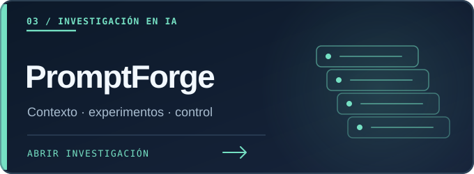

<!--
CHRIS HOTZA / LABORATORIO ABIERTO
README de perfil. Diseño original, SVG locales, interacción nativa de GitHub.
Sin servicios externos de estadísticas, scripts, contadores ni chat simulado.
La investigación histórica sigue en README.archive-2026-10-16.md y docs/.
-->

<picture>
  <source media="(prefers-color-scheme: dark)" srcset="./assets/lab-argentina-dark.svg">
  <source media="(prefers-color-scheme: light)" srcset="./assets/lab-argentina-light.svg">
  
</picture>

 

### Che, bienvenido al laboratorio. 🇦🇷

**Soy Chris. Investigador independiente, vibe coder y curioso por naturaleza.**

Me gusta meterme en problemas que todavía no sé resolver. Investigo, propongo ideas y trabajo con inteligencia artificial para convertirlas en código, experimentos y herramientas que puedan servir de verdad.

**Mi norte es simple: generar valor en la sociedad.**

[**Explorá mis proyectos ↓**](#proyectos) &nbsp;·&nbsp; [**Conocé cómo laburo ↓**](#metodo) &nbsp;·&nbsp; [**Research archive ↗**](docs/README.md)

---

> **La IA que labura con Chris:** *Él trae las preguntas, las ideas y el criterio. Yo lo ayudo a investigar, programar y probar caminos distintos. Lo que funciona se comprueba. Y lo que no, se vuelve a intentar.*

## ✦ Del laboratorio a los repositorios

No hay una sola disciplina acá. Hay preguntas que terminaron convirtiéndose en proyectos. Tocá una tarjeta para entrar al repositorio y ver qué se construyó, qué se probó y qué falta.

<table>
<tr>
<td width="50%" valign="top">

 
Investigación de arquitecturas con estado persistente y autoobservación. No demuestra conciencia artificial.
</td>
<td width="50%" valign="top">

 
Un atlas para que los agentes encuentren, clasifiquen y verifiquen repositorios sin leerlo todo.
</td>
</tr>
<tr>
<td valign="top">

 
Ingeniería de contexto y experimentos reproducibles para trabajar mejor con modelos de IA.
</td>
<td valign="top">

 
Microscopía, seguimiento de células y análisis temporal. Resultados internos documentados.
</td>
</tr>
<tr>
<td valign="top">

 
Herramientas para optimización y particionado de grafos, con interfaces pensadas para agentes.
</td>
<td valign="top">

 
Una forma de acompañar varias causas desde una misma plataforma. Las integraciones externas siguen en desarrollo.
</td>
</tr>
</table>

**[Ver todos los repositorios públicos →](https://github.com/chrishotza?tab=repositories)**

---

## ✦ Cómo laburo con IA

**La dirección es humana. La construcción es colaborativa. La evidencia manda.**

`PREGUNTA` → `HIPÓTESIS` → `IA + CÓDIGO` → `PRUEBAS` → `APRENDIZAJE`

No me interesa juntar prototipos para la foto. Me interesa entender qué funciona, qué no, y qué podemos hacer con eso. Algunos proyectos son aplicaciones; otros siguen siendo investigaciones. Cada uno tiene sus límites y su propia evidencia.

### ¿Por dónde querés empezar?

<b>🧠 Por las preguntas difíciles sobre inteligencia artificial</b>

 

**¿Qué puede aportar una arquitectura con memoria y autoobservación?**

En [Skill-Conscious](https://github.com/chrishotza/Skill-Conscious) investigo mecanismos computacionales de persistencia, autorreferencia y selección de trayectorias. El foco es construir protocolos y pruebas, no declarar resueltas preguntas filosóficas.

<b>🛠️ Por las herramientas que usan otras IAs</b>

 

**¿Cómo hacemos que los agentes trabajen con más criterio y menos ruido?**

[RepoOrbit](https://github.com/chrishotza/Repo-Orbit), [PromptForge](https://github.com/chrishotza/PromptForge) y [ATOF](https://github.com/chrishotza/Adaptiv-Topologica-Optimization-Framework) exploran herramientas navegables por máquinas, interfaces claras, experimentos repetibles y trazabilidad.

<b>🌱 Por los problemas que importan fuera de la pantalla</b>

 

También trabajo en [análisis celular](https://github.com/chrishotza/ai4s-life-science-2026), [bienestar animal](https://github.com/chrishotza/Aeris-Dairy-Twin), [inteligencia energética](https://github.com/chrishotza/bess-operational-intelligence) y [participación en causas sociales](https://github.com/chrishotza/UnGesto-).

No son productos ni resultados equivalentes. Son distintas formas de intentar que la investigación llegue a problemas concretos.

<b>🗃️ Quiero ver el resto del laboratorio</b>

 

Otros trabajos públicos incluyen [DayZ Console Observatory](https://github.com/chrishotza/DayZConsoleObservatory), [Crypto Security Forensics Lab](https://github.com/chrishotza/Crypto-Security-Forensics-Lab) y [Flint Prop AMM Research](https://github.com/chrishotza/Flint-Prop-AMM-Research).

Para recorrer la historia completa, están el [archivo de investigación](docs/README.md) y el [README original preservado](README.archive-2026-10-16.md).

<b>🌐 In English · A short introduction</b>

 

Hi, I'm Chris Hotza, an independent researcher and vibe coder from Argentina.

**Big questions. Real experiments.** I use AI to investigate, build, test and learn across scientific computing, experimental AI and useful tools. My motivation is to create value for society.

I lead the questions and the direction. AI helps with the research and implementation. The evidence speaks for the results.

**[Explore the projects](#proyectos)** · **[Research archive](docs/README.md)**

---

**Hecho desde Argentina, con curiosidad, IA y bastante insistencia. 🧉**

De acá para el mundo · From Argentina, with questions

 

[Archivo de investigación](docs/README.md) · [Historia completa preservada](README.archive-2026-10-16.md) · [GitHub @chrishotza](https://github.com/chrishotza)

