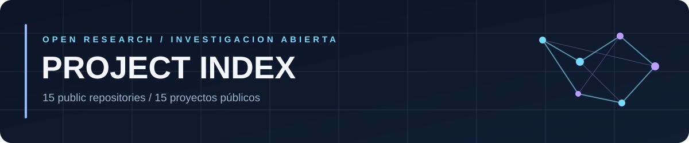

<!-- Public repositories only. One coherent design. Native GitHub Markdown and repository-local SVG. -->

### 01 / AI & AGENTS · IA Y AGENTES

**[Skill-Conscious](https://github.com/chrishotza/Skill-Conscious)**  
**EN** Persistent memory, self-reference and state in experimental AI.  
**ES** Memoria persistente, autorreferencia y estado en IA experimental.

**[Repo-Orbit](https://github.com/chrishotza/Repo-Orbit)**  
**EN** An evidence-aware repository atlas for AI agents.  
**ES** Atlas de repositorios con evidencia para agentes de IA.

**[PromptForge](https://github.com/chrishotza/PromptForge)**  
**EN** Context engineering and reproducible LLM evaluation.  
**ES** Ingeniería de contexto y evaluación reproducible de modelos.

**[cov-ia](https://github.com/chrishotza/cov-ia)**  
**EN** Research into efficient AI inference.  
**ES** Investigación sobre inferencia eficiente de IA.

---

### 02 / LIFE SCIENCE · CIENCIAS DE LA VIDA

**[ai4s-life-science-2026](https://github.com/chrishotza/ai4s-life-science-2026)**  
**EN** Cell tracking and temporal analysis from microscopy.  
**ES** Seguimiento celular y análisis temporal por microscopía.

**[Aeris-Dairy-Twin](https://github.com/chrishotza/Aeris-Dairy-Twin)**  
**EN** Multimodal animal-welfare state monitoring research.  
**ES** Investigación sobre monitoreo multimodal del bienestar animal.

---

### 03 / OPTIMIZATION · OPTIMIZACIÓN

**[Adaptiv-Topologica-Optimization-Framework](https://github.com/chrishotza/Adaptiv-Topologica-Optimization-Framework)**  
**EN** Reproducible graph partitioning and optimization tools.  
**ES** Herramientas reproducibles para particionado y optimización de grafos.

**[adaptive-topological-optimization](https://github.com/chrishotza/adaptive-topological-optimization)**  
**EN** Topology-aware graph optimization experiments.  
**ES** Experimentos de optimización de grafos según su topología.

**[bloc-reloc-v2](https://github.com/chrishotza/bloc-reloc-v2)**  
**EN** Experimental graph partitioning and hub handling.  
**ES** Particionado experimental de grafos y tratamiento de nodos centrales.

---

### 04 / SYSTEMS & SECURITY · SISTEMAS Y SEGURIDAD

**[bess-operational-intelligence](https://github.com/chrishotza/bess-operational-intelligence)**  
**EN** Supervisory decision research for battery storage.  
**ES** Investigación sobre decisiones supervisoras en almacenamiento de energía.

**[Crypto-Security-Forensics-Lab](https://github.com/chrishotza/Crypto-Security-Forensics-Lab)**  
**EN** Forensic evidence on crypto infrastructure and Solana execution.  
**ES** Evidencia forense sobre infraestructura cripto y ejecución en Solana.

**[Flint-Prop-AMM-Research](https://github.com/chrishotza/Flint-Prop-AMM-Research)**  
**EN** Read-only liquidity and market-data reconstruction.  
**ES** Reconstrucción de liquidez y datos de mercado sin operaciones.

**[T3N-Enterprise-Audit-Agent](https://github.com/chrishotza/T3N-Enterprise-Audit-Agent)**  
**EN** Privacy-focused Rust/WASM flight-booking contract research.  
**ES** Investigación de contratos Rust/WASM para reservas aéreas con privacidad.

---

### 05 / APPLICATIONS · APLICACIONES

**[DayZConsoleObservatory](https://github.com/chrishotza/DayZConsoleObservatory)**  
**EN** Local analysis of DayZ console-server records.  
**ES** Análisis local de registros de servidores DayZ.

**[UnGesto-](https://github.com/chrishotza/UnGesto-)**  
**EN** Discover social causes and register support; external official signing is pending.  
**ES** Descubrir causas y registrar apoyos; las firmas oficiales externas siguen pendientes.

---

15 PUBLIC REPOSITORIES · EN / ES

